# 第 6 类 · Agent 与 LLM 及系统设计(夜间扩产五)

> 本篇是第 6 类的第五批夜间扩产(Q2561-Q2605 共 45 题),四条线补遗:Agent 侧的工具结果签名校验与漂移处置、计划版本对比与风险分级、上下文注入仲裁与预算装填、滚动窗口锚点与失锚回捞、子 Agent 超时切分与部分结果语义、工具黑白名单热切换与在途边界、会话导出导入与版本迁移、行为统计画像基线、降级最小工具集、多租户 prompt 隔离审计;RAG 侧的语义边界检测与阈值标定、查询日志频次聚类与长尾合并、embedding 归一化实测与事故复现、时效敏感查询打分、跨语料实体消歧、页码级引用定位、负缓存;LLM 运维侧的稳定优先级队列、有界队列按优先级驱逐、降级容量预估与限流联动、流式续传语义、fair-share 调度与信用借还、成本分位数基线告警、红黑名单影子灰度;分布式侧的 CAS 互斥与 fencing、租约读本地化与批量续期、Gossip 推拉收敛实测、重试风暴抖动削峰、副本路由表与滞回更新、配额结算对账。
> 全部代码仅标准库、可独立运行,LLM 一律用 FakeLLM/stub 桩,向量检索用确定性假嵌入加余弦,时钟与随机全部注入,不联网不睡大觉,已在 Python 3.9 逐题实跑通过。
> 学习建议:每题先说清「不这样做会出什么事故」,再讲机制,最后落到可验证的断言——面试官要的不是名词,是行为证据。

### Q2561 · 工具调用结果的签名校验:类型指纹与字段契约

> 难度:★★★☆ | 标签:Agent, 工具调用, 契约校验

**问**:Agent 的工具返回值五花八门,直接塞进上下文会出什么问题?你会给工具结果加一道什么样的闸门?

**答**:工具是最不受控的输入源:字段悄悄改名、类型从字符串变整数、混进无关字段,都会污染后续推理,而且错误会在几轮之后才以"答案奇怪"的形式暴露,极难归因。闸门的做法是给每个工具声明一份字段契约,返回值进来先算类型指纹逐字段比对:缺失、类型不符、多出都生成结构化错误并拒收。注意 bool 是 int 的子类,指纹函数必须先判 bool 否则布尔值会被当成整数放行;列表要看元素类型,空列表记成未知而不是猜。拒收不是抛异常了事,错误列表要留进审计日志,才能回头统计哪个工具最常违约。这层校验很便宜,却把"工具坏结果"从推理问题降级成数据问题。

```python
# file: code/06_Agent与LLM及系统设计/q2561_result_signature.py
"""Q2561 工具调用结果的签名校验:类型指纹与字段契约。

工具返回值进入 Agent 上下文前先过一道签名校验:逐字段比对类型指纹,
缺失、多出、类型不符都要留痕,坏结果不允许混进推理上下文。
"""
import json

CONTRACT = {"name": "str", "score": "float", "tags": "list[str]"}


def type_tag(v):
    """把一个值映射成类型指纹字符串。"""
    if isinstance(v, bool):
        return "bool"
    if isinstance(v, int):
        return "int"
    if isinstance(v, float):
        return "float"
    if isinstance(v, str):
        return "str"
    if isinstance(v, list):
        inner = type_tag(v[0]) if v else "?"
        return "list[" + inner + "]"
    if isinstance(v, dict):
        return "dict"
    return "unknown"


def check_signature(result, contract):
    """返回错误列表,空列表表示签名通过。"""
    errors = []
    for key in sorted(contract):
        if key not in result:
            errors.append("missing:" + key)
        elif type_tag(result[key]) != contract[key]:
            errors.append("type:" + key + ":" + type_tag(result[key]) + "!=" + contract[key])
    extra = sorted(set(result) - set(contract))
    if extra:
        errors.append("extra:" + ",".join(extra))
    return errors


def fake_tool_call(payload):
    """stub:模拟工具返回,真实场景这里是 HTTP 或 SDK 调用。"""
    return json.loads(payload)


def main():
    good = fake_tool_call('{"name": "订单A", "score": 0.92, "tags": ["vip"]}')
    bad = fake_tool_call('{"name": 7, "tags": "vip", "bonus": 1}')
    errs_good = check_signature(good, CONTRACT)
    errs_bad = check_signature(bad, CONTRACT)
    assert errs_good == [], errs_good
    assert "type:name:int!=str" in errs_bad, errs_bad
    assert "type:tags:str!=list[str]" in errs_bad, errs_bad
    assert "missing:score" in errs_bad, errs_bad
    assert "extra:bonus" in errs_bad, errs_bad
    print("正常结果签名通过:", errs_good)
    print("异常结果拒收原因:", errs_bad)


if __name__ == "__main__":
    main()
```

**追问**:
- 追问一:校验放在工具注册表还是调用点?答:放调用点统一包裹,注册表只声明契约,这样契约升级不用改每个调用方。
- 追问二:多出的字段为什么也算错?答:多出字段往往是上游悄悄加行为,默认放行等于默许 schema 漂移,应该至少告警。

### Q2562 · 签名漂移的处置策略:严格拒收、降级读取与豁免名单

> 难度:★★★★ | 标签:Agent, 兼容性, 容错

**问**:上游工具的 schema 悄悄从 v1 漂到 v2,字段改名了,你的 Agent 一夜之间全挂。读方应该有哪些处置姿态?

**答**:三种姿态对应三种信任级别:strict 只认契约里的字段,对不上直接拒收并上报漂移,适合金融类强契约工具;degrade 只读新旧双方都认识的键,缺失的补缺省值,服务不中断但结果要打降级标记;豁免名单允许指定工具静默降级,用于已经评估过风险的老接口。关键工程点是降级也必须留痕:谁被降级、缺了什么字段、补了什么默认值,否则下游会拿半截数据当完整数据用。策略选择要按工具分级而不是全局一刀切,核心工具 strict,边缘工具 degrade。漂移事件本身要回流给工具 owner,推动契约版本化,而不是让读方永远降级下去。

```python
# file: code/06_Agent与LLM及系统设计/q2562_signature_drift.py
"""Q2562 结果签名漂移的三种处置:严格拒收、降级读取与豁免名单。

上游工具悄悄换了 schema(字段改名、新增字段),读方有三种姿态:
strict 直接拒收并上报漂移;degrade 只读双方都认识的键并补缺省;
豁免名单里的工具允许静默降级,但必须留审计记录。
"""

V2_RESULT = {"tool": "scorer", "schema": 2, "confidence": 0.9, "model": "glm-x"}
V1_KNOWN = {"score": None, "confidence": None}  # v1 读方认识的键与缺省值


def strict_read(res):
    if "score" not in res:
        raise KeyError("契约字段 score 缺失,疑似 schema 漂移")
    return {"score": res["score"]}


def degrade_read(res, known):
    return {key: res.get(key, default) for key, default in known.items()}


def read_result(res, policy, exempt, audit):
    tool = res["tool"]
    if policy == "strict" and tool not in exempt:
        try:
            return strict_read(res), "strict"
        except KeyError as exc:
            audit.append("rejected:" + tool + ":" + str(exc))
            return None, "rejected"
    out = degrade_read(res, V1_KNOWN)
    if tool in exempt:
        audit.append("degraded-exempt:" + tool)
    else:
        audit.append("degraded:" + tool)
    return out, "degrade"


def main():
    audit = []
    r1, mode1 = read_result(V2_RESULT, "strict", set(), audit)
    assert r1 is None and mode1 == "rejected"
    r2, mode2 = read_result(V2_RESULT, "degrade", set(), audit)
    assert r2 == {"score": None, "confidence": 0.9}, r2
    r3, mode3 = read_result(V2_RESULT, "strict", {"scorer"}, audit)
    assert r3["confidence"] == 0.9 and mode3 == "degrade"
    assert any(a.startswith("rejected:") for a in audit)
    assert "degraded-exempt:scorer" in audit
    print("严格拒收并留痕:", audit[0])
    print("降级读取结果:", r2)
    print("豁免名单静默降级:", audit[-1])


if __name__ == "__main__":
    main()
```

**追问**:
- 追问一:degrade 模式补的缺省值有什么风险?答:None 和业务零是两回事,缺省必须显式标记"未取到",避免把缺失当合法值参与计算。
- 追问二:豁免名单会不会越积越多?答:给豁免加过期时间,到期自动回到 strict,续期需要 owner 重新审批。

### Q2563 · Agent 计划的版本对比:步骤增删改与顺序四类归并

> 难度:★★★☆ | 标签:Agent, 计划管理, diff

**问**:LLM 重写了一版执行计划,你怎么快速判断这版计划改了什么、能不能放心执行?

**答**:先把计划表示成带稳定 id 的步骤列表,这是 diff 的前提;没有 id 就只能整段文本比对,产出的是噪音。对齐方式是按 id 求集合差:新增、删除一目了然,共有的步骤逐字段比对找出参数变更,再用保留步骤在两版里的出现顺序判断是否调序。产出物是机器可读的四类归并 diff,而不是一段"改动说明",审批和回归消费同一份数据。工程上要特别注意删除项:被删步骤的 id 是否还被别的步骤引用,是下一步风险分级的输入。这套 diff 也常用于审计:证明线上跑的计划和评审过的计划逐字段一致。

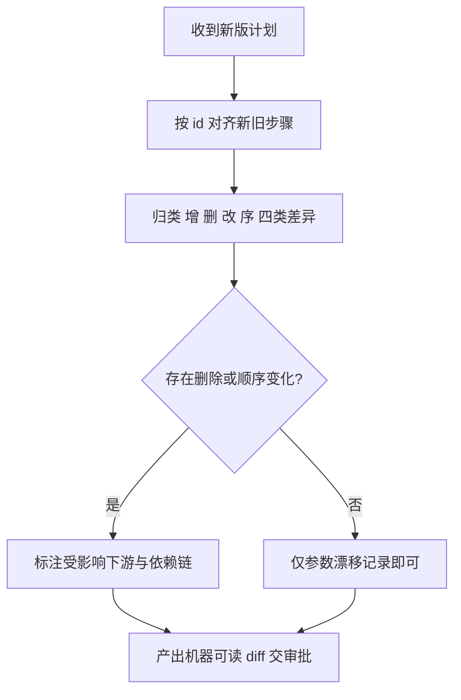

```python
# file: code/06_Agent与LLM及系统设计/q2563_plan_diff.py
"""Q2563 Agent 计划的版本对比:步骤增删改与顺序变化四类归并。

计划被重写后,先用 id 对齐新旧两版,再按 增/删/改/序 四类归并差异,
产出机器可读的 diff,供审批、审计与回归使用。
"""


def index_plan(plan):
    return {step["id"]: step for step in plan}


def diff_plans(old, new):
    oi, ni = index_plan(old), index_plan(new)
    added = sorted(set(ni) - set(oi))
    removed = sorted(set(oi) - set(ni))
    changed = sorted(sid for sid in set(oi) & set(ni) if oi[sid] != ni[sid])
    seq_old = [s["id"] for s in old if s["id"] in ni]
    seq_new = [s["id"] for s in new if s["id"] in oi]
    return {"added": added, "removed": removed, "changed": changed,
            "reordered": seq_old != seq_new}


def main():
    old = [
        {"id": "s1", "tool": "search", "kw": "财报"},
        {"id": "s2", "tool": "extract", "src": "s1"},
        {"id": "s3", "tool": "summary", "src": "s2"},
    ]
    new = [
        {"id": "s2b", "tool": "crawl", "url": "x"},    # 新增
        {"id": "s3", "tool": "summary", "src": "s2"},  # 保留但挪到 s1 前
        {"id": "s1", "tool": "search", "kw": "年报"},  # 参数漂移
    ]
    d = diff_plans(old, new)
    assert d["added"] == ["s2b"], d
    assert d["removed"] == ["s2"], d
    assert d["changed"] == ["s1"], d
    assert d["reordered"] is True, d
    print("新增:", d["added"])
    print("删除:", d["removed"])
    print("参数变更:", d["changed"])
    print("顺序有变化:", d["reordered"])


if __name__ == "__main__":
    main()
```

**追问**:
- 追问一:步骤没有稳定 id 怎么办?答:用工具名加参数指纹做模糊对齐,但要在 diff 里标出匹配置信度,低置信度按新增加删除处理。
- 追问二:和文本 diff 有什么区别?答:文本 diff 面向渲染,结构 diff 面向执行语义,后者才能回答哪条依赖链被断了。

### Q2564 · 计划变更的语义分级:结构变更重于参数漂移

> 难度:★★★★ | 标签:Agent, 计划管理, 风险分级

**问**:diff 有了,为什么不能直接"有 diff 就送人工审"?怎么让大部分变更自动通过?

**答**:因为变更的风险天差地别:改一个查询词是参数漂移,删掉一个被下游依赖的步骤是断链,二者不该共享同一个审批队列。分级器给四类变更配基础风险分,增最低、参数变更次之、删较高、调序居中,再叠一条硬规则:删除的步骤若被保留步骤引用,风险直接拉满并标记阻断。总分划线决定 auto-approve 还是 manual-review,划线要按事故回溯校准,让历史事故全部落在人工侧。收益是审批队列里只剩真正危险的变更,自动通过的部分留档可追溯。这套分级同样适用于配置变更和 prompt 变更,机制完全复用。

```python
# file: code/06_Agent与LLM及系统设计/q2564_plan_change_grade.py
"""Q2564 计划变更的语义分级:结构变更重于参数漂移。

对 Q2563 的 diff 做风险分级:删除被依赖的步骤最危险直接阻断,
新增与参数漂移次之,纯顺序调换最低;总分决定 自动通过 或 人工复核。
"""

RISK = {"added": 1, "changed": 2, "reordered": 1, "removed": 3}


def grade_change(diff, dependents):
    score = 0
    notes = []
    for sid in diff["removed"]:
        blocked = dependents.get(sid, [])
        if blocked:
            score += 5
            notes.append("删除被依赖步骤:" + sid + " 阻断 " + ",".join(blocked))
        else:
            score += RISK["removed"]
            notes.append("删除无依赖步骤:" + sid)
    score += RISK["added"] * len(diff["added"])
    score += RISK["changed"] * len(diff["changed"])
    if diff["reordered"]:
        score += RISK["reordered"]
        notes.append("存在顺序调换")
    verdict = "auto-approve" if score <= 3 else "manual-review"
    return score, verdict, notes


def main():
    diff = {"added": ["s2b"], "removed": ["s2"], "changed": ["s1"], "reordered": True}
    deps = {"s2": ["s3"]}  # s3 依赖 s2 的输出
    score, verdict, notes = grade_change(diff, deps)
    assert score == 5 + 1 + 2 + 1, score
    assert verdict == "manual-review", verdict
    diff2 = {"added": [], "removed": [], "changed": ["s1"], "reordered": False}
    score2, verdict2, _ = grade_change(diff2, deps)
    assert score2 == 2 and verdict2 == "auto-approve"
    print("风险分:", score, "裁决:", verdict)
    for n in notes:
        print(" -", n)
    print("仅参数漂移:", score2, verdict2)


if __name__ == "__main__":
    main()
```

**追问**:
- 追问一:风险分怎么定才不拍脑袋?答:拿历史变更和它引发的事故做回归,谁的权重能分开事故与正常就选谁,再随时间重校。
- 追问二:阻断级变更有没有例外通道?答:有,走双人审批加演练通过才放行,例外本身也要记录进基线。

### Q2565 · 上下文注入的优先级仲裁:多来源抢同一槽位

> 难度:★★★☆ | 标签:Agent, 上下文, 优先级

**问**:系统策略、租户画像、检索结果、历史摘要都想往上下文里写,冲突了听谁的?

**答**:先固定一个全局优先级序,比如 system 高于 tenant 高于 retrieved 高于 history,来源序就是裁决序,不再一事一议。同一槽位被多个来源申请时,高优先级先占,后来者若内容哈希相同记为重复只留一份,不同则记为被挤并丢弃,两种情况都留痕。仲裁的价值在于可解释:事后能回答"上下文里为什么没有这段检索结果",是重复还是被策略挤掉,一句话说清。实现上按优先级排序后线性扫一遍即可,槽位用首占制,避免低优先级内容先行造成覆盖混乱。要点是同一来源内部也要去重,检索多路召回撞车是重复注入的常见来源。

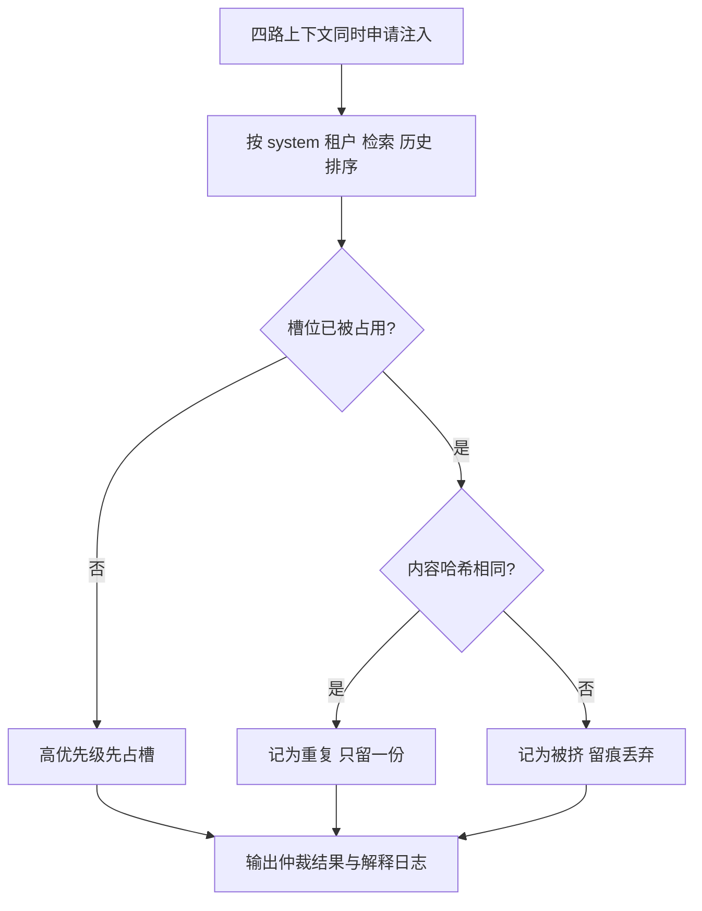

```python
# file: code/06_Agent与LLM及系统设计/q2565_injection_arbitration.py
"""Q2565 上下文注入的优先级仲裁:多来源抢同一槽位。

系统策略、租户画像、检索结果、历史摘要都想往上下文里塞内容,
按固定优先级仲裁:同槽位高优先级先占,同内容去重只留一份,
被挤掉的要留痕,方便事后解释上下文里为什么没有它。
"""
import json

PRIORITY = {"system": 0, "tenant": 1, "retrieved": 2, "history": 3}


def arbitrate(items):
    ordered = sorted(items, key=lambda x: PRIORITY[x["source"]])
    slots = {}
    for it in ordered:
        h = json.dumps(it["content"], ensure_ascii=False, sort_keys=True)
        rec = slots.setdefault(it["slot"],
                               {"kept": it, "hashes": {h}, "dup": [], "dropped": []})
        if rec["kept"] is not it:
            if h in rec["hashes"]:
                rec["dup"].append(it["source"])
            else:
                rec["hashes"].add(h)
                rec["dropped"].append(it["source"])
    return slots


def main():
    items = [
        {"source": "history", "slot": "facts", "content": "用户在杭州"},
        {"source": "retrieved", "slot": "facts", "content": "用户在杭州"},
        {"source": "tenant", "slot": "style", "content": "正式语气"},
        {"source": "system", "slot": "style", "content": "正式语气"},
        {"source": "history", "slot": "style", "content": "口语化"},
    ]
    slots = arbitrate(items)
    assert slots["style"]["kept"]["source"] == "system", slots["style"]
    assert slots["style"]["dup"] == ["tenant"], slots["style"]
    assert slots["style"]["dropped"] == ["history"], slots["style"]
    assert slots["facts"]["kept"]["source"] == "retrieved"
    assert slots["facts"]["dup"] == ["history"]
    print("style 胜者:", slots["style"]["kept"]["source"],
          "重复:", slots["style"]["dup"], "被挤:", slots["style"]["dropped"])
    print("facts 胜者:", slots["facts"]["kept"]["source"], "重复:", slots["facts"]["dup"])


if __name__ == "__main__":
    main()
```

**追问**:
- 追问一:为什么用内容哈希而不是原文比对?答:哈希规整了键序和空白,序列化方式不同但语义相同的内容也能去重。
- 追问二:被挤掉的内容就永远丢了吗?答:留痕后可进溢出区,下轮窗口有空位时按优先级回补。

### Q2566 · 注入预算的按优先级装填:装得下才进

> 难度:★★☆☆ | 标签:Agent, 上下文, 预算

**问**:优先级定好了,但上下文窗口有限,装填算法怎么写才不浪费预算?

**答**:按优先级从高到低线性装填,当前剩余预算装得下就进,装不下就丢弃并记录,不要为了塞大块去挤掉已装入的高优先级项。排序时同级按代价升序,小件先装能提高预算利用率,这是把装箱的首次适应思想用到 token 预算上。丢弃清单必须可解释:每一项被丢是因为哪一项占用了预算,评估和调试都靠它。要警惕的误区是"先全部塞进去再裁剪",裁剪顺序稍微想错就会把系统策略裁掉,而装填式从一开始就保证高优先级不可被逐出。预算数字要预留输出空间,可用的输入预算应该减去输出预留再参与装填。

```python
# file: code/06_Agent与LLM及系统设计/q2566_budget_fill.py
"""Q2566 注入预算的按优先级装填:装得下才进上下文,丢弃要可解释。"""


def fill(items, budget):
    kept, dropped = [], []
    used = 0
    for it in sorted(items, key=lambda x: (-x["priority"], x["cost"])):
        if it["cost"] <= budget - used:
            kept.append(it["name"])
            used += it["cost"]
        else:
            dropped.append(it["name"])
    return kept, dropped, used


def main():
    items = [
        {"name": "系统策略", "priority": 3, "cost": 100},
        {"name": "长文档A", "priority": 1, "cost": 500},
        {"name": "长文档B", "priority": 1, "cost": 200},
        {"name": "历史摘要", "priority": 2, "cost": 150},
    ]
    kept, dropped, used = fill(items, 600)
    assert kept == ["系统策略", "历史摘要", "长文档B"], kept
    assert dropped == ["长文档A"], dropped
    assert used == 450, used
    # 预算充裕时低优先级也能进
    kept2, dropped2, used2 = fill(items, 1200)
    assert dropped2 == [] and used2 == 950
    print("预算 600 装入:", kept, "用量", used)
    print("预算 600 丢弃:", dropped)
    print("预算 1200 全部装入,用量", used2)


if __name__ == "__main__":
    main()
```

**追问**:
- 追问一:大块高优先级内容装不下怎么办?答:对它做分段摘要或游标分页,把预算友好的部分先装进去。
- 追问二:为什么不用背包求最优?答:背包是 NP 难,注入是毫秒级路径,贪心装填的利用率损失换确定性时延是划算的。

### Q2567 · 长会话的滚动窗口加锚点:窗口滑动关键帧不丢

> 难度:★★☆☆ | 标签:Agent, 会话, 记忆

**问**:几百轮的会话,上下文只放得下最近 N 条,朴素滑动窗口会出什么事故?

**答**:朴素窗口按时间逐出,系统规则、任务目标这类开头消息最早被挤掉,Agent 跑着跑着就忘了自己是谁、在干嘛,这是长会话最典型的事故。锚点机制给关键消息打标记,逐出时锚点豁免:窗口内先挑非锚点里最旧的逐出,全是锚点时宁可短暂超窗也不丢关键帧。锚点来源有两类:人工钉住的,比如用户显式说"记住这一点";自动选出的,交给下一题的打分机制。落地时注意锚点数量要有限额,否则窗口会被锚点填满变成不滚动的假窗口。验证方式很直接:滚动几十轮后断言关键消息仍在窗口内。

```python
# file: code/06_Agent与LLM及系统设计/q2567_window_anchor.py
"""Q2567 长会话的滚动窗口加锚点:窗口滑动但关键帧不丢。

朴素滚动窗口会把系统规则、任务目标一并挤掉;给关键消息打锚点,
逐出时锚点豁免,宁可短暂超窗也不丢关键帧。
"""


def advance(history, anchors, new_msg, window):
    """追加消息并按窗口逐出最旧的非锚点消息,返回被逐出的 id 列表。"""
    history.append(dict(new_msg))
    evicted = []
    while len(history) > window:
        idx = next((i for i, m in enumerate(history) if m["id"] not in anchors), None)
        if idx is None:
            break  # 窗口内全是锚点:宁可超窗也不丢锚
        evicted.append(history.pop(idx)["id"])
    return evicted


def main():
    history = [{"id": "m1", "text": "系统规则"}]
    anchors = {"m1"}
    for i in range(2, 8):
        ev = advance(history, anchors, {"id": "m" + str(i), "text": "对话" + str(i)}, window=4)
    ids = [m["id"] for m in history]
    assert "m1" in ids, ids            # 锚点在多轮滚动后仍在
    assert len(ids) <= 4, ids
    # 中途把 m6 钉成锚点,再滚 4 轮,m6 依然幸存
    anchors.add("m6")
    for i in range(8, 12):
        advance(history, anchors, {"id": "m" + str(i), "text": "对话" + str(i)}, window=4)
    ids2 = [m["id"] for m in history]
    assert "m1" in ids2 and "m6" in ids2, ids2
    print("第一轮保留:", ids)
    print("钉住 m6 后保留:", ids2, "← 两个锚点都幸存")


if __name__ == "__main__":
    main()
```

**追问**:
- 追问一:锚点消息本身很长怎么办?答:锚点存的是指针加摘要,原文在归档,窗口里只放几十个 token 的精简版。
- 追问二:锚点和摘要方案怎么选?答:不冲突,锚点保关键帧,摘要保全貌,滚动窗口加锚点加滚动摘要是最常见的组合。

### Q2568 · 锚点的自动选取与失锚检测:定义被逐出要报警回捞

> 难度:★★★★ | 标签:Agent, 会话, 记忆

**问**:锚点不能全靠人工钉,自动选锚怎么打分?怎么发现"该锚的没锚上"?

**答**:自动选锚用重要性加近因性打分:消息类型有先验权重,任务目标、约束条件天然高于闲聊,再叠加近几轮的活跃度加成,取 top-k 钉住。失锚检测是配套的报警器:被保留的消息引用了某个术语,而这个术语的定义消息已被逐出,就是失锚,典型表现是 Agent 后面开始用错概念。检测实现可以从简,定义消息带"定义:X"模式,保留消息做词面匹配即可覆盖大半场景。处置不是重跑而是回捞:从归档把定义消息取回重新钉住,成本远低于让 Agent 带病运行。这套机制的价值在于把上下文完整性变成可检测的状态,而不是靠人盯着翻记录。

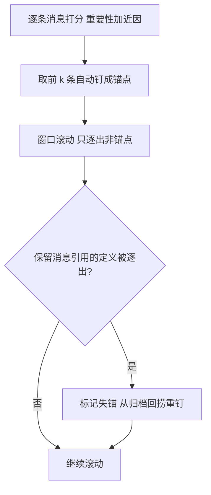

```python
# file: code/06_Agent与LLM及系统设计/q2568_anchor_select.py
"""Q2568 锚点的自动选取与失锚检测:定义被逐出要能报警并回捞。

重要性加近因性给消息打分,分高的自动钉成锚点;被保留消息引用了
某个术语,而该术语的定义消息已被逐出,就是失锚,要从归档回捞重钉。
"""
import re

WEIGHT = {"goal": 5.0, "constraint": 4.0, "fact": 2.0, "chat": 1.0}


def score(msg, turn):
    return WEIGHT.get(msg["kind"], 1.0) + max(0.0, 3.0 - (turn - msg["turn"]))


def pick_anchors(history, turn, k):
    ranked = sorted(history, key=lambda m: -score(m, turn))
    return {m["id"] for m in ranked[:k]}


def detect_lost_anchor(kept, evicted):
    defined = {}
    for m in evicted:
        found = re.search(r"定义[:：](\w+)", m["text"])
        if found:
            defined[found.group(1)] = m["id"]
    lost = []
    for m in kept:
        for term, src in defined.items():
            if term in m["text"] and m["id"] != src:
                lost.append((m["id"], term, src))
    return lost


def main():
    history = [
        {"id": "m1", "kind": "goal", "turn": 1, "text": "目标:输出季度复盘"},
        {"id": "m2", "kind": "constraint", "turn": 2, "text": "定义:ACV 为年度合同额"},
        {"id": "m3", "kind": "chat", "turn": 3, "text": "再聊聊 ACV 口径"},
        {"id": "m4", "kind": "chat", "turn": 4, "text": "ACV 记不算服务费"},
    ]
    anchors = pick_anchors(history, turn=4, k=1)
    assert anchors == {"m1"}, anchors
    kept = [m for m in history if m["id"] in anchors] + [history[3]]
    kept_ids = {m["id"] for m in kept}
    evicted = [m for m in history if m["id"] not in kept_ids]
    assert {m["id"] for m in evicted} == {"m2", "m3"}, evicted
    lost = detect_lost_anchor(kept, evicted)
    assert lost == [("m4", "ACV", "m2")], lost
    print("自动锚点:", sorted(anchors), "→ 定义消息 m2 被逐出")
    print("失锚检测:", lost, "→ 从归档回捞 m2 重新钉住")


if __name__ == "__main__":
    main()
```

**追问**:
- 追问一:词面匹配抓不住代词指代怎么办?答:指代回填在逐出前做,把"它"还原成实体词再进窗口,别指望逐出后还能补。
- 追问二:k 怎么定?答:锚点总量设窗口的固定比例配额,超了按分数排队,分数同分时近因优先。

### Q2569 · Agent 间超时预算切分:预留回收余量再按权重分

> 难度:★★★☆ | 标签:Agent, 超时, 并发

**问**:父 Agent 只剩 10 秒,要并行派 5 个子 Agent,时间怎么分才能保证自己不被拖死?

**答**:第一原则是父端先扣预留:回收结果、汇总、异常处置都要时间,这笔钱在分配前先划走,分给子任务的是剩余量。剩余量按预期代价加权,代价重的多拿,但设下限防饿死、上限防一家独大,裁剪后超支再按余量比例收回。子 Agent 拿到的是自己的绝对截止时刻,由父端当前时刻加份额算出并随任务下发,子端自查自己的钟,超时自己负责返回,父端绝不阻塞超过自己的死线。这套切分的关键洞察是:超时问题在分配时就已经决定了结果,运行期的挣扎改变不了预算不足的事实。切分参数要按历史耗时分布校准,权重来自数据不是直觉。

```python
# file: code/06_Agent与LLM及系统设计/q2569_timeout_split.py
"""Q2569 Agent 间超时预算切分:给子 Agent 分时间要留回收余量。

父 Agent 剩余 T 秒要派 N 个子任务:先扣结果回收预留,再按预期
代价加权分配,设下限防饿死、上限防一家独大;子 Agent 拿到的是
自己的绝对截止时刻,超时自己负责,父端绝不被拖过自己的死线。
"""
import time


def split_budget(parent_remaining, weights, floor, cap, reserve):
    usable = parent_remaining - reserve
    assert usable > 0, "父预算扣掉回收预留后为负"
    total_w = sum(weights)
    raw = [usable * w / total_w for w in weights]
    clipped = [min(cap, max(floor, r)) for r in raw]
    if sum(clipped) > usable:  # 上限下限裁剪后若超支,按余量比例收回
        over = sum(clipped) - usable
        room = [c - floor for c in clipped]
        total_room = sum(room)
        if total_room > 0:
            clipped = [c - over * r / total_room for c, r in zip(clipped, room)]
    return [round(c, 3) for c in clipped]


def main():
    budgets = split_budget(parent_remaining=10.0, weights=[4, 3, 1],
                           floor=0.5, cap=6.0, reserve=1.5)
    usable = 8.5
    assert sum(budgets) <= usable + 1e-6, budgets
    assert all(b >= 0.5 for b in budgets), budgets
    assert all(b <= 6.0 for b in budgets), budgets
    now = time.monotonic()
    deadlines = [now + b for b in budgets]
    assert max(deadlines) <= now + 10.0
    extreme = split_budget(10.0, [9, 9, 1], floor=0.5, cap=3.0, reserve=1.5)
    assert all(b <= 3.0 for b in extreme) and sum(extreme) <= 8.5 + 1e-6
    print("常规切分:", budgets, "合计", round(sum(budgets), 3), "预留 1.5s 给回收")
    print("封顶切分:", extreme, "← cap=3 生效,无一家独大")


if __name__ == "__main__":
    main()
```

**追问**:
- 追问一:某个子任务提前完成了,余量给谁?答:还回父端的公共池,按剩余工作量重分,但每次重分都留痕避免抖动。
- 追问二:子 Agent 内部还要再派孙子怎么办?答:同样的切分规则递归下传,每层扣自己的预留,深度越深每层预算越薄。

### Q2570 · 超时的失败语义:部分结果也有结构化身份

> 难度:★★★★ | 标签:Agent, 超时, 容错

**问**:子任务超时,父端该收到什么?直接抛异常错在哪?

**答**:抛异常把"超时但干了一半"和"一行都没干"混为一谈,父端失去了精细化处置的机会。正确的语义是结构化返回:状态字段区分 done、partial、failed,partial 携带已完成的条目和进度说明,让父端能按最低需求裁决——够用就收下,不够就跳过或重派。全有或全无的任务要显式声明不可部分交付,超时即 failed,父端捕获后跳过并继续整棵树,绝不让一个子任务拖垮全局。这套语义的隐藏收益是可观测:partial 率是预算不足的第一信号,比用户投诉早得多。注意部分结果的元数据要完整,时间戳、已重试次数、截止时刻都在,下游才敢放心用。

```python
# file: code/06_Agent与LLM及系统设计/q2570_timeout_semantics.py
"""Q2570 超时的失败语义:部分结果也要有结构化的身份。

子任务超时不该只是抛异常:能部分交付的任务返回 partial 加已得
条目,父端按最低需求决定收下还是丢弃;全有或全无的任务超时即
失败,父端捕获后跳过并继续,绝不让一个子任务拖垮整棵树。
"""


class Clock:
    def __init__(self):
        self.t = 0.0

    def advance(self, dt):
        self.t += dt
        return self.t


def run_child(clock, deadline, per_item, limit):
    items = []
    while True:
        if clock.t + per_item > deadline:
            return {"status": "partial", "items": items, "spent": clock.t}
        clock.advance(per_item)
        items.append(len(items) + 1)
        if len(items) >= limit:
            return {"status": "done", "items": items, "spent": clock.t}


def handle(result, min_needed):
    if result["status"] == "done":
        return "accept-full"
    if result["status"] == "partial" and len(result["items"]) >= min_needed:
        return "accept-partial"
    return "skip"


def main():
    clock = Clock()
    r1 = run_child(clock, deadline=2.5, per_item=1.0, limit=10)
    assert r1["status"] == "partial" and r1["items"] == [1, 2], r1
    assert handle(r1, min_needed=2) == "accept-partial"
    clock2 = Clock()
    r2 = run_child(clock2, deadline=2.5, per_item=1.0, limit=2)
    assert r2["status"] == "done"
    assert handle(r2, min_needed=2) == "accept-full"
    assert handle(r1, min_needed=3) == "skip"  # 部分结果太少也不收
    # 不可部分交付的任务:超时即失败,父端捕获并跳过
    verdict = None
    try:
        raise TimeoutError("all-or-nothing 子任务超时")
    except TimeoutError as exc:
        verdict = "skip:" + str(exc)
    assert verdict.startswith("skip:")
    print("partial:", r1)
    print("done:", r2)
    print("硬失败处置:", verdict)


if __name__ == "__main__":
    main()
```

**追问**:
- 追问一:partial 结果被下游用了,最终态又变成 failed,怎么办?答:部分结果带 provisional 标记,任务终态落定后回调订正,下游据此决定是否撤回。
- 追问二:min_needed 谁定?答:任务发起方在派发时声明,和预算一起下发,别让父端临场猜。

### Q2571 · 工具黑白名单的运行时热切换:换表不换进程

> 难度:★★★☆ | 标签:Agent, 工具治理, 热更新

**问**:线上发现某个工具越权,不能重启进程,怎么立刻把它停掉?

**答**:策略表是唯一事实源:每个工具只有 allow 或 deny 两种状态,查不到的工具默认 deny,默认拒绝是安全底线。热切换用整体替换而不是逐项修补,替换是引用级原子操作,不存在半新半旧的中间态;版本号单调递增,每次切换记版本和原因,审计能还原任意时刻的生效策略。被 deny 的工具当场拦截,错误信息带上版本号,调用方一看就知道是策略变了不是工具坏了。恢复也要走同一条通道,切换记录完整保留,who when why 三要素齐全。演练时要验证切换即时生效:切换后的第一次调用必须被拦。

```python
# file: code/06_Agent与LLM及系统设计/q2571_tool_gate.py
"""Q2571 工具黑白名单的运行时热切换:换表不换进程。

策略表是唯一事实源,切换用整体替换而不是逐项修补,版本号单调
递增;被 deny 的工具当场拦截并带版本信息,切换动作留痕可审计。
"""


class ToolGate:
    def __init__(self, policy):
        self._policy = dict(policy)
        self.version = 1
        self.log = []

    def switch(self, new_policy, reason):
        self.version += 1
        self._policy = dict(new_policy)
        self.log.append((self.version, reason))

    def check(self, tool):
        return self._policy.get(tool, "deny") == "allow"

    def call(self, tool):
        if not self.check(tool):
            raise PermissionError("tool denied by policy v" + str(self.version) + ":" + tool)
        return {"tool": tool, "ok": True}


def main():
    gate = ToolGate({"search": "allow", "calc": "allow"})
    assert gate.call("search")["ok"]
    gate.switch({"search": "deny", "calc": "allow"}, "审计发现搜索越权")
    try:
        gate.call("search")
        raise SystemExit(1)
    except PermissionError as exc:
        print("热切换后拦截:", exc)
    assert gate.call("calc")["ok"]
    assert gate.version == 2 and gate.log == [(2, "审计发现搜索越权")]
    gate.switch({"search": "allow", "calc": "allow"}, "审计整改通过恢复")
    assert gate.call("search")["ok"] and gate.version == 3
    print("当前版本:", gate.version, "切换记录:", gate.log)


if __name__ == "__main__":
    main()
```

**追问**:
- 追问一:多进程部署怎么同步策略?答:策略中心推送加本地版本号对账,进程启动时拉全量,运行中只收增量并比对版本。
- 追问二:为什么默认 deny 而不是默认 allow?答:新工具注册即受控,漏配的代价是功能不可用而不是权限泄漏,前者可修复后者是事故。

### Q2572 · 切换的生效边界:在途调用按发起时还是结束时算

> 难度:★★★★ | 标签:Agent, 工具治理, 一致性

**问**:调用发起时合法,执行到一半政策翻黑,这个结果算数吗?

**答**:这是热切换最容易被忽略的语义洞:调用是长时操作,政策是瞬时快照,两者之间有时间差。start-check 按发起时的政策放行,延迟低、实现简单,但敏感工具上等于给了政策切换前的最后一班车;end-check 在完成时再复核一次,期间翻黑则结果作废并留痕。选择按工具敏感度分:读缓存类工具 start-check 无妨,写操作、外发、支付类一律 end-check。实现上发起时记下政策版本,完成时比对版本与策略,版本不一致就走作废路径。工程要点是作废也有成本:工具的副作用可能已经发生,所以高危工具应该设计成可撤销副作用或干脆两阶段提交。

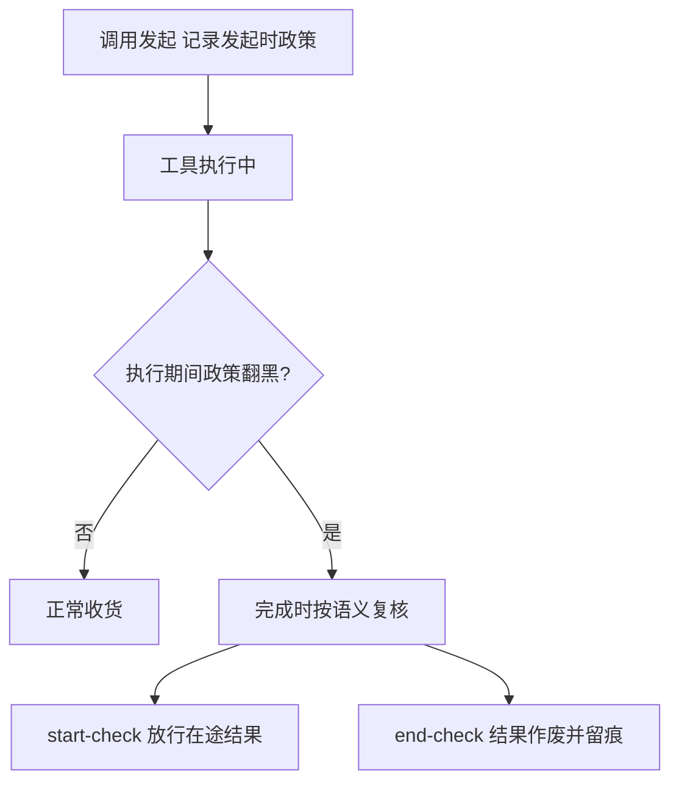

```python
# file: code/06_Agent与LLM及系统设计/q2572_switch_boundary.py
"""Q2572 切换的生效边界:在途调用按发起时还是结束时政策算。

调用发起时合法、完成时政策已翻黑,结果算不算数?start-check
按发起时政策放行,延迟低但对危险工具不安全;end-check 在完成时
复核,期间翻黑立即作废结果,敏感工具一律推荐 end-check。
"""


class Executor:
    def __init__(self):
        self.policy = {"search": "allow"}
        self.version = 1
        self.events = []

    def flip(self, tool, mode, reason):
        self.policy[tool] = mode
        self.version += 1
        self.events.append("v" + str(self.version) + ":" + tool + "=" + mode + "(" + reason + ")")

    def run(self, tool, semantics, mid_hook=None):
        start_ok = self.policy.get(tool) == "allow"
        if mid_hook:
            mid_hook()  # 模拟工具在途期间政策切换
        end_ok = self.policy.get(tool) == "allow"
        if semantics == "start-check":
            return start_ok
        return start_ok and end_ok


def main():
    ex1 = Executor()
    ex2 = Executor()

    def flip1():
        ex1.flip("search", "deny", "审计叫停")

    def flip2():
        ex2.flip("search", "deny", "审计叫停")

    r1 = ex1.run("search", "start-check", flip1)
    r2 = ex2.run("search", "end-check", flip2)
    assert r1 is True and r2 is False
    assert ex1.version == 2 and ex2.version == 2
    print("start-check 在途放行:", r1, "← 危险工具不安全")
    print("end-check 完成时复核:", r2, "← 结果作废,敏感工具推荐")
    print("切换事件:", ex2.events)


if __name__ == "__main__":
    main()
```

**追问**:
- 追问一:作废的结果下游已经拿到怎么办?答:作废决定要广播,下游按撤回通知清理,这就要求结果带可追踪的调用 id。
- 追问二:end-check 会不会误伤正常调用?答:会,所以只有高危工具走 end-check,且翻黑事件本身少见,误伤率可控。

### Q2573 · 会话导出与导入的可移植性:带版本号的状态快照

> 难度:★★☆☆ | 标签:Agent, 会话, 可移植性

**问**:会话要从 A 机房搬到 B 机房,从 v1 客户端迁到 v2 服务端,状态快照怎么设计才可移植?

**答**:可移植的核心是快照必须是带 schema_version 的纯数据:消息列表、锚点、计数器全部是基本类型,不含有状态的句柄、连接、函数引用。导出侧把内部状态转成字典,导入侧按版本闸校验:高于自己支持的版本直接拒绝,拒绝信息要可读,告诉用户该升级了。往返等价是验收标准:导出、序列化、反序列化、导入,再导出,两次快照逐字段相等。凭据类字段绝不进快照,导入后按目标环境的凭据体系重新绑定。这套设计让会话成为一等公民:迁移、备份、调试回放用的都是同一份格式。

```python
# file: code/06_Agent与LLM及系统设计/q2573_session_portable.py
"""Q2573 会话导出与导入的可移植性:带版本号的状态快照。

会话状态只有导出成带 schema_version 的纯数据,才能跨进程跨机器
搬家;导入侧用版本闸拒绝过高的版本,往返导出导入后状态逐字段
等价,凭据类字段绝不进快照。
"""
import json

SCHEMA_VERSION = 2


class Session:
    def __init__(self, tenant, messages=None, anchors=None, counters=None):
        self.tenant = tenant
        self.messages = messages or []
        self.anchors = anchors or []
        self.counters = counters or {"turns": 0}

    def export(self):
        return {"schema_version": SCHEMA_VERSION, "tenant": self.tenant,
                "messages": list(self.messages), "anchors": list(self.anchors),
                "counters": dict(self.counters)}

    @classmethod
    def import_(cls, blob):
        if blob["schema_version"] > SCHEMA_VERSION:
            raise ValueError("会话 schema_version " + str(blob["schema_version"])
                             + " 高于当前支持的 " + str(SCHEMA_VERSION))
        return cls(blob["tenant"], blob.get("messages"),
                   blob.get("anchors"), blob.get("counters"))


def main():
    a = Session("t1", [{"role": "user", "text": "hi"}], ["m0"], {"turns": 3})
    blob = json.loads(json.dumps(a.export(), ensure_ascii=False))
    b = Session.import_(blob)
    assert b.tenant == a.tenant and b.messages == a.messages
    assert b.counters == a.counters and b.anchors == a.anchors
    assert b.export() == a.export()
    blob["schema_version"] = 99
    rejected = False
    try:
        Session.import_(blob)
    except ValueError as exc:
        rejected = True
        print("版本闸:", exc)
    assert rejected, "高版本会话应被拒绝"
    print("导出导入往返一致,状态逐字段等价")


if __name__ == "__main__":
    main()
```

**追问**:
- 追问一:快照里能放绝对时间戳吗?答:放,但要同时放时钟源标识,跨时区恢复时才能正确解释。
- 追问二:大会话快照太重怎么办?答:消息体外置,快照里放内容哈希与游标,导入端按需回源拉取。

### Q2574 · 会话导入的校验与版本降级:旧版迁移未知字段警告

> 难度:★★★☆ | 标签:Agent, 会话, 兼容性

**问**:导入端除了拒绝高版本,还要处理哪些脏快照?

**答**:三类脏数据各有闸门:旧版本做一次性显式迁移,比如 v1 的扁平 history 加 pinned 映射成 v2 的 messages 加 anchors,迁移动作本身写进警告;未知字段保留原样并打 unknown-field 警告,绝不静默丢弃,那可能是新版本的功能数据,删了就真丢了;缺失字段补缺省值,同时警告缺省发生了,让调用方知道拿到的是默认行为。校验顺序有讲究:未知字段扫描要在迁移前对原始快照做,否则迁移重建后的字典会把问题盖住。所有警告进导入报告,导入成功不代表没有故事,报告才是完整事实。这套模式与配置加载、模型工件加载完全同构,学会一次处处可用。

```python
# file: code/06_Agent与LLM及系统设计/q2574_session_migrate.py
"""Q2574 会话导入的校验与版本降级:缺省、未知字段与旧版迁移。

导入端三道闸:未来版本直接拒绝;旧版本做一次性迁移;未知字段
保留警告不静默丢弃,缺失字段补缺省,迁移结果必须逐字段可断言。
"""

SUPPORTED = 2


def import_session(blob, warnings):
    known = {"schema_version", "tenant", "messages", "anchors", "history", "pinned"}
    for key in blob:
        if key not in known:
            warnings.append("unknown-field:" + key)
    v = blob.get("schema_version", 1)
    if v > SUPPORTED:
        raise ValueError("schema_version " + str(v) + " 高于当前支持 " + str(SUPPORTED))
    if v < SUPPORTED:
        if v == 1:
            blob = {"schema_version": 2,
                    "tenant": blob.get("tenant", "unknown"),
                    "messages": [{"role": m.get("role", "user"),
                                  "text": m.get("content", "")}
                                 for m in blob.get("history", [])],
                    "anchors": blob.get("pinned", [])}
            warnings.append("migrated:v1->v2")
        else:
            raise ValueError("无法迁移的旧版本:" + str(v))
    out = {"schema_version": SUPPORTED,
           "tenant": blob.get("tenant", "unknown"),
           "messages": blob.get("messages", []),
           "anchors": blob.get("anchors", [])}
    if not out["anchors"]:
        warnings.append("default:anchors=empty")
    return out


def main():
    warnings = []
    old = {"schema_version": 1, "tenant": "t9",
           "history": [{"role": "user", "content": "hi"}],
           "pinned": ["h0"], "theme": "dark"}
    s = import_session(old, warnings)
    assert s["messages"] == [{"role": "user", "text": "hi"}], s
    assert s["anchors"] == ["h0"], s
    assert "migrated:v1->v2" in warnings and "unknown-field:theme" in warnings
    warnings2 = []
    try:
        import_session({"schema_version": 3}, warnings2)
        raise SystemExit(1)
    except ValueError as exc:
        print("未来版本拒绝:", exc)
    print("v1 迁移结果:", s)
    print("警告:", warnings)


if __name__ == "__main__":
    main()
```

**追问**:
- 追问一:为什么旧版本迁移不在导出端做?答:导出端不知道导入端支持到哪一版,写端永远写最新,读端负责向下兼容,这是格式演化的通用规则。
- 追问二:未知字段警告会不会刷屏?答:按字段名聚合去重,只报一次,报告里带计数。

### Q2575 · Agent 行为的回归基线:统计画像与偏差评分

> 难度:★★★★ | 标签:Agent, 测试, 回归

**问**:端到端断言只能抓确定性错误,LLM 输出带随机性,回归怎么抓"没坏但变了"?

**答**:统计画像基线的思路是不比文本比行为:记录一组正常运行的画像——步数分布、各工具调用频次、状态计数,取均值和标准差。新版本跑同一批种子,算每个指标偏离基线的程度,任何一项超过阈值就告警,阈值常用两三个标准差起步再按误报率调。它抓得住端到端断言抓不住的问题:某工具调用频率翻倍、步数普遍变长,输出可能都对,但成本和时延已经劣化。画像维度要选行为学稳定的量,别放会随正常波动剧烈变化的指标。基线本身要版本化:升级 prompt 或模型后画像重录并审批,否则新基线把漂移洗成正常。

```python
# file: code/06_Agent与LLM及系统设计/q2575_behavior_baseline.py
"""Q2575 Agent 行为的回归基线:统计画像与偏差评分。

金样本指纹只能抓可复现场景;统计画像基线记录步数分布与工具调用
频次的均值方差,新版本跑一批种子,任一指标偏离超阈值就告警,
能抓住"没坏但行为漂移"的隐性回归。
"""
import random
import statistics


def run_agent(seed):
    rng = random.Random(seed)
    steps = rng.randint(6, 9)
    tools = {}
    for _ in range(steps):
        t = rng.choice(["search", "calc", "sum"])
        tools[t] = tools.get(t, 0) + 1
    return {"steps": steps, "tools": tools}


def build_baseline(seeds):
    runs = [run_agent(s) for s in seeds]
    steps = [r["steps"] for r in runs]
    tool_total = {}
    for r in runs:
        for t, c in r["tools"].items():
            tool_total[t] = tool_total.get(t, 0) + c
    n = len(runs)
    return {"steps_mean": statistics.mean(steps),
            "steps_std": max(statistics.pstdev(steps), 1.0),
            "tool_mean": {t: c / n for t, c in tool_total.items()}}


def deviation(profile, run):
    worst = abs(run["steps"] - profile["steps_mean"]) / profile["steps_std"]
    for t, m in profile["tool_mean"].items():
        worst = max(worst, abs(run["tools"].get(t, 0) - m) / max(m, 1.0))
    return worst


def main():
    profile = build_baseline([1, 2, 3, 4, 5])
    normal = run_agent(6)
    weird = {"steps": 30, "tools": {"search": 30}}
    d1, d2 = deviation(profile, normal), deviation(profile, weird)
    assert d1 < 2.0, d1
    assert d2 > 2.0, d2
    print("基线:步数均值", round(profile["steps_mean"], 2),
          "标准差", round(profile["steps_std"], 2))
    print("正常新样本偏差:", round(d1, 2), "通过")
    print("异常新样本偏差:", round(d2, 2), "触发回归告警")


if __name__ == "__main__":
    main()
```

**追问**:
- 追问一:种子决定一切的话,画像不就固定了?答:种子只压住采样噪声,画像捕捉的是分布形态,种子集要覆盖场景多样性而不是单点。
- 追问二:和金样本指纹什么关系?答:金样本抓可复现路径的精确匹配,画像抓统计层面的漂移,一个管正确性一个管健康度,互补。

### Q2576 · 降级模式的最小工具集:能力降配核心链路不断

> 难度:★★☆☆ | 标签:Agent, 降级, 工具治理

**问**:上游依赖挂了一半,Agent 是整体罢工还是带伤干活?

**答**:提前把工具集按运行模式配成档位:full 全量,degraded 只留核心链路必需的工具,切档是整体生效而不是散装关闭。被裁工具的调用当场拦截,错误信息带上当前模式名,Agent 按预演过的替代路径走:检索不可用就走缓存兜底,通知不可用就降级为落库待发。最小工具集是灾备预案的一部分,要定期演练,验证降级档下核心任务能走通,而不是挂在墙上的一张清单。恢复后切回 full 档,降级期间的替代路径选择全部留痕,复盘时能算出降级的业务代价。关键认知是:降级不是功能开关列表,是一套提前验证过的完整行为模式。

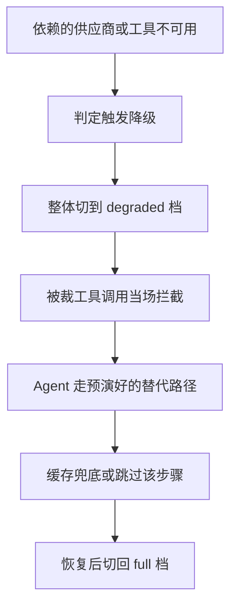

```python
# file: code/06_Agent与LLM及系统设计/q2576_min_toolset.py
"""Q2576 降级模式的最小工具集:能力降配但核心链路不断。

把工具集按运行模式配成档位:full 全量,degraded 只留核心;
降级触发时整体切档,被裁工具的调用当场拦截,Agent 按预演好的
替代路径走缓存兜底,而不是临场报错找不到路。
"""

PROFILES = {
    "full": {"search": "allow", "calc": "allow", "mail": "allow"},
    "degraded": {"search": "deny", "calc": "allow", "mail": "deny"},
}


class Agent:
    def __init__(self, profile):
        self.profile = profile

    def use(self, tool):
        if PROFILES[self.profile].get(tool) != "allow":
            raise PermissionError(tool + " 在 " + self.profile + " 模式不可用")
        return tool + "-ok"


def plan_route(agent, need_search):
    if need_search:
        try:
            agent.use("search")
            return "live-search"
        except PermissionError:
            return "cache-fallback"
    agent.use("calc")
    return "calc-path"


def main():
    full = Agent("full")
    assert plan_route(full, True) == "live-search"
    assert plan_route(full, False) == "calc-path"
    degraded = Agent("degraded")
    assert plan_route(degraded, True) == "cache-fallback"
    assert plan_route(degraded, False) == "calc-path"
    blocked = False
    try:
        degraded.use("mail")
        raise SystemExit(1)
    except PermissionError as exc:
        blocked = True
        print("最小工具集拦截:", exc)
    assert blocked, "mail 应被降级档拦截"
    print("full 模式:", plan_route(full, True))
    print("degraded 模式:", plan_route(degraded, True), "核心链路 calc 仍可用")


if __name__ == "__main__":
    main()
```

**追问**:
- 追问一:最小工具集怎么圈定?答:按核心任务的依赖闭包圈,任务关键路径上不可替代的才入选,可替代的留在 full 档。
- 追问二:降级档下质量下降谁来兜底?答:输出加降级标记透传给用户,免责声明和预期管理也是降级设计的一部分。

### Q2577 · 多租户的 prompt 隔离审计:渲染结果不许出现别家密文

> 难度:★★★★ | 标签:Agent, 多租户, 安全审计

**问**:多租户系统最怕串号,怎么系统性地发现 prompt 里的跨租户泄漏?

**答**:防线是渲染后审计:每条渲染完成的 prompt 落审计库,扫描器逐条检查是否包含其他租户的敏感令牌——账号、密钥片段、专属词表,命中即拦截发送并升级告警。它抓的是集成期错误:模板变量写错、缓存键没带租户、全局单例被并发污染,这类 bug 单测难覆盖,审计是最后一道网。扫描必须零误报才可自动拦截,所以敏感令牌要设计成唯一且不可能出现在正常文案里的形式,比如带前缀的账号号段。审计要双向:既查本租户 prompt 里的别家令牌,也查别家令牌有没有经本租户的响应回流。干净的审计通过率要进安全周报,沉默的防线最容易被不知不觉拆掉。

```python
# file: code/06_Agent与LLM及系统设计/q2577_prompt_isolation.py
"""Q2577 多租户的 prompt 隔离审计:渲染结果里不许出现别家密文。

模板渲染后的 prompt 落审计库,离线扫描器逐条检查是否包含其他
租户的敏感令牌;命中即拦截发送并升级告警。用注入的坏模板演示
一次真实泄漏被审计逮住,干净模板必须零误报。
"""

TENANT_SECRET = {"t1": "ACCT-111", "t2": "ACCT-222"}


def render_prompt_ok(tenant):
    return "你是助手,服务对象账号 " + TENANT_SECRET[tenant]


def render_prompt_buggy(tenant):
    """事故模板:误用了全局最近租户的状态,跨租户串号。"""
    return "你是助手,服务对象账号 " + TENANT_SECRET["t2"]


def audit(prompt, tenant):
    leaks = []
    for other, secret in TENANT_SECRET.items():
        if other != tenant and secret in prompt:
            leaks.append(other)
    return leaks


def main():
    clean = render_prompt_ok("t1")
    assert audit(clean, "t1") == []
    dirty = render_prompt_buggy("t1")
    leaks = audit(dirty, "t1")
    assert leaks == ["t2"], leaks
    print("干净 prompt 审计通过:零泄漏零误报")
    print("泄漏 prompt 命中租户:", leaks, "→ 拦截发送并升级告警")


if __name__ == "__main__":
    main()
```

**追问**:
- 追问一:扫描离线跑还是在线跑?答:在线拦高危,离线全量兜底,在线只查精确令牌控制时延,离线可以上模糊匹配。
- 追问二:命中后先拦还是先报?答:先拦再报,泄漏的代价不对称,误拦的代价是体验,泄漏的代价是事故。

### Q2578 · 切块的语义边界检测:相邻句相似度断崖处下刀

> 难度:★★★☆ | 标签:RAG, 切块, 嵌入

**问**:固定长度切块把一个论述拦腰截断,有没有更聪明的切法?

**答**:语义边界检测的思路是让内容自己告诉我们切在哪:句子过嵌入后算相邻句余弦,相似度骤降的地方就是主题断崖,在断崖处下刀,块内主题完整。工程上嵌入可以用便宜的小模型甚至词哈希假向量做离线实验,先验证边界信号存在再上真模型。相邻相似度曲线是核心产出物:组内相似度高且平,跨主题处出现深谷,阈值切在谷底附近即可。它和固定长度不冲突,常见组合是语义边界定主切点,块超长再按句二级切分。注意别追求全自动,阈值必须配合下一题的标定流程,拍脑袋的阈值比固定长度更不稳定。

```python
# file: code/06_Agent与LLM及系统设计/q2578_semantic_boundary.py
"""Q2578 切块的语义边界检测:相邻句相似度断崖处下刀。

固定长度切块会把一个完整论述拦腰截断;把句子嵌入后算相邻句
余弦,相似度跌破阈值即为主题断崖,在断崖处切块,块内主题完整。
嵌入用确定性词哈希假向量,离线可复现。
"""
import math
import re

DIM = 64


def embed(text):
    """确定性假嵌入:词哈希入桶后归一化,仅用于离线实验。"""
    v = [0.0] * DIM
    for w in re.findall(r"[a-z0-9]+", text.lower()):
        h = 0
        for ch in w:
            h = (h * 31 + ord(ch)) % DIM
        v[h] += 1.0
    n = math.sqrt(sum(x * x for x in v)) or 1.0
    return [x / n for x in v]


def cosine(a, b):
    return sum(x * y for x, y in zip(a, b))


def adjacent_sims(sentences):
    embs = [embed(s) for s in sentences]
    return [cosine(embs[i], embs[i + 1]) for i in range(len(embs) - 1)]


def detect_boundaries(sentences, threshold):
    return [i + 1 for i, s in enumerate(adjacent_sims(sentences)) if s < threshold]


def chunk(sentences, bounds):
    chunks, prev = [], 0
    for b in bounds + [len(sentences)]:
        chunks.append(sentences[prev:b])
        prev = b
    return chunks


SENTS = ["cat eats fish", "cat likes fish", "fish feeds cat",
         "database stores rows", "database stores rows fast", "rows live in database"]


def main():
    sims = adjacent_sims(SENTS)
    in_group = [sims[0], sims[1], sims[3], sims[4]]
    across = sims[2]
    assert min(in_group) > 0.3, in_group          # 组内相似度高
    assert across < 0.1, across                    # 跨主题断崖低
    bounds = detect_boundaries(SENTS, threshold=0.15)
    assert bounds == [3], bounds
    cs = chunk(SENTS, bounds)
    assert len(cs) == 2 and cs[0][0] == "cat eats fish" and cs[1][0] == "database stores rows"
    print("相邻相似度:", [round(s, 3) for s in sims])
    print("边界句索引:", bounds, "块数:", len(cs))


if __name__ == "__main__":
    main()
```

**追问**:
- 追问一:相邻窗口取一句还是多句?答:短句多时取两三句的滑窗均值更稳,单句太受噪声影响。
- 追问二:检测错了怎么办?答:边界检测输出的是候选切点加置信度,低置信度切点回退到固定长度策略。

### Q2579 · 语义边界阈值的标定:扫参选 F1 最高点

> 难度:★★☆☆ | 标签:RAG, 切块, 评估

**问**:边界阈值怎么定才不是玄学?

**答**:把它当分类问题标定:人工标一小批文档的真实边界当真值,阈值从低到高扫一遍,每个阈值算精确率、召回率、F1,取 F1 最高点上线。曲线形态比单点更有信息量:F1 在一段区间内平坦,说明阈值不敏感,取区间中点最稳;曲线尖锐,说明信号弱,要回头换嵌入或加窗口。标定集要覆盖文档类型多样性,纯技术文档标出来的阈值用在对话记录上必然翻车。阈值是配置不是代码,换嵌入模型、换语料类型都要重标,把标定脚本固化成回归任务。这套方法同样适用于去重阈值、拒答门限,任何"相似度加阈值"的场合都适用。

```python
# file: code/06_Agent与LLM及系统设计/q2579_boundary_calibrate.py
"""Q2579 语义边界阈值的标定:扫参选 F1 最高点。

阈值拍脑袋定不可靠;拿人工标注的边界当真值,扫一遍阈值,
逐点算精确率 召回率 F1,取 F1 最高且落在平台期的阈值上线。
"""
import math
import re

DIM = 64


def embed(text):
    v = [0.0] * DIM
    for w in re.findall(r"[a-z0-9]+", text.lower()):
        h = 0
        for ch in w:
            h = (h * 31 + ord(ch)) % DIM
        v[h] += 1.0
    n = math.sqrt(sum(x * x for x in v)) or 1.0
    return [x / n for x in v]


def adjacent_sims(sentences):
    embs = [embed(s) for s in sentences]
    return [sum(x * y for x, y in zip(embs[i], embs[i + 1]))
            for i in range(len(embs) - 1)]


def f1(detected, truth):
    tp = len(set(detected) & set(truth))
    p = tp / len(detected) if detected else 0.0
    r = tp / len(truth) if truth else 0.0
    return 2 * p * r / (p + r) if p + r else 0.0


def calibrate(sims, truth, thresholds):
    curve = []
    for th in thresholds:
        det = [i + 1 for i, s in enumerate(sims) if s < th]
        curve.append((th, f1(det, truth), det))
    return curve


SENTS = ["cat eats fish", "cat likes fish", "fish feeds cat",
         "database stores rows", "database stores rows fast", "rows live in database",
         "cache misses hurt", "cache misses slow reads"]


def main():
    sims = adjacent_sims(SENTS)
    truth = [3, 6]  # 两组主题切换点
    thresholds = [round(0.05 + 0.05 * i, 2) for i in range(10)]
    curve = calibrate(sims, truth, thresholds)
    best = max(curve, key=lambda x: x[1])
    assert best[1] == 1.0, curve            # 存在完美阈值
    assert best[2] == truth, best            # 且检测恰等于真值
    print("相似度:", [round(s, 3) for s in sims])
    for th, f, det in curve:
        print("阈值", th, "F1", round(f, 3), "检测", det)
    print("选定阈值:", best[0])


if __name__ == "__main__":
    main()
```

**追问**:
- 追问一:没有人工标注预算怎么办?答:用结构信号当代理真值,比如标题行、分节符,便宜且量大,标完抽样人工校验。
- 追问二:精确率和召回率哪个重要?答:切块场景召回优先,漏切产生混主题块伤害检索,过切只损失少量上下文完整性。

### Q2580 · 查询日志的频次聚类:归一化后按同型合并

> 难度:★★★☆ | 标签:RAG, 日志挖掘, 聚类

**问**:日志里"Python GIL 是什么""什么是 Python GIL"各占一条,热度统计全失真,怎么办?

**答**:先归一化再聚类:去标点、转小写、去掉"是什么""的吗"这类语助成分,再把剩余字符集排序成规范形,同规范形即同一意图,簇大小就是真实热度。字符集排序是中文查询的实用近似,词序变化完全免疫,代价是同字不同义会误合,对热度统计这个误差可接受。聚类的下游价值链是:热度榜指导缓存预热、语料补齐、FAQ 建设,头部簇和长尾要区别对待。注意归一化规则要版本化,规则一改热度榜就不可比,历史报表要标注用的哪版规则。更精细的语义聚类用嵌入加近邻,但频次统计场景归一化法便宜十倍且可解释。

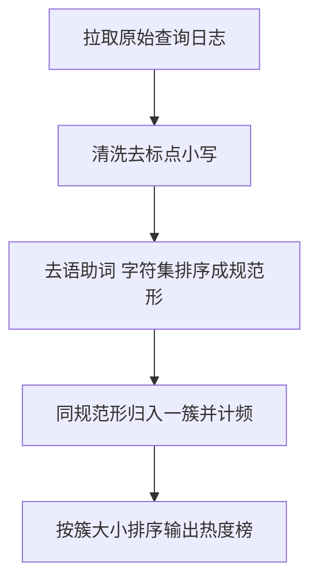

```python
# file: code/06_Agent与LLM及系统设计/q2580_query_cluster.py
"""Q2580 查询日志的频次聚类:归一化后按同型合并计数。

日志里的查询十种写法一个意思:大小写 标点 词序 语助词都在抖。
先归一化成规范形(去标点 小写 字符集排序),同规范形即同一簇,
簇内计频,簇大小就是该意图的真实热度。
"""
import re
from collections import Counter

FILLER = set("的吗请一下什么哪些如何")


def normalize(q):
    q = re.sub(r"[^\w\u4e00-\u9fff]+", "", q.lower())
    return "".join(sorted(ch for ch in q if ch not in FILLER))


def cluster(queries):
    groups = {}
    for q in queries:
        groups.setdefault(normalize(q), []).append(q)
    return groups


def main():
    logs = ["Python GIL 是什么", "什么是 Python GIL", "python gil 是什么?",
            "GIL 的作用", "GIL 有什么用", "redis 持久化", "Redis 持久化!",
            "持久化 redis", "怎么买咖啡"]
    groups = cluster(logs)
    sizes = sorted((len(v) for v in groups.values()), reverse=True)
    assert sizes == [3, 3, 1, 1, 1], sizes
    top = max(groups.values(), key=len)
    assert top[0] == "Python GIL 是什么"
    rep = Counter(top).most_common(1)[0][0]
    print("簇数量:", len(groups), "簇大小分布:", sizes)
    print("最大簇成员:", top)
    print("代表查询:", rep)


if __name__ == "__main__":
    main()
```

**追问**:
- 追问一:为什么不用编辑距离聚类?答:编辑距离是两两比较,日志千万级开销不可接受,规范形是线性哈希式聚类。
- 追问二:多语言混合日志怎么处理?答:按语言路由分桶,各桶用自己的归一化规则,统计时再合并。

### Q2581 · 聚类的代表查询与长尾合并:报得出一二三兜得住其余

> 难度:★★☆☆ | 标签:RAG, 日志挖掘, 报表

**问**:聚出几百个簇,报表怎么呈现才有用?

**答**:报表两级化:头部簇展示,每个簇选出出现次数最多的原始写法当代表——用户写法有口语惯性,出现最多的一般最自然;低于支持度的簇整体并入长尾桶,只报总条数和占比。支持度是报表的旋钮:调高则头部更干净,调低则细节更多,运营周报和工程分析用不同支持度。代表选取要防一类坑:同一簇里大小写、标点不同的写法互为变体,按原始串计次选代表即可,别二次归一。长尾不是垃圾,长尾占比上升往往是用户群变化的信号,趋势比绝对值重要。这套"头部展示加长尾合并"的模式适用于所有离散高基数报表,错误码、UA、地域通吃。

```python
# file: code/06_Agent与LLM及系统设计/q2581_cluster_represent.py
"""Q2581 聚类的代表查询与长尾合并:报得出一二三,也兜得住其余。

每个簇选出现次数最多的原始写法当代表,低于支持度的簇整体并入
长尾桶,报表只展示头部,长尾合并计数,避免小簇淹没重点。
"""
from collections import Counter


def pick_representatives(groups, min_support):
    reps, tail = [], []
    for members in groups.values():
        if len(members) >= min_support:
            reps.append((Counter(members).most_common(1)[0][0], len(members)))
        else:
            tail.extend(members)
    reps.sort(key=lambda x: -x[1])
    return reps, tail


def main():
    groups = {
        "k1": ["Python GIL 是什么", "什么是 Python GIL", "python gil 是什么?"],
        "k2": ["redis 持久化", "Redis 持久化!", "Redis 持久化"],
        "k3": ["怎么买咖啡", "买咖啡"],
    }
    reps, tail = pick_representatives(groups, min_support=3)
    assert len(reps) == 2 and reps[0][1] == 3 and reps[1][1] == 3, reps
    assert tail == ["怎么买咖啡", "买咖啡"], tail
    reps2, tail2 = pick_representatives(groups, min_support=2)
    assert len(reps2) == 3 and tail2 == []
    print("代表查询:", reps)
    print("长尾合并条数:", len(tail), "→", tail)
    print("支持度降到 2 后:", reps2, "长尾", tail2)


if __name__ == "__main__":
    main()
```

**追问**:
- 追问一:两个簇该不该合并成一个意图?答:那是语义聚类的事,报表阶段只做频次事实,意图合并交给下一层分析。
- 追问二:代表查询带时间戳吗?答:带,热度随时间漂移,代表要按月刷新,否则预热的缓存对不上当下的问法。

### Q2582 · embedding 归一化的必要性实测:余弦等价归一后点积

> 难度:★★★☆ | 标签:RAG, 嵌入, 向量检索

**问**:为什么向量入库前都要归一化?不归一会怎样,能实测出来吗?

**答**:数学上归一化后的点积严格等于余弦:cos 等于 dot 除以两个模长,模长归一后商恒等于积,这就是所有向量库默认归一的原因。不归一的后果是点积被模长主导:方向完全相同的两个向量,模长翻倍点积翻倍,近正交的向量对也可能因为模长悬殊点积为正,相似度语义整个失真。实测三件事就能讲清:同方向不同模长的对,余弦恒为 1 而点积随模长任意大;归一后模长恒为 1;归一后点积与直接算余弦在浮点误差内相等。另一个实测收获是性能:归一后用内积索引,比原始向量算带除法的余弦快且可走底层加速。归一化是检索正确性的地基,比换模型提升的排序质量便宜得多。

```python
# file: code/06_Agent与LLM及系统设计/q2582_embed_norm.py
"""Q2582 embedding 归一化的必要性实测:余弦等价于归一后的点积。

数学事实:cos(a,b) = dot(norm(a), norm(b));工程后果:检索库若
没归一化,点积被模长主导,方向完全相同的两向量点积可以任意大。
本实验用小向量实测定量关系。
"""
import math


def dot(a, b):
    return sum(x * y for x, y in zip(a, b))


def norm(v):
    return math.sqrt(sum(x * x for x in v))


def normalize(v):
    n = norm(v) or 1.0
    return [x / n for x in v]


def cosine_raw(a, b):
    return dot(a, b) / (norm(a) * norm(b))


def main():
    a = [3.0, 4.0]
    b = [6.0, 8.0]      # 与 a 同方向,模长翻倍
    c = [-0.8, 0.6]     # 与 a 近似正交
    assert abs(cosine_raw(a, b) - 1.0) < 1e-12          # 方向完全相同
    assert abs(dot(normalize(a), normalize(b)) - cosine_raw(a, b)) < 1e-12
    assert abs(norm(normalize(a)) - 1.0) < 1e-12        # 归一后模长恒为 1
    raw_same = dot(a, b)          # 未归一点积:被模长放大
    raw_ortho = dot(a, c)         # 未归一点积:近正交仍可能为正
    assert abs(raw_same - 50.0) < 1e-12
    assert raw_ortho < 0.5 and cosine_raw(a, c) < 0.1
    print("dot a b =", raw_same, "但真实余弦 = 1.0,点积虚高 50 倍")
    print("dot a c =", round(raw_ortho, 4), "而余弦 =", round(cosine_raw(a, c), 4))
    print("结论:入库前统一归一化,点积才严格等价余弦。")


if __name__ == "__main__":
    main()
```

**追问**:
- 追问一:所有嵌入模型都建议归一吗?答:绝大多数;个别模型输出本身在单位球上,归一不改变结果,统一做也无害。
- 追问二:混合检索里稀疏稠密分数怎么可比?答:各自归一到可比分位再融合,归一的思想从向量层一路用到分数融合层。

### Q2583 · 归一化缺失的事故复现:模长压倒角度排序错位

> 难度:★★★★ | 标签:RAG, 嵌入, 事故复盘

**问**:线上检索"为什么排第一的文档明显不对",怎么复现定位?

**答**:先怀疑归一化:用一组构造向量复现事故——查询与短文档方向完全一致,与长文档夹角 45 度;未归一点积下长文档模长优势碾压角度劣势排到第一,归一后按余弦排序立刻回到正确顺序。这个最小复现的价值是把"模型不行"的直觉纠正为"度量不对"的工程问题:同样的向量,换个度量顺序就对了。复盘要追根因:哪条写入路径漏了归一,通常是新语料管道绕过了统一的嵌入服务。修复要双保险:写入端强制归一,查询端对任何来源的向量先归一再用,并在监控里加模长分布漂移检测,模长突然变大就是漏归一的信号。事故复现脚本直接转成回归用例,防止修复被后续重构悄悄冲掉。

```python
# file: code/06_Agent与LLM及系统设计/q2583_norm_incident.py
"""Q2583 归一化缺失的事故复现:模长压倒角度,检索排序错位。

同方向短文档被模长大的弱相关文档压过去,是线上最常见的
"为什么排第一的文档不对" 事故;归一化后按余弦排序立刻修复,
复现实验可当回归用例。
"""
import math


def dot(a, b):
    return sum(x * y for x, y in zip(a, b))


def normalize(v):
    n = math.sqrt(sum(x * x for x in v)) or 1.0
    return [x / n for x in v]


def rank(query, docs, metric):
    if metric == "dot":
        scored = [(d["id"], dot(query, d["vec"])) for d in docs]
    else:
        q = normalize(query)
        scored = [(d["id"], round(dot(q, normalize(d["vec"])), 4)) for d in docs]
    return [i for i, _ in sorted(scored, key=lambda x: -x[1])], dict(scored)


def main():
    query = [1.0, 1.0]
    docs = [
        {"id": "真相关-短文", "vec": [0.9, 0.9]},   # 角度完全一致,模长小
        {"id": "弱相关-长文", "vec": [2.0, 0.0]},   # 夹角 45 度,模长大
    ]
    bad, raw = rank(query, docs, "dot")
    good, ang = rank(query, docs, "cos")
    assert bad[0] == "弱相关-长文", bad        # 事故:点积让长文排前
    assert good[0] == "真相关-短文", good      # 修复:余弦回到正确顺序
    assert raw["弱相关-长文"] == 2.0 and raw["真相关-短文"] == 1.8
    assert ang["真相关-短文"] == 1.0 and ang["弱相关-长文"] == 0.7071
    print("未归一 dot 得分:", raw, "排序:", bad, "← 事故排序")
    print("归一后 cos 得分:", ang, "排序:", good, "← 正确排序")


if __name__ == "__main__":
    main()
```

**追问**:
- 追问一:为什么排序错位当时没被评估集抓住?答:评估集若也用未归一度量,错得一样,评估器必须独立实现正确的度量。
- 追问二:部分归一部分没归一的库怎么诊断?答:模长分布双峰是特征,统计全库模长的分位数,双峰即混库。

### Q2584 · 检索结果的时效打分:先识别查询是否时效敏感

> 难度:★★★☆ | 标签:RAG, 排序, 新鲜度

**问**:给检索加时间衰减排序,为什么"什么是 RAG"这类查询反而变差了?

**答**:因为新鲜度加权全局打开是错的:稳定型查询要的是经典解释,衰减会把旧的高质量解释压下去,推出浅显的新文。正确做法是先识别查询是否时效敏感——正则或小模型检测"最新、今年、2026"这类时间信号,只对时效敏感查询启用新鲜度加成,稳定查询走纯相关度。时效敏感查询的打分是相关度加新鲜度的线性组合,权重按查询类型分档,新闻类高、技术类低。文档侧的新鲜度用发布时间归一到 0 到 1,注意区分"发布新"和"内容新",转载旧文的新发布时间是常见陷阱。上线方式用对拍:同查询双跑开关两侧,人工评头部差异,确认无误伤再放量。

```python
# file: code/06_Agent与LLM及系统设计/q2584_freshness_query.py
"""Q2584 检索结果的时效打分:先识别查询是否时效敏感。

时间衰减排序不该全局打开:什么是 RAG 这类稳定型查询被新鲜度
加权会推出旧闻漏掉经典;先检测查询里的时间信号,只对时效敏感
查询启用新鲜度加成。
"""
import re

TIME_HINTS = re.compile(r"最新|今年|今天|最近|2026|实时")
FRESH_WEIGHT = 0.3

DOCS = [
    {"id": "2023旧闻", "sim": 0.90, "freshness": 0.10},
    {"id": "2026新报", "sim": 0.78, "freshness": 0.95},
]


def is_fresh_query(q):
    return bool(TIME_HINTS.search(q))


def score(docs, query):
    fresh = is_fresh_query(query)
    out = []
    for d in docs:
        s = d["sim"] + (FRESH_WEIGHT * d["freshness"] if fresh else 0.0)
        out.append((d["id"], round(s, 3)))
    return sorted(out, key=lambda x: -x[1])


def main():
    q1 = "什么是 RAG"
    q2 = "2026 最新的 RAG 进展"
    assert is_fresh_query(q2) and not is_fresh_query(q1)
    r1 = score(DOCS, q1)
    r2 = score(DOCS, q2)
    assert r1[0][0] == "2023旧闻", r1
    assert r2[0][0] == "2026新报", r2
    print("稳定查询", q1, "→", r1, "纯相关度")
    print("时效查询", q2, "→", r2, "相关度加新鲜度,排序翻转")


if __name__ == "__main__":
    main()
```

**追问**:
- 追问一:检测漏了隐含时效怎么办?答:兜底规则是实体驱动,股价、天气、版本号这类实体默认时效敏感,进实体白名单。
- 追问二:时间表达式解析错怎么办?答:检测只做开关不做解析,开关错了最多回到纯相关度,伤害可控,这是把识别做轻的原因。

### Q2585 · 跨语料的实体消歧:同名实体按上下文归属

> 难度:★★★★ | 标签:RAG, 实体消歧, NLP

**问**:科技库和美食库里都有"苹果",检索混库时怎么知道用户说的是哪个?

**答**:消歧打分两个因子:上下文特征命中数——每个实体挂一组特征词,提及处的上下文命中的特征越多越归属谁;语料先验——查询来自哪个语料域,该域的实体加一分先验。两个因子相加,冲突时先验定夺,无上下文时先验兜底,保证任何输入都有确定输出而不是随机选边。工程化要点是特征词表离线构建,按实体与语料共现统计自动挖,人工只做抽检;特征表与实体库同版本管理,更新走灰度。消歧结果要透传到下游:引用来源标实体 id,答案生成时避免把两个实体的属性混在一段。这套打分框架是消歧的最小可用版,进阶版用嵌入相似度替代词面特征,机制不变换打分器。

```python
# file: code/06_Agent与LLM及系统设计/q2585_entity_disambig.py
"""Q2585 跨语料的实体消歧:同名实体按上下文特征归属。

苹果 在科技库与美食库里是两个实体;消歧打分 = 上下文特征词
命中数 + 语料先验,无上下文时先验兜底,而不是随机选一个。
"""

ENTITIES = {
    "苹果-公司": {"corpus": "tech", "hints": {"发布", "iphone", "市值", "库克"}},
    "苹果-水果": {"corpus": "food", "hints": {"维生素", "甜", "果园", "削皮"}},
}


def disambiguate(mention, context, corpus_prior):
    assert mention in ("苹果",), "示例只处理 苹果"
    best, best_score = None, -1.0
    for name, ent in ENTITIES.items():
        overlap = len(set(context) & ent["hints"])
        prior = 1.0 if ent["corpus"] == corpus_prior else 0.5
        s = overlap + prior
        if s > best_score:
            best, best_score = name, s
    return best, best_score


def main():
    m1 = disambiguate("苹果", {"发布", "iphone", "发布会"}, "tech")
    m2 = disambiguate("苹果", {"削皮", "维生素", "甜"}, "food")
    assert m1[0] == "苹果-公司" and m1[1] == 3.0, m1   # 两个特征命中 加 先验
    assert m2[0] == "苹果-水果" and m2[1] == 4.0, m2
    m3 = disambiguate("苹果", set(), "food")   # 无上下文,靠语料先验兜底
    assert m3[0] == "苹果-水果", m3
    m4 = disambiguate("苹果", {"甜", "库克"}, "tech")  # 特征冲突,先验定夺
    assert m4[0] == "苹果-公司", m4
    print("科技语料命中:", m1)
    print("美食语料命中:", m2)
    print("无上下文先验兜底:", m3, "特征冲突先验定夺:", m4)


if __name__ == "__main__":
    main()
```

**追问**:
- 追问一:一个提及可能同时指两个实体怎么办?答:分数差小于阈值时标记歧义态,转澄清或并列作答,别硬选边。
- 追问二:消歧在检索前还是检索后?答:查询理解阶段先消歧用于路由,检索结果层再验一次,两道闸各自兜一种错。

### Q2586 · 答案引用的页码级定位:块级引用归并页码区间

> 难度:★★★☆ | 标签:RAG, 引用, 可溯源

**问**:检索和引用都是块级的,但用户要看的是"在第几页",中间怎么换算?

**答**:块的元数据里带页区间,这是块入库时就该埋好的字段;答案引用若干块时,把块的页区间收集排序,相邻页合并成连续区间,输出"第3-5页"这种可读引用。合并规则决定体验:间隔一页也算连续更符合人的阅读直觉,但跨章节时要断开,章节信息可在区间合并时校验。页码引用和偏移引用互补:偏移用于程序校验证据确实存在,页码用于人读,两层都在才可审计也可读。注意 PDF 解析的页码漂移:同一块跨页时区间取并集,解析器页码与印刷页码不一致时统一以印刷页码为准并留映射。引用的可读性直接决定用户对系统的信任,这层薄薄的换算是高杠杆投入。

```python
# file: code/06_Agent与LLM及系统设计/q2586_page_citation.py
"""Q2586 答案引用的页码级定位:块级引用归并成页码区间。

块是检索单位,页是人读单位;引用若干块时把块的页区间排序合并
相邻页,输出连续页码,再渲染成 第3-5页 这样的可读引用。
"""

CHUNKS = {
    "c1": (3, 4), "c2": (4, 5), "c3": (9, 9), "c4": (2, 2),
}


def pages_of(chunk_ids):
    spans = sorted(CHUNKS[c] for c in chunk_ids)
    merged = []
    for s, e in spans:
        if merged and s <= merged[-1][1] + 1:  # 相邻页也算连续
            merged[-1][1] = max(merged[-1][1], e)
        else:
            merged.append([s, e])
    return [tuple(x) for x in merged]


def cite_text(chunk_ids):
    parts = []
    for s, e in pages_of(chunk_ids):
        parts.append("第" + str(s) + "页" if s == e else "第" + str(s) + "-" + str(e) + "页")
    return "、".join(parts)


def main():
    out = pages_of(["c1", "c2", "c3"])
    assert out == [(3, 5), (9, 9)], out
    assert cite_text(["c1", "c2"]) == "第3-5页", cite_text(["c1", "c2"])
    assert cite_text(["c4"]) == "第2页"
    assert cite_text(["c3", "c4"]) == "第2页、第9页"
    print("引用 [c1,c2,c3] 归并为:", cite_text(["c1", "c2", "c3"]))
    print("引用 [c3,c4] 归并为:", cite_text(["c3", "c4"]))


if __name__ == "__main__":
    main()
```

**追问**:
- 追问一:块没有页元数据怎么办?答:回填成本极高,通常靠入库管道补,历史语料用版式启发式批量回填并抽样校验。
- 追问二:引用页码错了算事故吗?答:算,引用错页比无引用更伤信任,页码映射要有对拍校验。

### Q2587 · 负缓存:已知无答案的问题不再重复检索

> 难度:★★★☆ | 标签:RAG, 缓存, 成本

**问**:同一个无答案的问题每天被问几百次,每次都全链路检索一遍,怎么止血?

**答**:负缓存把"确认无答案"也当成可缓存的结果:第一次检索判定最高分低于门限,把问题哈希连同拒答原因、TTL 写进缓存;TTL 内同问题直接短路,跳过整条召回重排链路,只剩一次哈希查找的成本。TTL 是安全的来源:语料持续更新,今天的无答案不等于永远无答案,过期自动重查,拒答永不陈旧。写入要挑场景:阈值边缘的判定别写,避免把"差一点就有答案"固化成拒答;明确的零分命中等强信号才写。指标要分开记:负缓存命中率、省下的检索次数、误缓存率——把可答问题错缓存的概率必须单独监控。负缓存和正缓存同构,只是缓存的值是"没有",工程上常被遗忘,成本收益却很实在。

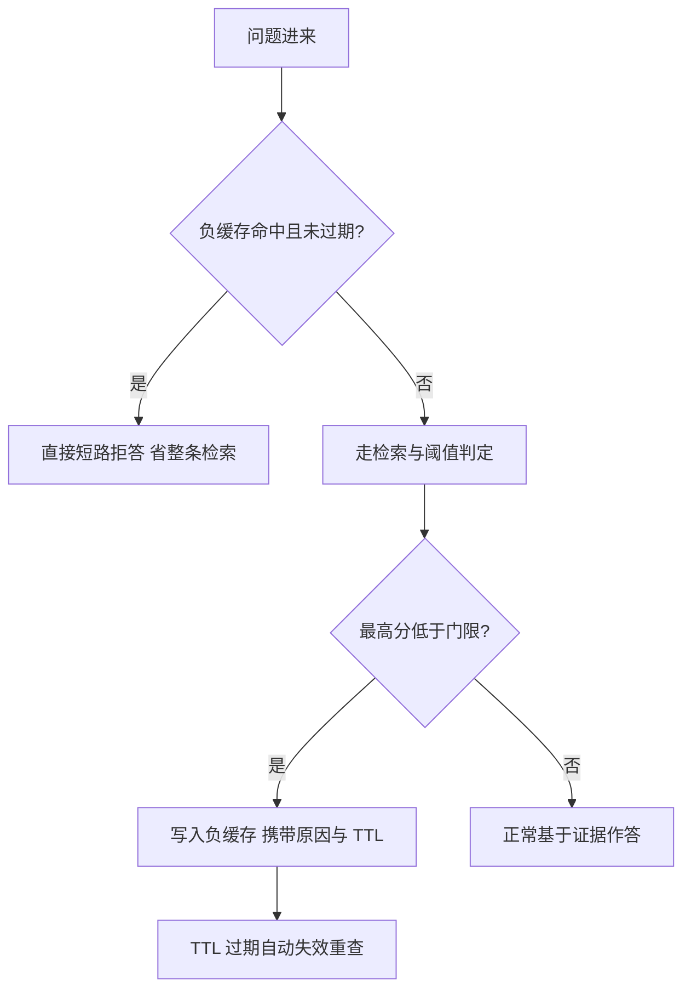

```python
# file: code/06_Agent与LLM及系统设计/q2587_negative_cache.py
"""Q2587 负缓存:已知无答案的问题不再重复检索。

低分拒答的问题往往会被反复问:第一次检索确认无证据后,把问题
哈希连同原因写进负缓存,TTL 内直接短路拒答,省掉整条检索链路;
TTL 过期自动失效重查,语料更新后不会永远拒答。
"""
import hashlib


class NegativeCache:
    def __init__(self, ttl):
        self.ttl = ttl
        self.store = {}   # qhash -> (expire_at, reason)
        self.saved = 0

    @staticmethod
    def key(q):
        return hashlib.md5(q.encode("utf-8")).hexdigest()[:12]

    def put(self, q, now, reason):
        self.store[self.key(q)] = (now + self.ttl, reason)

    def get(self, q, now):
        rec = self.store.get(self.key(q))
        if rec is None:
            return None
        expire, reason = rec
        if now >= expire:
            del self.store[self.key(q)]
            return None
        self.saved += 1
        return reason


def fake_best_sim(q):
    """stub:确定性假相似度,只区分无证据与有证据两类问题。"""
    return 0.31 if "外星人" in q else 0.92


def pipeline(q, cache, now, stats):
    hit = cache.get(q, now)
    if hit is not None:
        stats["negative-hit"] += 1
        return "拒答:" + hit
    stats["retrieval"] += 1
    if fake_best_sim(q) < 0.8:
        cache.put(q, now, "语料中无相关证据")
        return "拒答:语料中无相关证据"
    stats["answered"] += 1
    return "基于证据作答"


def main():
    cache = NegativeCache(ttl=100)
    stats = {"retrieval": 0, "negative-hit": 0, "answered": 0}
    q = "地球上有外星人基地吗"
    r1 = pipeline(q, cache, 0, stats)
    r2 = pipeline(q, cache, 10, stats)
    assert r1 == r2 and stats["retrieval"] == 1 and stats["negative-hit"] == 1
    r3 = pipeline(q, cache, 200, stats)          # TTL 过期,重新检索
    assert stats["retrieval"] == 2 and stats["negative-hit"] == 1
    r4 = pipeline("什么是 RAG", cache, 0, stats)
    assert stats["answered"] == 1 and r4 == "基于证据作答"
    assert cache.saved == 1
    print("首次检索:", r1)
    print("负缓存命中:", r2, "← 省一次检索,TTL 内直接短路")
    print("TTL 过期后重查:", r3)
    print("可答问题不受影响:", r4)


if __name__ == "__main__":
    main()
```

**追问**:
- 追问一:语料更新怎么主动清负缓存?答:更新事件触发按语料版本段的批量失效,不做全清,避免命中率瞬间归零。
- 追问二:改写重试和负缓存冲突吗?答:不冲突,负缓存记的是改写归一后的意图哈希,改写前的变体都命中同一条。

### Q2588 · 请求优先级队列的实现:heapq 加序列号保稳定

> 难度:★★★☆ | 标签:LLM 运维, 队列, 数据结构

**问**:用 Python 实现一个请求优先级队列,有哪些一看就错的坑?

**答**:第一个坑是堆方向:heapq 是最小堆,数字越小越先出,约定优先级数字小者为高,写反了高优先级全沉底。第二个坑是稳定性:同优先级的元组比较会落到下一项,如果下一项是请求对象会直接报错,如果是字符串则按字典序出队——那是运气不是契约,必须显式塞一个单调递增 seq,同优先级严格按到达序出队。第三个坑是空队列:pop 要有可读的报错而不是裸 IndexError 泄栈。这三个点合起来就是 priority、seq、item 三元组的固定写法。优先级语义要写进类型注释和监控:队列里各级深度分别暴露,高优先级队列变深才是容量告警信号,总深度会掩盖结构性饥饿。

```python
# file: code/06_Agent与LLM及系统设计/q2588_priority_queue.py
"""Q2588 请求优先级队列的实现:heapq 加序列号保稳定。

优先级队列的核心实现细节:heapq 是最小堆,数字越小越先出;
同优先级时元组比较会落到第三项 item 上,顺序由字典序决定,
这是运气不是契约——必须补一个单调递增 seq 保证 FIFO 稳定。
"""
import heapq


class PriorityQueue:
    def __init__(self):
        self._h = []
        self._seq = 0

    def push(self, item, priority):
        heapq.heappush(self._h, (priority, self._seq, item))
        self._seq += 1

    def pop(self):
        if not self._h:
            raise IndexError("queue empty")
        _, _, item = heapq.heappop(self._h)
        return item

    def __len__(self):
        return len(self._h)


def main():
    q = PriorityQueue()
    q.push("low-1", 5)
    q.push("high-1", 1)
    q.push("low-2", 5)
    q.push("high-2", 1)
    out = [q.pop() for _ in range(4)]
    assert out == ["high-1", "high-2", "low-1", "low-2"], out
    # 对照:无 seq 的堆,同优先级按 item 字典序出队,语义不可控
    h = []
    for name, p in [("zz", 5), ("aa", 5)]:
        heapq.heappush(h, (p, name))
    assert heapq.heappop(h)[1] == "aa"   # 字典序,不是到达序
    try:
        q.pop()
        raise SystemExit(1)
    except IndexError as exc:
        print("空队列弹出被拒:", exc)
    print("带 seq 的出队序:", out, "← 同级按到达序,跨级按优先级")


if __name__ == "__main__":
    main()
```

**追问**:
- 追问一:优先级用什么字段?答:小整数等级加截止时刻组合,纯等级会丢 deadline 信息,纯 deadline 会饿低等级。
- 追问二:进程内队列挂了怎么办?答:堆本身无持久化,可靠场景外置到带持久化的队列,进程内堆只做调度缓冲。

### Q2589 · 队列满时按优先级拒绝:低价值让位或被拒

> 难度:★★☆☆ | 标签:LLM 运维, 队列, 背压

**问**:有界优先级队列满了,新请求来了怎么办才不算拍脑袋?

**答**:双出口设计:新请求优先级比队里最差的还高,就挤掉它;不如队里最差的,直接拒收。实现技巧是存负优先级,让最小堆的堆顶恒为"最不值钱"的请求,比较与替换都是对数复杂度,heapreplace 一次完成弹出加压入。驱逐和拒收都要留指标,两者的比例是负载画像:全是驱逐说明高优流量超载,全是拒收说明低优流量在试探容量。被拒方要拿到明确的拒绝原因与建议重试时间,而不是无声超时。注意这套机制假设优先级可比,等级体系一变,驱逐逻辑跟着变,所以等级定义要进配置治理,不许各调用方私自定义等级。

```python
# file: code/06_Agent与LLM及系统设计/q2589_queue_evict.py
"""Q2589 队列满时按优先级拒绝:低价值请求让位或被拒。

有界优先级队列的双出口设计:高优先级到来挤掉堆里最差的,
新来的低优先级直接拒收;堆顶永远是最不值钱的请求,替换用
heapreplace 一次完成,拒绝与驱逐都要留指标。
"""
import heapq


class BoundedPQ:
    def __init__(self, capacity):
        self.cap = capacity
        self._h = []          # 存负优先级:堆顶恒为最不值钱的请求
        self._seq = 0
        self.evicted = []
        self.rejected = 0

    def push(self, item, priority):
        if len(self._h) < self.cap:
            heapq.heappush(self._h, (-priority, self._seq, item))
            self._seq += 1
            return "queued"
        worst = self._h[0]  # 堆顶是优先级数字最大即最不值钱的
        if priority < -worst[0]:
            heapq.heapreplace(self._h, (-priority, self._seq, item))
            self._seq += 1
            self.evicted.append(worst[2])
            return "evicted-lowest"
        self.rejected += 1
        return "rejected"

    def drain(self):
        raw = [(-negp, s, it)
               for negp, s, it in (heapq.heappop(self._h) for _ in range(len(self._h)))]
        raw.sort()
        return [it for _, _, it in raw]


def main():
    q = BoundedPQ(3)
    assert q.push("a-low", 9) == "queued"
    assert q.push("b-mid", 5) == "queued"
    assert q.push("c-low", 8) == "queued"
    assert q.push("d-high", 1) == "evicted-lowest"   # 挤掉 a-low
    assert q.evicted == ["a-low"], q.evicted
    assert q.push("e-worst", 10) == "rejected"
    assert q.rejected == 1
    drained = q.drain()
    assert drained == ["d-high", "b-mid", "c-low"], drained
    print("被挤掉:", q.evicted, "被拒收:", q.rejected)
    print("最终队列:", drained)


if __name__ == "__main__":
    main()
```

**追问**:
- 追问一:被驱逐的请求直接丢吗?答:落盘进溢出队列或转低档异步处理,驱逐是降级不是销毁。
- 追问二:同优先级的驱逐怎么选?答:seq 最大的先逐,即最新到达的先逐,保持先进者多留一会的驱逐公平性。

### Q2590 · 供应商降级的容量预估:降配后还接得住多少量

> 难度:★★★☆ | 标签:LLM 运维, 容量规划, 降级

**问**:主供应商挂了切备用,备用只有一半吞吐,切过去之前要算清什么账?

**答**:切换决策必须是算术题不是勇气题:用离散时间排队模拟,每秒到达减服务,算出降级容量下的峰值积压与最大等待。本例的账很扎眼:60 rps 的负载砸到 40 rps 的备用上,六十秒积压 1200 个请求,最大等待 30 秒——这个数字意味着必须同步限流,裸切就是把备用也压死。安全接入上限按备用容量打折再留余量,七折加一成是常见起点,再按压测校准。预估要覆盖三个数:降级容量、当前负载、安全上限,三者共同决定切多少流量过去。演练时用真实负载回放验证预估,排队模拟的到达形态与服务率要从生产日志拟合,别用拍脑袋的均值。

```python
# file: code/06_Agent与LLM及系统设计/q2590_capacity_estimate.py
"""Q2590 供应商降级的容量预估:降配后到底还接得住多少量。

主供应商挂掉切备用前,先算清备用容量扛不扛得住当前负载:
离散时间排队模拟,每秒到达减服务,积压线性增长,得出峰值积压
与最大等待,再按安全系数算出降级期接入上限。
"""


def simulate(arrival_rate, service_rate, seconds):
    """离散时间排队:每秒到达 arrival_rate 个,服务 service_rate 个。"""
    backlog = 0.0
    peak = 0.0
    max_wait = 0.0
    for _ in range(int(seconds)):
        backlog += arrival_rate
        served = min(backlog, service_rate)
        backlog -= served
        peak = max(peak, backlog)
        max_wait = max(max_wait, backlog / max(service_rate, 1e-9))
    return {"peak_backlog": round(peak, 1), "max_wait_s": round(max_wait, 1)}


def main():
    load = 60.0
    primary = simulate(load, 100.0, 60)
    degraded = simulate(load, 40.0, 60)
    assert primary == {"peak_backlog": 0.0, "max_wait_s": 0.0}, primary
    assert degraded["peak_backlog"] == 1200.0, degraded
    assert degraded["max_wait_s"] == 30.0
    safe = round(40.0 * 0.7 * 0.9, 1)  # 七折再留一成余量
    assert safe == 25.2 and safe < load
    print("主供 100rps 扛 60rps:", primary)
    print("降级 40rps 扛 60rps:", degraded, "← 必须同步限流")
    print("降级期安全接入上限约", safe, "rps,超出部分要排队或拒绝")


if __name__ == "__main__":
    main()
```

**追问**:
- 追问一:为什么不直接切一小部分流量试?答:试探可用但要有预估值撑腰,否则试探本身就是压测事故,预估给出试探的安全区间。
- 追问二:积压的请求最终怎么办?答:按截止时间过期即弃,等待超过用户可接受时延的请求早点拒绝,比晚点给一个超时更好。

### Q2591 · 容量预估联动限流阈值:按等级下调并保底

> 难度:★★☆☆ | 标签:LLM 运维, 限流, 降级

**问**:降级容量算出来了,限流阈值怎么跟着动才不靠人肉?

**答**:阈值联动要机械:容量比例乘以各等级基线,取整加地板,一键下发,中间不允许人工心算环节。等级间的单调关系必须保持:premium 高于 standard 高于 free,下调后若破坏单调,限流就失去了等级语义。premium 要留保底份额:极端降级时各档都砍到地板,premium 凭保底值仍能服务最关键流量,这是"降级不降核心"的机制化。比例是唯一输入,意味着同一套联动逻辑可以对接任意容量预估源,压测值、健康度打分、人工熔断都能驱动。每次联动下发都带版本与原因,回滚就是回滚版本,三秒完成。校验器独立于联动逻辑:下发前单调性、地板值、比例范围三道断言,防止配置事故。

```python
# file: code/06_Agent与LLM及系统设计/q2591_derate_limits.py
"""Q2591 容量预估联动限流阈值:按等级按比例下调并保底。

降级容量算出来后,限流阈值要机械联动下调,别靠人拍脑袋;
premium 留保底份额,free 先砍到地板,下调后逐级校验单调。
"""

BASE_LIMITS = {"premium": 400, "standard": 100, "free": 20}


def derate(capacity_ratio, base=BASE_LIMITS, floor=1):
    assert 0 < capacity_ratio <= 1, "容量比例必须在 0 到 1 之间"
    return {k: max(floor, int(v * capacity_ratio)) for k, v in base.items()}


def protected_derate(ratio, protect):
    out = derate(ratio)
    out["premium"] = max(out["premium"], protect)
    return out


def main():
    healthy = derate(1.0)
    degraded = derate(0.35)
    assert healthy == BASE_LIMITS
    assert degraded["premium"] == 140 and degraded["standard"] == 35, degraded
    assert degraded["free"] == 7
    assert degraded["premium"] > degraded["standard"] > degraded["free"]  # 单调保持
    worst = protected_derate(0.05, protect=50)
    assert worst["premium"] == 50 and worst["free"] == 1
    print("健康态:", healthy)
    print("降级态 35%:", degraded)
    print("极端降级带保底:", worst, "← premium 至少留 50")


if __name__ == "__main__":
    main()
```

**追问**:
- 追问一:free 砍到地板还有必要留吗?答:留,免费流量的探活价值与投诉缓冲有价值,但地板要低到不影响核心配额。
- 追问二:联动多频繁算抖动?答:按容量估计的变化率加滞回,估计值波动小于阈值不联动,避免限流值来回横跳。

### Q2592 · 流式断点续传的语义:幂等去重与半截词分叉

> 难度:★★★★ | 标签:LLM 运维, 流式, 可靠性

**问**:流式中断重连,续传真正难定义的是什么?

**答**:难的不是重发,是两件事的语义:重复事件怎么幂等,断在半个 token 上怎么续。重复靠 seq 去重:服务端 at-least-once 从最后确认位起重放,可能多发,客户端只认没见过的序号,重复事件零成本丢弃,不重不漏由客户端保证。半截词是分叉点:断点落在 token 中间,半截内容绝不能入账拼接,否则恢复后出现"再见见"这种脏字;正确语义是从词边界整词重发,客户端用整词覆盖半截。这两条合起来定义了续传的契约:客户端状态只有已确认 seq 集合,服务端状态只有事件流本身,双方无共享状态也能对齐。实现时重放窗口要有上限,超出窗口的会话走整段重生成,别让无限重放拖垮服务端。

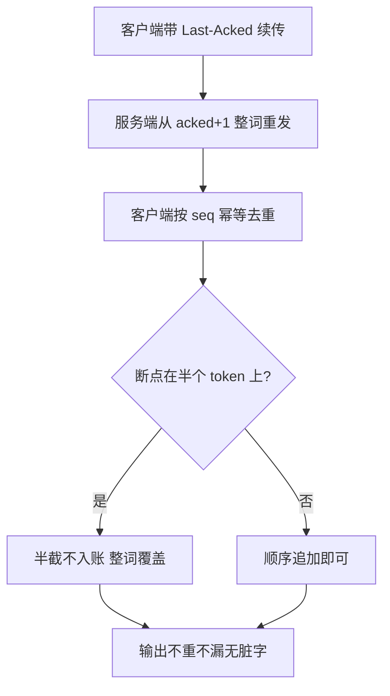

```python
# file: code/06_Agent与LLM及系统设计/q2592_stream_resume.py
"""Q2592 流式断点续传的语义:幂等去重与半截词的分叉处理。

续传必须定义两件事:重复事件怎么去重(客户端按 seq 幂等,
at-least-once 多发无害),断在半个 token 上怎么续(半截不入账,
服务端从词边界整词重发,客户端覆盖而不是拼接,不出脏字)。
"""

def server_stream(tokens, last_acked):
    """服务端从 last_acked+1 起重放,at-least-once,可能多给。"""
    return [(i, t) for i, t in enumerate(tokens) if i > last_acked]


def client_assemble(events, known):
    """客户端按 seq 幂等去重,只认没见过的序号。"""
    parts = []
    for seq, tok in sorted(events):
        if seq in known:
            continue
        known.add(seq)
        parts.append(tok)
    return "".join(parts)


def main():
    tokens = ["你好", ",", "世界", "!", "再见"]
    known = set()
    acked = 1                       # 客户端已确认 0、1 两个事件
    dup = server_stream(tokens, acked) * 2   # 网络层重发一份
    text = client_assemble(dup, known)
    assert text == "世界!再见", text  # 去重后不重不漏
    # 断在 再见 的半个词上:半截 不 入账,整词重发覆盖
    half = "再"
    replay = server_stream(tokens, acked)   # 服务端从边界整词重发
    text2 = client_assemble(replay, set())
    assert text2 == "世界!再见"
    assert half + "见" == "再见" and half not in text2.replace("再见", "")
    print("重复事件去重重组:", text)
    print("词边界续传:", text2, "| 半截", repr(half), "被整词覆盖,不拼接出脏字")


if __name__ == "__main__":
    main()
```

**追问**:
- 追问一:半截内容服务端要保存吗?答:不要,服务端按整词边界重放即可,半截是客户端本地显示态,保存它只会引入一致性问题。
- 追问二:seq 从哪里保证单调?答:服务端生成事件时分配,重启后从持久化位点续号,跨重启单调是契约的一部分。

### Q2593 · 多租户 fair-share 调度:按权重分蛋糕闲者让位

> 难度:★★★★ | 标签:LLM 运维, 调度, 多租户

**问**:三个租户共享一池推理容量,怎么保证谁都吃不亏、闲的不浪费?

**答**:加权令牌轮转是 fair-share 的最小实现:每轮按权重给租户发令牌,有需求才消费,余量自然流转。三个性质要在实现里逐个验证:吃得饱——总供给大于等于总需求时人人满足;争抢收敛——需求远超供给时,份额收敛到权重比,本例 2 比 1 的权重分出 60 比 30;闲置让位——零需求的租户令牌被活跃方白拿,这是 fair-share 区别于硬限流的特征,硬限流下闲置就是浪费。它保证长期公平而不是瞬时公平,短窗口内租户可能拿到偏离权重的份额,这是特性不是缺陷,突发因此成为可能。要补的工程件是观测:每租户的应得份额与实得份额分开统计,偏差即不公指标,进容量周报。

```python
# file: code/06_Agent与LLM及系统设计/q2593_fair_share.py
"""Q2593 多租户 fair-share 调度:按权重分蛋糕,闲者让位。

加权令牌轮转:每轮给租户发 w 个令牌,有需求才消费,余量
自然流转;争抢时份额收敛到权重比,空闲租户的份额被活跃方
白拿,这是 fair-share 区别于硬限流的特征。
"""


def schedule(weights, demand, rounds):
    tokens = {t: 0 for t in weights}
    served = {t: 0 for t in weights}
    for _ in range(rounds):
        for t, w in weights.items():
            tokens[t] += w
        for t in weights:
            if demand[t] > served[t]:
                use = min(tokens[t], demand[t] - served[t])
                tokens[t] -= use
                served[t] += use
    return served


def main():
    r = schedule({"A": 2, "B": 1}, {"A": 40, "B": 20}, 40)   # 供给 120 = 需求
    assert r == {"A": 40, "B": 20}, r
    r2 = schedule({"A": 2, "B": 1}, {"A": 100, "B": 100}, 30)  # 供给 90 全争抢
    assert r2 == {"A": 60, "B": 30}, r2
    r3 = schedule({"A": 2, "B": 1}, {"A": 100, "B": 0}, 10)
    assert r3 == {"A": 20, "B": 0}, r3
    print("吃得饱:", r, "需求全满足")
    print("争抢:", r2, "A:B = 2:1 收敛到权重比")
    print("B 闲置:", r3, "A 白拿 B 的份额")


if __name__ == "__main__":
    main()
```

**追问**:
- 追问一:权重怎么定?答:按 SLA 等级与付费档位定,再按不公指标回校,权重是治理决策不是技术参数。
- 追问二:有租户恶意憋大招怎么办?答:令牌封顶加突发审计,长期闲置突然爆量的行为触发人工审查。

### Q2594 · fair-share 的借还机制:闲时攒券忙时爆量封顶

> 难度:★★★☆ | 标签:LLM 运维, 调度, 多租户

**问**:纯 fair-share 对突发流量不友好,怎么给突发开一扇受控的门?

**答**:信用券机制:租户闲置期每轮攒一张券,突发期一次性消耗,相当于向未来的自己借容量;封顶限制最大借用量,本例攒满 6 张,突发 8 个也只能放 6 个,剩下按每轮一张的节奏排队补给。封顶的价值是防两件事:防长期闲置者瞬间打满全场伤害他人,防攒券机制被当成免费的大额突进通道。对照实验能看清封顶的作用:无封顶时十轮闲置攒十张,突发全放还剩余量可继续透支;封顶 6 时同样的闲置只攒到 6,突发被压平。券的语义要明确:借的是自己的份额,不是公共池,所以不产生跨租户债务。参数就两个——积累速率与上限,都按租户档位配置,治理路径与限流阈值同构。

```python
# file: code/06_Agent与LLM及系统设计/q2594_credit_borrow.py
"""Q2594 fair-share 的借还机制:闲时攒券,忙时爆量,封顶防抖。

纯 fair-share 对突发不友好;给租户发可积累的信用券,闲置期
攒券、突发期一次性消耗,封顶限制最大借用量,防长期闲置者
瞬间打满全场,防抖且可解释。
"""


def simulate(demand, cap, regen=1):
    credit = 0
    timeline = []
    served_total = 0
    for r, want in enumerate(demand):
        credit = min(cap, credit + regen)   # 闲置攒券,封顶
        use = min(want, credit)
        credit -= use
        served_total += use
        timeline.append((r, want, use, credit))
    return timeline, served_total


def main():
    demand = [0] * 10 + [8] + [0] * 3
    timeline, total = simulate(demand, cap=6)
    assert timeline[9] == (9, 0, 0, 6), timeline[9]     # 攒券封顶在 6
    assert timeline[10] == (10, 8, 6, 0), timeline[10]  # 突发 8 只放 6
    assert total == 6
    uncapped, total2 = simulate(demand, cap=100)
    assert uncapped[9] == (9, 0, 0, 10), uncapped[9]    # 无封顶攒到 10
    assert uncapped[10] == (10, 8, 8, 3), uncapped[10]  # 突发 8 全放,余 3 券
    print("时间线 轮 需求 放行 余券(封顶 6):")
    for row in timeline[8:11]:
        print("  ", row)
    print("封顶:突发只放 6;无封顶对照:一次放 8,余券 2 还能继续透支")


if __name__ == "__main__":
    main()
```

**追问**:
- 追问一:券要不要过期?答:要,设衰减或有效期,否则租户囤券跨月突进,与封顶的初衷相悖。
- 追问二:突发被压掉的请求去哪?答:进本租户的排队队列按券节奏消化,或转降级档处理,别静默丢弃。

### Q2595 · 成本告警的分位数基线:历史同时段 P95 动态阈值

> 难度:★★★☆ | 标签:LLM 运维, 成本, 告警

**问**:成本告警用固定阈值,白天误报晚上漏报,怎么改?

**答**:把基线做成时间感知的:每个小时取历史同时段(如过去两周的同小时)的 P95 当基线,当前值超过基线乘系数才告警。业务高峰的基线天然高,夜间低谷的基线天然低,同一套系数全时段适用,误报漏报同时下降。P95 而不是 max 或均值:均值被历史异常拉高,max 对抖动过敏,P95 代表"正常偏贵"的上沿,是告警的天然参照。冷却窗口防连环轰炸:同一时段一次告警后两小时内静默,人工还没看完,机器别刷屏。基线数据要干净:历史里的已知事故时段剔除,否则事故基线会把真异常洗白。上线后用历史事故回放验证:回放当天该报的报了、平静天零误报,才算标定完成。

```python
# file: code/06_Agent与LLM及系统设计/q2595_cost_baseline.py
"""Q2595 成本告警的分位数基线:用历史同时段的 P95 做动态阈值。

固定阈值白天误报晚上漏报;按小时取历史同时段的 P95 当动态基线,
当前值超基线乘系数才告警,并带冷却窗口防连环轰炸。
业务高峰的基线天然高,夜间低谷的基线天然低。
"""
import random


def p95(xs):
    xs = sorted(xs)
    idx = min(len(xs) - 1, int(0.95 * (len(xs) - 1) + 0.5))
    return xs[idx]


def build_history(days=14, seed=7):
    rng = random.Random(seed)
    hist = {}
    for h in range(24):
        hist[h] = [50 + rng.randint(-5, 5) + (10 if 9 <= h <= 18 else 0)
                   for _ in range(days)]
    return hist


def detect(today, hist, factor=1.5, cooldown=2):
    alerts = []
    cool_until = -1
    for h, cost in enumerate(today):
        base = p95(hist[h])
        if cost > base * factor and h > cool_until:
            alerts.append((h, cost, base))
            cool_until = h + cooldown
    return alerts


def main():
    hist = build_history()
    rng = random.Random(99)
    normal_day = [55 + rng.randint(-4, 6) + (8 if 9 <= h <= 18 else 0) for h in range(24)]
    incident = list(normal_day)
    incident[14] = 200
    incident[15] = 190
    a1 = detect(normal_day, hist)
    a2 = detect(incident, hist)
    assert a1 == [], a1
    hits = [a[0] for a in a2]
    assert 14 in hits, a2
    assert 15 not in hits, a2          # 冷却窗口内不重复报
    assert p95(hist[14]) >= p95(hist[3])  # 白天基线高于凌晨
    print("正常日告警:", a1)
    print("异常日告警:", a2, "← 15 点在冷却窗口内被抑制")
    print("基线示例 14 点 P95:", p95(hist[14]), "凌晨 3 点 P95:", p95(hist[3]))


if __name__ == "__main__":
    main()
```

**追问**:
- 追问一:为什么按小时不用按工作日?答:先按小时,工作日周末形态不同再叠加星期因子,分桶粒度以每桶样本量够算 P95 为底线。
- 追问二:系数怎么定?答:1.5 起步,按历史回放的漏报误报平衡点调,系数变化要留记录。

### Q2596 · 红黑名单的灰度过滤:影子观察达标再转正

> 难度:★★★☆ | 标签:LLM 运维, 合规, 灰度

**问**:新过滤规则上线就误伤,回滚又慢,怎么让过滤器的发布有台阶?

**答**:影子模式:新规则只记录 would-block,不真拦,线上行为完全不变;影子数据与标注样本对齐后算两个数——命中率与误伤率,误伤率超红线就不转正,回炉修规则。转正决策是数据闸不是人情闸:误伤率阈值事先约定,达标自动转正,不达标自动续影。影子的副作用要管理:观察期用户实际暴露在坏内容里,所以观察期要短,高危类别可以影子与强制并行——影子只评新规则,强制继续跑旧规则。本例的演示也说明为什么必须影子:三条命中里有一条误伤("枪械历史课"),误伤率三分之一,直接上线就是一天三起投诉。规则迭代频繁的系统,影子转正应该做成流水线,规则从产生到生效全程无手工环节。

```python
# file: code/06_Agent与LLM及系统设计/q2596_shadow_filter.py
"""Q2596 红黑名单的灰度过滤:先影子观察,误伤达标再转正。

新过滤规则直接 enforce 误伤没法撤;先跑 observe 模式只记录
would-block 不真拦,用标注样本算误伤率,达标才转正,不达标
回炉修规则——灰度让过滤器的上线和下线都有台阶。
"""
import random

RULE_BAD = ["赌", "枪"]
SAMPLES = [("正常咨询", "ok"), ("赌博推广", "bad"), ("买枪支", "bad"),
           ("正常复诊", "ok"), ("枪械历史课", "ok")]  # 最后一例规则误伤


def rule_hit(text):
    return any(w in text for w in RULE_BAD)


def run(mode):
    stats = {"blocked": 0, "passed": 0, "would_block": 0, "fp_if_enforced": 0}
    for text, label in SAMPLES:
        hit = rule_hit(text)
        if hit:
            if mode == "enforce":
                stats["blocked"] += 1
            else:
                stats["would_block"] += 1
            if label == "ok":
                stats["fp_if_enforced"] += 1
        else:
            stats["passed"] += 1
    return stats


def promote(shadow, allow_fp):
    fp_rate = shadow["fp_if_enforced"] / max(shadow["would_block"], 1)
    return fp_rate <= allow_fp


def main():
    shadow = run("observe")
    enforce = run("enforce")
    assert shadow["would_block"] == 3 and shadow["blocked"] == 0, shadow
    assert enforce["blocked"] == 3 and shadow["fp_if_enforced"] == 1
    assert promote(shadow, allow_fp=0.2) is False   # 误伤 1/3 超标
    assert promote(shadow, allow_fp=0.5) is True
    print("影子模式:", shadow, "← 一条都没真拦")
    print("误伤率:", shadow["fp_if_enforced"], "/", shadow["would_block"],
          "超 20% 红线 → 不转正,先修规则")


if __name__ == "__main__":
    main()
```

**追问**:
- 追问一:影子期怎么算误伤?答:需要标注或强判定源,实务上用人工抽检加用户申诉回流双通道积累真值。
- 追问二:转正后发现误伤怎么退?答:规则带版本,回滚到上一版规则秒级生效,影子机制同样用于验证回滚版本。

### Q2597 · 基于 CAS 的分布式互斥:谁能改锁由 CAS 说了算

> 难度:★★★★ | 标签:分布式, 锁, 一致性

**问**:不用现成的锁服务,一条原子的比较交换能撑起分布式互斥吗?

**答**:能,而且这条语义就是一切锁服务的内核:加锁是 cas 空为自身,释放是 cas 自身为空。它自动解决三个经典问题:互斥——同一时刻只有一个 cas 能成功;防误删——释放带旧值比对,B 冒名释放时旧值对不上必然失败;防接管后误释放——旧主迟到释放时锁值已是新主的,比对失败,新主无感。模拟里必须把 cas 写成单点原子操作,真实系统里对应 Redis 的 Lua、etcd 的事务、ZooKeeper 的版本号。CAS 互斥的短板在持有者崩溃:没人释放锁就死锁,这要靠下一题的 TTL 加 fencing 补齐。面试时能徒手写出这三个失败场景的推演,比背十种锁的实现更能证明理解。

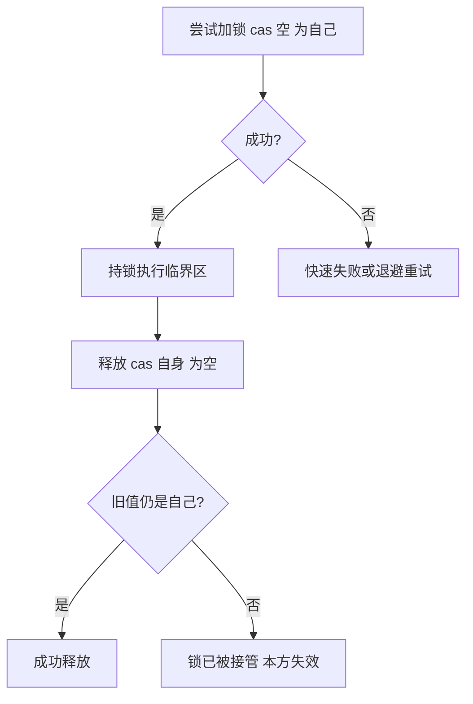

```python
# file: code/06_Agent与LLM及系统设计/q2597_cas_mutex.py
"""Q2597 基于比较交换的分布式互斥:谁能改锁由 CAS 说了算。

分布式锁的本质是一条原子 CAS 语义:加锁 cas(空, 自己),释放
cas(自己, 空);释放带着自己的旧值比对,冒名者对不上旧值必然
失败——过期锁被别人接管后,旧主的迟到释放也伤不到新主。
"""


class Store:
    def __init__(self):
        self.kv = {}

    def cas(self, key, expect, new):
        """模拟原子的 compare-and-swap:当前值等于 expect 才写入。"""
        if self.kv.get(key) == expect:
            self.kv[key] = new
            return True
        return False


def acquire(store, owner, key="lock"):
    return owner + "#1" if store.cas(key, None, owner + "#1") else None


def release(store, owner, key="lock"):
    return store.cas(key, owner + "#1", None)


def main():
    s = Store()
    t1 = acquire(s, "A")
    assert t1 == "A#1" and s.kv["lock"] == "A#1"
    assert acquire(s, "B") is None        # B 抢不到
    assert release(s, "B") is False       # B 冒名释放被 CAS 拒绝
    assert s.kv["lock"] == "A#1", s.kv
    assert release(s, "A") is True
    assert s.kv["lock"] is None
    t2 = acquire(s, "B")
    assert t2 == "B#1" and release(s, "B") is True
    print("A 持锁,B 抢锁与冒名释放均失败")
    print("A 释放后 B 正常获取并释放:", t2)


if __name__ == "__main__":
    main()
```

**追问**:
- 追问一:锁值里放什么?答:持有者身份加过期时刻加 fencing 号,裸字符串锁在故障场景全是坑。
- 追问二:自旋重试还是快速失败?答:按调用语义,用户在线请求快速失败转降级,后台任务退避重试。

### Q2598 · CAS 互斥的容错:崩溃接管 TTL 与 fencing 挡旧主

> 难度:★★★☆ | 标签:分布式, 锁, 容错

**问**:持有者拿到锁就崩溃了,锁怎么解?它醒来后又写了一条数据怎么办?

**答**:两个机制接力:锁值带过期时刻,接管方的 cas 加上时间条件,过期即可强行接管,崩溃不释放也不会永久死锁;接管时 fencing 号单调递增,资源侧守卫只认不小于已知最大号的写入,旧主拿着过期号迟到提交会被当场拒绝。时序推演是关键:fencing 2 的旧主在 fencing 3 的新主接管后写入,守卫比对号大小直接拒收,这就是 fencing token 的全部意义——把"谁是当前合法持有者"从锁服务推到资源侧各点独立判定。TTL 的取值要覆盖持有者的最大合法执行时长加时钟误差,太短误接管、太长故障恢复慢。两个机制缺一不可:只有 TTL,旧主醒来还能写;只有 fencing,没人接管的死锁仍在。

```python
# file: code/06_Agent与LLM及系统设计/q2598_fencing.py
"""Q2598 CAS 互斥的容错:持有者崩溃后 TTL 到期可接管,fencing 挡旧主。

锁值带过期时刻,持有者崩溃不释放也能被接管;接管时 fencing 号
单调递增,资源侧守卫只认不小于签发时的最大 fencing 号,旧主
拿着过期号迟到写入会被当场拒绝。
"""


class LockStore:
    def __init__(self):
        self.holder = None
        self.expires = 0.0
        self.fencing = 0

    def cas_acquire(self, owner, now, ttl):
        if self.holder is not None and now < self.expires:
            return None
        self.fencing += 1
        self.holder = owner
        self.expires = now + ttl
        return self.fencing

    def cas_release(self, owner, now):
        if self.holder == owner and now < self.expires:
            self.holder = None
            return True
        return False


def guarded_write(current_fencing, fencing, log):
    if fencing >= current_fencing:
        log.append("write-ok:" + str(fencing))
        return True
    log.append("write-rejected-stale:" + str(fencing))
    return False


def main():
    s = LockStore()
    f1 = s.cas_acquire("A", now=0.0, ttl=5.0)
    assert f1 == 1
    assert s.cas_acquire("B", now=3.0, ttl=5.0) is None   # 未过期拿不到
    assert s.cas_release("B", now=3.0) is False           # 非持有人不能释放
    assert s.cas_release("A", now=3.0) is True
    f2 = s.cas_acquire("A", now=4.0, ttl=5.0)             # A 拿到锁后崩溃
    assert f2 == 2
    log = []
    guarded_write(f2, f2, log)                            # A 用 fencing=2 写
    f3 = s.cas_acquire("B", now=10.0, ttl=5.0)            # TTL 已过,B 接管
    assert f3 == 3
    guarded_write(f3, f2, log)                            # 旧主迟到写被拒
    guarded_write(f3, f3, log)
    assert log == ["write-ok:2", "write-rejected-stale:2", "write-ok:3"], log
    print("接管后 fencing 单调递增:", f2, "->", f3)
    print("资源侧守卫:", log[1], "← 崩溃旧主的迟到写被挡")


if __name__ == "__main__":
    main()
```

**追问**:
- 追问一:fencing 号谁发?答:锁服务在授予时发,全局单调,资源侧只需比较大小,不需要全局时钟。
- 追问二:资源不支持守卫怎么办?答:典型如某些存储没有条件写,把 fencing 校验做在写入代理层,所有写经代理转发。

### Q2599 · 租约下的读本地化:租约期内副本自己答

> 难度:★★★★ | 标签:分布式, 租约, 读路径

**问**:强一致读都要走主库,副本读又怕读到旧数据,有没有两全?

**答**:读租约是两全的钥匙:主给副本签发有时限的租约,并承诺租约期内不单方面改数据,副本在租约期内用本地数据应答读请求,一致性由主的承诺背书,读路径零跨网络。租约到期或主发生写入,租约立即失效,副本下次读被迫回主续租并同步新值,续租动作顺带完成了确认没有新写入的校验。实测账本能说明价值:本例租约 10 秒,三次读只有一次回主,本地命中两次,主的 RPC 压力与租约时长成反比。租约时长是权衡旋钮:长则本地命中高但故障切换慢,写时租约失效又保证了写后读的一致性。这套机制的隐藏前提是时钟安全,主的承诺依赖它对租约时长的判断,时钟漂移要在租约里留余量。

```python
# file: code/06_Agent与LLM及系统设计/q2599_lease_read.py
"""Q2599 租约下的读本地化:租约有效期内副本自己答,不用问主。

主给副本签发读租约,租约期内副本可以放心用本地数据应答一致性
读——因为主承诺租约期内不单方面改数据;写入会使租约立即失效,
副本下次读被迫回主续租并同步新值。
"""


class Primary:
    def __init__(self):
        self.data = {"k": "v1"}
        self.lease_until = {}
        self.rpc = 0

    def grant(self, replica, now, ttl=10.0):
        self.rpc += 1
        self.lease_until[replica] = now + ttl
        return self.lease_until[replica]

    def write(self, key, value, now):
        self.data[key] = value
        for r in self.lease_until:      # 写使所有读租约立即失效
            self.lease_until[r] = now


class Replica:
    def __init__(self, name, primary):
        self.name = name
        self.primary = primary
        self.local = dict(primary.data)
        self.local_hits = 0

    def read(self, key, now):
        if now < self.primary.lease_until.get(self.name, 0):
            self.local_hits += 1
            return self.local[key], "local"
        self.primary.grant(self.name, now)   # 续租顺带确认没有新写入
        self.local[key] = self.primary.data[key]
        return self.local[key], "via-primary"


def main():
    p = Primary()
    r = Replica("r1", p)
    trace = []
    for t in (1.0, 2.0, 9.0):
        v, src = r.read("k", t)
        trace.append((t, v, src))
    assert trace[0][2] == "via-primary"
    assert trace[1][2] == "local" and trace[2][2] == "local"
    assert p.rpc == 1 and r.local_hits == 2   # 租约期内只有一次授权
    p.write("k", "v2", now=9.5)
    v, src = r.read("k", 9.7)
    assert v == "v2" and src == "via-primary"
    print("读路径:", trace)
    print("写后租约失效强制回主:", v, src, "| 主 RPC 次数:", p.rpc)


if __name__ == "__main__":
    main()
```

**追问**:
- 追问一:主挂了租约怎么办?答:新主上任后旧租约作废,副本凭 epoch 识别旧主签发的租约并拒绝使用。
- 追问二:本地读的数据要存什么版本?答:存续租时的快照版本号,响应里带出去,下游可以做版本对账。

### Q2600 · 读租约的批量续期:一次 RPC 续一串

> 难度:★★★☆ | 标签:分布式, 租约, 优化

**问**:一百个副本都拿租约,续期 RPC 把主库打爆了怎么办?

**答**:把临近到期的租约攒成一批,一次批量请求全部续掉:逐个续期两个到期副本要发两次 RPC,批量一次搞定,租约越多摊薄越狠,续期开销从按副本数线性降到每轮一次。触发条件是"余量低于阈值"而不是"已经到期",给网络抖动留缓冲;没到期的租约绝不碰,批次里只装真正需要的。语义与逐个续期严格等价:同一批副本、同样的新过期时刻,断言可验证。批量大小是旋钮:太大单次请求重、失败重试代价高,太小摊薄不足,常用几十到几百按往返时延定。失败处理要按批内粒度:整批失败整批重试,部分失败把失败项拆出下一批,不能让一个副本拖住整批。

```python
# file: code/06_Agent与LLM及系统设计/q2600_batch_renew.py
"""Q2600 读租约的批量续期:一次 RPC 续一串,摊薄心跳开销。

租约多、心跳勤,逐个续期的 RPC 量线性爆炸;把临近到期的租约
攒成一批发一次批量请求,一次往返覆盖一串副本,续期次数从 k
降到 1,语义与逐个续期完全等价。
"""


def renew_individually(leases, now, threshold, ttl):
    rpc = 0
    for name in leases:
        if leases[name] - now < threshold:
            rpc += 1
            leases[name] = now + ttl
    return rpc


def renew_batch(leases, now, threshold, ttl):
    due = sorted(n for n in leases if leases[n] - now < threshold)
    if not due:
        return 0, []
    for n in due:
        leases[n] = now + ttl
    return 1, due   # 一次批量调用覆盖所有到期者


def main():
    now = 100.0
    l1 = {"r1": 102.0, "r2": 103.0, "r3": 108.0, "r4": 120.0}
    l2 = dict(l1)
    c1 = renew_individually(l1, now, threshold=5.0, ttl=20.0)
    c2, due = renew_batch(l2, now, threshold=5.0, ttl=20.0)
    assert c1 == 2 and c2 == 1, (c1, c2)
    assert due == ["r1", "r2"], due
    assert l1 == l2, "批量与逐个结果等价"
    c3, due3 = renew_batch(l2, now + 10, threshold=5.0, ttl=20.0)
    assert c3 == 1 and due3 == ["r3"], (c3, due3)   # 上轮没续的 r3 到期被补续
    print("逐个续期 RPC:", c1, "| 批量续期 RPC:", c2, "→ 省", c1 - c2, "次")
    print("本次批量覆盖:", due, "| 下轮补续:", due3, "← 未到期的不碰")


if __name__ == "__main__":
    main()
```

**追问**:
- 追问一:批量请求本身丢了呢?答:租约只是回到未续状态,下轮重试,租约机制的自我修复性让批量续期天然幂等。
- 追问二:还能更省吗?答:续期与心跳、指标上报合并成同一条控制面消息,一次 RPC 干多件事。

### Q2601 · Gossip 推与拉的收敛实测:轮数逼近 log2 n

> 难度:★★★☆ | 标签:分布式, Gossip, 协议

**问**:Gossip 协议说几轮就收敛,推和拉有区别吗?实测说话。

**答**:固定种子跑三模式对比:推是感染者主动扩散,前期翻倍极快,但最后几个未感染者要靠运气被撞中,尾部收敛慢;拉是未感染者主动问,尾部反而快,因为它每轮都在出击;推拉结合双向开火,轮数最贴近理论下限 log2 n。本例 32 节点,理论下限 5 轮,推拉模式固定种子下优于单推单拉。Gossip 的工程价值在无中心成员管理、故障传播、配置分发,代价是消息冗余:全员感染前的消息数远大于节点数,推模式尤甚。参数就一个——每轮选几个邻居,扇出加一轮收敛快但总消息涨,按集群规模和容忍时延定。实测必须固定随机种子,否则每次数字不同,演示变成玄学。

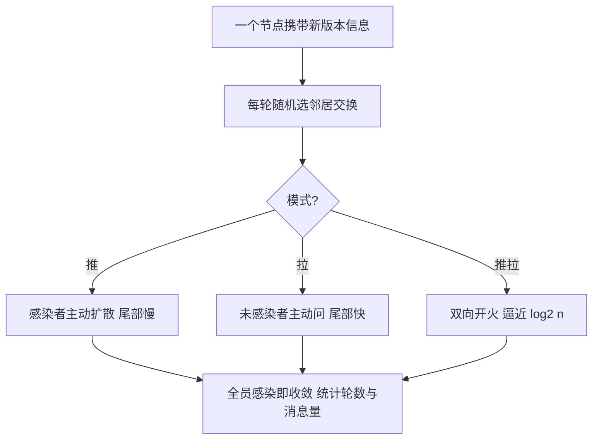

```python
# file: code/06_Agent与LLM及系统设计/q2601_gossip_sim.py
"""Q2601 Gossip 推与拉的收敛实测:固定种子下比较轮数与消息量。

推模式传播快但尾部慢:最后几个未感染节点要靠运气撞上;
拉模式让未感染者主动出击,尾部收敛更快;推拉结合双向开火,
轮数逼近理论下限 log2 n。固定种子可复现。
"""
import math
import random


def simulate(n, mode, seed, rounds_cap=60):
    rng = random.Random(seed)
    informed = [False] * n
    informed[0] = True
    msgs = 0
    for r in range(rounds_cap):
        new = list(informed)
        for i in range(n):
            peer = rng.randrange(n)
            if peer == i:
                continue
            if mode == "push" and informed[i] and not informed[peer]:
                msgs += 1
                new[peer] = True
            elif mode == "pull" and informed[peer] and not informed[i]:
                msgs += 1
                new[i] = True
            elif mode == "push-pull" and informed[i] != informed[peer]:
                msgs += 1
                new[i] = new[peer] = True
        informed = new
        if all(informed):
            return r + 1, msgs
    return None, msgs


def main():
    n = 32
    results = {}
    for mode in ("push", "pull", "push-pull"):
        rounds, msgs = simulate(n, mode, seed=42)
        assert rounds is not None, mode + " 未收敛"
        results[mode] = (rounds, msgs)
    assert results["push-pull"][0] <= results["push"][0], results
    assert results["push-pull"][0] <= results["pull"][0], results
    print("n =", n, "理论下限 log2 n =", math.ceil(math.log2(n)))
    for mode, (r, m) in sorted(results.items(), key=lambda kv: kv[1][0]):
        print(mode, "收敛轮数:", r, "成功传播消息数:", m)


if __name__ == "__main__":
    main()
```

**追问**:
- 追问一:信息会永远传下去吗?答:会,所以要带版本或 TTL,收到已知版本的传播直接丢弃,否则消息量不收敛。
- 追问二:节点中途加入怎么办?答:新节点先拉一轮全量,再进入 gossip 循环,纯推协议对新成员不友好。

### Q2602 · 重试风暴的抖动实测:同刻重试削峰过半

> 难度:★★☆☆ | 标签:分布式, 重试, 抖动

**问**:服务恢复瞬间被自己人的重试打死,怎么办?加抖动真有用吗?

**答**:故障恢复瞬间,所有客户端的重试定时器几乎同时到期——它们是同一时刻开始退避的,同步重试形成二次风暴,恢复期最脆弱的服务吃下最大的一拳。抖动的机制是把每家的重试时刻加一段随机偏移,同刻的尖峰被摊开到整个退避区间:本例 100 个客户端,无抖动第 0 拍 100 个同时到站,加 0 到 9 拍抖动后单拍峰值降到个位数,削峰六成以上。抖动要加在退避基数上而不是替代退避:指数退避加全抖动是标配,关键场景用去关联抖动更平滑。服务端也要配合:恢复初期用准入控制限流,别指望客户端全都有教养。实测的价值在于给出数字:削峰比例是抖动参数选型的依据,不是感觉。

```python
# file: code/06_Agent与LLM及系统设计/q2602_retry_jitter.py
"""Q2602 重试风暴的抖动实测:同刻重试压垮恢复期服务。

服务恢复瞬间,所有客户端的重试定时器同时到期,请求同刻砸下来
形成二次风暴;给每客户端的退避加随机抖动,把同一时刻的重试摊开
到一段时间上,单拍峰值大幅下降。
"""
import random
from collections import Counter


def arrivals(clients, jitter, seed):
    rng = random.Random(seed)
    ticks = Counter()
    for _ in range(clients):
        d = rng.randint(0, jitter) if jitter else 0
        ticks[d] += 1
    return ticks


def main():
    n = 100
    burst = arrivals(n, jitter=0, seed=1)
    smoothed = arrivals(n, jitter=9, seed=1)
    peak_burst = max(burst.values())
    peak_smooth = max(smoothed.values())
    assert peak_burst == n, peak_burst        # 全部同刻到站
    assert peak_smooth < peak_burst, peak_smooth
    reduction = round(100 * (1 - peak_smooth / peak_burst))
    assert reduction >= 60, reduction
    print("无抖动:第 0 拍同时到站", peak_burst, "个 ← 二次风暴")
    print("加 0-9 拍抖动:单拍峰值", peak_smooth, "个 ← 削峰", reduction, "%")
    print("各拍分布:", dict(sorted(smoothed.items())))


if __name__ == "__main__":
    main()
```

**追问**:
- 追问一:抖动范围怎么选?答:与退避上限同量级,范围太小摊不开,太大额外拉高尾时延,按 SLA 的尾时延预算反推。
- 追问二:客户端时钟不同会自动错峰吗?答:会,但不能依赖,时钟同源的机房集群里同步风暴照样发生。

### Q2603 · 副本选择的路由表:本地优先权重次之健康否决

> 难度:★★★☆ | 标签:分布式, 路由, 副本

**问**:流量打到哪个副本,决策要过哪几道闸?

**答**:路由决策是三层过滤:健康一票否决——不健康的副本不参与任何比较,这是硬闸;本地优先——同区副本优先,跨区意味着时延和带宽成本,本区没有活副本才跨区兜底;权重决胜——同区活副本里挑权重最高的做确定性主选。流量分配与主选解耦:确定性选主用于长连接、有状态会话,加权随机用于无状态流量摊平,本例权重 5 比 3 在千次采样里收敛到约六成四成。路由表是配置不是代码,变更走审计与版本;摘除与恢复的触发交给下一题的滞回门。跨区兜底要显式暴露:兜底流量占比是容量规划信号,长期靠兜底说明容量部署失衡。

```python
# file: code/06_Agent与LLM及系统设计/q2603_replica_router.py
"""Q2603 副本选择的路由表:本地优先,权重次之,健康一票否决。

路由表四个字段定一次选择:健康一票否决,同区里挑权重最高的,
本区没有才跨区兜底;流量分配另用加权随机,与确定性选主解耦。
"""
import random
from collections import Counter

TABLE = [
    {"name": "sh-1", "region": "sh", "weight": 5, "healthy": True},
    {"name": "sh-2", "region": "sh", "weight": 3, "healthy": True},
    {"name": "bj-1", "region": "bj", "weight": 9, "healthy": True},
]


def alive_pool(table, region):
    alive = [r for r in table if r["healthy"]]
    if not alive:
        return []
    local = [r for r in alive if r["region"] == region]
    return local or alive


def pick(table, region):
    pool = alive_pool(table, region)
    return max(pool, key=lambda r: r["weight"]) if pool else None


def pick_weighted(table, region, rng):
    pool = alive_pool(table, region)
    if not pool:
        return None
    total = sum(r["weight"] for r in pool)
    x = rng.random() * total
    acc = 0.0
    for r in pool:
        acc += r["weight"]
        if x <= acc:
            return r
    return pool[-1]


def main():
    assert pick(TABLE, "sh")["name"] == "sh-1"   # 本地最高权重
    assert pick(TABLE, "gz")["name"] == "bj-1"   # 无本地,跨区兜底
    TABLE[0]["healthy"] = False
    assert pick(TABLE, "sh")["name"] == "sh-2"
    TABLE[1]["healthy"] = False
    assert pick(TABLE, "sh")["name"] == "bj-1"   # 全城不健康,跨区
    TABLE[0]["healthy"] = TABLE[1]["healthy"] = True
    rng = random.Random(11)
    c = Counter(pick_weighted(TABLE, "sh", rng)["name"] for _ in range(1000))
    assert c["sh-1"] + c["sh-2"] == 1000
    assert 580 < c["sh-1"] < 680, c              # 权重 5:3 → 约 62.5%
    print("确定性选路:本地优先跨区兜底")
    print("千次加权随机分布:", dict(c), "≈ 权重 5:3")


if __name__ == "__main__":
    main()
```

**追问**:
- 追问一:区怎么定义?答:按物理故障域,机房或可用区,不要按逻辑部门划分,路由表治理的是物理拓扑。
- 追问二:健康状态谁维护?答:主动探活加业务侧上报双源,路由器只消费结论不自己发探测,职责单一。

### Q2604 · 路由表更新的滞回:抖动副本不许反复进出

> 难度:★★★☆ | 标签:分布式, 路由, 稳定性

**问**:副本健康检查一好一坏地抖,路由表每秒进出一次,怎么稳住?

**答**:滞回门给摘除与恢复设不对称的门槛:连续 k 次失败才摘,连续 m 次成功才恢复,m 大于 k,坏得快、回得慢,偏向保守。对照实验最有说服力:每拍翻转的抖动副本,朴素门翻转 47 次,连接池和调用方跟着抽风;滞回门下抖动凑不够连击数,翻转 0 次,稳在表内。真坏的副本也不会被滞回包庇:连续失败凑够门槛照样摘除,恢复仍需连续成功,摘除与恢复各走各的计数器。参数 k 与 m 按探测频率折算时间窗,摘除窗口要短于用户可感知的故障时延。状态切换全留痕,进出各多少次是路由稳定性的核心指标,趋势恶化要查探测灵敏度。

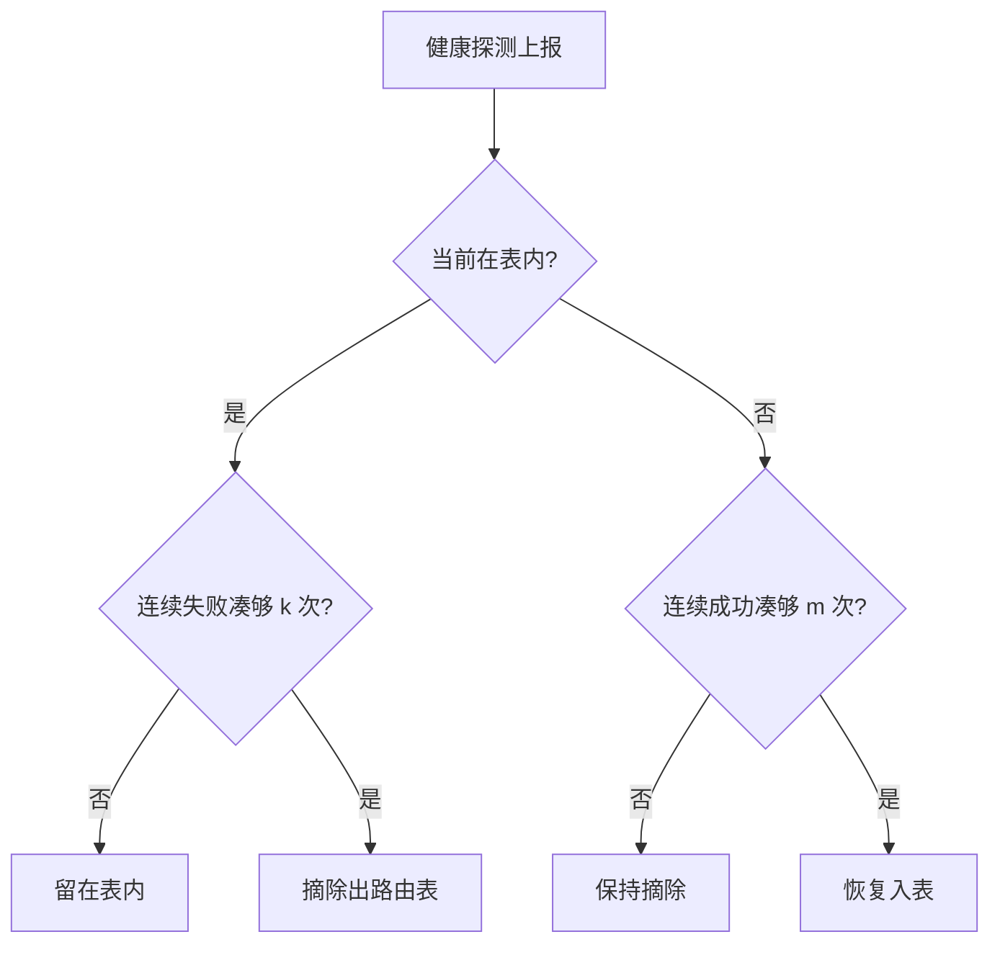

```python
# file: code/06_Agent与LLM及系统设计/q2604_hysteresis.py
"""Q2604 路由表更新的滞回:抖动副本不许反复进出。

健康抖动的副本若一 fail 就摘、一 ok 就回,路由表反复震荡,
连接池跟着抽风;滞回要求连续 k 次失败才摘除、连续 m 次成功
才恢复,抖动信号凑不够连击数,副本稳在表内。
"""


class HealthGate:
    def __init__(self, fail_to_remove, ok_to_restore):
        self.f2r = fail_to_remove
        self.o2s = ok_to_restore
        self.in_table = True
        self.fails = 0
        self.oks = 0
        self.flips = 0

    def report(self, healthy):
        if healthy:
            self.fails = 0
            self.oks += 1
            if not self.in_table and self.oks >= self.o2s:
                self.in_table = True
                self.flips += 1
        else:
            self.oks = 0
            self.fails += 1
            if self.in_table and self.fails >= self.f2r:
                self.in_table = False
                self.flips += 1


def main():
    flappy = [True, False] * 24              # 每拍翻转的抖动副本
    naive = HealthGate(1, 1)
    hyst = HealthGate(2, 3)
    for h in flappy:
        naive.report(h)
        hyst.report(h)
    assert naive.flips == 47, naive.flips    # 首拍免翻转,此后每拍一翻
    assert hyst.flips == 0 and hyst.in_table, (hyst.flips, hyst.in_table)
    bad = HealthGate(2, 3)
    bad.report(False)
    assert bad.in_table is True                # 单次失败不动
    bad.report(False)
    assert bad.in_table is False and bad.flips == 1   # 连续 2 失败才摘
    bad.report(True)
    assert bad.in_table is False               # 单次成功不回
    for _ in range(2):
        bad.report(True)
    assert bad.in_table is True and bad.flips == 2    # 连续 3 成功才恢复
    print("抖动副本:朴素门翻转", naive.flips, "次 vs 滞回门", hyst.flips, "次")
    print("真坏副本:摘除后恢复也需连击,状态切换共", bad.flips, "次")


if __name__ == "__main__":
    main()
```

**追问**:
- 追问一:滞回会不会让真坏副本多活一会儿?答:会,这是用秒级延迟换掉分钟级震荡,止损窗口内还有重试与超时兜底。
- 追问二:探测本身抖怎么办?答:多探测源投票再加滞回,两层平滑,单源抖动到不了路由表。

### Q2605 · 配额结算的对账:流水结算差值可定位

> 难度:★★★☆ | 标签:分布式, 配额, 对账

**问**:用量流水和结算单对不上,怎么把"差多少"变成"谁差多少、差在哪"?

**答**:对账是三方口径的算术:用量流水按租户累加,结算单按租户累加,结算单先按单号去重——重复推送是结算系统的常态,不去重就把重复当成真实消费。差值逐租户算,非零即差异,输出"t1 少结 50"这样可执行的定位,而不是一句总额不平。两类经典差异各有指纹:流水漏单表现为某租户单边缺失,重复结算表现为单号重复加数值漂移,对账报告按指纹分类,修复动作直接挂到分类上。容差按数据性质分:数值配额类零容差,差一个 token 都要追;跨天边界的流水归属另设窗口规则。对账频率按业务周期,日对账抓新鲜错误,月对账兜长尾,双层互不替代。

```python
# file: code/06_Agent与LLM及系统设计/q2605_quota_recon.py
"""Q2605 配额结算的对账:流水累加对不上结算单要能定位差异。

月末对账三方口径:用量流水按租户累加、结算单按租户累加,先按
结算单号去重再比差值;差值非零要能指出是哪个租户差多少,漏单
与重复单都能当场定位。
"""
from collections import defaultdict

LEDGER = [  # 用量流水: 租户, tokens, 事件号
    ("t1", 100, "e1"), ("t1", 250, "e2"), ("t2", 80, "e3"), ("t3", 40, "e4"),
]
SETTLE = [  # 结算单: 租户, tokens, 单号(t1 少结 50, s3 重复出现)
    ("t1", 300, "s1"), ("t2", 80, "s2"), ("t3", 40, "s3"), ("t3", 40, "s3"),
]


def reconcile(ledger, settle):
    usage = defaultdict(int)
    for t, tok, _ in ledger:
        usage[t] += tok
    billed = defaultdict(int)
    seen = set()
    dup = []
    for t, tok, sid in settle:
        if sid in seen:
            dup.append(sid)
            continue
        seen.add(sid)
        billed[t] += tok
    diffs = {}
    for t in sorted(set(usage) | set(billed)):
        d = billed[t] - usage.get(t, 0)
        if d != 0:
            diffs[t] = d
    return dict(usage), dict(billed), diffs, dup


def main():
    usage, billed, diffs, dup = reconcile(LEDGER, SETTLE)
    assert usage == {"t1": 350, "t2": 80, "t3": 40}, usage
    assert billed == {"t1": 300, "t2": 80, "t3": 40}, billed
    assert diffs == {"t1": -50}, diffs
    assert dup == ["s3"], dup
    ledger2 = [e for e in LEDGER if e[2] != "e3"]   # 流水丢一条
    _, _, diffs2, _ = reconcile(ledger2, SETTLE)
    assert diffs2 == {"t1": -50, "t2": 80}, diffs2
    print("用量:", usage)
    print("结算:", billed)
    print("差异:", diffs, "→ t1 少结 50 tokens 需补账")
    print("重复结算单:", dup, "已按单号去重")
    print("流水漏单场景差异:", diffs2, "→ t2 少记 80 可当场定位")


if __name__ == "__main__":
    main()
```

**追问**:
- 追问一:对账发现差异谁先修?答:按指纹分派:重复结算找结算方,漏单找采集方,先修增量再修存量。
- 追问二:流水本身会丢吗?答:会,采集端要用带确认的投递加序号断点,对账是兜底不是替代,采集可靠性是第一道闸。
