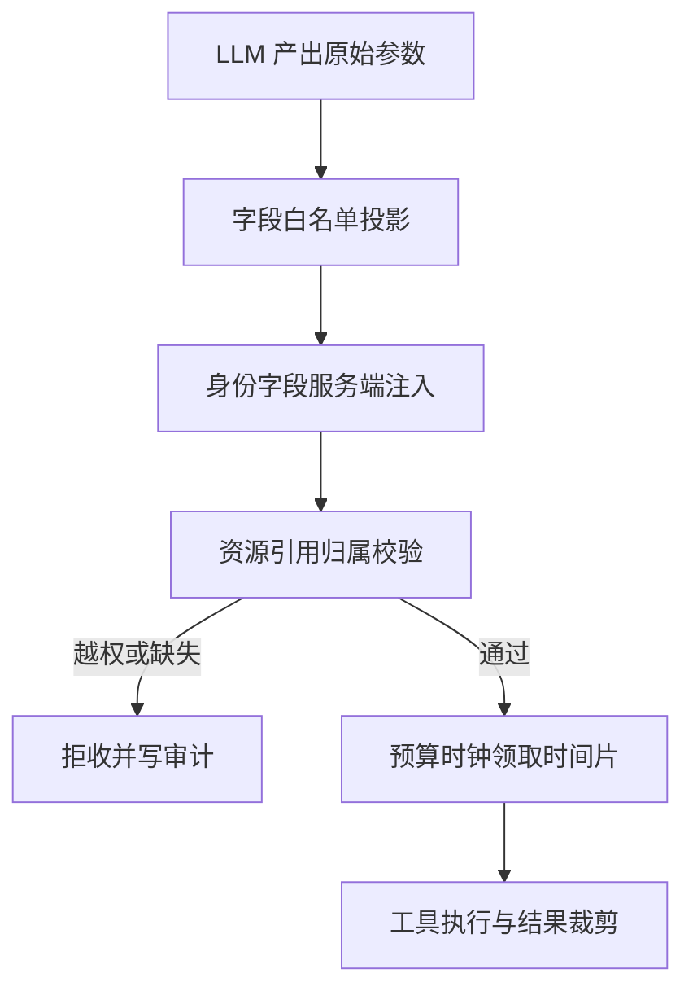
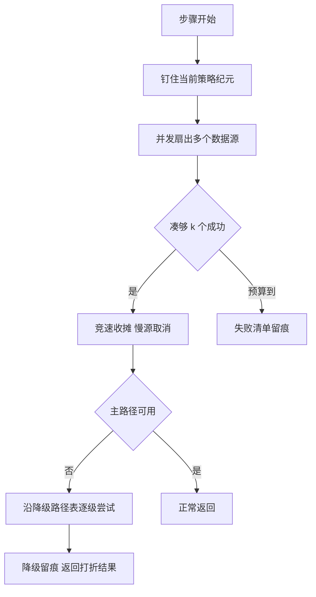
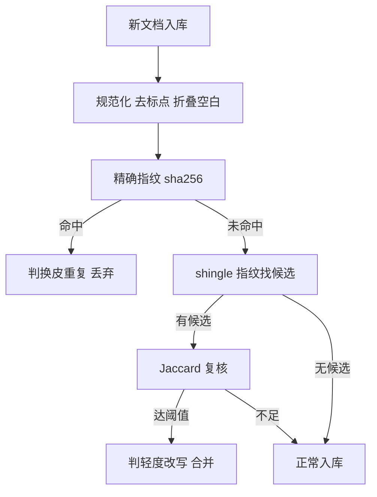
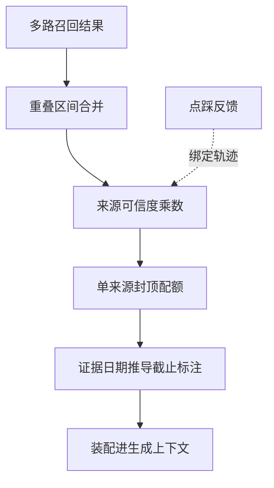
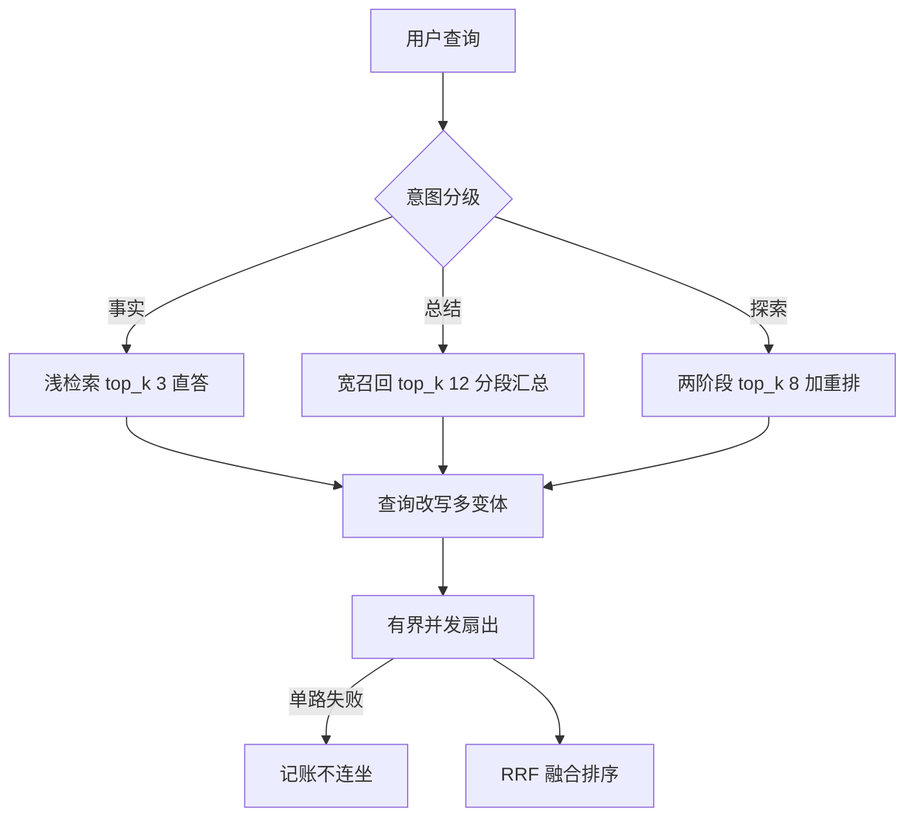
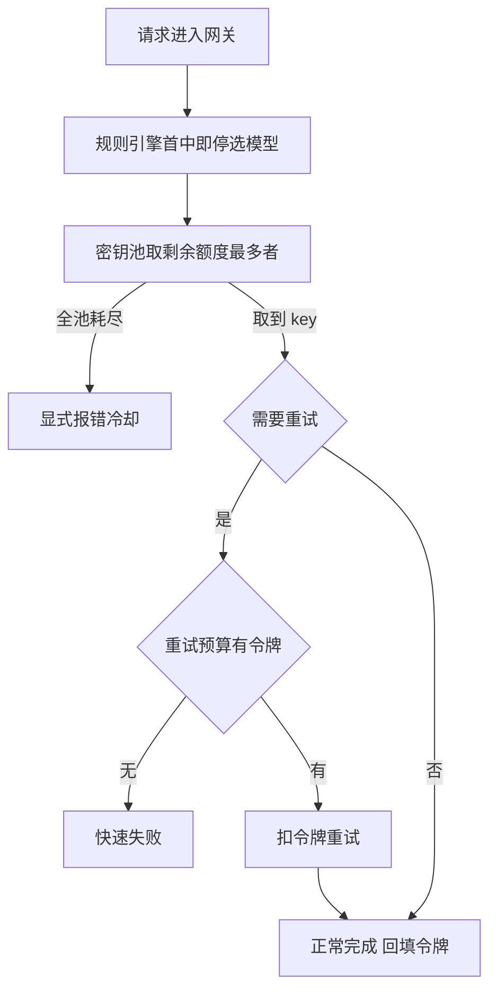
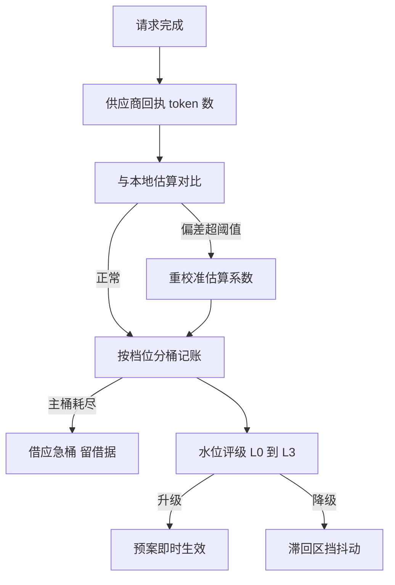
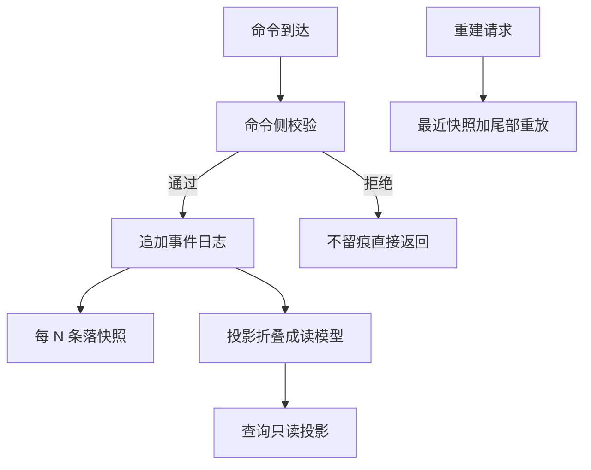
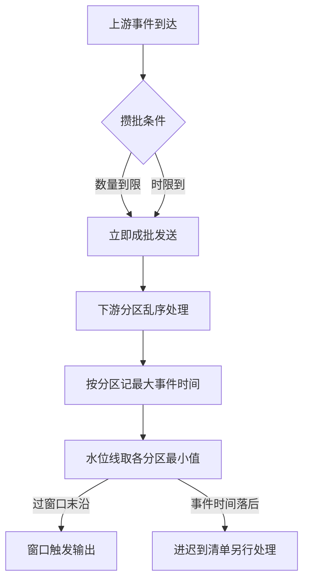

# 第 6 类 · Agent 与 LLM 及系统设计(夜间扩产六)

> 本篇是第 6 类的第六批夜间扩产(Q2831-Q2875 共 45 题),四条线补遗:Agent 侧的工具参数最小权限构造与资源级授权、步骤预算时钟与收尾模式、列表结果头尾采样、多轮对话指针重置语义、输出溯源信封、队列提交幂等、竞速聚合器、降级路径表、策略纪元热切换、跨 Agent 最小披露、入参规范化闸、按任务装配最小工具集与子 Agent 验收门;RAG 侧的语料规范化指纹闸、重叠块召回合并、检索深度收益曲线实测、多查询有界并发扇出、答案缓存新鲜度分层、来源可信度乘数、点踩归因绑定、双盲检索对比、重切块血缘映射、来源封顶、意图分级路由与数据截止标注;LLM 运维侧的键值双模式脱敏、配额分桶计费、排队透明化、路由规则引擎、虚拟时钟回放、压力分级预案、token 计量校准、重试预算、密钥池轮换、敏感级路由与请求指纹归一;分布式侧的事件溯源加快照、CQRS 投影、位图集合、双阈值攒批、存储层幂等合并等待、灰度回滚状态机、乱序水位线与过载采样降级。
> 全部代码仅标准库、可独立运行,LLM 一律用 stub 桩,向量检索用确定性假嵌入加余弦,时钟与随机全部注入,不联网不睡大觉,已在 Python 3.9 逐题实跑通过。
> 学习建议:每题先讲清「不做会出什么事故」,再讲机制与参数,最后落到可复现的断言——面试时能把边界条件和失效模式说全,比背名词值钱。

### Q2831 · 工具参数的最小权限构造:身份字段服务端注入

> 难度:★★★☆ | 标签:Agent, 工具治理, 安全

**问**:让 LLM 直接填工具的全部参数,最危险的是什么?你会怎么构造一份可信的工具入参?

**答**:把身份和业务参数混在一起让 LLM 填,等于让一个会幻觉的组件替你做鉴权:它可能编造 operator、顺手把 tenant_id 填成别家租户,这类越权在提示词层面拦不住。正确姿势是在 schema 里把字段分两类:llm_fillable 只放业务参数,server_injected 的身份字段永远从服务端安全上下文覆盖注入,LLM 试图填写身份字段直接判越权拒收。构造器是唯一入口,合并结果即最终参数,这样「谁有资格填什么」变成一份可审计的静态声明。顺带把未声明字段也拦下来,防止上游加字段时静默改变行为。这层闸很薄,却把越权问题从「事后审计」提前到「参数构造时」。

```python
# file: code/06_Agent与LLM及系统设计/q2831_min_privilege_args.py
"""Q2831 工具参数的最小权限构造:身份字段由服务端注入,LLM 只填业务字段。

LLM 不可信:它可能编造 operator、越权填 tenant_id。参数构造器按 schema
把字段分成 llm_fillable 与 server_injected 两类,身份字段永远以服务端
安全上下文为准,LLM 多填的身份字段直接判越权,未声明字段也要拦。
"""

TOOL_SCHEMA = {
    "tool": "pay.refund",
    "llm_fillable": ["order_id", "amount"],
    "server_injected": ["tenant_id", "operator"],
}


def build_args(llm_args, sec_ctx):
    """合并 LLM 参数与服务端安全上下文,返回最终参数与错误列表。"""
    errors = []
    args = {}
    for k in TOOL_SCHEMA["server_injected"]:
        if k not in sec_ctx:
            errors.append("安全上下文缺失:" + k)
        else:
            args[k] = sec_ctx[k]
    for k in TOOL_SCHEMA["llm_fillable"]:
        if k in llm_args:
            args[k] = llm_args[k]
        else:
            errors.append("LLM 缺填:" + k)
    rogue = sorted(set(llm_args) & set(TOOL_SCHEMA["server_injected"]))
    if rogue:
        errors.append("LLM 越权填写身份字段:" + ",".join(rogue))
    extra = sorted(set(llm_args) - set(TOOL_SCHEMA["llm_fillable"])
                   - set(TOOL_SCHEMA["server_injected"]))
    if extra:
        errors.append("LLM 填了未声明字段:" + ",".join(extra))
    return args, errors


def main():
    sec = {"tenant_id": "t_acme", "operator": "u_42"}
    # 正常:LLM 只填业务字段,身份由服务端注入
    args, errs = build_args({"order_id": "o_1", "amount": 99}, sec)
    assert errs == [], errs
    assert args == {"tenant_id": "t_acme", "operator": "u_42",
                    "order_id": "o_1", "amount": 99}, args
    # 越权:LLM 试图冒充操作者并夹带未声明字段
    args2, errs2 = build_args(
        {"order_id": "o_1", "operator": "root", "memo": "x"}, sec)
    assert args2["operator"] == "u_42", args2   # 身份字段以服务端为准
    assert any("越权" in e for e in errs2), errs2
    assert any("未声明" in e for e in errs2), errs2
    print("正常构造:", args)
    print("越权拦截:", errs2)


if __name__ == "__main__":
    main()
```

**追问**:
- 追问一:身份注入和提示词里写「不要填 operator」有什么区别? 答:提示词是概率性约束会被越狱和遗忘,注入是代码路径上的确定性覆盖,两者可以叠加但只有后者能兜底。
- 追问二:LLM 缺填业务字段应该补默认值吗? 答:看字段性质:金额、账号这类绝不补默认值直接拒收,排序页数这类才允许缺省。

### Q2832 · 工具参数的资源级授权:引用 id 的归属校验

> 难度:★★★☆ | 标签:Agent, 工具治理, 授权

**问**:字段类型校验都做了,为什么还会出现越权读写?资源层授权该放在哪一步?

**答**:字段级校验只能保证「参数形状对」,保证不了「引用的东西是你的」:LLM 完全可能从上下文里捡来别人的 doc_id 当参数,类型合法但资源越权。做法是给每个工具声明哪些参数是资源引用,执行前逐个查归属与可见性,不属于当前租户一律拒收并写审计轨迹。关键在时机:授权必须发生在调用工具之前,而不是等工具内部抛权限异常——后者意味着请求已经进了工具的执行路径,泄漏可能已经发生。审计要双向记录:允许和拒绝都留痕,才能统计哪个工具最常被越权试探。这套声明和租户模型共用一套数据,不要为 Agent 另建一份权限口径。

```python
# file: code/06_Agent与LLM及系统设计/q2832_param_resource_authz.py
"""Q2832 工具参数的资源级授权:引用 id 必须归属当前租户。

字段类型对了不代表能引用:LLM 可能拿别人的 doc_id 当参数。给工具声明
哪些参数是资源引用,执行前逐个校验归属与可见性,越权引用一律拒收
并写审计痕迹,而不是等工具自己抛权限异常。
"""

RESOURCE_OWNER = {
    "doc_1": "t_acme",
    "doc_2": "t_acme",
    "doc_9": "t_beta",
}

TOOL_REFS = {
    "read_doc": ["doc_id"],
    "delete_doc": ["doc_id"],
}


def authorize_args(tool, args, tenant, audit):
    """校验资源引用归属,返回是否放行,所有结论都写审计。"""
    for field in TOOL_REFS.get(tool, []):
        rid = args.get(field)
        if rid is None:
            audit.append("reject:" + tool + ":" + field + ":missing")
            return False
        owner = RESOURCE_OWNER.get(rid)
        if owner != tenant:
            audit.append("reject:" + tool + ":" + field + ":"
                         + rid + ":owner=" + str(owner))
            return False
    audit.append("allow:" + tool + ":" + ",".join(sorted(args)))
    return True


def main():
    audit = []
    ok = authorize_args("read_doc", {"doc_id": "doc_1"}, "t_acme", audit)
    assert ok is True, audit
    assert audit[-1] == "allow:read_doc:doc_id", audit
    # 跨租户引用:acme 想读 beta 的文档
    ok2 = authorize_args("delete_doc", {"doc_id": "doc_9"}, "t_acme", audit)
    assert ok2 is False, audit
    assert "reject:delete_doc:doc_id:doc_9:owner=t_beta" in audit, audit
    # 无引用字段的工具默认放行
    ok3 = authorize_args("list_docs", {}, "t_acme", audit)
    assert ok3 is True, audit
    print("审计轨迹:", audit)
    print("结论:越权引用在参数层被拦,工具本体根本没被调用")


if __name__ == "__main__":
    main()
```

**追问**:
- 追问一:组合 id 怎么办,比如批量传一组 doc_id? 答:每个元素都过同一归属校验,策略上建议整批 all-or-nothing,部分放行会让调用方误以为整批都授权了。
- 追问二:校验和工具执行之间会不会有 TOCTOU 窗口? 答:会,资源被删或转移后校验结果过期,所以工具本体还要保留最终权限检查,参数层是前置闸不是唯一闸。

### Q2833 · Agent 步骤的预算时钟:时间片记账与收尾模式

> 难度:★★★☆ | 标签:Agent, 预算, 运行时

**问**:Agent 跑到一半预算快用完了,通常怎么处理?比被墙钟硬杀更好的办法是什么?

**答**:多数实现是给整个 run 设个总超时,到点直接 kill,结果是一堆悬挂状态和说不清的半成品。更好的做法是预算时钟:每步开始时按预估领时间片、结束时按实际耗时扣账,实际超过预估的步骤记为超支;剩余预算跌破水位线后运行进入收尾模式,后续步骤自动换便宜路径——检索不重排、生成不展开,把最后一点预算花在产出可用结果上。超支记录是治理数据:哪个步骤总是超预估,下次规划就该按它的真实分布定片。这样预算耗尽是「体面收场」,而不是中途猝死。

```python
# file: code/06_Agent与LLM及系统设计/q2833_budget_clock.py
"""Q2833 Agent 步骤的预算时钟:时间片记账与收尾模式。

给整次运行一个时间预算,每步按预估领时间片、按实际耗时扣账;实际
超过预估的步骤记超支,剩余预算跌破水位线后运行进入收尾模式,后续
步骤自动换便宜路径,而不是被墙钟硬杀在半路留下一堆悬挂状态。
"""

WRAPUP_RATIO = 0.3


class BudgetClock:
    def __init__(self, total_ms):
        self.total = total_ms
        self.remaining = total_ms
        self.overruns = []
        self.mode = "normal"

    def charge(self, name, est_ms, actual_ms):
        """记账一步:先看模式,再按实际扣账,返回本步可用片。"""
        if self.mode == "normal" and self.remaining < self.total * WRAPUP_RATIO:
            self.mode = "wrap_up"
        self.remaining = max(0, self.remaining - actual_ms)
        if actual_ms > est_ms:
            self.overruns.append(name)
        return min(est_ms, self.remaining + actual_ms)


def pick_step_variant(clock, name):
    """收尾模式下选便宜路径:检索不重排、生成不展开。"""
    if clock.mode == "wrap_up":
        return name + ":lite"
    return name + ":full"


def main():
    clock = BudgetClock(1000)
    plan = [
        ("search", 150, 250),   # 超支
        ("read", 200, 300),     # 超支
        ("plan", 200, 200),
        ("draft", 300, 300),
    ]
    chosen = []
    for name, est, actual in plan:
        clock.charge(name, est, actual)
        chosen.append(pick_step_variant(clock, name))
    assert clock.overruns == ["search", "read"], clock.overruns
    assert chosen == ["search:full", "read:full", "plan:full", "draft:lite"], chosen
    assert clock.mode == "wrap_up", clock.mode
    assert clock.remaining == 0, clock.remaining
    print("各步实际选择:", chosen)
    print("超支步骤:", clock.overruns)
    print("最终模式:", clock.mode, "剩余预算:", clock.remaining)
    print("效果:预算快耗尽时自动转收尾,而不是中途被硬杀")


if __name__ == "__main__":
    main()
```

**追问**:
- 追问一:时间片预估从哪来? 答:冷启动用配置给的保守值,运行后用同类步骤的滑动均值校准,预估本身也要跟着数据走。
- 追问二:收尾模式还超预算怎么办? 答:水位线要预留收尾路径的耗时,收尾步骤只允许 fail-fast,超了就输出已完成的 部分 plus 说明。

### Q2834 · 列表结果的头尾采样裁剪:省略计数与回捞游标

> 难度:★★☆☆ | 标签:Agent, 上下文, 裁剪

**问**:工具返回了上千条记录,直接塞进上下文会发生什么?怎么裁剪才不算「偷偷篡改数据」?

**答**:全量塞入会瞬间吃光上下文预算,还会让模型把注意力摊薄在重复行上。裁剪的正统做法是头尾保留、中间折叠成一个省略标记,标记本身是结构化数据:写了省略了多少条、附带回捞游标。这和粗暴切片的本质区别是「可感知」:模型和调用方都知道列表被折过、折了多少、怎么取回,而不是拿到一份看不出被动过手脚的列表。标记要占一行预算,裁剪策略要把它计入;列表本身不长时必须原样返回,不为裁剪而裁剪。省略计数还是运营指标,某工具天天折叠几百条,说明它的分页参数该调了。

```python
# file: code/06_Agent与LLM及系统设计/q2834_list_sample_trim.py
"""Q2834 列表结果的头尾采样裁剪:省略计数与可回捞标记。

工具返回上千条记录直接进上下文是灾难。裁剪策略:保头尾、中间折叠成
一个带计数的省略标记,标记本身是结构化数据,下游既知道被截了多少,
也知道怎么回捞,而不是拿到一份看不出被动过手脚的列表。
"""


def trim_list(items, keep_head, keep_tail):
    """头尾保留,中间折叠为省略标记,返回裁剪后列表与标记。"""
    n = len(items)
    if n <= keep_head + keep_tail:
        return list(items), None
    omitted = n - keep_head - keep_tail
    marker = {
        "omitted": omitted,
        "hint": "中间结果已省略,可用 cursor 分页回捞",
        "cursor": str(keep_head) + "-" + str(n - keep_tail),
    }
    head = items[:keep_head]
    tail = items[-keep_tail:] if keep_tail > 0 else []
    return head + [marker] + tail, marker


def main():
    items = ["row_%02d" % i for i in range(1, 13)]
    trimmed, marker = trim_list(items, keep_head=2, keep_tail=2)
    assert marker == {"omitted": 8,
                      "hint": "中间结果已省略,可用 cursor 分页回捞",
                      "cursor": "2-10"}, marker
    assert trimmed[0] == "row_01" and trimmed[1] == "row_02", trimmed
    assert trimmed[-1] == "row_12" and trimmed[-2] == "row_11", trimmed
    assert trimmed[2]["omitted"] == 8, trimmed[2]
    # 列表本身不长时不裁剪,保持原样
    same, no_marker = trim_list(items[:3], 2, 2)
    assert no_marker is None and same == items[:3], same
    # 不保尾部:标记仍然准确
    head_only, marker2 = trim_list(items, 3, 0)
    assert marker2["omitted"] == 9, marker2
    assert head_only[-1] == marker2, head_only
    print("裁剪后:", trimmed)
    print("短列表不裁:", same)
    print("省略计数随策略变化:", marker2["omitted"])


if __name__ == "__main__":
    main()
```

**追问**:
- 追问一:头部重要还是尾部重要? 答:按工具语义定:日志类尾端最新优先保尾,排行榜类头部优先保头,模板里每个工具声明自己的保留偏好。
- 追问二:模型会试图引用被省略的行吗? 答:会,所以提示里要注明折叠标记含义,且回捞走的是新一轮工具调用,不是让模型脑补中间内容。

### Q2835 · 多轮对话的指针重置语义:软硬重置与悬空指代

> 难度:★★☆☆ | 标签:Agent, 会话, 状态管理

**问**:用户说「重新开个话题」,你的对话状态应该清成什么样?重置后第一句话里的「它」指什么?

**答**:一把梭全清是最省事也最错的:用户名、偏好这类跨话题事实跟着陪葬,下一轮还得重新问。正确语义是分级:软重置清历史与未钉住的槽位、保留钉住的事实,用于「换个话题」;硬重置全清,用于登出或换账号,两者必须在产品语义里写清楚。更隐蔽的坑是悬空指代:历史清空后,「它明天呢」里的它已经没有先行词,解析器必须显式返回失败让系统开口追问,而不是拿残留槽位瞎猜。重置语义最好作为会话状态机的一部分有单测覆盖,因为它恰好处在「用户感知最明显、测试最容易漏」的位置。



```python
# file: code/06_Agent与LLM及系统设计/q2835_pointer_reset.py
"""Q2835 多轮对话的指针重置语义:软重置 硬重置与悬空指代。

用户说「重新开个话题」时,很多系统直接清空全部状态,把用户名、
偏好等还需要的事实一起丢了;另一些系统什么也不清,新话题里还残留
旧槽位。正确语义是分级:软重置清历史与未钉槽位、保留钉住的事实,
硬重置全清;重置后指代解析必须显式失败,逼系统开口问而不是瞎猜。
"""


class DialogueState:
    def __init__(self):
        self.history = []
        self.slots = {}
        self.pinned = set()

    def turn(self, text):
        self.history.append(text)

    def pin(self, key):
        self.pinned.add(key)

    def soft_reset(self):
        """软重置:清历史,槽位只留钉住的。"""
        self.history = []
        self.slots = {k: v for k, v in self.slots.items() if k in self.pinned}

    def hard_reset(self):
        """硬重置:历史 槽位 钉住关系全清。"""
        self.history = []
        self.slots = {}
        self.pinned = set()

    def resolve_pronoun(self):
        """指代解析:没有历史可锚定时必须显式失败。"""
        if len(self.history) < 1:
            return None
        return self.history[-1]


def main():
    st = DialogueState()
    st.turn("帮我查北京的天气")
    st.slots["user_city"] = "北京"
    st.slots["user_name"] = "王工"
    st.pin("user_name")
    # 软重置:话题重开,身份保留,城市这种话题槽位清掉
    st.soft_reset()
    assert st.history == [], st.history
    assert st.slots == {"user_name": "王工"}, st.slots
    assert st.resolve_pronoun() is None  # 历史空了,「它」无从解析
    # 用户接着说「它明天呢」——系统必须追问而不是猜
    need_ask = st.resolve_pronoun() is None
    assert need_ask is True
    # 硬重置:连钉住的身份一起清(退出登录场景)
    st.hard_reset()
    assert st.slots == {} and st.pinned == set(), (st.slots, st.pinned)
    print("软重置后槽位:", {"user_name": "王工"}, "悬空指代需追问:", need_ask)
    print("硬重置后全部清空,适合登出或换账号场景")


if __name__ == "__main__":
    main()
```

**追问**:
- 追问一:钉住集合谁来维护? 答:身份类字段由系统自动钉,业务偏好让用户可见可改,自动钉住的要能被硬重置一并清掉,否则登出等于没登。
- 追问二:软重置和摘要压缩什么关系? 答:摘要压缩是保留语义的降损,软重置是用户授权的丢弃,前者动上下文不动槽位语义,后者直接换语境。

### Q2836 · Agent 输出的溯源信封:指纹 工具清单与内容哈希

> 难度:★★★☆ | 标签:Agent, 可溯源, 输出

**问**:答案发出去之后被截图转发甚至改了数字,你怎么自证「原文是什么、依据是什么」?

**答**:给每个回答附一个溯源信封,四件事说清楚:run_id 串起全链路日志;输入指纹锁定用户到底问了什么,归一化后哈希,同一个问题换个措辞空白也能对上;工具调用清单回答「结论动用了哪些数据」;内容哈希让下游一步验真,任何篡改都对不上。信封的价值在争议时刻:客诉、审计、合规调查时,你能在几分钟内还原这答案是哪次运行、读了哪些文档、原文哈希是否匹配。注意输入指纹要先做空白折叠等归一化,否则指纹库全是假阴性。哈希用整段答案原文计算,信封跟着答案一起存储而不是分开存。

```python
# file: code/06_Agent与LLM及系统设计/q2836_provenance_envelope.py
"""Q2836 Agent 输出的溯源信封:指纹 工具清单与内容哈希。

答案离开 Agent 边界后就可能被转发 截图 改写。给每个回答附一个溯源
信封:run_id 串起全链路日志,输入指纹锁定用户到底问了什么,工具
调用清单回答「结论靠什么得出」,内容哈希让下游能验证答案没被篡改。
"""

import hashlib


def norm_text(s):
    return " ".join(s.split()).strip()


def make_envelope(run_id, user_input, answer, tool_calls, model_version):
    return {
        "run_id": run_id,
        "model_version": model_version,
        "input_fp": hashlib.sha256(
            norm_text(user_input).encode("utf-8")).hexdigest()[:16],
        "tool_calls": list(tool_calls),
        "content_hash": hashlib.sha256(
            answer.encode("utf-8")).hexdigest(),
    }


def verify(envelope, answer):
    """下游验真:重算内容哈希比对,任何改动都会暴露。"""
    expect = hashlib.sha256(answer.encode("utf-8")).hexdigest()
    return expect == envelope["content_hash"]


def main():
    answer = "本季度退款平均 3 个工作日到账。"
    env = make_envelope(
        run_id="run_20261105_001",
        user_input="  退款   多久到账? ",
        answer=answer,
        tool_calls=["search(policy_v3)", "read_doc(d1)"],
        model_version="glm-x-2026Q4",
    )
    assert env["input_fp"] == hashlib.sha256(
        u"退款 多久到账?".encode("utf-8")).hexdigest()[:16], env   # 归一化后指纹稳定
    assert verify(env, answer) is True
    # 篡改检测:有人改了一个数字
    forged = "本季度退款平均 30 个工作日到账。"
    assert verify(env, forged) is False
    # 溯源:这结论动用了哪些工具,一眼可见
    assert env["tool_calls"] == ["search(policy_v3)", "read_doc(d1)"], env
    print("信封:", {k: env[k] for k in ("run_id", "input_fp", "model_version")})
    print("原文验真:", verify(env, answer), "篡改检出:", verify(env, forged) is False)
    print("工具清单:", env["tool_calls"])


if __name__ == "__main__":
    main()
```

**追问**:
- 追问一:信封会被一起伪造吗? 答:所以信封要进 append-only 的哈希链存储,信封自身也可签名,防的是事后改库而不是转发截图。
- 追问二:流式输出怎么算哈希? 答:按最终聚合后的完整文本算,流式过程中只透出信封骨架,最后一块带 content_hash。

### Q2837 · 任务队列的提交幂等:同键复用与参数冲突拒收

> 难度:★★★☆ | 标签:Agent, 队列, 幂等

**问**:用户双击提交、上游网络重试,同一个任务进了队列两次,消费端该怎么配合才不重复执行?

**答**:消费端去重是最后一道闸,但最优解是在提交层就把重复挡掉:同一个幂等键在窗口内重复提交,直接返回原任务号并标记 replayed,任务根本不会建第二份;键相同但参数指纹不同,说明是业务冲突,宁可明确报 conflict 也不能悄悄新开任务。窗口语义要讲清:窗口过后同键再来,视为业务上的新一轮,允许建新任务,所以窗口长度要匹配业务的最长重试周期。实现上任务号必须单调唯一、指纹用规范化 JSON 哈希,参数字段顺序不同也要算同一个。提交幂等把重复消灭在入口,消费端去重就从日常职责降级为兜底。

```python
# file: code/06_Agent与LLM及系统设计/q2837_submit_idempotency.py
"""Q2837 任务队列的提交幂等:同键复用任务号与参数冲突拒收。

用户双击提交 网络重发 上游重试,都会把同一个任务投两遍。提交层幂等:
同一个幂等键在窗口内重复提交,直接返回原任务号而不是再建一个任务;
键相同但参数指纹不同,说明是业务冲突,宁可报错也不能悄悄新开任务。
"""

import hashlib
import json


def fingerprint(payload):
    return hashlib.sha256(
        json.dumps(payload, sort_keys=True, ensure_ascii=False).encode("utf-8")
    ).hexdigest()[:12]


class TaskQueue:
    def __init__(self, window_s):
        self.window = window_s
        self.store = {}
        self.counter = 0

    def submit(self, key, payload, now):
        fp = fingerprint(payload)
        hit = self.store.get(key)
        if hit is not None and now - hit["ts"] < self.window:
            if hit["fp"] != fp:
                return None, "conflict"
            return hit["id"], "replayed"
        self.counter += 1
        tid = "task_%03d" % self.counter
        self.store[key] = {"id": tid, "fp": fp, "ts": now}
        return tid, "created"


def main():
    q = TaskQueue(window_s=60)
    payload = {"account": "a1", "amount": 100}
    t1, r1 = q.submit("order_9", payload, now=1000)
    assert r1 == "created" and t1 == "task_001", (t1, r1)
    # 三秒后同键同参重发:拿到同一个任务号,不再新建
    t2, r2 = q.submit("order_9", payload, now=1003)
    assert t2 == t1 and r2 == "replayed", (t2, r2)
    # 同键不同参:业务冲突,拒收
    t3, r3 = q.submit("order_9", {"account": "a1", "amount": 999}, now=1005)
    assert t3 is None and r3 == "conflict", (t3, r3)
    # 窗口过后同键再来:允许新任务(业务上的新一轮)
    t4, r4 = q.submit("order_9", payload, now=1100)
    assert r4 == "created" and t4 == "task_002", (t4, r4)
    assert q.counter == 2, q.counter  # 五次提交只建了两个任务
    print("提交1:", t1, r1, "| 提交2:", t2, r2)
    print("冲突提交:", r3, "| 窗口后:", t4, r4, "| 实际建任务数:", q.counter)


if __name__ == "__main__":
    main()
```

**追问**:
- 追问一:幂等键谁生成? 答:调用方按业务实体生成,比如订单号,平台代生成的键在重试场景会变,等于没幂等。
- 追问二:指纹冲突一定是恶意吗? 答:多数是上游把不同业务映射到了同一个键,conflict 报错信息里带上双方指纹,方便定位映射错误。

### Q2838 · 并发工具的竞速聚合:预算内前 k 个成功先到先得

> 难度:★★★★ | 标签:Agent, 并发, 聚合

**问**:多个等价数据源并发查询,为什么要凑够 k 个成功就收摊?聚合器要处理哪些边界?

**答**:等价源并发时,等全员返回意味着尾延迟由最慢者决定,而且最慢的那个往往最后还失败了。竞速聚合改成目标导向:设定预算和需要的成功数 k,谁先成功收谁,凑够 k 个立刻 shutdown 取消剩余任务;预算到点还没凑齐,就用已有结果加失败清单收场。失败按异常类型留痕,成功的按名字排序保证输出确定。实现上要注意三点:as_completed 的超时要接住并转成超时失败;shutdown 用 cancel_futures 清排队任务;已启动但没跑完的线程让它自然结束,别强杀。这套模式把尾延迟从 P100 变成 P_k,代价是放弃最慢源可能带来的增量信息。

```python
# file: code/06_Agent与LLM及系统设计/q2838_race_aggregator.py
"""Q2838 并发工具的竞速聚合:预算内前 k 个成功结果先到先得。

多个等价数据源并发查询时,不必等全员返回:设定预算和需要的成功数 k,
谁先成功用谁,凑够 k 个立刻收摊,慢的和失败的按失败清单留痕。相比
逐个串行重试,尾延迟从「最慢者」变成「第 k 快者」。
"""

import time
from concurrent.futures import (
    ThreadPoolExecutor,
    as_completed,
    TimeoutError as FuturesTimeout,
)


def race_aggregate(jobs, want, deadline_s):
    """jobs: [(name, fn)],fn 返回值即结果或抛异常。返回 (成功, 失败)。"""
    results, failures = [], []
    ex = ThreadPoolExecutor(max_workers=len(jobs))
    try:
        futs = {ex.submit(fn): name for name, fn in jobs}
        end = time.monotonic() + deadline_s
        try:
            for fut in as_completed(futs, timeout=deadline_s):
                name = futs[fut]
                try:
                    results.append((name, fut.result()))
                    if len(results) >= want:
                        break
                except Exception as exc:
                    failures.append((name, type(exc).__name__))
        except FuturesTimeout:
            failures.append(("<deadline>", "FuturesTimeout"))
    finally:
        ex.shutdown(wait=False, cancel_futures=True)
    return sorted(results), failures, time.monotonic() < end


def slow_source():
    time.sleep(0.6)
    return "slow"


def fast_source_a():
    time.sleep(0.01)
    return "dataA"


def fast_source_b():
    time.sleep(0.03)
    return "dataB"


def broken_source():
    raise RuntimeError("源挂了")


def main():
    jobs = [
        ("slow", slow_source),
        ("fast_a", fast_source_a),
        ("fast_b", fast_source_b),
        ("broken", broken_source),
    ]
    t0 = time.monotonic()
    results, failures, within = race_aggregate(jobs, want=2, deadline_s=0.2)
    cost = time.monotonic() - t0
    assert [n for n, _ in results] == ["fast_a", "fast_b"], results
    assert ("broken", "RuntimeError") in failures, failures
    assert within is True and cost < 0.2, (within, cost)  # 没等慢源
    print("前2个成功:", results)
    print("失败留痕:", failures)
    print("耗时 %.3fs,慢源未被等待" % cost)


if __name__ == "__main__":
    main()
```

**追问**:
- 追问一:k 取多大合适? 答:按业务容错度定:只读展示类 k=1 竞速最快,数据要交叉验证的取 k=2 或 3,k 越大尾延迟越差。
- 追问二:结果不一致怎么办? 答:竞速模式默认先到先得,要一致性就升级成多数派投票,那是另一个延迟预算的买卖。

### Q2839 · 工具失败的降级路径表:声明式 fallback 链

> 难度:★★★☆ | 标签:Agent, 降级, 工具治理

**问**:核心工具挂了,你的 Agent 是直接报错还是能继续干活?降级链怎么声明、怎么留痕?

**答**:每个核心工具都该有一张降级路径表:实时接口挂了走缓存,缓存没有走滞留副本,再没有给静态默认值,逐级尝试直到有东西可交付。声明式的价值在于路径是评审过的:每一级给什么质量的数据、打什么折扣,业务方签字后才上线,而不是故障发生时值班同学现场发挥。降级必须留痕,调用方拿到结果的同时知道它走了第几级、打了折,下游才能决定信多少;全链失败要显式抛错,不能假装成功。路径表还是演练脚本:平时按表注入故障验证每一级真的接得住,而不是等到事故才发现滞留副本早就过期了。

```python
# file: code/06_Agent与LLM及系统设计/q2839_fallback_path_table.py
"""Q2839 工具失败的降级路径表:声明式 fallback 链与降级留痕。

每个核心工具都该有一张降级路径表:实时接口挂了走缓存,缓存没有走
滞留副本,再没有给静态默认值。逐级尝试、走了哪级全程留痕,调用方
拿到结果的同时知道它打了折,而不是把降级数据冒充实时的用。
"""

CACHE = {}
STALE = {"gpu": {"price": 4999}}


def cache_lookup(args):
    v = CACHE.get(args["sku"])
    if v is None:
        raise KeyError("cache miss")
    return dict(v, degraded=False)


def stale_copy(args):
    v = STALE.get(args["sku"])
    if v is None:
        raise KeyError("stale miss")
    return dict(v, degraded=True, note="2小时前快照")


def static_default(args):
    return {"price": None, "degraded": True, "note": "默认占位"}


FALLBACK_TABLE = {
    "get_price": [
        ("cache", cache_lookup),
        ("stale", stale_copy),
        ("default", static_default),
    ],
}


def call_tool(tool, args):
    """沿降级链逐级尝试,返回结果与走过的路径。"""
    chain = FALLBACK_TABLE.get(tool)
    if not chain:
        raise RuntimeError("工具无降级路径:" + tool)
    path = []
    for level, fn in chain:
        try:
            value = fn(args)
            path.append(level)
            return value, path
        except KeyError:
            path.append(level + "_miss")
    raise RuntimeError("全部降级路径失败:" + ",".join(path))


def main():
    v1, p1 = call_tool("get_price", {"sku": "gpu"})
    assert p1 == ["cache_miss", "stale"], p1
    assert v1["price"] == 4999 and v1["degraded"] is True, v1
    # 完全没数据的 sku:一路降到默认值
    v2, p2 = call_tool("get_price", {"sku": "npu"})
    assert p2 == ["cache_miss", "stale_miss", "default"], p2
    assert v2["price"] is None, v2
    # 没有降级表的工具:失败必须显式抛出,不能假装成功
    err_msg = ""
    try:
        call_tool("send_mail", {"to": "x"})
        raise AssertionError("应当抛出")
    except RuntimeError as exc:
        err_msg = str(exc)
        assert "无降级路径" in err_msg, err_msg
    print("走滞留副本:", p1, v1)
    print("一路降到底:", p2, v2)
    print("无降级表工具显式失败:", err_msg)


if __name__ == "__main__":
    main()
```

**追问**:
- 追问一:降级结果会不会被误当实时数据存下来? 答:会,所以降级结果要带 degraded 标记且不回写缓存,只允许用于本次应答。
- 追问二:降级链的顺序能动态调吗? 答:可以按工具健康度把更可靠的级提前,但变更要走评审,顺序本身就是业务决策。

### Q2840 · 策略热切换的纪元绑定:步骤开始即钉住策略版本

> 难度:★★★★ | 标签:Agent, 策略, 热更新

**问**:运维在 Agent 运行中途改了重试上限或超时策略,正在跑的那一步用什么版本?怎么保证可追溯?

**答**:热切换最容易出的事故是「切换生效边界不清」:有的步骤用新策略有的用旧的,复现问题时说不清。规则要定死在步骤边界:每一步开始时对策略注册表做快照并钉住纪元号,本步内读的都是钉住的那份,策略被换也不回头,下一步自然用新版。纪元号随步骤留痕,事后审计能精确到「第 N 步用的是哪个版本」,回归测试也能按纪元复放。实现上快照要浅拷贝整个策略对象,避免注册表原地改值污染在途步骤;切换本身是原子操作,改完纪元加一。这套语义把「切换」从一个危险动作变成一个普通操作。



```python
# file: code/06_Agent与LLM及系统设计/q2840_policy_epoch.py
"""Q2840 策略热切换的纪元绑定:步骤开始即钉住策略版本。

运维改了重试上限 超时或工具策略,正在跑的 Agent 怎么办?规则是
步骤边界生效:每一步开始时对策略做快照并钉住纪元号,本步内策略被
热切换也不回头,下一步自然用新版。这样每一步用哪版策略都有据可查。
"""


class PolicyRegistry:
    def __init__(self, policy):
        self._policy = dict(policy)
        self.epoch = 1

    def snapshot(self):
        """步骤开始时调用:钉住当前策略与纪元。"""
        return dict(self._policy), self.epoch

    def hot_swap(self, patch):
        """热切换:只影响之后开始的步骤。"""
        self._policy.update(patch)
        self.epoch += 1


def run_step(registry, name, action):
    """一步的执行:开头钉策略,执行中读的都是钉住的那份。"""
    policy, epoch = registry.snapshot()
    used = action(policy)  # 模拟本步执行期间读到的策略值
    return {"name": name, "epoch": epoch, "retry_max_seen": used}


def main():
    reg = PolicyRegistry({"retry_max": 3})
    # 步骤一开始就钉住 epoch1 的 retry_max=3
    step1 = run_step(reg, "fetch", lambda p: p["retry_max"])
    # 执行中途运维热切换
    reg.hot_swap({"retry_max": 1})
    step2 = run_step(reg, "parse", lambda p: p["retry_max"])
    assert step1 == {"name": "fetch", "epoch": 1, "retry_max_seen": 3}, step1
    assert step2 == {"name": "parse", "epoch": 2, "retry_max_seen": 1}, step2
    assert reg.epoch == 2
    # 纪元可追溯:每个步骤能说清自己用的哪版策略
    trail = [step1["epoch"], step2["epoch"]]
    assert trail == [1, 2], trail
    print("步骤1:", step1, "(中途切换不影响)")
    print("步骤2:", step2, "(已用新策略)")
    print("策略纪元随步骤留痕:", trail)


if __name__ == "__main__":
    main()
```

**追问**:
- 追问一:为什么不在步骤中途即时生效? 答:中途生效会让单步行为取决于切换时机,不可复现;边界生效牺牲一点时效换来确定性,值得。
- 追问二:长步骤怎么办,等它跑完才生效吗? 答:长步骤可以在内部再设检查点做二级快照,但那要显式声明,不要隐式半路换策略。

### Q2841 · 跨 Agent 委派的最小披露:字段投影与披露台账

> 难度:★★★☆ | 标签:Agent, 多Agent, 安全

**问**:把任务委派给子 Agent 时,直接把父上下文整包传过去有什么风险?最小披露怎么做才不流于形式?

**答**:整包传递最省事也最危险:内部成本、客户隐私、别家租户的数据全跟着走,子 Agent 一旦被注入或者日志外泄,泄漏面就是整个上下文。最小披露按受派角色声明字段白名单,投影出完成该任务的最小必要集合,给了什么、扣了什么全部写进披露台账。台账是这套机制有牙齿的关键:审计能回答「run_1 到底把客户手机号给过谁」,而不是凭记忆说「应该没给」。白名单按角色配置而不是按调用点散写,新角色上线先过一轮数据分级评审。披露不足导致子任务失败,也比过度披露后再补救便宜得多。

```python
# file: code/06_Agent与LLM及系统设计/q2841_min_disclosure.py
"""Q2841 跨 Agent 委派的最小披露:字段投影与披露台账。

把任务委派给子 Agent 时,把整个上下文原样塞过去是最省事也最危险的:
成本 内部备注 客户隐私全跟着走。正确做法是按受派角色声明字段白名单,
投影出最小必要集合,给了什么 扣了什么全部进披露台账,审计可以复盘。
"""

DISCLOSURE_ALLOW = {
    "brief": ["query", "deadline"],
    "deep": ["query", "corpus_hint", "deadline"],
}


def delegate(to_agent, payload, ledger, run_id):
    """按白名单投影披露内容,并写台账。"""
    allow = DISCLOSURE_ALLOW[to_agent]
    out = {k: payload[k] for k in allow if k in payload}
    withheld = sorted(set(payload) - set(allow))
    ledger.append({
        "run": run_id,
        "to": to_agent,
        "given": sorted(out),
        "withheld": withheld,
    })
    return out


def main():
    payload = {
        "query": "对比两家供应商报价",
        "deadline": "2026-11-07",
        "corpus_hint": "procure_2026",
        "internal_cost": 87.5,          # 内部成本,不该出门
        "customer_phone": "13800001111",  # 隐私,不该出门
    }
    ledger = []
    brief = delegate("brief", payload, ledger, "run_1")
    deep = delegate("deep", payload, ledger, "run_1")
    assert sorted(brief) == ["deadline", "query"], brief
    assert sorted(deep) == ["corpus_hint", "deadline", "query"], deep
    assert "customer_phone" not in brief and "customer_phone" not in deep
    assert ledger[0]["withheld"] == ["corpus_hint", "customer_phone",
                                     "internal_cost"], ledger
    assert ledger[1]["withheld"] == ["customer_phone", "internal_cost"], ledger
    assert ledger[1]["given"] == ["corpus_hint", "deadline", "query"], ledger
    print("brief 子代理拿到:", sorted(brief))
    print("deep 子代理拿到:", sorted(deep))
    print("披露台账:", ledger[0])


if __name__ == "__main__":
    main()
```

**追问**:
- 追问一:自由文本里的 PII 怎么办? 答:白名单管结构化字段,文本字段过一遍敏感模式扫描再披露,两层叠加。
- 追问二:子 Agent 还能再委派吗? 答:可以,但白名单只能收窄不能放大,台账里记清父链,越往下可见数据越少。

### Q2842 · 工具入参的规范化闸:类型矫正 别名归一与钳制

> 难度:★☆☆☆ | 标签:Agent, 工具治理, 健壮性

**问**:LLM 交上来的参数经常「差不多对」,每个工具自己报错重试,还是先过一道规范化?

**答**:参数错误大部分是「差不多对」:数字带引号、字段用别名、取值越界、字符串带空白。让每个工具自己处理,等于把同一套逻辑抄几十遍,错误信息还五花八门。规范化闸按 schema 统一处理:类型矫正、别名归一、范围钳制、缺省回填,矫正动作逐条留痕——静默改参不等于没改,留痕才能发现「模型总把 top_k 写成 50」这类系统性问题。闸的边界也要守住:业务语义字段(金额、账号)只校验不矫正,避免把错误值修成另一个错误值。这层做在签名校验之前,先把「形状问题」消化掉,让契约校验专注「语义问题」。

```python
# file: code/06_Agent与LLM及系统设计/q2842_param_normalize.py
"""Q2842 工具入参的规范化闸:类型矫正 别名归一与越界钳制。

LLM 交上来的参数经常是「差不多对」:数字带引号 字段用别名 越界取值。
与其让工具层各自报错,不如过一道规范化闸:按 schema 矫正类型 归一
别名 钳制范围 补缺省,矫正动作全部留痕,静默改参不等于没改。
"""

SCHEMA = {
    "top_k": {"type": "int", "alias": ["k", "limit"], "min": 1, "max": 20, "default": 5},
    "query": {"type": "str", "strip": True},
    "fuzzy": {"type": "bool", "truthy": ["yes", "true", "1"]},
}


def normalize(raw, schema, notes):
    out = {}
    for name, spec in schema.items():
        found = name in raw
        v = raw.get(name)
        if not found:
            for a in spec.get("alias", []):
                if a in raw:
                    v = raw[a]
                    found = True
                    notes.append("别名:" + a + "->" + name)
                    break
        if not found:
            if "default" in spec:
                out[name] = spec["default"]
                notes.append("缺省:" + name + "=" + str(spec["default"]))
            continue
        if spec["type"] == "int":
            v = int(v)
            lo, hi = spec.get("min"), spec.get("max")
            if lo is not None and v < lo:
                notes.append("钳制:" + name + ":" + str(v) + "->" + str(lo))
                v = lo
            if hi is not None and v > hi:
                notes.append("钳制:" + name + ":" + str(v) + "->" + str(hi))
                v = hi
        elif spec["type"] == "str" and spec.get("strip"):
            v = str(v).strip()
        elif spec["type"] == "bool":
            if isinstance(v, str):
                v = v.strip().lower() in spec.get("truthy", ["true"])
                notes.append("布尔矫正:" + name)
        out[name] = v
    return out


def main():
    notes = []
    args = normalize({"k": "10", "query": "  退款政策  ", "fuzzy": "yes"},
                     SCHEMA, notes)
    assert args == {"top_k": 10, "query": "退款政策", "fuzzy": True}, args
    # 缺 top_k 走缺省,limit 是别名之一,越界被钳到 20
    notes2 = []
    args2 = normalize({"limit": "50", "query": "发票"}, SCHEMA, notes2)
    assert args2["top_k"] == 20, args2
    assert any("缺省" in n or "钳制" in n for n in notes2), notes2
    assert args2["query"] == "发票"
    print("矫正后:", args)
    print("留痕:", notes)
    print("别名加钳制:", args2["top_k"], notes2[:2])


if __name__ == "__main__":
    main()
```

**追问**:
- 追问一:钳制会不会掩盖模型的真实意图? 答:越界钳制要留痕,同一参数反复被钳说明提示词或 schema 描述不清,该修上游而不是靠钳制兜底。
- 追问二:别名表谁维护? 答:工具作者随 schema 声明,历史别名保留但标记 deprecated,新提示词只用标准名。

### Q2843 · 按任务模板装配最小工具集:运行期裁剪与越界拦截

> 难度:★★★☆ | 标签:Agent, 权限, 工具治理

**问**:权限系统注册了几十个工具,怎么保证客服 Agent 永远碰不到退款接口?

**答**:全局注册表是权限管理的坏味道:工具全量可见,靠提示词求模型「别调支付类工具」,拦不住幻觉和注入。正确做法是按任务模板装配:每个任务类型声明自己的最小工具集,运行期从全量注册表裁出这一份,没装配的工具想调都没有——越界调用在注册表层直接 PermissionError,连参数都轮不到构造。模板还兼做依赖清单:声明的工具在注册表里缺失要显式暴露,而不是静默缺功能让任务半路失败。模板本身要版本化,加工具是权限变更,走评审留记录。最小集同时是爆炸半径:哪怕 Agent 被完全劫持,它能造成的破坏也封顶在这几个工具里。

```python
# file: code/06_Agent与LLM及系统设计/q2843_min_toolset.py
"""Q2843 按任务模板装配最小工具集:运行期裁剪与越界拦截。

权限系统常见漏洞:全局注册了几十个工具,每个 Agent 都看得到。收口
办法是按任务模板装配:客服模板只给检索 读文档,支付类工具根本不进
本次运行的注册表,想调都没得调,而不是注册了再靠提示词求它别调。
"""

FULL_REGISTRY = {
    "search": "搜索知识库",
    "read_doc": "读文档详情",
    "send_mail": "发邮件",
    "pay.refund": "发起退款",
}

TASK_TEMPLATES = {
    "faq_bot": {"tools": ["search", "read_doc"]},
    "ops_bot": {"tools": ["search", "read_doc", "send_mail"]},
}


def assemble(task, available):
    """按模板从全量注册表裁出本次运行的工具集。"""
    declared = TASK_TEMPLATES[task]["tools"]
    missing = [t for t in declared if t not in available]
    run_tools = {t: available[t] for t in declared if t in available}
    return run_tools, missing


def guard_call(run_tools, tool):
    if tool not in run_tools:
        raise PermissionError("工具不在本任务最小集:" + tool)
    return run_tools[tool]


def main():
    run_tools, missing = assemble("faq_bot", FULL_REGISTRY)
    assert sorted(run_tools) == ["read_doc", "search"], run_tools
    assert missing == [], missing
    assert "pay.refund" not in run_tools, run_tools  # 压根不装配
    # faq_bot 试图发邮件:拦截
    err = ""
    try:
        guard_call(run_tools, "send_mail")
    except PermissionError as exc:
        err = str(exc)
    assert "不在本任务最小集" in err, err
    # 模板依赖的工具缺失要显式暴露,而不是静默缺功能
    run_tools2, missing2 = assemble("ops_bot", {"search": "搜索知识库"})
    assert missing2 == ["read_doc", "send_mail"], missing2
    print("faq_bot 工具集:", sorted(run_tools))
    print("越界调用拦截:", err)
    print("模板依赖缺失:", missing2)


if __name__ == "__main__":
    main()
```

**追问**:
- 追问一:模板会越积越多吗? 答:会,要定期对账:长期零使用的模板下线,两个模板重合度超阈值就合并,工具集膨胀是权限松动的信号。
- 追问二:动态任务怎么选模板? 答:入口按意图路由到模板,路由错误的兜底模板只配只读工具,先能干活再说。

### Q2844 · 子 Agent 产出的验收门:契约校验与限次重派

> 难度:★★★★ | 标签:Agent, 多Agent, 契约

**问**:子 Agent 交回来的结果直接信吗?不合格怎么反馈、重派几次该放弃?

**答**:子 Agent 的产出必须过验收门:契约校验逐项检查必填字段、引用真实性,引用了不存在文档的输出比没有输出更糟,因为它披着可信的外壳。不合格要带着具体错因重派——「引用 d9 不存在」比「格式不对」有用得多,子 Agent 修起来才有的放矢;重派必须限次,达到上限整单失败转人工,否则两个 Agent 会互相空转把预算烧光。验收门和工具签名校验的区别在于对象:前者验子 Agent 的自由产出,后者验工具的结构化返回,两者共用同一套契约表达。每次重派的错因要留轨迹,既是调试数据,也是评估子 Agent 质量的素材。

```python
# file: code/06_Agent与LLM及系统设计/q2844_acceptance_gate.py
"""Q2844 子 Agent 产出的验收门:契约校验与限次重派。

子 Agent 的产出不能直接信:缺引用 编造 citation id 是常事。验收门
按契约逐项检查,不合格就带着具体反馈重派,限次内修不好整单失败,
防止两个 Agent 无限互相空转。
"""

SOURCE_POOL = {"d1", "d2"}


def contract_check(out):
    errs = []
    if not out.get("summary"):
        errs.append("缺 summary")
    cites = out.get("citations", [])
    if not cites:
        errs.append("缺引用")
    for c in cites:
        if c not in SOURCE_POOL:
            errs.append("引用不存在:" + c)
    return errs


def gated_delegate(stub, max_attempts=3):
    """带验收门的重派循环,返回产出与尝试次数。"""
    feedback = []
    for i in range(1, max_attempts + 1):
        out = stub(feedback)
        errs = contract_check(out)
        if not errs:
            return out, i
        feedback = errs  # 带着具体错因重派
    raise RuntimeError("子 Agent " + str(max_attempts) + " 次产出仍不合格")


def make_stub():
    """stub:模拟子 Agent,前两版有缺陷,第三版合格。"""
    state = {"n": 0}

    def stub(_feedback):
        state["n"] += 1
        if state["n"] == 1:
            return {"summary": "结论A"}                      # 缺引用
        if state["n"] == 2:
            return {"summary": "结论B", "citations": ["d9"]}  # 编造引用
        return {"summary": "结论C", "citations": ["d1", "d2"]}
    return stub


def main():
    out, n = gated_delegate(make_stub())
    assert n == 3, n
    assert out["citations"] == ["d1", "d2"], out
    # 一直不合格:限次后整单失败,而不是无限重派
    def always_bad(_fb):
        return {"summary": "x"}
    try:
        gated_delegate(always_bad, max_attempts=2)
        raise AssertionError("应当失败")
    except RuntimeError as exc:
        msg = str(exc)
    assert "2 次产出仍不合格" in msg, msg
    print("第 %d 版通过验收:%s" % (n, out["summary"]))
    print("超限处置:", msg)


if __name__ == "__main__":
    main()
```

**追问**:
- 追问一:重派时要把失败历史也发给子 Agent 吗? 答:发错因摘要就够,发全量失败轨迹会污染上下文还可能被模仿。
- 追问二:验收规则和业务规则冲突谁说了算? 答:验收门只管契约层,业务判断留给调用方,门里塞业务规则会让它变成第二个业务系统。

### Q2845 · 语料入库的规范化指纹闸:两级查重与相似复核

> 难度:★★★☆ | 标签:RAG, 语料, 去重

**问**:同一篇文档换个 URL、改改标点又进语料库,检索结果全是重复,怎么在入库前拦住?

**答**:语料重复是慢性病:爬虫重抓、多渠道转载、换皮洗稿,每一条都让索引膨胀、让同一段原文在上下文里出现三遍。入库前过指纹闸,两级防线:第一级规范化后精确哈希——统一小写、标点替换为空格、折叠空白,挡住换皮重复;第二级 shingle 指纹找相似候选,命中再用 Jaccard 复核,拦住轻度改写,复核这步不能省,否则标点差异会造成误杀。规范化里「标点替换为空格」比「删除」稳,避免原本分开的词被粘成一个新词。闸的判决要留档:exact_dup、near_dup、new 三种结论连同指向的原文档 id 一起入库,治理时才知道重复簇有多大。



```python
# file: code/06_Agent与LLM及系统设计/q2845_corpus_fingerprint.py
"""Q2845 语料入库的规范化指纹闸:两级查重与相似验证。

同一篇文档换个 URL 大小写 标点 空白就再次入库,是语料库膨胀和检索
结果重复的主因。入库前过指纹闸:第一级规范化后精确哈希,挡住换皮
重复;第二级 shingle 指纹找相似候选,再用 Jaccard 复核,拦住轻度改写。
"""

import hashlib
import re


def canonical(text):
    t = text.lower()
    t = re.sub(r"[^\w\s]", " ", t)   # 标点替换为空格,避免不同词被粘连
    return re.sub(r"\s+", " ", t).strip()


def exact_fp(text):
    return hashlib.sha256(canonical(text).encode("utf-8")).hexdigest()[:16]


def shingles(text, n=2):
    toks = canonical(text).split(" ")
    return {" ".join(toks[i:i + n]) for i in range(max(0, len(toks) - n + 1))}


def sh_fp(s):
    return hashlib.md5(s.encode("utf-8")).hexdigest()


def jaccard(a, b):
    return len(a & b) / float(len(a | b)) if a | b else 1.0


class Corpus:
    def __init__(self, near_threshold=0.6):
        self.exact = {}
        self.bands = {}
        self.items = []
        self.near_threshold = near_threshold

    def add(self, doc_id, text):
        fp = exact_fp(text)
        if fp in self.exact:
            return "exact_dup", self.exact[fp]
        sh = shingles(text)
        cands = set()
        for s in sh:
            cands |= self.bands.get(sh_fp(s), set())
        for cid in cands:
            if jaccard(sh, self.items[cid][1]) >= self.near_threshold:
                return "near_dup", self.items[cid][0]
        self.exact[fp] = doc_id
        self.items.append((doc_id, sh))
        idx = len(self.items) - 1
        for s in sh:
            self.bands.setdefault(sh_fp(s), set()).add(idx)
        return "new", doc_id


def main():
    corpus = Corpus()
    base = "退款申请提交后 系统会在 三个工作日内 完成审核 原路退回到 用户的 付款账户 如遇 节假日 自动顺延"
    r1 = corpus.add("d1", base)
    assert r1 == ("new", "d1"), r1
    # 换皮重复:改标点 空白与大小写,精确指纹即命中
    r2 = corpus.add("d2", "退款申请提交后, 系统会在  三个工作日内, 完成审核, 原路退回到 用户的 付款账户, 如遇 节假日 自动顺延!")
    assert r2 == ("exact_dup", "d1"), r2
    # 轻度改写:换一个词,相似指纹命中候选再 Jaccard 复核
    r3 = corpus.add("d3", "退款申请提交后 系统会在 三个工作日内 完成审核 原路退回到 用户的 本人储蓄卡 如遇 节假日 自动顺延")
    assert r3[0] == "near_dup" and r3[1] == "d1", r3
    # 完全不同的文档正常入库
    r4 = corpus.add("d4", "年度合同续签需要提前三十天提交审批流程")
    assert r4 == ("new", "d4"), r4
    print("d1 入库:", r1)
    print("d2 换皮重复:", r2)
    print("d3 轻度改写:", r3)
    print("d4 正常入库:", r4)


if __name__ == "__main__":
    main()
```

**追问**:
- 追问一:图片和表格怎么查重? 答:表格规范化表头后同样走指纹闸,图片用感知哈希,与文本指纹分库存储。
- 追问二:阈值定 0.6 会误杀续写文档吗? 答:长文档按段落分别建指纹,段落级相似不等于整篇重复,跨段聚合后再判。

### Q2846 · 重叠块的召回合并:同源重叠命中拼回连续原文

> 难度:★★★☆ | 标签:RAG, 检索, 切块

**问**:切块时加了 overlap 保边界语义,召回时同一片段命中三个重叠块,上下文该怎么装配?

**答**:overlap 解决了「句子被切两半」,代价是同一段原文以多个高度重叠的块被同时召回,直接装配就是同一段话重复计费三次。召回后要做同源合并:同一文档的命中按字符区间排序,重叠区间拼成连续 span,分数取区间内最高,命中块数记进元数据。合并的收益是双份的:上下文长度省下来给更多不同证据,生成端也不会把重复当强调。注意合并只在同源文档内做,跨文档的相似原文是另一回事,那是冲突检测的活;不相邻的区间保持独立,硬拼会把无关段落缝在一起。合并后的 span 还能反哺引用:引用定位回到原文偏移,而不是飘在块 id 上。

```python
# file: code/06_Agent与LLM及系统设计/q2846_overlap_merge.py
"""Q2846 重叠块的召回合并:同源重叠命中拼回连续原文。

切块时为了让边界句子不被腰斩,相邻块通常带 overlap;代价是同一段
原文会以多个高度重叠的块被同时召回,上下文里同一段话出现三遍。
召回后按同源文档做区间合并:重叠 span 拼回连续原文,分数取最高。
"""


def merge_overlaps(hits):
    """hits: [{doc, start, end, score}],按文档合并重叠区间。"""
    by_doc = {}
    for h in hits:
        by_doc.setdefault(h["doc"], []).append(h)
    merged = []
    for doc in sorted(by_doc):
        spans = sorted(by_doc[doc], key=lambda h: (h["start"], h["end"]))
        cur = None
        for h in spans:
            if cur is not None and h["start"] < cur["end"]:
                cur["end"] = max(cur["end"], h["end"])
                cur["score"] = max(cur["score"], h["score"])
                cur["chunks"] += 1
            else:
                cur = {"doc": doc, "start": h["start"], "end": h["end"],
                       "score": h["score"], "chunks": 1}
                merged.append(cur)
    return merged


def main():
    hits = [
        {"doc": "A", "start": 0, "end": 100, "score": 0.91},
        {"doc": "A", "start": 80, "end": 180, "score": 0.74},
        {"doc": "A", "start": 160, "end": 260, "score": 0.83},
        {"doc": "A", "start": 300, "end": 400, "score": 0.60},  # 不相邻
        {"doc": "B", "start": 0, "end": 50, "score": 0.66},
    ]
    out = merge_overlaps(hits)
    a_spans = [m for m in out if m["doc"] == "A"]
    assert len(a_spans) == 2, a_spans
    assert a_spans[0] == {"doc": "A", "start": 0, "end": 260,
                          "score": 0.91, "chunks": 3}, a_spans[0]
    assert a_spans[1]["start"] == 300, a_spans[1]  # 不重叠的独立保留
    b = [m for m in out if m["doc"] == "B"][0]
    assert b["chunks"] == 1 and b["score"] == 0.66, b
    before = len(hits)
    after = len(out)
    assert after == 3 and after < before, (before, after)
    print("合并前 %d 块 → 合并后 %d 段" % (before, after))
    print("A 文档拼回:", a_spans[0])
    print("分数取最高 0.91,重复内容不再重复计费")


if __name__ == "__main__":
    main()
```

**追问**:
- 追问一:合并后分数取最高还是平均? 答:取最高,重叠区间里的低分块本来就该被高分块代表,平均会冤枉被热点带红的段落。
- 追问二:overlap 设多大才合理? 答:看切块粒度,经验值是块长的 10% 到 20%,配合召回合并后可以适度加大重叠而不心疼。

### Q2847 · 检索深度收益曲线实测:top_k 扫描找拐点

> 难度:★★☆☆ | 标签:RAG, 检索, 评估

**问**:top_k 该定多少?拍脑袋和实测各怎么做,实测要看哪两个指标?

**答**:top_k 是最容易被拍脑袋定的参数:k 太小漏证据,k 太大灌噪音还烧 token。实测方法是拿评估集扫 k:每个 k 算平均召回率和对应的上下文字符成本,画出收益曲线;召回率随 k 单调不减,但边际收益递减,取「再加深几乎不再提升」的拐点。曲线还顺手回答了另一个问题:从拐点再加深一档,要多付多少上下文成本换来不到百分之一的召回,这笔账在容量评审时最有说服力。注意评估集要覆盖不同难度,简单题可能在 k=1 就饱和、难题要很深,整体拐点是加权结果;换 embedding 模型或换语料后曲线要重扫,拐点不是永久常数。

```python
# file: code/06_Agent与LLM及系统设计/q2847_depth_curve.py
"""Q2847 检索深度收益曲线实测:top_k 扫描 找拐点。

top_k 不是拍脑袋定的:k 太小漏证据,k 太大灌噪音烧 token。拿评估集
扫一遍 k,画召回率随 k 的收益曲线,找「再加深几乎不再提升」的拐点,
用数据定检索深度,还能顺带算出每加一档要付多少上下文成本。
"""

VOCAB = ["退款", "发票", "物流", "合同", "条款", "库存"]
DOCS = {
    "d1": "退款 政策 退款 时限",
    "d2": "退款 流程 审核",
    "d3": "退款 发票 冲红",
    "d4": "发票 开具 抬头",
    "d5": "物流 发货 签收",
    "d6": "合同 条款 签署",
    "d7": "库存 盘点 补货",
    "d8": "退款 物流 运费",
}
EVAL = [
    ("退款", {"d1", "d2", "d3", "d8"}),
    ("发票", {"d3", "d4"}),
    ("物流", {"d5", "d8"}),
]


def embed(text):
    return [text.split(" ").count(w) for w in VOCAB]


def cosine(a, b):
    dot = sum(x * y for x, y in zip(a, b))
    na = sum(x * x for x in a) ** 0.5
    nb = sum(x * x for x in b) ** 0.5
    return dot / (na * nb) if na and nb else 0.0


def search(q, k):
    qv = embed(q)
    scored = [(cosine(qv, embed(t)), d) for d, t in DOCS.items()]
    scored.sort(key=lambda x: (-x[0], x[1]))
    return [d for _, d in scored[:k]]


def main():
    doc_chars = sum(len(t) for t in DOCS.values()) / float(len(DOCS))
    ks = [1, 2, 4, 6, 8]
    curve = []
    for k in ks:
        recalls = []
        for q, rel in EVAL:
            top = search(q, k)
            recalls.append(len(set(top) & rel) / float(len(rel)))
        curve.append((k, sum(recalls) / len(recalls), k * doc_chars))
    for k, r, cost in curve:
        print("k=%d recall=%.3f 上下文字符=%.0f" % (k, r, cost))
    recalls_only = [r for _, r, _ in curve]
    assert recalls_only == sorted(recalls_only), curve  # 召回单调不减
    peak = max(recalls_only)
    knee = next(k for k, r, _ in curve if r >= 0.9 * peak)
    assert knee <= 4, knee  # 拐点之前已拿到绝大部分收益
    print("拐点:k=%d,此后召回几乎不再提升,多灌的只有噪音" % knee)


if __name__ == "__main__":
    main()
```

**追问**:
- 追问一:召回率的真值哪来? 答:评估集里每题人工标注相关文档集合,离线真值贵但一次投入长期复用,线上可以用点击行为近似。
- 追问二:rerank 之后拐点会变吗? 答:会,重排把对的结果顶到前面,同样的召回率需要的 k 更小,曲线要按管线整体扫。

### Q2848 · 多查询并发扇出:有界并发 部分失败与 RRF 融合

> 难度:★★★★ | 标签:RAG, 检索, 并发

**问**:查询改写成五个变体后逐个串行检索太慢,全并发又怕打爆下游,怎么平衡?一个变体挂了要不要连坐?

**答**:多查询扇出是典型的有界并发场景:线程池限并发,单路失败只记账不连坐,成功的路用倒数排名融合出最终排序。RRF 的好处是不需要各路分数可比——不同变体调的可能是不同索引、分数口径完全不同,只按排名积分天然规避归一化。部分失败的语义要明确:挂一路记录错误类型继续融合,挂过半才考虑整单失败,因为查询变体本来就是冗余设计,冗余的意义就是容忍部分失效。融合前把成功路按固定顺序排列,保证同样的输入产出同样的融合结果,否则评估没法复现。扇出并发度要对齐下游容量,别让一个用户的五个变体把共享检索服务的配额吃光。

```python
# file: code/06_Agent与LLM及系统设计/q2848_multiquery_fanout.py
"""Q2848 多查询并发扇出:有界并发 部分失败与 RRF 融合。

查询改写成多个变体后逐个串行检索太慢,全并发又怕打爆下游。用有界
并发扇出,单个变体失败只记账不连坐,成功的变体用倒数排名融合出
最终排序——三个查询挂一个,照样出结果。
"""

from concurrent.futures import ThreadPoolExecutor, as_completed

FAKE_INDEX = {
    "退款流程是什么": ["d2", "d1", "d8"],
    "退款怎么申请": ["d1", "d2", "d3"],
    "坏了的查询": None,  # 检索时抛异常
}


def retriever(q):
    ranks = FAKE_INDEX.get(q)
    if ranks is None:
        raise RuntimeError("检索服务超时")
    return ranks


def fanout(queries, max_workers=2):
    ok, failed = [], []
    with ThreadPoolExecutor(max_workers=max_workers) as ex:
        futs = {ex.submit(retriever, q): q for q in queries}
        for fut in as_completed(futs):
            q = futs[fut]
            try:
                ok.append((q, fut.result()))
            except Exception as exc:
                failed.append((q, type(exc).__name__))
    ok.sort(key=lambda x: x[0])  # 固定顺序保证融合确定性
    return [ranks for _, ranks in ok], failed


def rrf_fuse(rank_lists, k=60):
    scores = {}
    for ranks in rank_lists:
        for r, doc in enumerate(ranks):
            scores[doc] = scores.get(doc, 0.0) + 1.0 / (k + r + 1)
    return sorted(scores, key=lambda d: (-scores[d], d))


def main():
    queries = ["退款流程是什么", "退款怎么申请", "坏了的查询"]
    rank_lists, failed = fanout(queries)
    assert len(rank_lists) == 2, rank_lists      # 挂掉的不连坐
    assert failed == [("坏了的查询", "RuntimeError")], failed
    fused = rrf_fuse(rank_lists)
    assert fused[0] == "d1", fused  # d1 在两路都靠前,融合后第一
    assert "d2" in fused[:2], fused
    assert "d3" in fused, fused
    print("成功变体:", len(rank_lists), "失败:", failed)
    print("RRF 融合排序:", fused)
    print("两路共现的 d1 排第一,单路独有 d3 也有位置")


if __name__ == "__main__":
    main()
```

**追问**:
- 追问一:变体之间差异太小怎么办? 答:融合后和单查询结果几乎一致就说明改写没带来增量,该回去改改写提示词,而不是白付并发成本。
- 追问二:RRF 的 k 常数怎么定? 答:经典取 60,作用是压平头部排名差距,一般不调,调它不如调变体数量。

### Q2849 · 答案缓存的新鲜度分层:分档 TTL 与语料版本双失效

> 难度:★★★☆ | 标签:RAG, 缓存, 新鲜度

**问**:RAG 答案缓存怎么定过期策略?语料重建索引后,缓存里的答案还能用吗?

**答**:答案缓存的坑是过期方式只有一种:全用短 TTL 命中率上不去,全用长 TTL 时效内容出错。按内容分档:价格、库存这类热数据分钟级 TTL,公司成立年份这类常青数据天级 TTL,档位随答案一起写入。但 TTL 只解决时间维度,还有语料维度:索引一重建,缓存答案对应的证据块可能已经改写或删除,所以命中必须同时校验语料版本号,版本一变即使 TTL 未到也失效。失效原因要分型上报——miss、expired、stale_corpus 是三个不同的运营信号:第一个是量不够,第二个是档位定错,第三个是语料更新太频繁,各修各的。双键校验很便宜,却把「缓存返回旧答案」这类最难排查的客诉提前消掉了。

```python
# file: code/06_Agent与LLM及系统设计/q2849_freshness_cache.py
"""Q2849 答案缓存的新鲜度分层:分档 TTL 与语料版本双重失效。

答案缓存最大的坑是「过期方式只有一种」:价格类答案半小时就敢用了,
政策类答案可以放一天,语料一重建索引所有缓存又都不可信。给缓存条目
带分档 TTL 和语料版本号,双重校验都过才命中,失效原因也要分型上报。
"""


class FreshnessCache:
    TIER_TTL = {"hot": 60, "evergreen": 86400}

    def __init__(self):
        self.store = {}

    def put(self, q, ans, tier, now, corpus_version):
        self.store[q] = {"ans": ans, "tier": tier,
                         "ts": now, "ttl": self.TIER_TTL[tier],
                         "corpus_version": corpus_version}

    def get(self, q, now, corpus_version):
        e = self.store.get(q)
        if e is None:
            return None, "miss"
        if e["corpus_version"] != corpus_version:
            return None, "stale_corpus"
        if now - e["ts"] > e["ttl"]:
            return None, "expired"
        return e["ans"], "hit"


def main():
    cache = FreshnessCache()
    cache.put("退货多久到账", "3 个工作日", "hot", now=1000, corpus_version="v7")
    cache.put("公司成立于哪年", "2019 年", "evergreen", now=1000, corpus_version="v7")
    ans, why = cache.get("退货多久到账", now=1030, corpus_version="v7")
    assert why == "hit" and ans == "3 个工作日", (ans, why)
    # hot 档 TTL 只有 60 秒
    _, why = cache.get("退货多久到账", now=1080, corpus_version="v7")
    assert why == "expired", why
    # evergreen 档 24 小时内仍然命中
    ans, why = cache.get("公司成立于哪年", now=80000, corpus_version="v7")
    assert why == "hit", why
    # 语料重建版本变了:TTL 未到也必须失效
    _, why = cache.get("公司成立于哪年", now=80001, corpus_version="v8")
    assert why == "stale_corpus", why
    print("命中/过期/版本失效三种结局齐备:")
    print("  hot 档 60 秒过期 -> expired")
    print("  evergreen 档跨夜仍命中 -> hit")
    print("  语料 v7->v8 触发 stale_corpus,失效原因分型可统计")


if __name__ == "__main__":
    main()
```

**追问**:
- 追问一:语料每次增量更新都升版本吗? 答:增量打脏块级标记,答案命中时校验它引用的块是否脏,粒度越细失效越精准、实现也越贵。
- 追问二:答案和证据的对应关系怎么存? 答:写缓存时把引用的证据块 id 列表一起存,失效校验就是一次集合比对。

### Q2850 · 检索排序的来源可信度乘数:分级表 未知降权与封顶

> 难度:★★★☆ | 标签:RAG, 排序, 可信度

**问**:相关性分数一样高,官方文档和论坛帖该怎么分先后?来源可信度怎么参与排序?

**答**:embedding 相似度只度量语义接近,不度量可信:论坛帖抄了官方文档的措辞,相似度会比原文还高。重排阶段给每个来源乘一个可信度系数:官方域 1.0、权威百科 0.8、论坛 0.5,没登记过的来源按最低档对待——宁可错杀待登记的新源,不让 SEO 农场冲榜。乘数设计有两个细节:1.0 档只保持原分不加分,可信度不能无中生有相关性;乘完封顶 1.0,防止上游分数本身溢出。分级表要作为配置管理,登记流程轻量但要留审核记录;系数变化前后跑一遍评估集对拍,确认排序变化方向符合预期。这一步和 MMR 这类多样性策略不冲突,一个管可信一个管多样,先后次序按业务定。



```python
# file: code/06_Agent与LLM及系统设计/q2850_trust_multiplier.py
"""Q2850 检索排序的来源可信度乘数:分级表 未知降权与封顶。

相关性分数不能代表可信度:论坛帖也能和官方文档算出一样高的相似度。
在重排阶段给每个来源乘一个可信度系数:官方域 1.0,百科 0.8,论坛
0.5,没登记过的来源按最低档对待,高分低信的来源再也无法霸占榜首。
"""

TRUST = {
    "help.example.com": 1.0,
    "wikipedia.org": 0.8,
    "forum.example.com": 0.5,
}
UNKNOWN_FACTOR = 0.3


def rerank(hits):
    out = []
    for h in hits:
        factor = TRUST.get(h["source"], UNKNOWN_FACTOR)
        final = min(h["score"] * factor, 1.0)   # 封顶防单一来源溢出
        out.append(dict(h, final=round(final, 4)))
    out.sort(key=lambda h: (-h["final"], h["source"]))
    return out


def main():
    hits = [
        {"doc": "x1", "source": "unknown-blog.io", "score": 0.99},
        {"doc": "f1", "source": "forum.example.com", "score": 0.95},
        {"doc": "g1", "source": "help.example.com", "score": 0.82},
        {"doc": "w1", "source": "wikipedia.org", "score": 0.80},
    ]
    out = rerank(hits)
    order = [h["doc"] for h in out]
    assert order == ["g1", "w1", "f1", "x1"], order  # 官方反超论坛
    assert out[0]["final"] == 0.82, out[0]  # 1.0 乘数不加分
    f1 = [h for h in out if h["doc"] == "f1"][0]
    assert abs(f1["final"] - 0.475) < 1e-6, f1  # 0.95 x 0.5,从第2掉到第3
    x1 = [h for h in out if h["doc"] == "x1"][0]
    assert x1["final"] == round(0.99 * 0.3, 4), x1  # 未知来源最低档垫底
    print("重排后:", [(h["doc"], h["final"]) for h in out])
    print("0.95 的论坛帖被压到 0.475,让位给 0.82 的官方文档")


if __name__ == "__main__":
    main()
```

**追问**:
- 追问一:未知来源直接不展示行不行? 答:太狠,新站永远进不来;给最低档加灰度登记通道,人工核验后升档。
- 追问二:可信度该乘在召回阶段还是重排阶段? 答:重排阶段,召回追求查全不设限,重排才做价值判断,混进召回会伤及多样性。

### Q2851 · 点踩反馈的归因绑定:反馈关联回检索轨迹

> 难度:★★☆☆ | 标签:RAG, 反馈, 归因

**问**:用户点了个踩,这条反馈怎么才能产生治理价值,而不是躺在日志里?

**答**:孤立的点踩没有价值:不知道当时喂了哪些来源、用了哪些块、走的是哪个版本的检索器,就无法归因到检索还是生成。反馈事件必须绑定检索轨迹:答案 id 关联到当时的来源列表和块 id,按来源聚合正负反馈,「哪个来源总在贡献坏答案」自然浮出水面,直接进语料治理清单。轨迹丢失的反馈单独留痕——它们没法归因但能反映整体情绪,归零处理反而是丢数据。聚合的粒度决定用途:按来源聚合指导来源治理,按块聚合指导重切和改写,按 query 聚类指导补语料,一套绑定协议喂三个下游。绑定要在写入答案时就做,事后从日志里反查轨迹的方案基本都会失败。

```python
# file: code/06_Agent与LLM及系统设计/q2851_feedback_binding.py
"""Q2851 点踩反馈的归因绑定:反馈必须关联回检索轨迹。

孤立的一个点踩没有价值:不知道当时喂了哪些来源 用的哪些块,就定位
不了是检索的锅还是生成的锅。反馈事件必须绑定检索轨迹,按来源聚合
负反馈,「哪个来源总在贡献坏答案」自然浮出水面。
"""


def bind_feedback(feedbacks, traces):
    """feedbacks: [{answer_id, vote}],traces: {answer_id: {sources}}。"""
    per_source = {}
    orphan = []
    for fb in feedbacks:
        tr = traces.get(fb["answer_id"])
        if not tr:
            orphan.append(fb)
            continue
        kind = "down" if fb["vote"] < 0 else "up"
        for s in tr["sources"]:
            slot = per_source.setdefault(s, {"up": 0, "down": 0})
            slot[kind] += 1
    return per_source, orphan


def main():
    traces = {
        "a1": {"sources": ["help.example.com", "forum.example.com"]},
        "a2": {"sources": ["forum.example.com"]},
        "a3": {"sources": ["help.example.com"]},
    }
    feedbacks = [
        {"answer_id": "a1", "vote": -1},
        {"answer_id": "a2", "vote": -1},
        {"answer_id": "a3", "vote": 1},
        {"answer_id": "a9", "vote": -1},   # 轨迹丢失,无法归因
    ]
    per_source, orphan = bind_feedback(feedbacks, traces)
    assert per_source == {
        "help.example.com": {"up": 1, "down": 1},
        "forum.example.com": {"up": 0, "down": 2},
    }, per_source
    assert orphan == [{"answer_id": "a9", "vote": -1}], orphan
    forum = per_source["forum.example.com"]
    assert forum["down"] == 2 and forum["up"] == 0, forum
    print("来源级聚合:", per_source)
    print("论坛来源 0 赞 2 踩,进入语料治理清单")
    print("无法归因的反馈单独留痕:", orphan)


if __name__ == "__main__":
    main()
```

**追问**:
- 追问一:点踩会被滥用吗? 答:要区分质量反馈和情绪反馈,采样人工复核 + 同来源多用户交叉验证,单用户单踩不直接触发治理动作。
- 追问二:正反馈也存吗? 答:存,只看负反馈会把好来源误伤,正负对比才知道来源的基线水平。

### Q2852 · 检索评估的双盲对比:匿名化 顺序随机化与揭盲

> 难度:★★★☆ | 标签:RAG, 评估, 双盲

**问**:让评测员对比新旧两个检索器,怎么设计协议才能排除位置偏好和新版偏爱?

**答**:人工对比评估最大的噪音是心理偏差:评测员知道左边是新系统,分数就会向新版漂;两个结果一好一差时,先看到的总占便宜。双盲协议三件套:两路结果匿名成 X/Y,出场顺序按种子随机化,评测员按统一书面规则打分,收齐后才能揭盲对号。顺序随机化要用固定种子,评估可复现;规则要先定后评,「覆盖广者优先」这类判据写成文档,换人评测结果一致才有意义。揭盲后的胜负统计直接回答「新检索器是否更好」,但要连平局一起报:平局率高说明两版差异不在评估集覆盖的范围里。这套协议成本低,却能把「我感觉新版好」变成有立场的数字。

```python
# file: code/06_Agent与LLM及系统设计/q2852_blind_compare.py
"""Q2852 检索评估的双盲对比:匿名化 顺序随机化与事后揭盲。

让评测员对比两个检索器时,如果他知道左边是新系统,评分就会偏向
新系统。双盲协议:两路结果匿名成 X/Y,出场顺序按种子随机,评测员
按统一规则打分,收齐后才能揭盲对号——偏好统计才有可信度。
"""

import random

RET_A = {
    "q1": ["d1", "d2", "d3"],
    "q2": ["d4", "d5"],
    "q3": ["d6"],
}
RET_B = {
    "q1": ["d1", "d2", "d3", "d9"],
    "q2": ["d4", "d5"],
    "q3": ["d7", "d6"],
}


def judge_score(results):
    """stub 评测规则:覆盖广者优先,平手取更短者。"""
    return (len(set(results)), -len(results))


def blind_sessions(queries, seed):
    rng = random.Random(seed)
    sheets = []
    for q in queries:
        pair = [RET_A[q], RET_B[q]]
        a_first = rng.random() < 0.5
        shown = pair if a_first else pair[::-1]
        mapping = {"X": ("A" if a_first else "B"),
                   "Y": ("B" if a_first else "A")}
        sheets.append({"q": q, "X": shown[0], "Y": shown[1], "map": mapping})
    return sheets


def run_eval(queries, seed):
    sheets = blind_sessions(queries, seed)
    wins = {"A": 0, "B": 0, "tie": 0}
    for s in sheets:
        sx, sy = judge_score(s["X"]), judge_score(s["Y"])
        if sx == sy:
            wins["tie"] += 1
        else:
            winner_label = "X" if sx > sy else "Y"
            wins[s["map"][winner_label]] += 1
    return sheets, wins


def main():
    queries = ["q1", "q2", "q3"]
    sheets, wins = run_eval(queries, seed=42)
    # 评测单上绝不能出现真实系统名
    for s in sheets:
        assert "A" not in (s["X"], s["Y"]) and isinstance(s["map"], dict)
    # 揭盲统计:B 在 q1 q3 胜出,A 只在平局里出现
    assert wins == {"A": 0, "B": 2, "tie": 1}, wins
    # 同一 seed 复跑结果一致(评估可复现)
    sheets2, wins2 = run_eval(queries, seed=42)
    assert wins2 == wins and sheets2 == sheets
    # 换 seed 会变出场顺序,但按规则推出的胜负一致
    _, wins3 = run_eval(queries, seed=7)
    assert wins3 == wins
    print("揭盲结果:", wins)
    print("出场顺序已随机化,评测单只含 X/Y 标签")
    print("胜负只由评测规则决定,与出场顺序无关")


if __name__ == "__main__":
    main()
```

**追问**:
- 追问一:评测规则主观怎么办? 答:规则写成可执行的判据由 stub 评测实现,主观评估只留给规则覆盖不了的少样本,并做多人交叉。
- 追问二:同一评测员评多轮会记住吗? 答:会,批次间隔拉长、题目顺序也随机化,长期评测轮换评测员。

### Q2853 · 重切后的块血缘映射:旧块到新块的对齐与引用续接

> 难度:★★★★ | 标签:RAG, 切块, 血缘

**问**:语料重切之后块 id 全变了,历史答案里的引用全部断链,怎么让老引用续接到新块?

**答**:重切是索引维护的常态:换切块策略、换模型都要重切,但历史答案、收藏、工单里的引用都锚在旧块 id 上,一刀切掉就全成断链。重切时建立血缘映射:新旧块都有字符区间,按区间重叠比率对齐,旧块最大重叠的新块就是它的后继;重叠不足一半的标成孤儿单独暴露,不能硬指——指错比断链更恶劣,断链至少知道去找什么。映射要持久化,引用解析服务用它把旧 id 翻译成新 id,翻译不到的返回明确的「已失效」。血缘还是回滚的资本:新切法出问题,靠映射能把引用迁回旧索引。注意映射按旧块算比率,旧块短新块长时要防多个旧块挤进同一个新块,那恰恰说明切法变了,孤儿率会升高,是变更风险信号。

```python
# file: code/06_Agent与LLM及系统设计/q2853_chunk_lineage.py
"""Q2853 重切后的块血缘映射:旧块到新块的对齐与引用续接。

语料重切后块 id 全变,历史答案里的引用就断了。重切时按字符区间
重叠建立旧块到新块的血缘映射,老引用凭映射续接到新块,重叠不足
一半的标成孤儿单独暴露,而不是悄悄指错。
"""


def build_lineage(old_chunks, new_chunks):
    """old/new: [{id, start, end}],按重叠比率对齐。"""
    mapping = {}
    orphans = []
    for oc in old_chunks:
        best_id, best_ratio = None, 0.0
        old_len = oc["end"] - oc["start"]
        for nc in new_chunks:
            lo = max(oc["start"], nc["start"])
            hi = min(oc["end"], nc["end"])
            overlap = max(0, hi - lo)
            ratio = overlap / float(old_len)
            if ratio > best_ratio or (ratio == best_ratio and best_id is None):
                best_ratio, best_id = ratio, nc["id"]
        if best_ratio >= 0.5:
            mapping[oc["id"]] = best_id
        else:
            orphans.append(oc["id"])
    return mapping, orphans


def resolve(citation, mapping):
    return mapping.get(citation)


def main():
    # 旧版按 10 字切块,新版按 15 字切块
    old_chunks = [
        {"id": "c1", "start": 0, "end": 10},
        {"id": "c2", "start": 10, "end": 20},
        {"id": "c3", "start": 20, "end": 30},
    ]
    new_chunks = [
        {"id": "n1", "start": 0, "end": 15},
        {"id": "n2", "start": 15, "end": 30},
    ]
    mapping, orphans = build_lineage(old_chunks, new_chunks)
    assert mapping == {"c1": "n1", "c2": "n1", "c3": "n2"}, (mapping, orphans)
    assert orphans == [], orphans
    # 历史答案引用 c2:重切后仍可解析到 n1
    assert resolve("c2", mapping) == "n1"
    # 新块与旧块错位严重时必须报孤儿,不能硬指
    old3 = [{"id": "c1", "start": 0, "end": 10}]
    new3 = [{"id": "n9", "start": 6, "end": 16}]
    mapping3, orphans3 = build_lineage(old3, new3)
    assert orphans3 == ["c1"] and mapping3 == {}, (mapping3, orphans3)
    print("血缘映射:", mapping)
    print("旧引用 c2 续接到:", resolve("c2", mapping))
    print("对不上的旧块进孤儿清单:", orphans3)


if __name__ == "__main__":
    main()
```

**追问**:
- 追问一:血缘映射要存多久? 答:覆盖两代索引即可,更老的引用归档为永久失效,无限保留映射的成本会失控。
- 追问二:重切前后语义变了怎么办? 答:血缘只管位置对齐,语义一致性靠重切前的对拍门禁,两道闸各管各的。

### Q2854 · 检索结果的来源封顶:防止单一来源垄断上下文

> 难度:★★★☆ | 标签:RAG, 排序, 多样性

**问**:一个站点的内容特别契合查询,把 top_k 全占了,生成端只听到一家之言怎么办?

**答**:相关性排序天然偏爱「同质爆款」:一个站点的模板化内容能把 top_k 霸满,生成端视角单一,遇到该来源有偏 or 过时的主题就全军覆没。装配上下文时按来源设上限:超额的先跳过让位给其他来源,名额没满再把超额结果按序回填——既保多样性又不浪费高相关结果。封顶数按 top_k 比例定,比如 cap = max(1, top_k / 3);回填语义要讲清,它是「多样性优先、相关性兜底」,不是把封顶结果永久扔掉。封顶和 MMR 的区别:MMR 在向量空间里做多样性,来源封顶在业务身份维度做多样性,后者更容易向业务方解释,也更容易配置。「单一来源占比」还是个监控指标,长期接近 100% 说明语料覆盖有缺口。

```python
# file: code/06_Agent与LLM及系统设计/q2854_source_cap.py
"""Q2854 检索结果的来源封顶:防止单一来源垄断上下文。

一个站点 SEO 做得好,同一来源能占满 top_k,生成端就只能听到一家
之言。装配上下文时按来源设上限:超额的先跳过,让位给其他来源,
最后不够再回头补,既保多样性又不浪费高相关结果。
"""


def cap_per_source(ranked, cap, top_n):
    out = []
    counts = {}
    overflow = []
    for h in ranked:
        s = h["source"]
        if counts.get(s, 0) >= cap:
            overflow.append(h)
            continue
        out.append(h)
        counts[s] = counts.get(s, 0) + 1
        if len(out) == top_n:
            return out, overflow
    # 名额没满:回头用超额结果补
    while overflow and len(out) < top_n:
        out.append(overflow.pop(0))
    return out, overflow


def main():
    ranked = [
        {"doc": "a1", "source": "wiki", "score": 0.93},
        {"doc": "a2", "source": "wiki", "score": 0.90},
        {"doc": "a3", "source": "wiki", "score": 0.88},
        {"doc": "b1", "source": "gov", "score": 0.80},
        {"doc": "b2", "source": "gov", "score": 0.78},
    ]
    out, overflow = cap_per_source(ranked, cap=2, top_n=4)
    docs = [h["doc"] for h in out]
    assert docs == ["a1", "a2", "b1", "b2"], docs   # a3 让位
    assert [h["doc"] for h in overflow] == ["a3"], overflow
    counts = {}
    for h in out:
        counts[h["source"]] = counts.get(h["source"], 0) + 1
    assert counts == {"wiki": 2, "gov": 2}, counts
    # 名额空缺时回头补位:超额的 a2 a3 按原顺序回填
    out2, _ = cap_per_source(ranked, cap=1, top_n=4)
    assert [h["doc"] for h in out2] == ["a1", "b1", "a2", "a3"], out2
    print("封顶后 top4:", docs)
    print("被让位的:", [h["doc"] for h in overflow])
    print("补位模式:", [h["doc"] for h in out2])


if __name__ == "__main__":
    main()
```

**追问**:
- 追问一:官方文档系列内容算同一来源吗? 答:按站点级封顶会误伤,官方站可以按文档系列细分子来源,粒度放在配置里。
- 追问二:封顶后相关性大幅下降怎么办? 答:设相关性下限,回填也不收低于下限的结果,宁缺毋滥触发拒答流程。

### Q2855 · 查询意图的分级路由:事实 总结与探索各走各的管线

> 难度:★★★☆ | 标签:RAG, 路由, 意图

**问**:所有查询都走同一条检索管线,问题出在哪?意图分级路由怎么设计匹配顺序?

**答**:「退款多久到账」和「总结全部售后政策」需要的检索深度完全不同:前者 k=3 直答最快,后者要宽召回加分段汇总,统一管线不是过深就是过浅。按意图分级路由:规则分类器把查询分到事实、总结、探索几类,每类绑定自己的管线参数——top_k、是否重排、是否分段。规则匹配顺序即优先级,要把更特异的模式放前面,比如「总结」前缀先于数字模式匹配,否则「总结里提到 7 天」会被数字规则抢走。分类错误是这套机制的主要成本,兜底类别给保守管线;规则要拿线上查询日志回归,避免为了一个 case 加的规则打翻一片。分级路由同时是成本杠杆:事实题走浅管线,平均成本立降一档。



```python
# file: code/06_Agent与LLM及系统设计/q2855_intent_routing.py
"""Q2855 查询意图的分级路由:事实题 荟题与探索题各走各的管线。

「发票丢了怎么补」和「总结全部售后政策」不该走同一条检索管线:
事实题浅挖快答,总结题要多路召回加分段汇总,探索题要重排保多样。
规则路由按意图分派管线,匹配顺序即优先级。
"""

import re

PIPELINES = {
    "fact": {"top_k": 3, "rerank": False, "mode": "direct"},
    "summary": {"top_k": 12, "rerank": False, "mode": "map_reduce"},
    "exploratory": {"top_k": 8, "rerank": True, "mode": "two_stage"},
}


def classify(q):
    if re.match(r"^(总结|概述|帮我归纳)", q):
        return "summary"
    if re.search(r"多少钱|几号|多久|\d+\s*(天|元|个)", q):
        return "fact"
    if re.search(r"为什么|如何|怎么|对比", q):
        return "exploratory"
    return "fact"


def route(q):
    return PIPELINES[classify(q)]


def main():
    cases = [
        ("退款多久到账", "fact"),
        ("总结全部售后政策", "summary"),
        ("为什么退款会被驳回", "exploratory"),
        ("发票丢了怎么补", "exploratory"),
        ("退货要 7 天还是 15 天", "fact"),
    ]
    for q, want in cases:
        assert classify(q) == want, (q, classify(q), want)
    p = route("退款多久到账")
    assert p == {"top_k": 3, "rerank": False, "mode": "direct"}, p
    assert route("总结全部售后政策")["mode"] == "map_reduce"
    assert route("为什么退款会被驳回")["rerank"] is True
    print("退款多久到账 ->", route("退款多久到账"))
    print("总结全部售后政策 ->", route("总结全部售后政策"))
    print("为什么退款会被驳回 ->", route("为什么退款会被驳回"))


if __name__ == "__main__":
    main()
```

**追问**:
- 追问一:规则分类器要不要换模型分类? 答:先看规则准确率,日志抽样标注后低于阈值再上小模型,模型分类也有延迟和成本。
- 追问二:多意图查询怎么办? 答:取主意图路由,结果不足时按次意图补一轮,不要试图一次满足两个意图。

### Q2856 · 答案的数据截止标注:从证据日期推导可信窗口

> 难度:★★★☆ | 标签:RAG, 时效, 标注

**问**:答案看起来很权威,但依据的是两年前的旧文档,用户怎么知道?系统怎么主动暴露时效?

**答**:RAG 的隐性风险是「权威口吻讲旧规」:证据块没有时效标签,用户把过期政策当现行的,客诉和合规风险都由此来。给答案盖时间戳:取它引用的全部证据的发布日期,最新日期作为「依据截至」,距今天数分档附提示——一个月内不提示,超一个月提示注意时效,超半年明确建议人工核实。注意用最新证据日期而不是最旧:新旧证据混合时,最新日期代表答案的信息上限,最旧日期记录在元数据里供审计。日期从元数据来,语料入库时必须强制携带发布时间,拿不到的要显式标记未知并降档处理。这层标注是免责与信任的平衡:既不吓唬用户,也不替过期内容背书。

```python
# file: code/06_Agent与LLM及系统设计/q2856_freshness_stamp.py
"""Q2856 答案的数据截止标注:从证据日期推导可信窗口。

用户问「现在政策是什么」,答案里不写「依据截至哪天」,用户就会把
两年前的旧规当现行政策。给答案盖时间戳:取全部证据的最新日期,
按距今天数分档附上新鲜度提示,过期严重时明确提示人工核实。
"""

from datetime import date

FRESH_DAYS = 30
STALE_DAYS = 180


def stamp(evidence_dates, today):
    """evidence_dates: 该答案引用的证据发布日期列表。"""
    newest = max(evidence_dates)
    oldest = min(evidence_dates)
    age = (today - newest).days
    if age <= FRESH_DAYS:
        note = None
    elif age <= STALE_DAYS:
        note = "证据已超过 %d 天未更新,注意时效" % FRESH_DAYS
    else:
        note = "证据严重过期,建议人工核实"
    text = "依据截至 " + newest.isoformat()
    return {"stamp": text, "newest": newest, "oldest": oldest,
            "age_days": age, "note": note}


def main():
    today = date(2026, 11, 5)
    s1 = stamp([date(2026, 10, 20), date(2026, 9, 1)], today)
    assert s1["stamp"] == "依据截至 2026-10-20" and s1["note"] is None, s1
    s2 = stamp([date(2026, 5, 1)], today)
    assert s2["age_days"] == 188, s2   # 超过 180 天,严重过期
    assert "人工核实" in s2["note"], s2
    s3 = stamp([date(2026, 8, 15)], today)
    assert s3["age_days"] == 82 and "30 天" in s3["note"], s3
    # 旧证据会拉低整体可信度:标注必须用最新证据日期
    s4 = stamp([date(2026, 11, 1), date(2025, 1, 1)], today)
    assert s4["newest"] == date(2026, 11, 1) and s4["note"] is None, s4
    assert s4["oldest"] == date(2025, 1, 1)
    for s in (s1, s2, s3):
        print(s["stamp"], "|", s["note"])


if __name__ == "__main__":
    main()
```

**追问**:
- 追问一:文档更新时间会被平台刷新,发布时间才可信? 答:对,优先取内容自述的生效日期,平台抓取时间只做兜底,两者都要存。
- 追问二:时效分档阈值一刀切吗? 答:按话题分级:法规政策类半年都嫌久,产品 FAQ 三个月没问题,阈值随话题配置。

### Q2857 · 请求日志的键值双模式脱敏:递归遍历与命中统计

> 难度:★★☆☆ | 标签:LLM 运维, 安全, 日志

**问**:LLM 请求体里既有密钥字段又有用户随手贴的手机号,日志脱敏怎么做才不漏?

**答**:单靠字段名脱敏会漏自由文本——用户把身份证号粘在 message 里;单靠正则会漏结构化字段——密钥躺在 header 里名字叫 x-auth。双模式叠加:键名命中敏感字典直接打码,字符串值再过手机号 邮箱等模式匹配,对整个请求体递归遍历,dict list str 一个不漏。工程细节有三:脱敏要在副本上进行,原请求对象不能被污染,否则同进程后续处理拿到的就是打码数据;命中数进统计,某租户请求密钥命中率异常要触发告警,可能是凭证被硬编码进业务参数;模式清单可配置,不同合规等级的租户用不同强度。脱敏后样本定期人工抽检,模式清单总有覆盖不到的新格式。

```python
# file: code/06_Agent与LLM及系统设计/q2857_log_masking.py
"""Q2857 请求日志的键值双模式脱敏:递归遍历与命中统计。

LLM 请求体里既有密钥字段又有用户随手贴的身份证 手机号,只按字段名
脱敏会漏自由文本,只按正则会漏结构化字段。双模式:键名命中直接打码,
字符串值再做模式匹配,全部递归,命中数进统计便于审计。
"""

import copy
import re

SENSITIVE_KEYS = {"api_key", "password", "authorization", "token", "secret"}
PHONE_RE = re.compile(r"1[3-9]\d{9}")
EMAIL_RE = re.compile(r"[\w.+-]+@[\w-]+\.[\w.]+")


def mask_node(node, stats):
    if isinstance(node, dict):
        out = {}
        for k, v in node.items():
            if k.lower() in SENSITIVE_KEYS:
                out[k] = "***"
                stats["by_key"] += 1
            else:
                out[k] = mask_node(v, stats)
        return out
    if isinstance(node, list):
        return [mask_node(x, stats) for x in node]
    if isinstance(node, str):
        s = PHONE_RE.sub("<phone>", node)
        s = EMAIL_RE.sub("<email>", s)
        if s != node:
            stats["by_value"] += 1
        return s
    return node


def mask_request(req):
    stats = {"by_key": 0, "by_value": 0}
    return mask_node(copy.deepcopy(req), stats), stats


def main():
    req = {
        "api_key": "sk-abcdef123456",
        "tenant": "t_acme",
        "messages": [
            {"role": "user",
             "content": "帮我联系 张三 13812345678, 邮箱 zs@corp.com 处理"},
        ],
        "meta": {"token": "tk_9", "nested": {"password": "p@ss"}},
    }
    masked, stats = mask_request(req)
    assert masked["api_key"] == "***", masked
    assert masked["meta"]["token"] == "***" and masked["meta"]["nested"]["password"] == "***"
    body = masked["messages"][0]["content"]
    assert "13812345678" not in body and "<phone>" in body, body
    assert "zs@corp.com" not in body and "<email>" in body, body
    assert masked["tenant"] == "t_acme"   # 正常字段不动
    assert req["api_key"] == "sk-abcdef123456"  # 原对象未被污染
    assert stats == {"by_key": 3, "by_value": 1}, stats
    print("脱敏后正文:", body)
    print("命中统计:", stats)


if __name__ == "__main__":
    main()
```

**追问**:
- 追问一:打码会破坏日志的可调试性吗? 答:保留格式保持长度可谈,但值必须不可逆;调试需要原文走受控的临时提权通道,不走日志。
- 追问二:嵌套多深的结构要设限吗? 答:要,设最大深度和最大节点数,恶意构造的深层结构能让脱敏器本身成为 DoS 点。

### Q2858 · 供应商配额的分桶计费:档位桶 应急桶与借据台账

> 难度:★★★☆ | 标签:LLM 运维, 成本, 配额

**问**:多档模型混在一个配额池里计费会出什么问题?主桶耗尽之后借应急配额,账怎么记才不乱?

**答**:旗舰模型和轻量模型价格差一个量级,混池计费的必然结果是轻量流量被旗舰流量挤爆,账单不可解释。按档位分桶:每个租户每档独立桶,桶内记账到上限为止;主桶耗尽可以借应急桶,借多少记多少借据,应急桶也耗尽就记超支——每一笔都有据可查,月底对账是查台账而不是猜。借据是治理数据:某租户月月借满应急桶,说明配额该调而不是靠借;超支记录是账单争议时的第一证据。分桶粒度按「租户 x 档位」够用,再细到模型版本会让桶数量爆炸。记账要幂等:同一请求的重试不能重复扣,请求 id 去重后入账。

```python
# file: code/06_Agent与LLM及系统设计/q2858_bucket_billing.py
"""Q2858 供应商配额的分桶计费:档位桶 应急桶与借据台账。

不同模型档位的价格和配额差一个量级,混在一个池子里算账必然互相
挤占。按档位分桶计费,主桶耗尽可借应急桶,借了多少留借据,应急桶
再耗尽就记超支——账目每一笔都对得上。
"""


class BucketBilling:
    def __init__(self, caps, emergency_cap):
        self.caps = dict(caps)
        self.used = {k: 0 for k in caps}
        self.emergency_cap = emergency_cap
        self.emergency_used = 0
        self.ious = []
        self.overages = []

    def record(self, tenant, tier, tokens):
        cap = self.caps[tier]
        need = self.used[tier] + tokens
        if need <= cap:
            self.used[tier] = need
            return "in_bucket"
        borrow = min(need - cap, self.emergency_cap - self.emergency_used)
        self.emergency_used += borrow
        spill = need - cap - borrow
        if borrow > 0:
            self.ious.append({"tenant": tenant, "tier": tier,
                              "borrow": borrow})
        if spill > 0:
            self.overages.append({"tenant": tenant, "tier": tier,
                                  "spill": spill})
        self.used[tier] = cap
        return "borrowed" if spill == 0 else "overage"


def main():
    bill = BucketBilling(caps={"lite": 5000, "pro": 10000},
                         emergency_cap=3000)
    assert bill.record("t1", "pro", 8000) == "in_bucket"
    r1 = bill.record("t1", "pro", 4000)   # 主桶差 2000,借应急
    assert r1 == "borrowed", r1
    assert bill.ious == [{"tenant": "t1", "tier": "pro", "borrow": 2000}]
    assert bill.used["pro"] == 10000 and bill.emergency_used == 2000
    r2 = bill.record("t1", "pro", 2000)   # 再借 1000,应急只剩 1000,溢出 1000
    assert r2 == "overage", r2
    assert bill.overages == [{"tenant": "t1", "tier": "pro", "spill": 1000}]
    # lite 桶不受 pro 桶挤占影响
    assert bill.record("t2", "lite", 1000) == "in_bucket"
    assert bill.used["lite"] == 1000
    print("主桶用量:", bill.used)
    print("应急桶:", bill.emergency_used, "借据:", bill.ious)
    print("超支记录:", bill.overages)


if __name__ == "__main__":
    main()
```

**追问**:
- 追问一:应急桶的定价和主桶一样吗? 答:应急配额通常单价更高,借据里存适用单价,结算时分开出账,激励租户提前报容量。
- 追问二:桶大小怎么定? 答:按历史用量分布定 P95 加安全余量,新租户给小桶观察一个月再调。

### Q2859 · 长请求的排队透明化:队列位置 预估等待与均值校正

> 难度:★★☆☆ | 标签:LLM 运维, 可观测性, 排队

**问**:长请求排队时用户只看到转圈,怎么做排队透明化?预估等待怎么才能不准得有底线?

**答**:排队最伤体验的不是慢,是不知道要等多久。入队时返回队列位置和预估等待,预估用近期完成耗时的滑动均值乘以位置;每完成一单就用真实等待校正均值,预估跟着近期负载走,而不是一成不变的拍脑袋值。均值要加平滑系数,单次异常完成不至于让预估跳变;预估要向上取整并声明「约」,宁可略保守也别让用户每次都觉得被欺骗。位置信息还能反哺调度:位置长期靠后的请求可以引导降级或换通道,这比闷头排队体面。这套机制的隐藏收益是排障:客服工单里带上位置和预估,「为什么这么慢」的争论直接变成数据对话。

```python
# file: code/06_Agent与LLM及系统设计/q2859_queue_transparency.py
"""Q2859 长请求的排队透明化:队列位置 预估等待与自适应均值的校正。

长请求最怕的不是慢,是「不知道还要等多久」。入队时给出队列位置和
预估等待,预估基于近期完成耗时的滑动均值,每完成一单就校正一次,
排障时用户看到的不是黑洞,而是会收敛的倒计时。
"""

from collections import deque


class TransparentQueue:
    def __init__(self, seed_avg_ms=800.0, alpha=0.5):
        self.waiting = deque()   # (rid, enqueue_ts)
        self.avg_ms = seed_avg_ms
        self.alpha = alpha

    def enqueue(self, rid, now):
        self.waiting.append((rid, now))
        pos = len(self.waiting)
        eta = int(pos * self.avg_ms)
        return pos, eta

    def finish(self, rid, now):
        for i, (r, t0) in enumerate(self.waiting):
            if r == rid:
                self.waiting.remove((r, t0))
                waited = now - t0
                self.avg_ms = self.alpha * self.avg_ms + (1 - self.alpha) * waited
                return waited
        raise KeyError("未知请求:" + rid)


def main():
    q = TransparentQueue(seed_avg_ms=800.0)
    p1, eta1 = q.enqueue("r1", now=0)
    assert (p1, eta1) == (1, 800), (p1, eta1)
    p2, eta2 = q.enqueue("r2", now=0)
    p3, eta3 = q.enqueue("r3", now=0)
    assert (p2, eta2) == (2, 1600) and (p3, eta3) == (3, 2400)
    # r2 只等了 500ms 就完成:均值 800 -> 650
    w = q.finish("r2", now=500)
    assert w == 500, w
    assert abs(q.avg_ms - 650.0) < 1e-9, q.avg_ms
    _, eta4 = q.enqueue("r4", now=510)
    assert eta4 == 1950, eta4   # 队列剩 r1 r3 r4,预估 3 x 650
    # r1 等了 1000ms:均值 650 -> 825,预估跟着近期真实耗时走
    w2 = q.finish("r1", now=1000)
    assert w2 == 1000, w2
    assert abs(q.avg_ms - 825.0) < 1e-9, q.avg_ms
    print("入队透明化: 位置3 预估 2400ms")
    print("完成反馈校正均值 800 -> 650 -> 825")
    print("用户看到的预估会随真实耗时收敛,而不是一成不变的拍脑袋值")


if __name__ == "__main__":
    main()
```

**追问**:
- 追问一:位置会跳号吗? 答:优先级插队会让位置跳变,插队发生时给被插请求的客户端推位置更新,透明化包括坏消息。
- 追问二:均值估计的窗口多长? 答:近期几十单的 EWMA 就够,窗口太长对负载变化反应迟钝,太短被单次异常牵着走。

### Q2860 · 模型路由的规则引擎:声明式规则 首中即停与兜底

> 难度:★★★☆ | 标签:LLM 运维, 路由, 规则引擎

**问**:路由逻辑散落在各处 if-else 里,加一条规则要改三个文件,怎么收口?

**答**:把路由决策从命令式 if-else 收口成有序的声明式规则表:每条规则带名字、目标模型和谓词,按序评估、首中即停,谁都不中走兜底。声明的价值在于规则可枚举、可评审、可导出成文档给业务方过目,新规则上线是一行配置加一次回归,而不是在流程深处加分支。顺序即优先级要当成契约写进注释:代码块规则排前,长文含代码也走代码模型,这类交叉场景必须有明确归属。规则谓词只读请求的稳定字段,读响应或者有副作用的谓词会让评估顺序变得不可预测。每条路由都要留痕规则名,否则「这个请求为什么走了 pro」永远在猜。



```python
# file: code/06_Agent与LLM及系统设计/q2860_route_rule_engine.py
"""Q2860 模型路由的规则引擎:声明式规则、首中即停与兜底。

把「长文走长上下文模型、代码块走代码模型、VIP 走旗舰」这类路由决策
从 if-else 堆里搬出来,变成有序的声明式规则表:按序评估、首中即停,
谁都不中走兜底。规则可增删、可测试、可导出成文档给业务方评审。
"""
FENCE = chr(96) * 3  # 反引号栅栏,运行时拼接避免与文档围栏冲突


def has_code_block(prompt: str) -> bool:
    return FENCE in prompt


RULES = [
    {"name": "vip", "model": "flagship-x",
     "test": lambda r: r.get("tier") == "vip"},
    {"name": "code_block", "model": "coder-x",
     "test": lambda r: has_code_block(r["prompt"])},
    {"name": "long_text", "model": "longctx-x",
     "test": lambda r: len(r["prompt"]) > 4000},
]
DEFAULT_MODEL = "standard-x"


def route(request: dict) -> str:
    for rule in RULES:  # 有序评估,首中即停
        if rule["test"](request):
            return rule["model"]
    return DEFAULT_MODEL


if __name__ == "__main__":
    cases = [
        {"prompt": "帮我写代码 " + FENCE + "print(1)" + FENCE, "tier": "free"},
        {"prompt": "短问题", "tier": "free"},
        {"prompt": "短问题", "tier": "vip"},
        {"prompt": "长" * 4001, "tier": "free"},
    ]
    for c in cases:
        print(route(c), "<-", c["tier"], len(c["prompt"]), "字")
    assert route(cases[0]) == "coder-x"
    assert route(cases[1]) == "standard-x"
    assert route(cases[2]) == "flagship-x"
    assert route(cases[3]) == "longctx-x"
    print("断言全部通过:声明式路由,首中即停,兜底可用")
```

**追问**:
- 追问一:规则冲突怎么发现? 答:上线前跑规则交叉矩阵:构造同时命中多条规则的请求,断言结果与声明的优先级一致。
- 追问二:什么该升级成模型分类而不是规则? 答:规则数超过几十条且互相踩踏、谓词开始堆正则,就该考虑前置一个小分类器,规则退化为兜底。

### Q2861 · 回放测试的虚拟时钟:等待记账 墙钟不走与序列断言

> 难度:★★★★ | 标签:LLM 运维, 测试, 确定性

**问**:重放一次带指数退避的失败流程,真实 sleep 会把回归测试拖到几分钟,怎么让回放瞬间完成还不失真?

**答**:回放测试的死穴是等待时间:两次重试间隔 2 秒 4 秒,真实 sleep 一次回归几分钟,大家就开始跳过这类测试,防线形同虚设。解法是注入虚拟时钟:sleep 不真的睡,只是记账加指针,虚拟时间精确推进,事件序列与真实时序完全一致。回放断言因此可以更狠:不仅断言最终状态,还断言「退避总共等了几秒、重试发生在虚拟时间哪一刻」,时序回归一眼可见;墙钟耗时断言在毫秒级,测试套件整体快到愿意常跑。虚拟时钟适合一切时间驱动的逻辑:退避 租约 过期 缓存 TTL 全部可测。注意被测代码要真的接受时钟注入,散落各处的 time.sleep 要先收口,这是这套测试的准备工作量。

```python
# file: code/06_Agent与LLM及系统设计/q2861_virtual_clock_replay.py
"""Q2861 回放测试的虚拟时钟:等待被记账 墙钟几乎不走。

重放一次带退避的失败流程,真实 sleep 会把测试拖到几分钟。注入虚拟
时钟:睡眠只是记账加指针,事件序列与真实时序完全一致,回放瞬间
完成,断言还能精确验到「退避总共等了几秒」。
"""

import time


class VirtualClock:
    def __init__(self):
        self._now = 0.0
        self.events = []

    def sleep(self, seconds):
        self._now += seconds
        self.events.append(("sleep", seconds))

    @property
    def now(self):
        return self._now


def retry_workflow(clock, fails_before_success, backoffs=(2, 4, 8)):
    """带指数退避的重试流程:每次失败后按档位等待。"""
    for attempt, delay in enumerate(backoffs, start=1):
        clock.events.append(("attempt", attempt))
        if attempt > fails_before_success:
            return "ok", attempt
        if delay:
            clock.sleep(delay)
    return "gave_up", len(backoffs)


def main():
    clock = VirtualClock()
    t0 = time.monotonic()
    status, attempts = retry_workflow(clock, fails_before_success=2)
    wall = time.monotonic() - t0
    assert status == "ok" and attempts == 3, (status, attempts)
    assert clock.events == [
        ("attempt", 1), ("sleep", 2),
        ("attempt", 2), ("sleep", 4),
        ("attempt", 3),
    ], clock.events
    assert clock.now == 6.0, clock.now   # 虚拟时间精确记账
    assert wall < 0.5, wall              # 真实墙钟几乎没走
    # 档位用尽仍失败:明确给 up,不无限重试
    clock2 = VirtualClock()
    status2, _ = retry_workflow(clock2, fails_before_success=99)
    assert status2 == "gave_up" and clock2.now == 14.0, (status2, clock2.now)
    print("事件序列:", clock.events)
    print("虚拟耗时 %.1fs 真实耗时 %.4fs" % (clock.now, wall))
    print("重试失败场景:", status2, "虚拟等待", clock2.now, "s")


if __name__ == "__main__":
    main()
```

**追问**:
- 追问一:虚拟时钟和 fake LLM 桩怎么配合? 答:桩的延迟也记到虚拟时钟上,整条链路的时序都在同一个时间轴里,断言才有统一口径。
- 追问二:哪些场景虚拟时钟测不了? 答:依赖真实并发竞争的竞态,虚拟时钟是确定性时间轴,要配合压力工具在真时序下做补充测试。

### Q2862 · 容量的压力分级:水位评级 滞回与预案联动

> 难度:★★★★ | 标签:LLM 运维, 容量, 预案

**问**:容量告警来了才现场决定砍什么,值班同学压力大还容易砍错,预案怎么前置?

**答**:容量治理要预案前置:按利用率划等级 L0 到 L3,每个等级绑定一组预案动作——轻度砍批处理,中度收窄到小模型,重度收紧准入排队拒入。水位到线预案自动生效,值班从「现场决策」变成「确认预案执行」。关键细节是滞回:升级即时,降级要等水位跌破上一档阈值再减一个余量,否则利用率在阈值附近抖动时,预案反复横跳,批处理任务被来回启停比不执行还伤。等级评定要挂多指标不只看利用率,排队深度和错误率同样入评;预案动作本身要演练过,L3 的准入收紧如果会误伤健康检查,演练时就会发现。分级表和预案是容量评审的产物,写进配置而不是写进值班手册的口头约定。

```python
# file: code/06_Agent与LLM及系统设计/q2862_load_level_plan.py
"""Q2862 容量的压力分级:水位评级 滞回与预案联动。

容量治理不能等到打挂才反应:按利用率划等级,每级绑定一组预案动作
(砍批处理 收窄模型 收紧准入);升级即时,降级要留滞回区,防止水位
在阈值附近来回抖动导致预案反复横跳。
"""

LEVELS = [
    (60, "L0", []),
    (80, "L1", ["batch_shed"]),
    (95, "L2", ["batch_shed", "small_model_only"]),
    (10 ** 9, "L3", ["batch_shed", "small_model_only", "queue_reject"]),
]


def level_by_util(u):
    for th, name, actions in LEVELS:
        if u < th:
            return name
    return "L3"


def evaluate(u, current_idx):
    """返回新等级索引:升级即时,降级需低于上一档阈值再减 5。"""
    target = 0
    for i, (th, _, _) in enumerate(LEVELS):
        if u < th:
            target = i
            break
    if target > current_idx:
        return target
    if target < current_idx:
        down_threshold = LEVELS[current_idx - 1][0] - 5
        if u < down_threshold:
            return target
        return current_idx
    return current_idx


def main():
    seq = [70, 85, 97, 91, 70, 50]
    idx, trail = 0, []
    for u in seq:
        idx = evaluate(u, idx)
        trail.append(LEVELS[idx][1])
    assert trail == ["L1", "L2", "L3", "L3", "L1", "L0"], trail
    # 91 时按水位本应回 L2,滞回挡住了抖动;70 才真正降级
    assert evaluate(91, 2) == 2, evaluate(91, 2)
    assert evaluate(70, 2) == 1, evaluate(70, 2)
    # 等级与预案一一对应
    assert LEVELS[2][2] == ["batch_shed", "small_model_only"]
    print("利用率序列:", seq)
    print("等级轨迹:", trail, "(91 处滞回生效,未回落)")
    print("L2 预案:", LEVELS[2][2])


if __name__ == "__main__":
    main()
```

**追问**:
- 追问一:多指标入评怎么组合? 答:取最差指标定级,单项恶化就该启动对应预案,加权平均会把单项问题平均掉。
- 追问二:预案恢复后要复盘什么? 答:复盘在 L2 停留时长和被砍任务的补偿执行,预案不是免责,砍掉的事要补回来。

### Q2863 · token 计量的校准:本地估算与供应商回执偏差追踪

> 难度:★★★☆ | 标签:LLM 运维, 计量, 校准

**问**:预算控制靠本地 token 估算,但估算器为什么会漂?怎么发现并纠正?

**答**:本地估算省了计量依赖,但它对语言分布敏感:模型或流量从英文转中文,每 token 对应的字符数就变,预算按旧系数算,超支是无声的。治理办法是持续对账:每次请求都拿到供应商回执的真实用量,和本地估算比对,均值比率系统性偏离 1 超过阈值就告警并重校准系数——比如发现系统性低估 25%,估算系数相应下调,预算重新对准现实。校准是自愈的:新系数来自最近窗口的真实分布,流量再漂再校。要注意比率波动和漂移的区别:方差大说明流量混合,均值稳偏才是系数问题;校准记录要留档,「为什么上月预算失准」可以回放系数变化史。回执延迟到账的链路里,校准用最近已完成窗口,别用正在累计的半截数据。

```python
# file: code/06_Agent与LLM及系统设计/q2863_token_calibration.py
"""Q2863 token 计量的校准:本地估算与供应商回执的偏差追踪。

预算控制靠本地估算,但估算器会漂:换模型 换语言分布都会让「每字符
token 数」变化。持续对比本地估算与供应商回执,偏差超过阈值就告警
并重校准系数,预算才不会悄悄失真。
"""


def estimate(chars, factor=4.0):
    return max(1, int(round(chars / factor)))


def calibrate(samples, factor, alert=0.2):
    """samples: [(chars, receipt_tokens)],返回告警与新系数。"""
    ratios = [receipt / float(max(1, estimate(chars, factor)))
              for chars, receipt in samples]
    mean = sum(ratios) / len(ratios)
    drifted = abs(mean - 1.0) > alert
    new_factor = factor / mean if drifted else factor
    return {"mean_ratio": mean, "drifted": drifted,
            "new_factor": new_factor}


def main():
    # 现网换成中文为主的流量后,每 token 约 3.2 字符,而估算按 4 算
    samples = [(3200, 1000), (6400, 2000), (1600, 500),
               (4800, 1500), (8000, 2500)]
    r = calibrate(samples, factor=4.0)
    assert abs(r["mean_ratio"] - 1.25) < 0.01, r   # 系统性低估 25%
    assert r["drifted"] is True, r
    err_before = sum(abs(estimate(c, 4.0) - t) for c, t in samples)
    err_after = sum(abs(estimate(c, r["new_factor"]) - t) for c, t in samples)
    assert r["new_factor"] - 3.2 < 0.01, r
    assert err_after < err_before, (err_before, err_after)
    # 没漂移时不乱动系数
    ok = calibrate([(4000, 1000), (8000, 2000)], factor=4.0)
    assert ok["drifted"] is False and ok["new_factor"] == 4.0, ok
    print("偏差均值:", round(r["mean_ratio"], 3), "-> 触发重校准")
    print("系数 4.0 ->", round(r["new_factor"], 3))
    print("估算误差:", err_before, "->", err_after)


if __name__ == "__main__":
    main()
```

**追问**:
- 追问一:不同语言分桶校准吗? 答:大流量语种值得分桶,小语种共享全局系数,分桶阈值看量级,过度分桶会让每桶样本不足。
- 追问二:回执和本地估算差在哪些结构上? 答:工具调用消息和长代码块差异最大,校准样本按结构分层能定位到具体偏差源。

### Q2864 · 重试预算:失败率联动的重试闸门与快速失败

> 难度:★★★★ | 标签:LLM 运维, 重试, 稳定性

**问**:下游一抖,重试流量把请求量放大三倍,怎么让重试自适应失败率?

**答**:无预算的重试是雪崩放大器:下游慢,超时重试,流量翻倍,下游更慢,直到整体熔断。重试预算的思路是给重试设总量闸门:正常流量按比例供弹,每个完成的请求回填一个令牌,每次重试花一个,预算耗尽后失败请求直接快速失败。效果是重试比例被硬性压在配额内——正常时期预算充裕重试畅通,故障时期预算被失败吃光,新请求不再重试,放大效应被掐断。被闸掉的请求不是白牺牲:快速失败让上游立刻感知故障去走降级,比在队列里耗到超时强。预算比例是核心参数,10% 意味着容忍下游 10% 的瞬时错误;它要和熔断器配合,预算管单请求级自适应,熔断管整体切换。预算耗尽率本身就是黄金指标,长期贴顶说明容量不够而不是抖动。

```python
# file: code/06_Agent与LLM及系统设计/q2864_retry_budget.py
"""Q2864 重试预算:失败率联动重试闸门 防Retry风暴。

无预算的重试是雪崩放大器:下游一抖,重试流量能把基数放大三倍。
给重试设预算桶:每个完成的请求回填 1 个令牌,每次重试花 1 个,
预算耗尽后失败请求直接快速失败——用牺牲一小撮请求换整个系统的稳定。
"""


class RetryBudget:
    def __init__(self, window_requests=100, ratio=0.1):
        self.capacity = int(window_requests * ratio)
        self.tokens = float(self.capacity)

    def try_acquire_retry(self):
        if self.tokens >= 1.0:
            self.tokens -= 1.0
            return True
        return False

    def on_request_done(self):
        """每完成一个客户端请求(不论成败)回填 1 令牌,不超容量。"""
        self.tokens = min(self.capacity, self.tokens + 1.0)


def simulate(requests, budget):
    """requests: 每项 (失败次数, 想重试的次数)。返回统计。"""
    allowed = denied = shed = 0
    for fails, wanted in requests:
        used = 0
        for _ in range(wanted):
            if budget.try_acquire_retry():
                used += 1
                allowed += 1
            else:
                denied += 1
                break
        if used < wanted and fails > used:
            shed += 1  # 想重试被拒,快速失败
        budget.on_request_done()
    return {"allowed": allowed, "denied": denied, "shed": shed}


def main():
    # 前 20 个普通请求各想重试 1 次,后 15 个困难请求想重试 2 次
    requests = [(1, 1)] * 20 + [(2, 2)] * 15
    budget = RetryBudget(window_requests=100, ratio=0.1)
    stats = simulate(requests, budget)
    # 普通请求净消耗 0(花1回填1);困难请求花2回填1,净 -1
    # 预算 10 个令牌:前 9 个困难请求重满 2 次,第 10 个起只重 1 次
    assert stats["allowed"] == 20 + 9 * 2 + 6, stats
    assert stats["denied"] == 6, stats
    assert stats["shed"] == 6, stats
    assert budget.tokens < 10.0, budget.tokens
    print("重试放行:", stats["allowed"], "被闸:", stats["denied"])
    print("快速失败请求:", stats["shed"], "(占 17%,换下游不被重试放大)")
    print("剩余预算:", budget.tokens)


if __name__ == "__main__":
    main()
```

**追问**:
- 追问一:重试预算和限流什么关系? 答:限流管入口总量,预算管重试增量,两者叠加才是完整的准入语义。
- 追问二:快速失败对用户友好吗? 答:配合客户端明确的可重试标记和降级路径,快速失败比挂两分钟再超时友好得多。

### Q2865 · 密钥池轮换:多 key 分摊限流与窗口冷却调度

> 难度:★★☆☆ | 标签:LLM 运维, 密钥, 限流

**问**:单一 API key 撞限流服务就停摆,多把 key 怎么轮换才公平又高效?

**答**:供应商限流按 key 计,多把 key 组池能把额度线性翻倍,轮换策略决定利用率:每次取剩余额度最多的 key,同分按固定顺序裁决,保证调度确定性;耗尽的 key 冷却到窗口重置,翻篇后满血回池。全池耗尽必须显式报错并附预估恢复时间,让上游能决策降级,而不是拿着 429 硬敲把冷却期拉长。工程上注意三点:窗口重置时间按各 key 实际开始时间记,别一刀切;key 状态要持久化,进程重启不该把刚用掉的额度忘掉;监控按 key 分列,某 key 频繁先进冷却说明它配额被降了,该去和供应商对。密钥池顺带是发布工具:新 key 先灰度小流量,验证配额真实再用满。



```python
# file: code/06_Agent与LLM及系统设计/q2865_key_pool.py
"""Q2865 密钥池轮换:多 key 分摊限流与冷却调度。

单一 API key 撞上限流,服务就停摆;多把 key 轮着用可以把限流额度
翻倍。轮换策略:优先用剩余额度最多的 key,耗尽的进入冷却,整窗
重置后回归池子;全池耗尽要显式报错,而不是拿着 429 硬敲。
"""


class KeyPool:
    def __init__(self, limits):
        self.limits = dict(limits)          # key -> 窗口内额度
        self.used = {k: 0 for k in limits}
        self.window_end = 0
        self.order = list(limits)           # 固定顺序用于同分裁决

    def acquire(self, now):
        if now >= self.window_end and self.window_end > 0:
            self.used = {k: 0 for k in self.limits}
            self.window_end = 0
        best, best_left = None, -1
        for k in self.order:
            left = self.limits[k] - self.used[k]
            if left > best_left:
                best, best_left = k, left
        if best_left <= 0:
            self.window_end = self.window_end or (now + 60)
            return None
        self.used[best] += 1
        return best


def main():
    pool = KeyPool({"k1": 2, "k2": 2, "k3": 2})
    seq = [pool.acquire(now=0) for _ in range(7)]
    # 前三把各用一次,接着各自第二次,第七次全池耗尽
    assert seq[:3] == ["k1", "k2", "k3"], seq
    assert seq[3:6] == ["k1", "k2", "k3"], seq
    assert seq[6] is None, seq
    # 窗口未重置继续取:仍然拿不到
    assert pool.acquire(now=30) is None
    # 窗口翻篇:池子满血复活
    assert pool.acquire(now=61) == "k1", pool.used
    print("轮换序列:", seq[:6], "第7次:", seq[6])
    print("窗口重置后恢复:", pool.used)


if __name__ == "__main__":
    main()
```

**追问**:
- 追问一:key 轮换会被供应商识别为规避限流吗? 答:要遵守服务条款,多 key 通常指企业名下的多配额实体,跨主体蹭额度是另一回事。
- 追问二:池子要几把 key? 答:按峰值流量除以单 key 配额再留一把冗余,轮换本身不产生额度,只是把已有额度用满。

### Q2866 · 敏感级路由:按数据分级选供应商 PII 只走内网

> 难度:★★★★ | 标签:LLM 运维, 合规, 路由

**问**:所有请求无差别发给云厂商,合规审查时会卡在哪?数据分级怎么变成路由前置闸?

**答**:不是所有数据都能出门:含 PII、商业秘密的请求发外部云,合规上可能直接违规。按数据分级路由:public 走云厂商降级链,internal 允许自托管优先云兜底,pii 链路里只有自托管——自托管宕机时宁可拒绝服务,fail-closed 而不是降级外发。关键设计是把「不可降级」编码进路由结构:pii 的候选列表里根本没有云厂商,想犯错误都无处可犯,比在代码里写「如果 pii 不要去云」这种祈使句可靠得多。拒绝时要返回明确的合规原因,让上游能走人工通道而不是当故障重试。分级标记要在入口就打上并随请求传播,中途才判断分级,敏感数据可能已经出了门。这套路由同时是审计素材:每条 pii 请求路由到了哪,有完整留痕。

```python
# file: code/06_Agent与LLM及系统设计/q2866_sensitivity_routing.py
"""Q2866 敏感级路由:按数据分级选供应商 PII 只走内网。

不是所有请求都能发给外部云厂商:含 PII 的请求必须留在自托管模型,
哪怕自托管正宕机,也宁可拒绝服务(fail-closed)也不能降级外发。
公有数据才允许沿健康度降级链走。分级路由把合规约束变成路由前置闸。
"""

HEALTH = {"selfhost": False, "cloud_pro": True, "cloud_lite": True}

ROUTE = {
    "pii": ["selfhost"],
    "internal": ["selfhost", "cloud_pro"],
    "public": ["cloud_pro", "cloud_lite"],
}


class PolicyRefusal(Exception):
    """合规拒绝:宁可失败不可外泄。"""


def route(data_class, health):
    for m in ROUTE[data_class]:
        if health.get(m):
            return m
    raise PolicyRefusal("无可用且合规的供应商,拒绝处理:" + data_class)


def main():
    # public:正常走云
    assert route("public", HEALTH) == "cloud_pro"
    # internal:自托管宕机,允许降到云
    assert route("internal", HEALTH) == "cloud_pro"
    # pii:自托管宕机,云再健康也不能去 —— fail-closed
    try:
        route("pii", HEALTH)
        raise AssertionError("必须拒绝")
    except PolicyRefusal as exc:
        msg = str(exc)
    assert "拒绝处理:pii" in msg, msg
    # 自托管恢复后 pii 立即回归内网
    health2 = dict(HEALTH, selfhost=True)
    assert route("pii", health2) == "selfhost"
    # 全部宕机:任何分级都拒绝而不是硬选一个
    down = {k: False for k in HEALTH}
    for cls in ("pii", "internal", "public"):
        try:
            route(cls, down)
            raise AssertionError("应当拒绝")
        except PolicyRefusal:
            pass
    print("public ->", route("public", HEALTH))
    print("internal 自托管宕机 ->", route("internal", HEALTH))
    print("pii 自托管宕机 ->", msg)
    print("要点:pii 链路里根本没有云厂商,想降级都无处可降")


if __name__ == "__main__":
    main()
```

**追问**:
- 追问一:分级谁打、可信吗? 答:入口按请求来源和声明分类打标,源头打错是最大风险,所以审计会抽样比对内容与标记。
- 追问二:自托管和云的结果质量差异大怎么办? 答:对 pii 类请求降预期或上人工复核,合规约束下质量取舍是业务决策,不是工程能擅自改的。

### Q2867 · 请求指纹的归一化:语义相同则指纹相同

> 难度:★★★☆ | 标签:LLM 运维, 缓存, 指纹

**问**:精确缓存命中率低,查下来同样的请求指纹却不一样,指纹该怎么归一化?

**答**:精确缓存的前提是「语义相同则指纹相同」,而原始请求携带大量非语义差异:多余空格、角色名大小写、每次都变的 request_id 和时间戳。指纹前做归一化:消息折叠空白、角色统一小写,易变字段进白名单直接剔除,参与指纹的字段也要声明——采样温度不同就是不同请求,必须区分。归一化规则每一条都是契约,要写成文档加测试:归一化不足命中率假性偏低,归一化过度则返回错误缓存,后者是事故。指纹还要绑定模型版本和系统提示词版本,否则换 prompt 后命中旧缓存,输出和当前行为对不上。上线后拿命中率和对拍抽样双指标盯:命中率升的同时,抽样对拍不一致率必须保持为零。

```python
# file: code/06_Agent与LLM及系统设计/q2867_request_fingerprint.py
"""Q2867 请求指纹的归一化:空白 角色与易变字段不进哈希。

给请求做精确缓存,指纹必须「语义相同则指纹相同」:多一个空格 角色名
大小写 换了 request_id,都不该改变指纹;但正文差一个字必须不同。
归一化规则要明确到每个字段,否则缓存命中率永远是个谜。
"""

import hashlib
import json
import re

VOLATILE = {"request_id", "timestamp", "user_id"}


def norm_messages(messages):
    out = []
    for m in messages:
        role = m.get("role", "user").strip().lower()
        content = re.sub(r"\s+", " ", m.get("content", "")).strip()
        out.append([role, content])
    return out


def fingerprint(messages, extra=None):
    clean_extra = {k: v for k, v in (extra or {}).items()
                   if k not in VOLATILE}
    payload = json.dumps({"m": norm_messages(messages), "x": clean_extra},
                         ensure_ascii=False, separators=(",", ":"),
                         sort_keys=True)
    return hashlib.sha256(payload.encode("utf-8")).hexdigest()[:16]


def main():
    base = [
        {"role": "System", "content": "你是  客服助手 "},
        {"role": "user", "content": "退货政策  是什么"},
    ]
    variant = [
        {"role": "system", "content": "你是 客服助手"},
        {"role": "user", "content": "退货政策 是什么"},
    ]
    fp1 = fingerprint(base, extra={"request_id": "aaa", "timestamp": 1})
    fp2 = fingerprint(variant, extra={"request_id": "bbb", "timestamp": 2})
    assert fp1 == fp2, (fp1, fp2)   # 空白 大小写 易变字段都不影响
    diff = [{"role": "user", "content": "退货政策是什么?"}]  # 多个问号
    assert fingerprint(diff) != fp1
    # 易变字段白名单外的字段参与指纹:温度不同就是不同请求
    assert fingerprint(base, extra={"temperature": 0.2}) != \
        fingerprint(base, extra={"temperature": 0.7})
    print("语义相同的两个请求指纹:", fp1, fp2, "相同:", fp1 == fp2)
    print("正文有差异的指纹不同,采样参数不同也区分")


if __name__ == "__main__":
    main()
```

**追问**:
- 追问一:多轮对话怎么取指纹? 答:整段 messages 归一化后哈希,多轮里任何一轮变化指纹都变,前缀缓存则取最长公共前缀,两者互补。
- 追问二:归一化把全角半角也统一吗? 答:对中文场景值得,但要先证明不会把有意义的差异抹掉,逐条规则加对拍再上。

### Q2868 · 事件溯源的最小实现:追加日志 快照加速与状态重放

> 难度:★★★★ | 标签:分布式, 事件溯源, 存储

**问**:事件溯源的核心承诺是什么?事件一多全量重放太慢,快照怎么和日志配合?

**答**:事件溯源把状态定义成「初始状态加全部事件的折叠」:日志 append-only,状态随时可重建,审计天然完整——任意时刻的状态都有完整证据链。代价是事件一多重放变慢,标准解法是快照:每应用 N 条事件存一次状态,重建时从最近快照起步只重放尾部,重放成本从 O(N) 降到 O(尾部)。要认清快照的语义:它只是缓存,不是真相,推倒重算也能得到同样结果,所以快照可以放心地过期和丢弃。事件结构一旦入库就是契约,加字段要走版本化,老事件按老结构解释;「未知事件」要显式报错,静默跳过会让重建结果悄悄失真。这套模式的价值在补账和排障:状态错了,重放日志找第一个分歧点,比翻业务代码快得多。

```python
# file: code/06_Agent与LLM及系统设计/q2868_event_sourcing_snapshot.py
"""Q2868 事件溯源的最小实现:追加事件 快照加速与状态重放。

事件溯源的核心承诺:状态 = 初始状态 + 全部事件的折叠。但事件一多
全量重放太慢,标准解法是每隔 N 条落一个快照,重建时从最近快照起
只重放尾部。事件日志不可变,快照只是缓存,错了推倒重算也无妨。
"""

EVENTS = [
    ("open", 100), ("deposit", 50), ("withdraw", 30),
    ("deposit", 10), ("withdraw", 20), ("deposit", 200),
    ("withdraw", 150), ("deposit", 5),
]


def apply(state, event):
    kind, val = event
    if kind == "open":
        return {"balance": val, "ops": 1}
    if kind == "deposit":
        return {"balance": state["balance"] + val, "ops": state["ops"] + 1}
    if kind == "withdraw":
        return {"balance": state["balance"] - val, "ops": state["ops"] + 1}
    raise ValueError("未知事件:" + kind)


def replay_full(events):
    s = None
    for e in events:
        s = apply(s, e)
    return s, len(events)


def replay_from_snapshot(events, snapshots, every=3):
    """snapshots: {已应用事件数: 状态},从最近快照起重放尾部。"""
    starts = [n for n in snapshots if n <= len(events)]
    base_n = max(starts) if starts else 0
    s = snapshots[base_n] if base_n else None
    tail = events[base_n:]
    for e in tail:
        s = apply(s, e)
    return s, base_n + len(tail), base_n


def main():
    full, n = replay_full(EVENTS)
    assert full == {"balance": 165, "ops": 8}, full
    # 追加日志期间每 3 条存一个快照(缓存语义)
    snapshots = {}
    for i in range(3, len(EVENTS) + 1, 3):
        s, _ = replay_full(EVENTS[:i])
        snapshots[i] = s
    assert snapshots[6]["balance"] == 310, snapshots[6]
    # 重建:从快照 6 起只重放 2 条
    s2, applied, base_n = replay_from_snapshot(EVENTS, snapshots, every=3)
    assert base_n == 6 and applied == 8, (base_n, applied)
    assert s2 == full, (s2, full)
    # 事件日志不可变:重放结果永远一致,快照坏了也能重建
    full2, _ = replay_full(EVENTS)
    assert full2 == full
    print("全量重放:", full, "事件数:", n)
    print("快照在 3/6 条处,重建只重放尾部", 8 - 6, "条")
    print("结果一致:", s2 == full2)


if __name__ == "__main__":
    main()
```

**追问**:
- 追问一:快照频率怎么定? 答:重建耗时可接受就不用快照,每次重建超过秒级再按事件量或时间间隔拍,频率本身是个性能旋钮。
- 追问二:并发追加怎么保证日志序? 答:单写者或分区序,事件带单调序号,消费端发现序号缺口就等待或报警,乱序重放没有意义。

### Q2869 · CQRS 读写分离概念:命令侧投影与读模型最终一致

> 难度:★★★☆ | 标签:分布式, CQRS, 架构

**问**:读写都在同一张表上,为什么大流量下要拆成命令侧和查询侧?拆开的代价是什么?

**答**:CQRS 把写路径和读路径彻底解耦:命令侧只做业务校验和追加事件,不管谁在读;查询侧用投影把事件折叠成查询友好的读模型——名单、计数、统计,一次查出来,不用每次现场聚合。收益是读写各自优化:写侧为不变量服务,读侧为查询模式服务,缓存、副本、索引随便加在投影上。代价必须讲清:投影是异步的,写入刚落、读模型未更新时,查到的是旧值,这是最终一致,不是 bug;业务上要么接受短暂旧读,要么提供读己之写的通道。投影是纯函数,事件日志在手随时重算,读模型坏了删了重建就行。适用边界也要会说:强一致交易类别硬上,读多写少、查询形状复杂的场景才划算。

```python
# file: code/06_Agent与LLM及系统设计/q2869_cqrs_projection.py
"""Q2869 CQRS 读写分离概念:命令侧校验 投影与读模型的最终一致。

命令侧只管校验和追加事件,读侧用投影把事件折成查询友好的读模型。
两边天然异步:写入刚落,读模型还没投影,查到的是旧值——这正是
CQRS 的代价,也是它把写负载与读负载彻底解耦的收益。
"""

CAPACITY = 2


def handle_command(cmd, events):
    """命令侧:校验通过才追加事件,拒绝不留痕。"""
    if cmd["action"] == "enroll":
        enrolled = sum(1 for e in events
                       if e[1] == cmd["course"] and e[0] != "cancel")
        if enrolled >= CAPACITY:
            return False, "课程已满"
    events.append((cmd["action"], cmd["course"], cmd["student"]))
    return True, "ok"


def project(events):
    """读侧投影:事件折叠成 course -> 学生名单 的读模型。"""
    model = {}
    for action, course, student in events:
        slot = model.setdefault(course, {"students": [], "count": 0})
        if action == "enroll":
            slot["students"].append(student)
            slot["count"] += 1
        elif action == "cancel":
            if student in slot["students"]:
                slot["students"].remove(student)
                slot["count"] -= 1
    return model


def main():
    events = []
    ok1, _ = handle_command({"action": "enroll", "course": "py",
                             "student": "alice"}, events)
    ok2, _ = handle_command({"action": "enroll", "course": "py",
                             "student": "bob"}, events)
    ok3, reason = handle_command({"action": "enroll", "course": "py",
                                  "student": "carol"}, events)
    assert (ok1, ok2) == (True, True) and ok3 is False, reason
    assert reason == "课程已满"
    handle_command({"action": "cancel", "course": "py",
                    "student": "bob"}, events)
    # 写入已落库,但读模型还是上次投影的旧值 —— 最终一致
    stale = {"py": {"students": ["alice", "bob"], "count": 2}}
    fresh = project(events)
    assert fresh == {"py": {"students": ["alice"], "count": 1}}, fresh
    assert stale != fresh
    # 查询只读投影,不碰事件日志:读路径廉价可缓存
    assert fresh["py"]["students"] == ["alice"]
    print("命令侧拒绝:", reason)
    print("事件日志:", events)
    print("投影后读模型:", fresh, "(bob 已取消,carol 未占座)")


if __name__ == "__main__":
    main()
```

**追问**:
- 追问一:读己之写怎么做? 答:写后短窗口内把该用户的读路由到主侧或等投影追平,token 校验式回落是常用实现。
- 追问二:投影延迟怎么监控? 答:事件日志位点减投影位点就是滞后量,超阈值告警,滞后量也是限流的输入。

### Q2870 · 位图签名集合:整数位当布尔阵 位运算做集合代数

> 难度:★★☆☆ | 标签:分布式, 位图, 数据结构

**问**:海量「某 id 是否出现过」的标记,set 存内存扛不住,位图为什么省?集合运算怎么做?

**答**:去重、签到、特征签名这类「是否出现」标记,set 存一个元素几十字节,千万级就是几百 MB;位图用整数的二进制位表达集合,一个位一个元素,内存省两个数量级。集合代数全部落到位运算:并是按位或,交是按位与,差是与上非,基数就是置位计数,一条指令的事。适用前提是 id 空间紧凑:位偏移按 id 直接定位,稀疏大 id 要先过一层压缩位图或哈希映射,否则内存被空洞吃掉。位图还能玩组合:按天建的位图,一周活跃就是七天位图按位或,留存分析就是昨天与今天之交,这一手在用户运营里是标配。工程上注意持久化和分片:位图按 id 段分片,单分片过大要能拆。



```python
# file: code/06_Agent与LLM及系统设计/q2870_bitmap_sets.py
"""Q2870 位图签名集合:一个整数当一亿个布尔用 位运算做集合代数。

海量「是否出现」标记(签到 UV 去重 特征签名)用 set 存太贵,位图
用整数二进制位表达集合:add 是按位置或,and/or/except 是三条位运算,
基数就是 popcount——内存省两个量级,交并差一步到位。
"""


class Bitmap:
    def __init__(self, bits=0):
        self.bits = bits

    def add(self, x):
        self.bits |= 1 << x
        return self

    def __contains__(self, x):
        return bool((self.bits >> x) & 1)

    def card(self):
        return bin(self.bits).count("1")

    def to_list(self, limit=64):
        return [i for i in range(limit) if (self.bits >> i) & 1]

    def union(self, other):
        return Bitmap(self.bits | other.bits)

    def intersect(self, other):
        return Bitmap(self.bits & other.bits)

    def except_(self, other):
        return Bitmap(self.bits & ~other.bits)


def main():
    day1 = Bitmap().add(1).add(3).add(5)     # 周一签到用户 1 3 5
    day2 = Bitmap().add(3).add(5).add(7)     # 周二签到用户 3 5 7
    both = day1.intersect(day2)
    either = day1.union(day2)
    only_d1 = day1.except_(day2)
    assert both.to_list() == [3, 5] and both.card() == 2, both.to_list()
    assert either.to_list() == [1, 3, 5, 7], either.to_list()
    assert only_d1.to_list() == [1], only_d1.to_list()
    assert 3 in day1 and 7 not in day1
    assert day1.card() == 3
    # 只补一个位,不用复制整个集合
    day1.add(2)
    assert day1.card() == 4 and day1.to_list() == [1, 2, 3, 5]
    print("两天都来:", both.to_list())
    print("任一天来:", either.to_list())
    print("只周一:", only_d1.to_list())
    print("位运算集合代数:交 并 差基数分别为", both.card(),
          either.card(), only_d1.card())


if __name__ == "__main__":
    main()
```

**追问**:
- 追问一:位图和布隆过滤器怎么选? 答:位图精确无假阳性但要 id 紧凑,布隆省内存可容忍假阳性,数据特征决定选型。
- 追问二:计数场景位图够吗? 答:置位只能记 0 和 1,要计数用计数变体,每位置多个位或分块计数,内存按位宽翻倍。

### Q2871 · 有界重排的批处理:数量上限与时限上限双触发

> 难度:★★★☆ | 标签:分布式, 批处理, 时延

**问**:攒批处理吞吐高,但上游不能无限等,批的触发条件怎么设计?

**答**:批处理的两难:攒得多吞吐好但时延差,攒得少反之。工程解是双阈值触发:数量攒到 max_size 立刻发,攒不够但最老一条等满 max_wait 也要发,谁先到谁触发,再加收尾冲刷处理流尾。这样吞吐和时延各有一道上限:高峰自动凑大批,低谷时限兜底,尾事件永远不会被无限拖延。max_wait 的定法要贴近下游:批处理任务的启动成本是多少,容忍的端到端时延是多少,倒推出窗口;max_size 则对齐下游单批处理能力的上限。触发原因要进监控:size 触发占比高说明流量旺,time 触发占比高说明在硬等,长期只有 drain 说明该降低等待或合并任务。批内去重和保序也要在装配时一并考虑。

```python
# file: code/06_Agent与LLM及系统设计/q2871_micro_batching.py
"""Q2871 有界重排的批处理:数量上限与时限上限双触发。

下游按批处理最高效,但上游不能无限等:攒够 max_size 立刻发,攒不够
但最老一条等满 max_wait 也要发——两个条件谁先到谁触发,尾事件永远
不会被无限拖延,吞吐与时延各有一道上限。
"""


def run_batcher(arrivals, max_size, max_wait):
    """arrivals: [(tick, item)],返回 [(tick, items, reason)]。"""
    buffer = []
    first_tick = None
    flushes = []
    for tick, item in arrivals:
        if not buffer:
            first_tick = tick
        buffer.append(item)
        if len(buffer) >= max_size:
            flushes.append((tick, buffer[:], "size"))
            buffer, first_tick = [], None
        elif tick - first_tick >= max_wait:
            flushes.append((tick, buffer[:], "time"))
            buffer, first_tick = [], None
    if buffer:
        flushes.append((arrivals[-1][0], buffer[:], "drain"))
    return flushes


def main():
    # 场景一:量不够,时限先到
    arrivals1 = [(1, "a"), (2, "b"), (3, "c"), (20, "d")]
    out1 = run_batcher(arrivals1, max_size=5, max_wait=2)
    assert out1 == [(3, ["a", "b", "c"], "time"),
                    (20, ["d"], "drain")], out1
    # 场景二:时限没到,数量先满
    arrivals2 = [(1, "a"), (1, "b"), (2, "c"), (2, "d"), (2, "e")]
    out2 = run_batcher(arrivals2, max_size=5, max_wait=10)
    assert out2 == [(2, ["a", "b", "c", "d", "e"], "size")], out2
    # 场景三:混合,两种触发加收尾冲刷交替出现
    arrivals3 = [(1, "a"), (2, "b"), (3, "c"), (4, "d"), (6, "e"),
                 (30, "g")]
    out3 = run_batcher(arrivals3, max_size=3, max_wait=2)
    reasons = [r for _, _, r in out3]
    assert reasons == ["size", "time", "drain"], reasons
    print("时限触发:", out1[0])
    print("数量触发:", out2[0])
    print("混合场景触发序列:", reasons)


if __name__ == "__main__":
    main()
```

**追问**:
- 追问一:两个条件同时满足算哪个? 答:按代码检查顺序定并写进契约,一般数量优先,理由是批满时延已经不可避免,优先保批质量。
- 追问二:攒批期间内存会爆吗? 答:批大小就是内存上限,再加一层总在途上限,超限直接背压上游,这是攒批器的自我保护。

### Q2872 · 请求幂等的存储层实现:条件插入与进行中合并等待

> 难度:★★★★ | 标签:分布式, 幂等, 并发

**问**:幂等去重表「先查后插」有竞态,两个请求同时到达同一个幂等键,存储层怎么实现才不会双重执行?

**答**:先查后插的经典竞态:A 查到没有,B 也查到没有,双双执行,幂等失败。存储层的正解是条件插入原语:同键只有一个调用者能成为领导者执行业务动作,后来者发现「进行中」标记就地等待,领导者完成后结果对等待者可见——工厂函数只执行一次,所有调用方拿到同一个值。等待要设超时,领导者崩溃要清理进行中标记让等待者重试,否则一个僵死的标记能锁死整个键。这套原语在数据库里是唯一约束加 upsert,在进程内是互斥锁加事件,语义一致。和幂等表的差别:幂等表管「已完成的重复请求」,这套管「正在进行的并发合并」,两者互补。领导者失败时等待者拿到的错误要区分「可重试」,别让它们把领导者的失败当自己的失败上报。

```python
# file: code/06_Agent与LLM及系统设计/q2872_storage_idempotency.py
"""Q2872 请求幂等的存储层实现:条件插入与进行中合并等待。

幂等最怕「查了没有,写时已有」的竞态。存储层原语 put_if_absent:
第一个调用者执行工厂函数,并发第二个发现同键在进行中,就地等待并
复用同一结果——工厂只跑一次,两个调用方拿到同一个值。
"""

import threading
import time


class IdempotentStore:
    def __init__(self):
        self._mu = threading.Lock()
        self._store = {}
        self._pending = {}   # key -> [Event, 结果盒子]

    def get_or_create(self, key, factory):
        with self._mu:
            if key in self._store:
                return self._store[key], "hit"
            if key in self._pending:
                ev = self._pending[key][0]
                role = "waiter"
            else:
                ev = threading.Event()
                self._pending[key] = [ev, None]
                role = "leader"
        if role == "leader":
            try:
                value = factory()
                with self._mu:
                    self._store[key] = value
                    self._pending[key][1] = value
                    del self._pending[key]
                    ev.set()
                return value, "created"
            except BaseException:
                with self._mu:
                    self._pending.pop(key, None)
                    ev.set()   # 唤醒等待者,让它们自己重试
                raise
        ev.wait(timeout=5)
        with self._mu:
            if key in self._store:
                return self._store[key], "waiter_hit"
        raise RuntimeError("领导者失败,等待者需重试")


def main():
    store = IdempotentStore()
    calls = {"n": 0}

    def slow_factory():
        calls["n"] += 1
        time.sleep(0.05)
        return {"order": "o1", "state": "paid"}

    start = threading.Barrier(2)
    got = {}

    def worker(i):
        start.wait()
        got[i] = store.get_or_create("pay:o1", slow_factory)

    ts = [threading.Thread(target=worker, args=(i,)) for i in (1, 2)]
    for t in ts:
        t.start()
    for t in ts:
        t.join()
    roles = sorted(v[1] for v in got.values())
    assert roles == ["created", "waiter_hit"], got
    assert got[1][0] == got[2][0], got
    assert calls["n"] == 1, calls   # 工厂只执行一次
    v3, role3 = store.get_or_create("pay:o1", slow_factory)
    assert role3 == "hit" and calls["n"] == 1
    print("两个并发角色:", roles)
    print("工厂执行次数:", calls["n"], "结果一致:", got[1][0] == got[2][0])
    print("后续调用直接命中:", role3)


if __name__ == "__main__":
    main()
```

**追问**:
- 追问一:领导者失败后等待者重试,会不会双重执行? 答:领导者失败意味着业务动作未成功,等待者重试是新的首次执行,不违反幂等;要防的是「成功但结果未落库」的窗口,结果落库要在动作返回前完成。
- 追问二:等待超时后怎么办? 答:返回可重试错误,由调用方决定重试或放弃,存储层不做无限等待。

### Q2873 · 灰度回滚的状态机:放量 回滚与冻结的守卫迁移

> 难度:★★★★ | 标签:分布式, 发布, 状态机

**问**:灰度发布的「放量 回滚 冻结」为什么必须收进状态机?守卫条件怎么设计?

**答**:发布操作最怕值班时刻的手滑:错误率 8% 还在点放量,回滚后又误触恢复。把灰度状态收进状态机:draft、canary、partial、full、frozen 五态,迁移白名单加守卫条件——canary 促升 partial 要求错误率低于阈值,rollback 落到 frozen 是终态,frozen 只能靠新版本重开。状态机挡住的不是笔误,是违反前提的迁移:守卫不过,操作被拒且状态不动,「拒绝后停留在原状态」这个语义必须保证,半途执行比拒绝更危险。守卫阈值要分级:金丝雀到半量看的是显性错误率,半量到全量还要看资源水位和下游反馈。每次迁移留轨迹,发布复盘有据可查。这个模式同样适用于配置发布、prompt 发布,凡是「有风险的渐进变更」都该有状态机。

```python
# file: code/06_Agent与LLM及系统设计/q2873_canary_state_machine.py
"""Q2873 灰度回滚的状态机:放量 暂停 回滚与冻结的守卫迁移。

灰度发布的状态迁移必须收进状态机:canary 促升 partial 要看错误率
守卫,rollback 落到 frozen 是终态,冻结后只能靠新版本重开。状态机
挡住的不是笔误,是「错误率 8% 还在放量」这种值班时刻的致命手滑。
"""

ALLOWED = {
    ("draft", "start_canary"): ("canary", None),
    ("canary", "promote"): ("partial", lambda r: r.err_rate < 0.01),
    ("canary", "rollback"): ("frozen", None),
    ("partial", "promote"): ("full", lambda r: r.err_rate < 0.005),
    ("partial", "rollback"): ("frozen", None),
    ("full", "rollback"): ("frozen", None),
}


class InvalidTransition(Exception):
    pass


class Release:
    def __init__(self, version, err_rate=0.0):
        self.version = version
        self.state = "draft"
        self.err_rate = err_rate
        self.history = ["draft"]

    def fire(self, action):
        key = (self.state, action)
        if key not in ALLOWED:
            raise InvalidTransition(
                "非法迁移:" + self.state + " --" + action + "-->")
        target, guard = ALLOWED[key]
        if guard is not None and not guard(self):
            raise InvalidTransition(
                "守卫未通过:" + self.state + " --" + action
                + "-->: err_rate=" + str(self.err_rate))
        self.state = target
        self.history.append(target)


def main():
    rel = Release("v2026.44", err_rate=0.004)
    rel.fire("start_canary")
    rel.fire("promote")            # 0.4% < 1%,可促升
    assert rel.state == "partial", rel.state
    rel.err_rate = 0.008
    err = ""
    try:
        rel.fire("promote")        # 0.8% > 0.5%,守卫拦下
    except InvalidTransition as exc:
        err = str(exc)
    assert "守卫未通过" in err, err
    assert rel.state == "partial"  # 拦下后原状态不动
    rel.fire("rollback")
    assert rel.state == "frozen"
    # frozen 是终态:继续放量必须新版本重开
    try:
        rel.fire("promote")
        raise AssertionError("应当拒绝")
    except InvalidTransition as exc:
        err2 = str(exc)
    assert "非法迁移" in err2, err2
    print("迁移轨迹:", rel.history)
    print("守卫拦截:", err)
    print("终态拒绝:", err2)


if __name__ == "__main__":
    main()
```

**追问**:
- 追问一:守卫指标谁供数? 答:指标管道要有独立于发布系统的数据源,用发布系统自己的数据当守卫,坏数据会掩护坏发布。
- 追问二:紧急情况下能绕过状态机吗? 答:要留带审计的紧急通道,绕过本身是一次记录在案的变更,事后必须复盘,而不是给状态机留后门。

### Q2874 · 乱序事件的水位线:窗口推进 迟到处理与收尾冲刷

> 难度:★★★★ | 标签:分布式, 流式, 水位线

**问**:多分区流式系统事件乱序到达,窗口结果什么时候能出?迟到的窗口结果怎么处理?

**答**:乱序流的核心问题是「什么时候敢说这个窗口不会再有事件了」。水位线机制:每个分区记录已见的最大事件时间,全局水位取各分区最小值——最慢分区决定推进速度,这是正确性换延迟的保守设计;水位没过窗口末沿,窗口结果憋着,水位一过立即触发。水位之后才到的事件判为迟到,进迟到清单另行处理,绝不能悄悄并进已发结果,那等于改了已发布的账。收尾冲刷处理流尾:流结束时把未触发窗口全部强制输出,标注为「不完整」供下游识别。水位是权衡旋钮:允许分区滞后余量可以缓解迟到,代价是结果更晚出。监控三个数:水位滞后、迟到率、触发延迟,任何一个恶化都直接影响下游数据质量承诺。



```python
# file: code/06_Agent与LLM及系统设计/q2874_watermark.py
"""Q2874 乱序事件的水位线:窗口推进 迟到处理与收尾冲刷。

多分区流式系统里,事件到达顺序和事件时间顺序无关。水位线取各分区
最大事件时间的最小值:水位没过窗口末沿,窗口不敢出结果;水位一过,
窗口立即触发;水位之后才姗姗来迟的事件,只能进迟到清单另行处理。
"""

from collections import defaultdict


def run_watermark(events, window, partitions):
    """events: [(partition, ts, payload)],返回 (触发, 迟到, 未触发)。"""
    last = {p: -1 for p in partitions}
    wm_seen = 0
    buffered = defaultdict(list)
    fired = []
    late = []
    for p, ts, payload in events:
        if ts < wm_seen:               # 早于已推进的水位:迟到
            late.append(payload)
            continue
        last[p] = max(last[p], ts)
        start = ts // window
        buffered[start].append(payload)
        wm = min(last[p] for p in partitions)
        for s in sorted(list(buffered)):
            if (s + 1) * window <= wm:
                fired.append((s, buffered.pop(s)))
        wm_seen = max(wm_seen, wm)
    return fired, late, dict(buffered)


def main():
    parts = ("p0", "p1", "p2")
    events = [
        ("p0", 5, "A"),
        ("p1", 12, "B"),
        ("p2", 18, "C"),
        ("p0", 25, "D"),
        ("p1", 3, "E"),    # p1 乱序回退,且水位已过 10:迟到
        ("p2", 40, "F"),
        ("p1", 30, "G"),
    ]
    fired, late, pending = run_watermark(events, window=10, partitions=parts)
    assert fired[0] == (0, ["A"]), fired    # 水位到 12,窗口 0 立即触发
    assert (1, ["B", "C"]) in fired, fired  # 水位到 25 后窗口 1 触发
    assert late == ["E"], late              # 水位已过 10,E 只能记迟到
    assert pending == {2: ["D"], 3: ["G"], 4: ["F"]}, pending  # 等水位
    assert len(fired) == 2, fired
    print("已触发窗口:", fired)
    print("迟到事件:", late)
    print("未触发窗口 2/3/4 在等水位,最慢分区 p0 停在 25 不敢出结果")


if __name__ == "__main__":
    main()
```

**追问**:
- 追问一:迟到事件一定丢弃吗? 答:进侧输出通道,下游按业务决定补发修正或忽略,丢弃是业务决策不是流引擎默认。
- 追问二:某分区长期无事件,水位会卡死吗? 答:会,所以用空闲分区检测,超时把无事件分区的水位按推测推进,这是已知的有损优化。

### Q2875 · 过载采样降级:全量转抽样 确定性抽取与恢复回升

> 难度:★★★☆ | 标签:分布式, 过载, 采样

**问**:观测数据本身把系统压垮,过载时怎么降级而不丢掉排障能力?

**答**:日志和链路追踪是最大的自我流量,系统过载时它们会加速压垮系统。按积压水位分档降级:空闲全量保留,中度积压抽 1/2,重度抽 1/10。抽取必须确定性:按 trace_id 哈希取模,同一 trace 永远同命运——要么整条链路都留,要么整条都弃,随机抽样会把链路砍得七零八落,排障价值归零。降级要无状态可逆:去留只由 id 和档位决定,水位回落自动回全量,不需要清理任何标记。档位切换本身要防抖,分档边界留滞回,别让采样率来回横跳;采样率写进每条记录,下游统计时能按比例还原。更重要的是排序:错误日志和慢请求永远优先保留,采样只砍「正常且快」的流量,把降级的痛感集中在信息量最低的部分。

```python
# file: code/06_Agent与LLM及系统设计/q2875_overload_sampling.py
"""Q2875 过载采样降级:全量转抽样 确定性抽取与恢复回升。

观测日志和链路追踪自己就是最大的流量。过载时按积压水位分档:全量
保留,中度积压抽 1/2,重度抽 1/10;抽取按 trace_id 哈希取模,同一
trace 永远同命运,不会出现链路断一半;水位回落自动恢复全量。
"""

import hashlib

SAMPLE_N = {"L0": 1, "L1": 2, "L2": 10}


def shed_level(backlog):
    if backlog < 100:
        return "L0"
    if backlog < 500:
        return "L1"
    return "L2"


def keep(trace_id, level):
    n = SAMPLE_N[level]
    h = int(hashlib.md5(trace_id.encode("utf-8")).hexdigest(), 16)
    return h % n == 0


def handle_batch(trace_ids, backlog):
    level = shed_level(backlog)
    kept = [t for t in trace_ids if keep(t, level)]
    return level, kept


def main():
    ids = ["trace_%03d" % i for i in range(40)]
    # 空闲:全量
    lv1, kept1 = handle_batch(ids, backlog=30)
    assert lv1 == "L0" and len(kept1) == 40, (lv1, len(kept1))
    # 重度过载:抽样,量级约 1/10,且确定性可复现
    lv2, kept2 = handle_batch(ids, backlog=800)
    assert lv2 == "L2" and 0 < len(kept2) < len(ids), (lv2, len(kept2))
    lv2b, kept2b = handle_batch(ids, backlog=800)
    assert kept2b == kept2   # 同输入同水位:留痕结果完全一致
    # 每条 trace 的去留只由自身哈希决定,与批次无关
    for t in kept2:
        assert keep(t, "L2")
    # 恢复:水位回落,自动回全量
    lv3, kept3 = handle_batch(ids, backlog=50)
    assert lv3 == "L0" and len(kept3) == 40
    print("L0 全量:", len(kept1), "条")
    print("L2 抽样:", len(kept2), "条,留痕:", kept2[:4], "...")
    print("恢复后全量:", len(kept3), "条,降级无状态可逆")


if __name__ == "__main__":
    main()
```

**追问**:
- 追问一:关键 trace 能强制全量吗? 答:能,头部的打样标记和错误标记直接豁免采样,白名单 id 段也可以常驻全量。
- 追问二:采样后的统计怎么修正? 答:按采样率加权还原总量,分位数类指标不能简单加权,要么接受偏差要么对分位数指标保全量。
