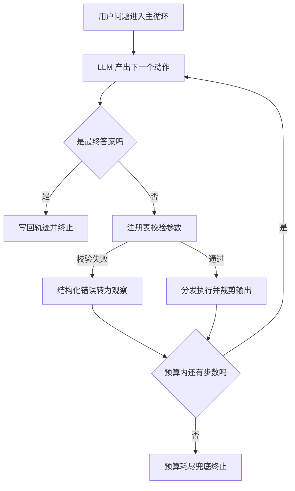
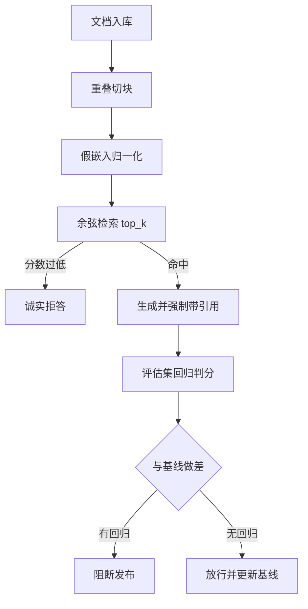
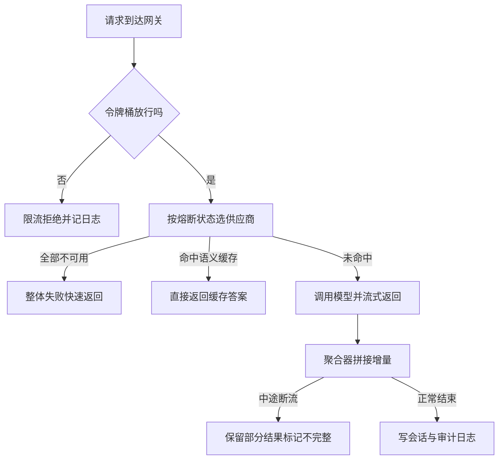
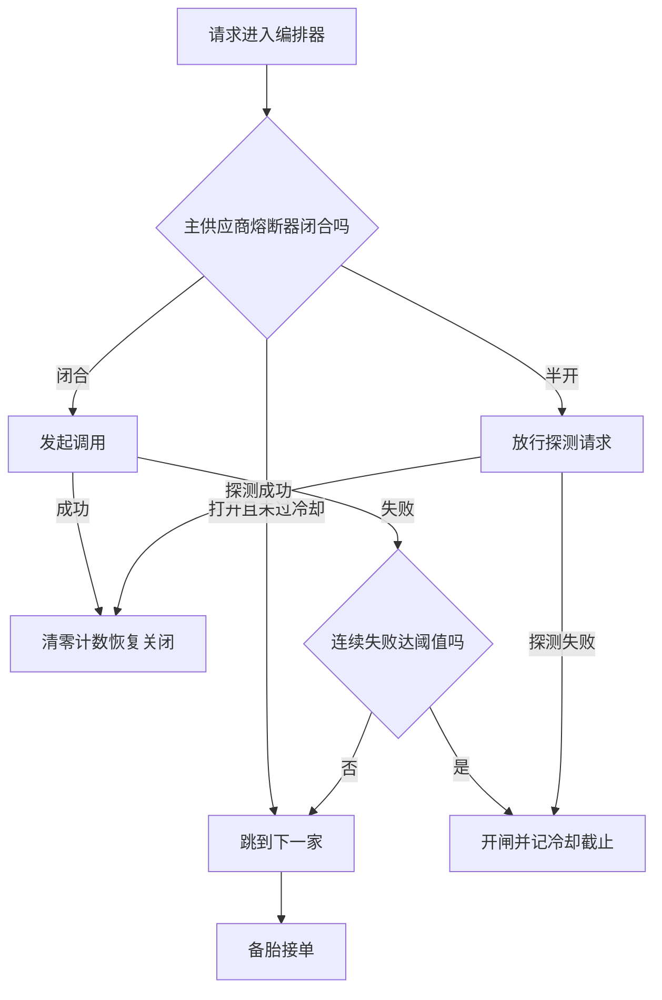
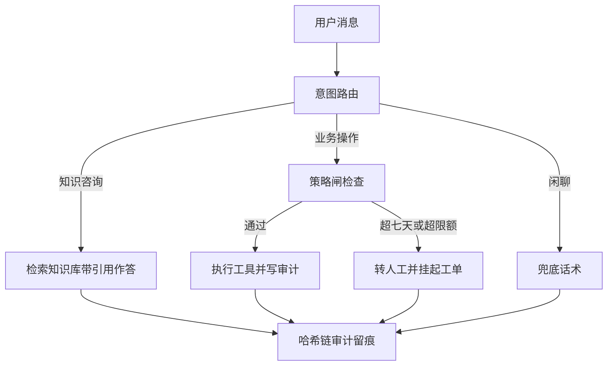

# 第 6 类 · Agent 与 LLM 及系统设计(收官扩产)

> 本篇是第 6 类的收官批(Q2981-Q3000 共 20 题),定位是「综合应用与查漏补缺」:把散落在前几批的零件装成整机——Agent 主循环与工具注册表、RAG 全链路、多 Agent 编排、会话存储、LLM 网关路由、结构化输出校验、评估回归、成本核算、上下文组装、人审状态机、提示词版本、语义缓存、流式聚合、A/B 实验、审计哈希链、工具沙箱、多供应商熔断、可观测三支柱,最后以一个端到端客服 Agent 骨架收束全类。
> 每题都强调「接缝处的拒绝与升级路径」:主循环的打转保护、网关的熔断限流、校验层的修复重试、编排器的降级留痕,这些边界行为比 happy path 更能区分候选人。
> 全部代码仅标准库、可独立运行,LLM 一律用脚本桩,向量检索用确定性假嵌入加余弦,时钟与随机全部注入,不联网不睡大觉,已在 Python 3.9 逐题实跑通过。
> 学习建议:先自己复述每题「不做会出什么事故」,再对照代码里的断言逐条验证;追问多为参数取舍与失效模式,面试时能说全边界条件即可过关。

### Q2981 · Agent 主循环的最小完整实现:计划-执行-观察-终止

> 难度:★★★★ | 标签:Agent, 主循环, ReAct

**问**:让你不用任何框架,从零写一个能跑通「调工具拿观察再作答」的 Agent 主循环,你会怎么设计终止条件和异常路径?

**答**:主循环就四拍:LLM 按当前轨迹产出下一个动作(调工具或给最终答案),执行器跑工具并把结果裁剪成观察写回轨迹,循环直到终止。终止必须有三条路,缺一不可:模型主动给最终答案(正常路径)、步数预算耗尽(防无限循环)、同参数重复调用的打转保护(模型卡死时的早期止损)。工具异常不能向上穿透,要转成「错误:XXX」的观察写回轨迹,让模型有机会换路,同时观察要做长度裁剪防止轨迹爆炸。打转保护用「工具名+参数」做签名去重,签名重复即终止,比数轮数更早发现卡死。这套循环是所有 Agent 框架的核心,面试时能手写说明你理解框架的骨架而非只会调 API。

```python
# file: code/06_Agent与LLM及系统设计/q2981_agent_loop.py
"""Q2981 Agent 主循环的最小完整实现:计划-执行-观察-终止。

主循环四拍:LLM 按当前轨迹产出下一个动作(调工具或给最终答案),
执行器跑工具并把结果裁剪成观察写回轨迹,循环直到出现终止条件。
终止有三条路:模型主动给最终答案、步数预算耗尽、检测到同参数
重复调用(打转保护)。LLM 用脚本桩,行为确定、可断言。
"""

FAKE_PLAN = [
    {"tool": "search", "args": {"q": "退款政策"}},
    {"tool": "search", "args": {"q": "退款时效"}},   # 换个问法继续检索
    {"tool": "lookup_order", "args": {"order_id": "o_9"}},
    {"final": "订单 o_9 已在 7 天无理由期内,可以退款。"},
]

TOOLS_DOCS = {
    "search": "检索知识库,返回相关条款",
    "lookup_order": "按订单号查订单状态",
}


class FakeLLM:
    """脚本桩:按轨迹长度吐出下一步动作,模拟规划-执行-观察。"""

    def __init__(self, script):
        self.script = script

    def next_action(self, trajectory):
        idx = len([t for t in trajectory if t["role"] == "action"])
        if idx >= len(self.script):
            return {"final": "预算内未收敛,给出兜底答复。"}
        return self.script[idx]


class AgentLoop:
    def __init__(self, llm, tools, max_steps=6):
        self.llm = llm
        self.tools = tools
        self.max_steps = max_steps

    def run(self, question):
        trajectory = [{"role": "user", "content": question}]
        seen_calls = []
        for step in range(self.max_steps):
            action = self.llm.next_action(trajectory)
            if "final" in action:
                trajectory.append({"role": "final", "content": action["final"]})
                return trajectory, "final", step + 1
            tool = action["tool"]
            call_sig = tool + ":" + str(sorted(action["args"].items()))
            if call_sig in seen_calls:
                trajectory.append({"role": "final",
                                   "content": "检测到重复调用,提前终止。"})
                return trajectory, "loop_guard", step + 1
            seen_calls.append(call_sig)
            if tool not in self.tools:
                obs = "错误:未知工具 " + tool
            else:
                try:
                    obs = str(self.tools[tool](**action["args"]))
                except Exception as exc:            # 工具失败转为观察而非崩溃
                    obs = "错误:" + type(exc).__name__
            obs = obs[:80]                          # 观察裁剪,防轨迹爆炸
            trajectory.append({"role": "action", "content": call_sig})
            trajectory.append({"role": "observation", "content": obs})
        trajectory.append({"role": "final", "content": "步数预算耗尽。"})
        return trajectory, "budget", self.max_steps


def main():
    tools = {
        "search": lambda q: "条款:签收后 7 天内可无理由退款。",
        "lookup_order": lambda order_id: "订单 o_9 状态:已签收 3 天。",
    }
    traj, why, steps = AgentLoop(FakeLLM(FAKE_PLAN), tools).run("o_9 能退款吗")
    assert why == "final", why
    assert traj[-1]["content"].startswith("订单 o_9"), traj[-1]
    assert steps == 4, steps

    # 打转保护:模型反复要求同一个调用
    loop_script = [{"tool": "search", "args": {"q": "x"}}] * 10
    traj2, why2, _ = AgentLoop(FakeLLM(loop_script), tools, max_steps=8).run("q")
    assert why2 == "loop_guard", why2

    # 预算耗尽:工具一直失败也不崩溃(每次参数不同,不触发打转保护)
    def boom(n=0):
        raise ValueError("down")
    script3 = [{"tool": "boom", "args": {"n": i}} for i in range(20)]
    traj3, why3, steps3 = AgentLoop(
        FakeLLM(script3), {"boom": boom}, max_steps=3).run("q")
    assert why3 == "budget", why3
    assert steps3 == 3
    print("终止原因:", why, "| 步数:", steps)
    print("打转保护与预算终止均生效,轨迹长度:", len(traj3))


if __name__ == "__main__":
    main()
```

**追问**:
- 追问一:打转保护为什么不直接比较完整轨迹哈希? 答:签名只含工具名与参数,既能在同参数重复时立刻止损,又不会把「同工具不同参数的合理重试」误杀。
- 追问二:观察裁剪到 80 字符会不会丢关键信息? 答:会,所以工程上要做结构化摘要而不是硬截断,保住错误码与 id 等关键字段,长文本只留头部与计数。

### Q2982 · 工具注册表的完整实现:schema 校验+统一分发

> 难度:★★★ | 标签:Agent, 工具治理, 校验

**问**:Agent 可用的工具越接越多,你怎么保证「参数错了不进执行、执行挂了不炸主循环」?

**答**:答案是把注册表做成 Agent 与工具之间唯一的边界。每个工具注册时声明 schema:必填项、参数类型、取值上下限;分发前统一校验,校验不过返回结构化错误而不是抛异常,LLM 能拿到可读的错误并自行修正。分发结果统一包成 ok/error 两态,连「未知工具」和「工具内部异常」也都是结构化返回,主循环因此永远不需要 try 每个工具。类型校验要小心 bool 是 int 的子类这类 Python 坑,数值参数还要做范围检查,金额上限这种业务约束就放在 schema 里而不是散在工具实现里。注册表同时天然是工具清单,可以按身份过滤后喂给模型做函数选择。

```python
# file: code/06_Agent与LLM及系统设计/q2982_tool_registry.py
"""Q2982 工具注册表的完整实现:schema 声明+参数校验+统一分发。

注册表是 Agent 与工具之间唯一的边界:每个工具注册时声明参数类型、
必填项与取值范围,分发前统一校验,校验不过返回结构化错误而不是抛
异常穿透到 LLM 轨迹里。分发结果统一包成 ok/error 两态,让上层无需
了解每个工具的内部实现。
"""

import math


class ToolRegistry:
    def __init__(self):
        self._tools = {}

    def register(self, name, fn, schema, desc=""):
        self._tools[name] = {"fn": fn, "schema": schema, "desc": desc}

    def list_tools(self):
        return {n: t["desc"] for n, t in sorted(self._tools.items())}

    def _validate(self, schema, args):
        errs = []
        for key in schema.get("required", []):
            if key not in args:
                errs.append("缺少必填参数:" + key)
        for key, val in args.items():
            if key not in schema.get("properties", {}):
                errs.append("未声明参数:" + key)
                continue
            spec = schema["properties"][key]
            want = spec.get("type")
            type_ok = {
                "string": lambda v: isinstance(v, str),
                "number": lambda v: isinstance(v, (int, float))
                                    and not isinstance(v, bool),
                "integer": lambda v: isinstance(v, int)
                                     and not isinstance(v, bool),
                "boolean": lambda v: isinstance(v, bool),
            }.get(want, lambda v: True)(val)
            if not type_ok:
                errs.append("参数 %s 类型应为 %s" % (key, want))
                continue
            if "minimum" in spec and val < spec["minimum"]:
                errs.append("参数 %s 低于最小值 %s" % (key, spec["minimum"]))
            if "maximum" in spec and val > spec["maximum"]:
                errs.append("参数 %s 超过最大值 %s" % (key, spec["maximum"]))
        return errs

    def dispatch(self, name, args):
        """统一入口:校验、执行、包装异常,永远返回 (ok, payload)。"""
        if name not in self._tools:
            return False, {"error": "unknown_tool", "tool": name}
        tool = self._tools[name]
        errs = self._validate(tool["schema"], args)
        if errs:
            return False, {"error": "invalid_args", "detail": errs}
        try:
            return True, {"result": tool["fn"](**args)}
        except Exception as exc:
            return False, {"error": "tool_failure",
                           "detail": type(exc).__name__}


def main():
    reg = ToolRegistry()
    reg.register(
        "pay.refund",
        lambda order_id, amount: "已退 %s 元到原路" % amount,
        schema={
            "required": ["order_id", "amount"],
            "properties": {
                "order_id": {"type": "string"},
                "amount": {"type": "number", "minimum": 0.01, "maximum": 5000},
            },
        },
        desc="按订单退款",
    )
    reg.register(
        "math.sqrt",
        lambda x: round(math.sqrt(x), 4),
        schema={"required": ["x"],
                "properties": {"x": {"type": "number"}}},
        desc="平方根",
    )

    ok, pay = reg.dispatch("pay.refund", {"order_id": "o_1", "amount": 99})
    assert ok and pay["result"] == "已退 99 元到原路", pay

    # 类型错、超上限、缺必填、未声明字段,各自给出可读错误
    ok2, e2 = reg.dispatch("pay.refund", {"order_id": "o_1", "amount": 99999})
    assert not ok2 and e2["error"] == "invalid_args", e2
    assert any("超过最大值" in d for d in e2["detail"]), e2
    ok3, e3 = reg.dispatch("pay.refund", {"amount": 10})
    assert any("缺少必填参数" in d for d in e3["detail"]), e3
    ok7, e7 = reg.dispatch("pay.refund", {"order_id": "o_1", "amount": 0})
    assert any("低于最小值" in d for d in e7["detail"]), e7
    ok4, e4 = reg.dispatch("pay.refund", {"order_id": "o_1", "amount": 1,
                                          "memo": "x"})
    assert any("未声明参数" in d for d in e4["detail"]), e4

    ok5, e5 = reg.dispatch("nope", {})
    assert not ok5 and e5["error"] == "unknown_tool", e5
    ok6, e6 = reg.dispatch("math.sqrt", {"x": -1})
    assert not ok6 and e6["error"] == "tool_failure", e6   # 异常被包装不上抛

    assert set(reg.list_tools()) == {"pay.refund", "math.sqrt"}
    print("分发成功:", pay["result"])
    print("校验失败样例:", e2["detail"])


if __name__ == "__main__":
    main()
```

**追问**:
- 追问一:为什么 bool 要在 number/integer 类型里显式排除? 答:Python 里 True 是 int 的实例,不做排除的话 LLM 填 true 会静默通过金额校验。
- 追问二:校验错误应该喂回给模型吗? 答:应该,把错误文本拼进下一轮提示,模型通常一次就能修正;这正是结构化输出重试层的雏形。



### Q2983 · RAG 完整最小链路:切块-嵌入-检索-生成-引用

> 难度:★★★★ | 标签:RAG, 检索, 引用

**问**:面试官常让你口述 RAG 流程,但更想听的是:每个环节偷工减料会在哪里翻车?

**答**:五个环节各有各的坑。切块不带重叠,答案恰好落在块边界时两边都检不中,所以窗口滑动要留 overlap;嵌入与查询要用同一套向量化,否则余弦没有意义,离线演示用词频哈希加 L2 归一化即可复现;检索必须设最低分数阈值,最高分只有 0.18 的「检索结果」其实是噪声,诚实拒答比硬编好;生成桩要被约束为「只依据被检出的块作答」;最后答案必须带 [块号] 引用且能映射回原文,引用映射是 RAG 可信度的底线——没有引用的检索增强等于没做,用户无法核对也无法追责。这五点每一处都能展开成面试的独立话题。

```python
# file: code/06_Agent与LLM及系统设计/q2983_rag_min_pipeline.py
"""Q2983 RAG 完整最小链路:切块-嵌入-检索-生成-引用。

五个环节缺一不可:重叠切块保住跨块边界的语义;假嵌入用词频哈希到
固定维度并归一化,保证可离线复现;检索用余弦取 top_k;生成桩只允许
依据被检出的块作答;最后强制答案携带 [编号] 引用并能映射回原文。
引用映射是 RAG 可信度的底线,没有引用的检索增强等于没做。
"""

import hashlib
import math

DIM = 64


def chunk_text(text, size=40, overlap=10):
    """滑动窗口切块,块间带 overlap,防止句子在边界被切断丢语义。"""
    chunks = []
    start = 0
    while start < len(text):
        chunks.append(text[start:start + size])
        if start + size >= len(text):
            break
        start += size - overlap
    return chunks


def _tokens(text):
    """中文友好分词:去空白后取二元组,相邻字组合保留局部语义。"""
    compact = "".join(text.split())
    if len(compact) < 2:
        return [compact] if compact else []
    return [compact[i:i + 2] for i in range(len(compact) - 1)]


def embed(text):
    """词频哈希假嵌入:L2 归一化,同文相似度高、无关文低。"""
    vec = [0.0] * DIM
    for token in _tokens(text):
        h = int(hashlib.md5(token.encode("utf-8")).hexdigest(), 16)
        vec[h % DIM] += 1.0
    norm = math.sqrt(sum(v * v for v in vec)) or 1.0
    return [v / norm for v in vec]


def cosine(a, b):
    return sum(x * y for x, y in zip(a, b))


class FakeLLM:
    """生成桩:只依据检索块作答,并带上 [块号] 引用。"""

    def generate(self, question, hits):
        best_idx = hits[0][1]
        return "根据资料[%d]作答(问题:%s)" % (best_idx, question)


class RagPipeline:
    def __init__(self, docs):
        self.chunks = []      # (doc_id, idx, text, vec)
        for doc_id, text in docs.items():
            for i, c in enumerate(chunk_text(text)):
                self.chunks.append((doc_id, i, c, embed(c)))

    def retrieve(self, query, top_k=2):
        qv = embed(query)
        scored = [(cosine(qv, c[3]), i) for i, c in enumerate(self.chunks)]
        scored.sort(key=lambda p: -p[0])
        return [(round(s, 4), i) for s, i in scored[:top_k] if s > 0]

    def answer(self, query, llm):
        hits = self.retrieve(query)
        if not hits or hits[0][0] < 0.4:    # 最高分过低:诚实拒答
            return {"text": "知识库中没有相关内容。", "citations": []}
        ans = llm.generate(query, hits)
        citations = []
        for score, idx in hits:
            doc_id, ci, text, _ = self.chunks[idx]
            citations.append({"doc": doc_id, "chunk": ci, "score": score})
        assert "[" in ans, "生成结果必须带引用标记"
        return {"text": ans, "citations": citations}


def main():
    docs = {
        "policy": "退款政策 签收后七天内可无理由退款 超过七天需人工审核",
        "shipping": "物流说明 下单后四十八小时内发货 偏远地区顺延两天",
    }
    pipe = RagPipeline(docs)
    out = pipe.answer("七天无理由退款怎么规定的", FakeLLM())
    top = out["citations"][0]
    assert top["doc"] == "policy", top          # 检索必须命中正确文档
    assert out["citations"][0]["score"] >= out["citations"][1]["score"]

    # 引用可回溯:能按编号拿回原文块
    block = chunk_text(docs["policy"])[top["chunk"]]
    assert "退款" in block, block

    miss = pipe.answer("公司周年庆什么时候", FakeLLM())
    assert miss["citations"] == [], miss        # 完全无关时诚实拒答

    ovl = chunk_text("a" * 90, size=40, overlap=10)
    assert len(ovl) == 3 and ovl[0][-10:] == ovl[1][:10]  # 重叠生效
    print("命中文档:", top["doc"], "块:", top["chunk"], "分:", top["score"])
    print("答案:", out["text"])
    print("无关系数:", len(miss["citations"]), "重叠块数:", len(ovl))


if __name__ == "__main__":
    main()
```

**追问**:
- 追问一:chunk size 和 overlap 怎么定? 答:按答案的典型长度定 size,按边界句子的重复度定 overlap,都要用评估集实测召回率而不是拍脑袋。
- 追问二:为什么拒答阈值要设在「最高分」而不是「平均分」? 答:平均分会被大量无关块稀释,最高分才反映「最好的证据够不够硬」。

### Q2984 · 多 Agent 流水线的完整编排:写作-评审-返工-降级

> 难度:★★★ | 标签:多Agent, 编排, 返工

**问**:多个 Agent 协作时,评审不通过怎么办?怎么避免两个 Agent 互相打回造成死循环?

**答**:关键设计是 Agent 之间不直接对话,全部经由编排器传递结构化消息:上游写作产出工件,下游评审返回带 verdict 和 issues 的结构化结论,不通过时编排器把 issues 作为反馈打回上游重写。死循环靠两个机制避免:返工次数有硬上限,超限走降级路径——带瑕疵放行并留痕,而不是无限重试;同时每次打回必须附带结构化反馈,上游按反馈修补(比如补上测试计划)而不是原样重写。编排轨迹里每一步都有日志,事后能重放整条流水线,这也是多 Agent 系统可调试性的来源。面试时能把「降级放行也是一等公民路径」讲清楚,比背几个编排框架名词值钱。

```python
# file: code/06_Agent与LLM及系统设计/q2984_multi_agent_pipeline.py
"""Q2984 多 Agent 流水线的完整编排:规划-写作-评审-返工-降级。

编排器维护一份工件在 Agent 间流转:上游写作、下游评审,评审不通过
带着结构化反馈打回上游,返工有上限,超限降级为「带瑕疵放行+留痕」
而不是死循环。关键设计:Agent 之间不直接对话,全部经由编排器传递
结构化消息,这样每一步都可观测、可重放、可加预算。
"""

MAX_REWORK = 1
BLACKLIST_FEATURES = {"导出报表"}     # 模拟无论怎么改都过不了评审的情形


class WriterAgent:
    def __init__(self):
        self.rounds = 0

    def write(self, plan, feedback=None):
        self.rounds += 1
        draft = "实现:" + plan["feature"]
        if feedback:
            draft += "(已修:" + feedback["issue"] + ")"
        return {"draft": draft, "rounds": self.rounds}


class ReviewerAgent:
    def review(self, plan, artifact):
        if plan["feature"] in BLACKLIST_FEATURES:
            return {"verdict": "reject", "issues": ["功能在禁改清单"]}
        if not plan.get("tests"):
            return {"verdict": "reject", "issues": ["缺少测试计划"]}
        return {"verdict": "approve", "issues": []}


class Orchestrator:
    """流水线编排:结构化消息在阶段间流转,返工计数有上限。"""

    def __init__(self, writer, reviewer):
        self.writer = writer
        self.reviewer = reviewer
        self.log = []

    def run(self, plan):
        feedback = None
        rework = 0
        self.log.append("stage:plan:" + plan["feature"])
        while True:
            artifact = self.writer.write(plan, feedback=feedback)
            verdict = self.reviewer.review(plan, artifact)
            self.log.append("stage:review:" + verdict["verdict"])
            if verdict["verdict"] == "approve":
                return artifact, "approved", rework
            rework += 1
            if rework > MAX_REWORK:
                self.log.append("stage:degrade:over_rework_limit")
                return artifact, "degraded", rework
            self.log.append("stage:rework:" + verdict["issues"][0])
            feedback = {"issue": verdict["issues"][0]}
            plan = dict(plan)
            plan["tests"] = ["case_1"]          # 按反馈修补计划再重写


def main():
    orch = Orchestrator(WriterAgent(), ReviewerAgent())
    artifact, status, rework = orch.run({"feature": "搜索联想"})
    assert status == "approved", status                 # 打回一次后通过
    assert rework == 1, rework
    assert artifact["draft"].endswith("(已修:缺少测试计划)")
    assert orch.log[0] == "stage:plan:搜索联想"
    assert "stage:review:reject" in orch.log
    assert "stage:rework:缺少测试计划" in orch.log

    # 无论怎么改都过不了评审:走降级路径而不是死循环
    orch2 = Orchestrator(WriterAgent(), ReviewerAgent())
    _, status2, rework2 = orch2.run({"feature": "导出报表", "tests": []})
    assert status2 == "degraded", status2
    assert rework2 == 2, rework2
    assert "stage:degrade:over_rework_limit" in orch2.log

    # 一次就合格的计划:零返工
    orch3 = Orchestrator(WriterAgent(), ReviewerAgent())
    _, status3, rework3 = orch3.run({"feature": "健康检查", "tests": ["c1"]})
    assert status3 == "approved" and rework3 == 0
    print("流水线状态:", status, "| 返工:", rework)
    print("编排轨迹:", " -> ".join(orch.log))
    print("降级轨迹:", " -> ".join(orch2.log))


if __name__ == "__main__":
    main()
```

**追问**:
- 追问一:降级放行的工件要怎么标记? 答:在工件上带 degraded 标志与原因,下游和用户都能看到,审计时不与正常产物混淆。
- 追问二:反馈应该全量打回还是只打回差异部分? 答:只打回差异与涉及上下文,全量打回既浪费 token 又可能让上游重写已经合格的部分。

### Q2985 · 会话存储的完整实现:追加-恢复-过期-截断

> 难度:★★ | 标签:会话管理, 存储, TTL

**问**:聊天产品的会话存储要满足哪些硬要求?过期清理为什么可以「读时惰性」?

**答**:三个硬要求:消息只追加不改写(历史是审计与调试依据,改写等于销毁证据);按会话 id 可完整恢复上下文;过期由注入时钟驱动,测试时可快进时间。过期清理可以读时惰性做——恢复时检查最后更新时间,超 TTL 即返回空并删除,不必起后台定时任务,单机场景下这是最省事的正确方案,规模化后才需要异步清理。另外必须有长度上限:超限从头丢最老的非系统消息,系统提示永远保留,防止长会话把上下文窗口撑爆。这些看似琐碎的规则,恰恰是线上会话错乱(串话、丢系统提示、上下文超限报错)的常见根因。

```python
# file: code/06_Agent与LLM及系统设计/q2985_session_store.py
"""Q2985 会话存储的完整实现:追加、恢复、过期与截断。

会话存储是聊天产品的地基,三个硬要求:消息只追加不改写(历史是
审计依据);按会话 id 可完整恢复;过期由注入时钟驱动,读时惰性
清理即可,不必起后台任务。另外要有长度上限:超限从头丢弃最老的
消息但保住系统消息,防止长会话把上下文撑爆。
"""

import time


class SessionStore:
    def __init__(self, max_messages=6, ttl_seconds=3600, clock=None):
        self.max_messages = max_messages
        self.ttl = ttl_seconds
        self.now = clock or time.time
        self._data = {}            # sid -> {"msgs": [...], "updated": ts}

    def append(self, sid, role, content):
        s = self._data.setdefault(sid, {"msgs": [], "updated": self.now()})
        s["msgs"].append({"role": role, "content": content,
                          "ts": self.now()})
        s["updated"] = s["msgs"][-1]["ts"]
        self._trim(sid)
        return len(s["msgs"])

    def _trim(self, sid):
        s = self._data[sid]
        while len(s["msgs"]) > self.max_messages:
            # 系统消息永远保留,从最老的非系统消息开始丢
            if s["msgs"][0]["role"] == "system" and \
               any(m["role"] != "system" for m in s["msgs"]):
                s["msgs"].pop(1)
            else:
                s["msgs"].pop(0)

    def restore(self, sid):
        """读时惰性过期:过期返回空并清除,未过期返回全部消息。"""
        s = self._data.get(sid)
        if s is None:
            return []
        if self.now() - s["updated"] > self.ttl:
            del self._data[sid]                 # 整段会话过期即删
            return []
        return list(s["msgs"])

    def count(self):
        return len(self._data)


def main():
    store = SessionStore(max_messages=4, ttl_seconds=60, clock=lambda: 1000.0)
    store.append("s1", "system", "你是客服助手")
    store.append("s1", "user", "查订单")
    store.append("s1", "assistant", "订单号是多少")
    assert store.restore("s1")[0]["role"] == "system"     # 可恢复
    assert len(store.restore("s1")) == 3

    # 超限截断:系统消息保住,最老的用户消息被丢
    store.append("s1", "user", "o_9")
    store.append("s1", "assistant", "已退款")
    msgs = store.restore("s1")
    assert len(msgs) == 4, len(msgs)
    assert msgs[0]["role"] == "system"
    assert all(m["content"] != "查订单" for m in msgs)   # 最老消息被丢
    assert msgs[-1]["content"] == "已退款"               # 最新消息保住

    # 过期:注入时钟前进,读时清理
    t2 = [1000.0]
    store2 = SessionStore(max_messages=10, ttl_seconds=60,
                          clock=lambda: t2[0])
    store2.append("s2", "user", "hi")
    assert store2.restore("s2")                  # 未过期可恢复
    t2[0] = 1120.0                               # 模拟 120 秒后
    assert store2.restore("s2") == []            # 过期返回空
    assert store2.count() == 0                   # 且被清理

    # 新会话不存在,恢复得空列表而不是 KeyError
    assert store.restore("ghost") == []
    print("会话条数上限内:", len(store.restore("s1")))
    print("过期清理后剩余会话:", store2.count())


if __name__ == "__main__":
    main()
```

**追问**:
- 追问一:多实例部署时惰性过期有什么坑? 答:各实例时钟与内存不一致,会话要放共享存储并把过期判断放在读取路径上统一执行。
- 追问二:为什么截断丢消息而不是丢最老几轮摘要? 答:生产上应该做「老消息压缩成摘要」而非硬丢,硬丢会破坏指代;最小实现先保系统消息只是底线。

### Q2986 · LLM 网关的完整路由:限流-熔断-降级-日志

> 难度:★★★★ | 标签:LLM网关, 熔断, 限流

**问**:所有模型调用都收敛到一个网关,这个网关内部应该有哪几层?各自用什么算法?

**答**:四层缺一不可。限流用令牌桶:容量扛突发、速率控均值,注入时钟便于测试,令牌不足直接拒绝而不是排队堵死调用方。健康管理用熔断:每家供应商独立计连续失败,达到阈值开闸冷却,冷却期内不再浪费请求;工程上还有半开探测,这里先做最小版。降级按优先级遍历供应商列表,跳过熔断中的,直到有一家接住,全挂时抛「all_providers_down」让上层走兜底话术。日志记录每一次路由决策:落在哪家、为什么跳过、是否被限流,出故障时能还原完整决策链。面试要点是四层的顺序:先限流再选路,请求被拒在门口总比进了死门强。

```python
# file: code/06_Agent与LLM及系统设计/q2986_llm_gateway.py
"""Q2986 LLM 网关的完整路由:健康检查+限流+降级+请求日志。

网关是所有模型调用的唯一出口,职责四件套:按优先级维护供应商
列表;每个供应商有熔断健康状态(连续失败达阈值就熔断,冷却后
半开放行探测);令牌桶限流防突发把配额打穿;每次路由写结构化
日志,包含最终落在哪一家、是否降级,出问题才有得查。
"""

import time


class TokenBucket:
    """令牌桶:注入时钟,容量 capacity,每秒补充 rate。"""

    def __init__(self, capacity, rate, clock=time.time):
        self.capacity = capacity
        self.rate = rate
        self.tokens = float(capacity)
        self.clock = clock
        self.last = clock()

    def allow(self, cost=1.0):
        now = self.clock()
        self.tokens = min(self.capacity,
                          self.tokens + (now - self.last) * self.rate)
        self.last = now
        if self.tokens >= cost:
            self.tokens -= cost
            return True
        return False


class Provider:
    def __init__(self, name, priority, fail_threshold=2, cooldown=10):
        self.name = name
        self.priority = priority
        self.fail_threshold = fail_threshold
        self.cooldown = cooldown
        self.fail_streak = 0
        self.open_until = 0.0          # 熔断截止时刻

    def available(self, now):
        return now >= self.open_until

    def record(self, ok, now):
        if ok:
            self.fail_streak = 0
        else:
            self.fail_streak += 1
            if self.fail_streak >= self.fail_threshold:
                self.open_until = now + self.cooldown   # 熔断


class Gateway:
    def __init__(self, providers, bucket, clock):
        self.providers = sorted(providers, key=lambda p: p.priority)
        self.bucket = bucket
        self.clock = clock
        self.logs = []

    def route(self, call):
        """call: fn(name)->text,失败抛异常。返回 (text, provider)。"""
        now = self.clock()
        if not self.bucket.allow():
            self.logs.append({"event": "rate_limited", "ts": now})
            raise RuntimeError("rate_limited")
        for p in self.providers:
            if not p.available(now):
                self.logs.append({"event": "skip_circuit_open",
                                  "provider": p.name})
                continue
            try:
                text = call(p.name)
            except Exception:
                p.record(False, now)
                self.logs.append({"event": "failover_from",
                                  "provider": p.name})
                continue
            p.record(True, now)
            self.logs.append({"event": "served", "provider": p.name})
            return text, p.name
        raise RuntimeError("all_providers_down")


def main():
    now = [1000.0]
    clock = lambda: now[0]
    bucket = TokenBucket(capacity=10, rate=5.0, clock=clock)
    calls = {"counter": 0}

    def call(name):
        if name == "primary":
            calls["counter"] += 1
            raise ConnectionError("primary down")
        return "回答来自 " + name

    gw = Gateway([Provider("primary", 1), Provider("backup", 2)], bucket,
                 clock)
    text, used = gw.route(call)
    assert used == "backup" and text == "回答来自 backup", (text, used)

    # 熔断:首调已让 primary 带一次失败,再来一次即连续两次熔断
    calls["counter"] = 0
    now[0] += 1
    gw.route(call)                           # primary 失败,熔断开闸
    assert gw.providers[0].open_until == 1011.0, gw.providers[0].open_until
    now[0] += 1
    gw.route(call)                           # 冷却期内 primary 被跳过
    assert calls["counter"] == 1, calls["counter"]   # 熔断前只再试了一次

    # 限流:清空令牌后拒绝而不是排队堵死
    now[0] = 2000.0
    bucket.tokens = 0.0
    bucket.last = now[0]
    gw3 = Gateway([Provider("a", 1)], bucket, clock)
    try:
        gw3.route(lambda n: "ok")
        raise AssertionError("应当被限流")
    except RuntimeError as exc:
        assert "rate_limited" in str(exc)

    events = [l["event"] for l in gw.logs]
    assert "served" in events and "failover_from" in events, gw.logs
    assert "rate_limited" in [l["event"] for l in gw3.logs]
    print("降级命中:", used)
    print("日志事件:", events[:5])


if __name__ == "__main__":
    main()
```

**追问**:
- 追问一:令牌桶和漏桶选哪个? 答:LLM 流量有明显突发,令牌桶允许短暂超速率更贴合;漏桶的严格恒定速率反而白白拒绝请求。
- 追问二:限流应该按什么维度分桶? 答:至少按租户+模型两维,再叠一层全局配额;单维全局桶会让一个大客户把所有人饿死。

### Q2987 · 结构化输出的完整校验层:解析-修复-重试

> 难度:★★★ | 标签:结构化输出, JSON, 重试

**问**:让 LLM 返回 JSON,线上最常见的失败形态有哪些?校验层怎么按代价从小到大处理?

**答**:失败形态按频率排:markdown 代码栅栏包裹、JSON 前后带客套话、尾逗号、全角引号、类型不符、干脆不输出 JSON。校验层按代价从小到大处理:先剥栅栏并截取首尾大括号之间的内容,这步是纯字符串操作;解析失败做廉价自动修复(全角引号归一、删掉闭括号前的尾逗号),仍不花钱;还不行才把错误信息拼回提示词让模型带反馈重试,重试次数封顶,封顶后返回结构化错误而不是抛异常。这个「修复优先于重试」的顺序很重要:每次重试都是一次真实的模型调用,又慢又贵,能用字符串手段救回的就别烧第二次调用。schema 校验放在解析成功之后,只查必填键和类型,保持最小。

```python
# file: code/06_Agent与LLM及系统设计/q2987_structured_output.py
"""Q2987 结构化输出的完整校验层:解析-修复-重试。

LLM 输出不可信:可能带 markdown 代码栅栏、尾逗号、中文引号、前后
闲话。校验层三步:先剥栅栏提取 JSON 候选;解析失败做廉价自动修复;
仍失败则把错误信息拼回提示词,让模型带上下文重试,重试次数封顶。
栅栏字符用 chr(96)*3 运行时拼接,避免与文档围栏冲突。
"""
import json

FENCE = chr(96) * 3  # 反引号栅栏,运行时拼接


class FakeLLM:
    """依次吐出预设输出:第一轮带栅栏+闲话,第二轮干净 JSON。"""
    def __init__(self, outputs):
        self.outputs = list(outputs)

    def chat(self, prompt: str) -> str:
        return self.outputs.pop(0)


def strip_fences(raw: str) -> str:
    text = raw.strip()
    if text.startswith(FENCE):  # 剥掉开头栅栏(如 json 标注)到首个换行
        text = text[text.find("\n") + 1:]
    if text.endswith(FENCE):    # 剥掉结尾栅栏
        text = text[:-len(FENCE)].rstrip()
    return text.strip()


def cheap_fix(text: str) -> str:
    text = text.replace(",", ",")   # 中文逗号归一
    text = text.replace(":", ":")   # 中文冒号归一
    text = text.rstrip(",")
    if text.endswith("}"):          # 尾逗号修复
        text = text[:-2] + "}"
    return text


def extract_json(text: str):
    for cand in (text, cheap_fix(text)):
        try:
            return json.loads(cand)
        except (json.JSONDecodeError, ValueError):
            continue
    return None


def structured_call(llm, schema_hint: str, retries: int = 2):
    prompt = "输出 JSON,字段要求:" + schema_hint
    last_err = "no output"
    for _ in range(retries + 1):
        raw = llm.chat(prompt)
        body = strip_fences(raw)
        obj = extract_json(body)
        if obj is not None:
            return obj
        last_err = body[:60]
        prompt = ("你上次的输出无法解析(" + last_err +
                  "),请只输出合法 JSON,字段:" + schema_hint)
    raise ValueError("结构化输出解析失败:" + last_err)


if __name__ == "__main__":
    llm = FakeLLM([
        "好的,结果如下:" + FENCE + "json\n{'name': '订单A', 'qty': 2,}\n" + FENCE,
        FENCE + "json\n{\"name\": \"订单A\", \"qty\": 2}\n" + FENCE,
    ])
    obj = structured_call(llm, "name, qty")
    assert obj == {"name": "订单A", "qty": 2}, obj
    print("第一轮带栅栏/中文标点/尾逗号 → 自动修复失败 → 带错误重试成功:", obj)
```

**追问**:
- 追问一:修复层会不会把合法 JSON 改坏? 答:修复只在原文解析失败后启用,合法输入永远原样通过;修复规则本身要保守,只处理已知无害形态。
- 追问二:为什么用函数式 API 而不用 JSON mode? 答:两者可叠加,JSON mode 降低坏输出概率但不能保证 schema,校验层仍是最后防线。

### Q2988 · 评估集的完整回归运行器:跑批-判分-对比基线

> 难度:★★★ | 标签:评估, 回归, 发布门禁

**问**:改了提示词或换了模型,怎么科学判断「新版能不能发布」?

**答**:用评估集当「测试套件」:每条用例带 must_contain 与 must_not 两类断言,运行器逐条跑模型判分。但关键不在跑分而在回归对比:与基线版本的通过集合做差,明确列出 fixed(本轮才过)与 broken(基线过、本轮挂)两个清单——一个 90% 的通过率数字本身没有决策价值,「弄坏了哪三条」才有。有 broken 就阻断发布,回滚或修复后再跑。用例设计上,must_not 专抓退化形态(比如兜底话术出现在不该出现的地方),比只查关键词命中更能发现「答非所问」。这套机制让提示词迭代从玄学变成工程。

```python
# file: code/06_Agent与LLM及系统设计/q2988_eval_regression.py
"""Q2988 评估集的完整回归运行器:跑批-判分-对比基线-出报告。

评估集是 LLM 功能的「测试套件」:每条用例带 must_contain 与
must_not 两类断言,运行器逐条跑桩模型并判分;关键在回归对比——
与基线通过集合做差,明确指出「新版本修好了哪些、又弄坏了哪些」,
没有差集的通过率数字没有决策价值。
"""


class FakeModel:
    """版本化桩:v1 答对余额与退款,v2 顺手弄坏了退款表述。"""

    def __init__(self, version):
        self.version = version

    def answer(self, q):
        table = {
            "v1": {
                "余额": "您的账户余额可在 个人中心-钱包 中查看。",
                "退款": "退款将在 3 个工作日内原路退回。",
                "发货": "发货时间以商品页标注为准,一般为 48 小时内。",
            },
            "v2": {
                "余额": "余额请到 个人中心-钱包 查看。",
                "退款": "钱会退回您的账户。",           # 丢了「原路」与时效
                "发货": "发货时间以商品页标注为准,一般为 48 小时内。",
            },
        }
        for key, ans in table[self.version].items():
            if key in q:
                return ans
        return "抱歉,我不明白。"


CASES = [
    {"id": "c1", "q": "怎么查余额",
     "must_contain": ["个人中心", "钱包"], "must_not": ["抱歉"]},
    {"id": "c2", "q": "退款多久到账",
     "must_contain": ["3 个工作日", "原路"], "must_not": ["人工"]},
    {"id": "c3", "q": "什么时候发货",
     "must_contain": ["48 小时"], "must_not": ["抱歉"]},
]


def judge(case, answer):
    reasons = []
    for token in case["must_contain"]:
        if token not in answer:
            reasons.append("缺少:" + token)
    for token in case["must_not"]:
        if token in answer:
            reasons.append("出现违禁:" + token)
    return reasons


def run_suite(model, cases=CASES):
    results = {}
    for case in cases:
        reasons = judge(case, model.answer(case["q"]))
        results[case["id"]] = {"pass": not reasons, "reasons": reasons}
    return results


def diff(baseline, current):
    """对比两轮结果:fixed=本轮才过,broken=基线过本轮挂。"""
    fixed = [cid for cid, r in current.items()
             if r["pass"] and not baseline[cid]["pass"]]
    broken = [cid for cid, r in current.items()
              if not r["pass"] and baseline[cid]["pass"]]
    rate = sum(1 for r in current.values() if r["pass"]) / len(current)
    return {"fixed": fixed, "broken": broken, "pass_rate": rate}


def main():
    base = run_suite(FakeModel("v1"))
    assert all(r["pass"] for r in base.values()), base   # 基线全绿

    cur = run_suite(FakeModel("v2"))
    d = diff(base, cur)
    assert d["broken"] == ["c2"], d                       # 回归被抓出来
    assert d["fixed"] == [], d
    assert abs(d["pass_rate"] - 2 / 3) < 1e-9
    reasons = cur["c2"]["reasons"]
    assert any("缺少:3 个工作日" in x for x in reasons), reasons

    # 反向:新版本修复了旧问题
    cur2 = dict(cur)
    cur2["c3"] = {"pass": False, "reasons": ["缺少:48 小时"]}
    d2 = diff(base, cur2)
    assert d2["broken"] == ["c2", "c3"], d2
    print("基线通过率: 100%% | 新版通过率: %.0f%%" % (d["pass_rate"] * 100))
    print("回归用例:", d["broken"], "| 失败原因:", reasons)
    print("结论:禁止直接发布,需回滚或修复 c2。")


if __name__ == "__main__":
    main()
```

**追问**:
- 追问一:关键词断言太脆,升级方向是什么? 答:LLM-as-judge 打分加人工抽检校准,但断言型用例仍保留,因为它确定、免费、可回归。
- 追问二:评估集要不要随版本更新? 答:case 集合要稳定才有可比性;新问题进「候选池」,定期评审后扩容,不能边跑边改。



### Q2989 · 成本核算器:输入-输出-缓存三层计价与预算告警

> 难度:★★★ | 标签:成本核算, 计费, 预算

**问**:LLM 账单怎么算才不出错?缓存命中到底省了多少钱?

**答**:成本模型分三层:输入 token 按模型单价、输出 token 通常贵数倍、命中缓存的输入按折扣价(常见一折左右),再加每请求固定费。核算器记账时先从输入里扣掉 cached_tokens 再按全价算,缓存部分单独按折扣价计,两笔不能重叠也不能漏;汇总要同时支持按天、按模型两个粒度,前者对预算后者对优化。预算告警设两档:80% 警告、100% 破线,给结构化告警对象而不是静默超支。还有一个常被忽略的指标:cache_saving——按「全价减折扣价」算出缓存省了多少钱,这是说服团队上缓存(提示词前缀稳定化)的直接依据。单位统一用「元/百万 token」,内部换算成每次调用的钱,避免千分之一级别的单位错。

```python
# file: code/06_Agent与LLM及系统设计/q2989_cost_accountant.py
"""Q2989 成本核算器:按 输入/输出/缓存 三层计价与预算告警。

LLM 账单三层:输入 token 按模型单价、输出 token 更贵、命中缓存的
输入按折扣价(常见 1 折)。核算器要按 请求/模型/天 三个粒度汇总,
并在日预算触线时给结构化告警而不是静默超支。所有价格以「每百万
token」计,内部换算成每次调用的钱。
"""


class CostAccountant:
    def __init__(self, price_table, daily_budget):
        """price_table: model -> {input, output, cached, per_request}
        单位:元 / 百万 token;per_request 单位:元/次。"""
        self.prices = price_table
        self.daily_budget = daily_budget
        self.records = []

    def record(self, ts_day, model, input_tokens, output_tokens,
               cached_tokens=0):
        p = self.prices[model]
        billable_input = max(input_tokens - cached_tokens, 0)
        cost = (billable_input / 1e6 * p["input"]
                + output_tokens / 1e6 * p["output"]
                + cached_tokens / 1e6 * p["cached"]
                + p["per_request"])
        self.records.append({"day": ts_day, "model": model,
                             "input": input_tokens,
                             "output": output_tokens,
                             "cached": cached_tokens,
                             "cost": round(cost, 6)})
        return cost

    def totals_by_day(self):
        out = {}
        for r in self.records:
            out[r["day"]] = round(out.get(r["day"], 0.0) + r["cost"], 6)
        return out

    def totals_by_model(self, day):
        out = {}
        for r in self.records:
            if r["day"] == day:
                out[r["model"]] = round(out.get(r["model"], 0.0)
                                        + r["cost"], 6)
        return out

    def budget_alert(self, day):
        spent = self.totals_by_day().get(day, 0.0)
        ratio = spent / self.daily_budget
        level = "ok"
        if ratio >= 1.0:
            level = "breach"
        elif ratio >= 0.8:
            level = "warn"
        return {"day": day, "spent": round(spent, 4),
                "budget": self.daily_budget, "ratio": round(ratio, 4),
                "level": level}

    @staticmethod
    def cache_saving(record, price_table):
        """命中缓存省了多少钱:全价输入减去缓存价。"""
        p = price_table[record["model"]]
        return round(record["cached"] / 1e6 * (p["input"] - p["cached"]), 6)


PRICES = {
    "glm-air": {"input": 0.5, "output": 2.0, "cached": 0.05,
                "per_request": 0.001},
    "glm-pro": {"input": 4.0, "output": 16.0, "cached": 0.4,
                "per_request": 0.01},
}


def main():
    acc = CostAccountant(PRICES, daily_budget=1.0)

    c1 = acc.record("2026-11-05", "glm-air", input_tokens=100_000,
                    output_tokens=2_000)
    expect1 = (100_000 / 1e6 * 0.5 + 2_000 / 1e6 * 2.0 + 0.001)
    assert abs(c1 - expect1) < 1e-9, (c1, expect1)

    # 大流量走 pro 且带缓存:缓存部分按折扣计
    c2 = acc.record("2026-11-05", "glm-pro", input_tokens=500_000,
                    output_tokens=8_000, cached_tokens=400_000)
    expect2 = (100_000 / 1e6 * 4.0 + 8_000 / 1e6 * 16.0
               + 400_000 / 1e6 * 0.4 + 0.01)
    assert abs(c2 - expect2) < 1e-9

    saving = CostAccountant.cache_saving(acc.records[-1], PRICES)
    assert abs(saving - 400_000 / 1e6 * (4.0 - 0.4)) < 1e-9

    # 按模型/按天汇总与预算告警
    by_model = acc.totals_by_model("2026-11-05")
    assert set(by_model) == {"glm-air", "glm-pro"}
    assert by_model["glm-pro"] > by_model["glm-air"]
    alert = acc.budget_alert("2026-11-05")
    assert alert["level"] in ("ok", "warn", "breach")
    assert alert["spent"] == round(c1 + c2, 4)

    # 超预算:级别落到 breach
    acc.record("2026-11-06", "glm-pro", input_tokens=200_000,
               output_tokens=20_000)
    alert2 = acc.budget_alert("2026-11-06")
    assert alert2["spent"] > acc.daily_budget
    assert alert2["level"] == "breach", alert2
    print("两笔成本: %.4f / %.4f 元" % (c1, c2))
    print("缓存节省: %.4f 元 | 告警级别: %s" % (saving, alert2["level"]))
    print("按天汇总:", acc.totals_by_day())


if __name__ == "__main__":
    main()
```

**追问**:
- 追问一:为什么输出 token 单价更高? 答:输出是逐 token 自回归生成,每步都要过一遍全部 KV cache,算力成本显著高于并行计价的输入。
- 追问二:预算告警后应该做什么? 答:自动降级到便宜模型或缩小检索范围,而不是只发邮件;硬约束要在网关层执行,软约束才走告警。

### Q2990 · 上下文组装器:系统-历史-检索-预算四源拼装

> 难度:★★★ | 标签:上下文工程, 预算, 截断

**问**:一次 LLM 调用的上下文由系统提示、对话历史、检索片段共同构成,超预算时丢弃顺序怎么定?

**答**:先定优先级:系统提示和最新一条用户消息永远保留,它们是功能正确性的底线;检索片段按相关度从高到低塞入;历史消息从新到旧回填。四者共享一个 token 预算,超预算时按优先级从低到高丢——最老的历史先丢,低相关的检索先丢,丢什么都要计数,统计信息返回给调用方便于调试。token 估算不必精确,中文按字、英文按 4 字符一 token 的混合近似足够定序,成本上误差远小于留出的余量。工程上再叠两条:预算必须大于系统提示加最新消息之和,否则直接报错而不是静默截掉系统提示;检索片段建议用带名字的 system 消息注入,与对话历史在结构上可区分。

```python
# file: code/06_Agent与LLM及系统设计/q2990_context_assembler.py
"""Q2990 上下文组装器:系统/历史/检索/预算 四源拼装。

组装器决定「这次调用带什么进上下文」:系统提示永远保留且排最前;
最新一条用户消息永远保留;检索片段按相关度从高到低塞入;历史消息
从新到旧回填。四者共享一个 token 预算,超预算时按优先级从低到高
丢弃(最老历史先丢、低相关检索先丢),并统计丢弃情况供调试。
"""


def estimate_tokens(text):
    """粗估:中文约 1 字 1 token,英文按 4 字符 1 token,取混合近似。"""
    cjk = sum(1 for ch in text if "\u4e00" <= ch <= "\u9fff")
    return cjk + (len(text) - cjk) // 4 + 1


class ContextAssembler:
    def __init__(self, budget):
        self.budget = budget

    def assemble(self, system, history, docs, latest_user):
        # 优先级:system > latest_user > 检索 > 历史(新到旧)
        system_msgs = [{"role": "system", "content": system}]
        latest = [{"role": "user", "content": latest_user}]
        fixed_cost = sum(estimate_tokens(m["content"])
                         for m in system_msgs + latest)
        remaining = self.budget - fixed_cost
        if remaining < 0:
            raise ValueError("预算小于系统提示与最新消息之和")

        used_docs, dropped_docs = [], 0
        for doc in sorted(docs, key=lambda d: -d["score"]):
            cost = estimate_tokens(doc["text"])
            if cost <= remaining:
                used_docs.append(doc)
                remaining -= cost
            else:
                dropped_docs += 1

        used_history, dropped_hist = [], 0
        for msg in reversed(history):
            cost = estimate_tokens(msg["content"])
            if cost <= remaining:
                used_history.insert(0, msg)   # 回填保持时间顺序
                remaining -= cost
            else:
                dropped_hist += 1

        messages = system_msgs + used_history + \
            [{"role": "system", "name": "retrieval", "content": d["text"]}
             for d in used_docs] + latest
        return {"messages": messages, "tokens": self.budget - remaining,
                "dropped_docs": dropped_docs,
                "dropped_history": dropped_hist}


def main():
    history = [{"role": "user", "content": "我要查订单 %d 的物流" % i}
               for i in range(8)]
    history.append({"role": "assistant", "content": "好的,请提供订单号。"})
    docs = [
        {"text": "物流政策:下单后 48 小时内发货。", "score": 0.91},
        {"text": "偏远地区顺延两天,新疆西藏除外。", "score": 0.62},
        {"text": "这条完全无关的长文本 " * 12, "score": 0.30},
    ]

    asm = ContextAssembler(budget=120)
    out = asm.assemble("你是物流客服", history, docs, "订单 o_7 到哪了")
    msgs = out["messages"]
    assert msgs[0]["role"] == "system" and "物流客服" in msgs[0]["content"]
    assert msgs[-1]["content"] == "订单 o_7 到哪了"     # 最新消息必在
    assert msgs[0]["content"] != msgs[-1]["content"]
    texts = [m["content"] for m in msgs]
    assert "物流政策:下单后 48 小时内发货。" in texts   # 高相关检索入选
    assert out["dropped_docs"] >= 1                     # 无关长文被挤出
    assert out["tokens"] <= 120
    # 检索片段按分数排序入上下文
    retrieval = [m["content"] for m in msgs if m.get("name") == "retrieval"]
    assert retrieval and retrieval[0].startswith("物流政策"), retrieval

    # 小预算:历史被大量丢弃但核心仍在
    asm2 = ContextAssembler(budget=40)
    out2 = asm2.assemble("你是物流客服", history, docs[:1], "o_7 到哪了")
    assert out2["messages"][-1]["content"] == "o_7 到哪了"
    assert out2["dropped_history"] > 0
    try:
        ContextAssembler(budget=5).assemble("系统提示很长" * 10, [], [],
                                            "hi")
        raise AssertionError("应当报预算不足")
    except ValueError as exc:
        assert "预算" in str(exc)
    print("组装消息数:", len(msgs), "| 预算内 token:", out["tokens"])
    print("丢弃: 检索 %d 条, 历史 %d 条" % (out["dropped_docs"],
                                            out["dropped_history"]))


if __name__ == "__main__":
    main()
```

**追问**:
- 追问一:为什么历史从新到旧回填而不是从旧到新丢? 答:近端消息对当前轮指代和意图影响最大,优先保新;旧上下文如果还重要,应该压缩成摘要占小预算。
- 追问二:token 估算误差怎么兜? 答:组装时留 10%-15% 余量,或组装后用真实 tokenizer 复核一次再裁。

### Q2991 · 人工确认的工作流状态机:守卫-超时升级-拒绝回路

> 难度:★★★ | 标签:工作流, 状态机, 人审

**问**:高危操作必须人工确认,这个审批流的状态机怎么设计才不会出现「工单卡死」?

**答**:用表驱动状态机:合法迁移硬编码在一张表里,非法迁移直接抛错,这是审计可靠性的基础——状态机之外不存在「第三条路」。防卡死靠超时升级:工单在 pending 停留超过阈值,自动升级给上一级审批者并重新计时,升级本身也是一次合法迁移、留痕。防死局靠拒绝回路:rejected 不是终态,可以 revise 回 draft 修改材料重新提交;执行中途出异常也能 abort 回 rejected,保留完整轨迹。所有迁移统一走 fire(event) 入口,内部查表,外部不可能绕过守卫直接改状态。面试时能画对「draft-pending-approved-executing-done」主干加「escalated」「rejected」两个旁路,基本就过关了。

```python
# file: code/06_Agent与LLM及系统设计/q2991_approval_state_machine.py
"""Q2991 人工确认的工作流状态机:守卫+超时升级+拒绝回路。

高危操作(大额退款、批量删除)不能让 Agent 自主执行,必须经过
人工确认状态机:合法迁移用表驱动硬编码,非法迁移一律拒绝;工单
在 pending 停留超时自动升级给上级审批者;拒绝后回 draft 可改材料
重新提交,而不是死在终态。状态机是审计的骨架,每个迁移都留痕。
"""

DRAFT, PENDING, APPROVED, REJECTED, EXECUTING, DONE, ESCALATED = \
    "draft", "pending", "approved", "rejected", "executing", "done", \
    "escalated"

TRANSITIONS = {
    DRAFT:     {PENDING: "submit"},
    PENDING:   {APPROVED: "approve", REJECTED: "reject",
                ESCALATED: "timeout"},
    ESCALATED: {APPROVED: "approve", REJECTED: "reject"},
    REJECTED:  {DRAFT: "revise"},
    APPROVED:  {EXECUTING: "begin"},
    EXECUTING: {DONE: "finish", REJECTED: "abort"},
}


class WorkflowError(Exception):
    pass


class ApprovalFlow:
    def __init__(self, clock, timeout=10.0, on_escalate=None):
        self.state = DRAFT
        self.clock = clock
        self.timeout = timeout
        self.on_escalate = on_escalate or (lambda level: "L%d" % (level + 1))
        self.submitted_at = None
        self.escalation_level = 0
        self.trail = []

    def fire(self, event):
        targets = TRANSITIONS.get(self.state, {})
        target = None
        for t, ev in targets.items():
            if ev == event:
                target = t
                break
        if target is None:
            raise WorkflowError("非法迁移: %s 在状态 %s 下触发 %s"
                                % (event, self.state, event))
        prev = self.state
        self.state = target
        self.trail.append("%s --%s--> %s" % (prev, event, target))
        if target == PENDING:
            self.submitted_at = self.clock()
        if target == ESCALATED:
            self.escalation_level += 1
            self.on_escalate(self.escalation_level)
        return self.state

    def check_timeout(self):
        """pending 停留超过阈值则自动升级,升级后重新计时。"""
        if self.state in (PENDING, ESCALATED) and \
           self.clock() - self.submitted_at > self.timeout:
            self.fire("timeout")

    def execute(self):
        if self.state != APPROVED:
            raise WorkflowError("只有 approved 可以执行")
        self.fire("begin")
        self.fire("finish")


def main():
    now = [0.0]
    escalated = []
    flow = ApprovalFlow(clock=lambda: now[0], timeout=10.0,
                        on_escalate=lambda lv: escalated.append(lv))

    # 非法迁移:draft 不能直接 approve
    try:
        flow.fire("approve")
        raise AssertionError("应当抛非法迁移")
    except WorkflowError as exc:
        assert "非法迁移" in str(exc)

    flow.fire("submit")
    assert flow.state == PENDING
    now[0] = 11.0                       # 超时
    flow.check_timeout()
    assert flow.state == ESCALATED and escalated == [1], flow.state
    flow.fire("approve")                # 上级批准
    flow.execute()
    assert flow.state == DONE
    assert len(flow.trail) == 5, flow.trail

    # 拒绝回路:rejected 回 draft 改材料再提交
    flow2 = ApprovalFlow(clock=lambda: 0.0)
    flow2.fire("submit")
    flow2.fire("reject")
    flow2.fire("revise")
    assert flow2.state == DRAFT
    flow2.fire("submit")
    flow2.fire("approve")
    assert flow2.state == APPROVED

    # 执行中途发现异常可 abort 回 rejected,留完整轨迹
    flow3 = ApprovalFlow(clock=lambda: 0.0)
    flow3.fire("submit")
    flow3.fire("approve")
    flow3.fire("begin")
    flow3.fire("abort")
    assert flow3.state == REJECTED
    print("升级轨迹:", " | ".join(str(x) for x in escalated))
    print("完整迁移链:", " -> ".join(t.split("--")[1] for t in flow.trail))


if __name__ == "__main__":
    main()
```

**追问**:
- 追问一:升级后仍然无人审批怎么办? 答:多级升级链逐级上抛,到顶级后按 SLA 自动拒绝或自动通过——策略要业务定,但机制必须兜底。
- 追问二:状态机怎么和幂等结合? 答:fire 先查当前状态,重复事件在非预期状态直接拒绝,天然吸收重复投递。

### Q2992 · 提示词版本管理器:多版本-变量渲染-稳定标签-回滚

> 难度:★★ | 标签:提示词管理, 版本化, 灰度

**问**:提示词散落在代码各处,改一句要发版,出问题回滚不了。怎么治理?

**答**:把提示词当代码管:同一模板可以有多个版本并存,渲染时统一做变量替换,缺失变量直接报错而不是静默填空串——空串填进提示词是最难查的线上事故之一。stable 标签决定线上默认用哪一版,新版本先并存灰度,渲染时可显式指定版本号做对比实验。回滚的本质就是把 stable 指针指回旧版本,一条命令完成,不用发版。多余变量要有提示但不报错,保证调用方加字段不炸线上。这套机制的隐含收益是:所有渲染结果可复现,同样的输入永远得到同样的提示词,评估和排查才有稳定前提。

```python
# file: code/06_Agent与LLM及系统设计/q2992_prompt_version_manager.py
"""Q2992 提示词版本管理器:多版本+变量渲染+稳定标签+一键回滚。

提示词是 LLM 应用的「代码」,必须像代码一样管版本:同一模板可以有
多个版本,渲染时统一做变量替换并对缺失变量报错;stable 标签决定
线上默认用哪一版;新版本灰度出问题要能一键回滚——本质是把 stable
指回旧版本。渲染结果要可复现,同样的输入永远得到同样的提示词。
"""

import re

VAR_PATTERN = re.compile(r"\{\{(\w+)\}\}")


class PromptError(Exception):
    pass


class PromptManager:
    def __init__(self):
        self._templates = {}      # name -> {version: template_str}
        self._stable = {}         # name -> stable version

    def add(self, name, version, template, stable=False):
        self._templates.setdefault(name, {})[version] = template
        if stable or name not in self._stable:
            self._stable[name] = version

    def promote(self, name, version):
        if version not in self._templates.get(name, {}):
            raise PromptError("版本不存在")
        self._stable[name] = version

    def rollback(self, name, to_version):
        """回滚 = 把 stable 指回指定旧版本。"""
        self.promote(name, to_version)

    def render(self, name, variables, version=None):
        versions = self._templates.get(name)
        if not versions:
            raise PromptError("模板不存在:" + name)
        ver = version or self._stable[name]
        template = versions[ver]
        required = set(VAR_PATTERN.findall(template))
        missing = required - set(variables)
        if missing:
            raise PromptError("缺少变量:" + ",".join(sorted(missing)))
        out = VAR_PATTERN.sub(
            lambda m: str(variables[m.group(1)]), template)
        extra = set(variables) - required
        note = "" if not extra else "(多余变量已忽略:%s)" \
            % ",".join(sorted(extra))
        return out + note

    def versions(self, name):
        return sorted(self._templates.get(name, {}))


def main():
    pm = PromptManager()
    pm.add("refund_reply", "v1",
           "您好,订单 {{order_id}} 的退款 {{amount}} 元将在 {{eta}} 内到账。",
           stable=True)
    pm.add("refund_reply", "v2",
           "您好,订单 {{order_id}} 已受理退款 {{amount}} 元,"
           "预计 {{eta}} 到账,短信将发送至 {{phone}}。")

    # 渲染走 stable,缺变量报错而不是填空串
    out = pm.render("refund_reply", {"order_id": "o_9", "amount": "199",
                                     "eta": "3 个工作日"})
    assert out.startswith("您好,订单 o_9 的退款 199 元"), out
    try:
        pm.render("refund_reply", {"order_id": "o_9"})
        raise AssertionError("应当报缺变量")
    except PromptError as exc:
        assert "缺少变量" in str(exc)

    # 指定版本渲染 + 多余变量提示
    out2 = pm.render("refund_reply",
                     {"order_id": "o_1", "amount": "50", "eta": "明天",
                      "phone": "138xxx", "memo": "x"},
                     version="v2")
    assert "138xxx" in out2 and "多余变量已忽略:memo" in out2, out2

    # 灰度出问题 → 一键回滚 stable
    pm.promote("refund_reply", "v2")
    assert pm.render("refund_reply", {"order_id": "x", "amount": "1",
                                      "eta": "d", "phone": "p"}).startswith(
        "您好,订单 x 已受理")
    pm.rollback("refund_reply", "v1")
    assert pm._stable["refund_reply"] == "v1"
    assert pm.versions("refund_reply") == ["v1", "v2"]
    try:
        pm.promote("refund_reply", "v9")
        raise AssertionError("应当报版本不存在")
    except PromptError:
        pass
    print("v1 渲染:", out)
    print("回滚后 stable:", pm._stable["refund_reply"])
    print("v2 渲染:", out2[:40] + "...")


if __name__ == "__main__":
    main()
```

**追问**:
- 追问一:版本切换要不要强制走评估集? 答:要,promote 前先跑回归,避免「改一个词坏一片」;灰度则是比例切流而不是全量。
- 追问二:模板里出现用户输入怎么防注入? 答:变量值做转义与长度限制,系统指令类内容永远不来自变量,渲染层只做替换不做拼接执行。

### Q2993 · 语义缓存的 TTL 与血缘失效:相似命中-过期-批量清除

> 难度:★★★ | 标签:语义缓存, TTL, 失效

**问**:语义缓存和精确键值缓存的本质区别在哪?失效为什么必须做两个维度?

**答**:语义缓存用嵌入加余弦阈值判断「问法不同但意思相同」,命中即省一次模型调用,这是它与精确缓存的本质区别,也带来新风险:相似度高的不同问题被错误复用,所以阈值要偏保守并留统计观察。失效必须两个维度都做:时间维度 TTL 到期即失效,因为答案可能过时;内容维度按血缘失效——当底层文档更新时,所有引用过该文档的缓存条目批量清除,否则用户会读到旧政策的缓存答案,这类事故比缓存未命中严重得多。清理策略用读时惰性:路过过期条目顺手删除,不需要后台任务;血缘失效则在文档更新点主动触发。命中率、未命中率、过期数、失效数都要统计,没有指标的缓存不敢上线。

```python
# file: code/06_Agent与LLM及系统设计/q2993_semantic_cache.py
"""Q2993 语义缓存的 TTL 与失效:相似命中+时间过期+文档级失效。

语义缓存不是精确匹配:用假嵌入加余弦阈值判断「问法不同但意思相同」,
命中即省一次调用。两个失效维度必须都做:时间维度 TTL 到期即失效
(答案可能过时);内容维度当底层文档更新时,凡引用过该文档的缓存
条目要能按血缘批量清除,否则用户会读到旧政策的缓存答案。
"""

import hashlib
import math

DIM = 32


def _tokens(text):
    """中文友好分词:去空白后取二元组。"""
    compact = "".join(text.split())
    if len(compact) < 2:
        return [compact] if compact else []
    return [compact[i:i + 2] for i in range(len(compact) - 1)]


def embed(text):
    vec = [0.0] * DIM
    for token in _tokens(text):
        h = int(hashlib.md5(token.encode("utf-8")).hexdigest(), 16)
        vec[h % DIM] += 1.0
    norm = math.sqrt(sum(v * v for v in vec)) or 1.0
    return [v / norm for v in vec]


def cosine(a, b):
    return sum(x * y for x, y in zip(a, b))


class SemanticCache:
    def __init__(self, threshold=0.85, ttl=60.0, clock=lambda: 0.0):
        self.threshold = threshold
        self.ttl = ttl
        self.clock = clock
        self.entries = []          # {q, vec, answer, refs, created}
        self.stats = {"hit": 0, "miss": 0, "expired": 0,
                      "invalidated": 0}

    def put(self, question, answer, refs=()):
        self.entries.append({"q": question, "vec": embed(question),
                             "answer": answer, "refs": set(refs),
                             "created": self.clock()})

    def _expired(self, entry, now):
        return now - entry["created"] > self.ttl

    def get(self, question):
        now = self.clock()
        qv = embed(question)
        best, best_score = None, -1.0
        for e in list(self.entries):
            if self._expired(e, now):       # 惰性清理:路过即清
                self.entries.remove(e)
                self.stats["expired"] += 1
                continue
            score = cosine(qv, e["vec"])
            if score > best_score:
                best, best_score = e, score
        if best is None or best_score < self.threshold:
            self.stats["miss"] += 1
            return None
        self.stats["hit"] += 1
        return {"answer": best["answer"], "score": round(best_score, 4)}

    def invalidate_doc(self, doc_id):
        """文档更新:清除所有引用过它的缓存条目(血缘失效)。"""
        before = len(self.entries)
        self.entries = [e for e in self.entries if doc_id not in e["refs"]]
        self.stats["invalidated"] += before - len(self.entries)


def main():
    now = [1000.0]
    cache = SemanticCache(threshold=0.85, ttl=60.0, clock=lambda: now[0])

    cache.put("退款政策是什么", "签收后 7 天内可无理由退款。",
              refs=("policy",))
    cache.put("发货要多久", "下单后 48 小时内发货。", refs=("shipping",))

    # 完全一致:命中
    hit = cache.get("退款政策是什么")
    assert hit and hit["score"] == 1.0, hit
    # 换种问法:尾部带语气词,二元组重叠度仍过阈值
    hit2 = cache.get("退款政策是什么 呢")
    assert hit2 and hit2["answer"].startswith("签收后"), hit2
    # 无关问题:未命中
    assert cache.get("发票怎么开") is None
    assert cache.stats["miss"] == 1 and cache.stats["hit"] == 2

    # TTL:时钟前移,过期条目在读取时被顺手清掉
    now[0] = 1100.0
    assert cache.get("退款政策是什么") is None
    assert cache.stats["expired"] == 2, cache.stats
    assert not cache.entries

    # 血缘失效:shipping 文档更新,引用它的缓存立刻清空
    cache.put("发货要多久", "下单后 24 小时内发货。", refs=("shipping",))
    assert cache.get("发货要多久") is not None
    cache.invalidate_doc("shipping")
    assert cache.get("发货要多久") is None
    assert cache.stats["invalidated"] == 1
    assert not cache.entries
    print("命中:", hit["answer"], "| 相似问法分数:", hit2["score"])
    print("统计:", cache.stats)


if __name__ == "__main__":
    main()
```

**追问**:
- 追问一:阈值定 0.85 还是 0.92 怎么权衡? 答:阈值低命中高但答非所问风险大,用真实查询分布画「分数-错误复用率」曲线,卡在错误率可接受的位置。
- 追问二:血缘失效的范围怎么界定? 答:put 时记录答案依据的文档集合,更新任一文档就失效其全部引用者;宁可多失效不能漏。

### Q2994 · 流式响应的聚合器:增量拼接-首字延迟-断流恢复

> 难度:★★ | 标签:流式, SSE, 聚合

**问**:流式接口给用户的是打字机体验,但下游审计和计费需要完整文本,中间的聚合器要注意什么?

**答**:聚合器站在流和业务之间,做四件事。逐块拼接正文,空块与 None 增量跳过,不产生幽灵字符。统计首 token 延迟——这是流式体验的核心指标,从请求发出到第一个可见字符,与总耗时分开看。识别结束哨兵:约定 done 标志表示正常结束,没等到哨兵就是异常收尾,不能当成功。最关键的是断流恢复:中途异常时保住已收到的部分结果并标记 incomplete,调用方可以决定展示部分答案、提示重试或降级,不能因为断流把整屏丢掉。首延迟只在第一个非空块时记一次,之后不再更新,保证指标含义稳定。

```python
# file: code/06_Agent与LLM及系统设计/q2994_stream_aggregator.py
"""Q2994 流式响应的聚合器:增量拼接+首字延迟+中断恢复。

流式接口给用户的是「打字机体验」,给下游的是完整文本,聚合器站在
中间:逐块拼接正文,统计首 token 延迟(体验指标)与总块数;约定
哨兵表示正常结束;中途异常时保住已收到的部分结果并标记 incomplete,
调用方可以决定展示部分答案还是降级重试——不能因为断流把整屏丢掉。
"""

import time


class StreamResult:
    def __init__(self):
        self.parts = []
        self.chunk_count = 0
        self.first_latency = None
        self.done = False
        self.error = None

    @property
    def text(self):
        return "".join(self.parts)

    @property
    def incomplete(self):
        return self.error is not None


def aggregate(chunks, clock=None):
    """chunks: 产生 str 或 dict 的迭代器;dict 带 done=True 表示哨兵。"""
    clk = clock or time.time
    res = StreamResult()
    start = clk()
    try:
        for item in chunks:
            if isinstance(item, dict) and item.get("done"):
                res.done = True
                break
            text = item["delta"] if isinstance(item, dict) else item
            if not text:
                continue
            if res.first_latency is None:
                res.first_latency = round(clk() - start, 4)
            res.parts.append(text)
            res.chunk_count += 1
    except Exception as exc:              # 断流:保留部分结果
        res.error = "%s: %s" % (type(exc).__name__, exc)
    return res


def fake_stream(chunks_data, raise_after=None):
    """模拟流:正常发 delta,可在第 n 块后抛异常模拟断流。"""
    for i, data in enumerate(chunks_data):
        if raise_after is not None and i >= raise_after:
            raise ConnectionError("网络中断")
        yield data


def main():
    # 正常流:拼接、首延迟、哨兵结束
    chunks = [{"delta": "退款"}, {"delta": "将在"},
              {"delta": "3 个工作日内到账。"}, {"done": True}]
    res = aggregate(chunks, clock=lambda: 0.0)
    assert res.text == "退款将在3 个工作日内到账。", res.text
    assert res.done and not res.incomplete
    assert res.chunk_count == 3 and res.first_latency == 0.0

    # 带模拟时钟的首字延迟
    ticks = iter([0.0, 0.8, 0.9, 1.0, 1.1])
    res2 = aggregate(fake_stream(["您好", "!", None]), clock=lambda: next(ticks))
    assert res2.first_latency == 0.8, res2.first_latency
    assert res2.text == "您好!" and not res2.done    # 没发哨兵

    # 断流:部分结果保住,incomplete=True
    res3 = aggregate(fake_stream(["订单", "已受理", ",退款中"],
                                 raise_after=2),
                     clock=lambda: 0.0)
    assert res3.text == "订单已受理", res3.text
    assert res3.incomplete and "ConnectionError" in res3.error
    assert res3.done is False
    # 空块与 None 增量被跳过,不产生幽灵块
    res4 = aggregate(["a", "", None, "b", {"done": True}], clock=lambda: 0.0)
    assert res4.text == "ab" and res4.chunk_count == 2
    print("完整流:", res.text)
    print("断流部分结果:", res3.text, "| 错误:", res3.error)
    print("首字延迟:", res2.first_latency, "s | 总块数:", res2.chunk_count)


if __name__ == "__main__":
    main()
```

**追问**:
- 追问一:断流后部分答案展示还是丢弃? 答:看领域:闲聊可展示并提示不完整,交易类必须丢弃,宁可重试也不能让用户看到半截承诺。
- 追问二:首字延迟高但总耗时正常,优化哪里? 答:优化首 token 之前的路径:提示词裁剪、上下文组装、路由决策,通常瓶颈不在生成而在前置处理。



### Q2995 · A/B 实验的分配与统计:稳定分桶-比例检验

> 难度:★★★ | 标签:A/B实验, 分桶, 统计

**问**:A/B 实验的分配为什么必须用哈希取模而不是随机数?显著性怎么看?

**答**:分配的铁律是稳定性:同一用户每次进来必须落在同一组,否则体验在两种策略间抖动,统计也被重复计数污染——用用户 id 哈希取模做确定性分桶,天然满足;随机数做不到,除非额外存映射表。哈希分桶还有个好处:扩容分组时按桶边界切,历史用户大概率不换组。统计端用两比例 pooled z 检验:比较两组转化率差与合并标准误,z 超过约 2(即 p 小于 0.05)才称显著,同时报告提升幅度的绝对值。样本不足时必须说「证据不足,继续观察」,小样本下算出的 p 值毫无意义,提前宣布胜利是 A/B 测试最常见的翻车方式。

```python
# file: code/06_Agent与LLM及系统设计/q2995_ab_experiment.py
"""Q2995 A/B 实验的分配与统计:稳定分桶+转化对比+显著性检验。

A/B 分配的铁律是稳定性:同一用户每次进来必须落在同一组,否则体验
抖动且统计被污染——用用户 id 的哈希取模做确定性分桶,而不是每次
随机。统计端用两比例 z 检验近似,给出提升幅度与显著性结论;样本
不足时明确说「证据不足」,不要宣布胜利。
"""

import hashlib
import math

BUCKETS = 100
TREATMENT_RATIO = 0.5


def assign(user_id):
    """确定性分桶:哈希取模,同一 user_id 永远同组。"""
    h = int(hashlib.md5(user_id.encode("utf-8")).hexdigest(), 16)
    bucket = h % BUCKETS
    return "treatment" if bucket < BUCKETS * TREATMENT_RATIO else "control"


class Experiment:
    def __init__(self):
        self.exposed = {"control": 0, "treatment": 0}
        self.converted = {"control": 0, "treatment": 0}

    def record(self, user_id, converted):
        group = assign(user_id)
        self.exposed[group] += 1
        if converted:
            self.converted[group] += 1
        return group

    def rates(self):
        return {g: self.converted[g] / self.exposed[g]
                for g in self.exposed if self.exposed[g]}

    def z_test(self):
        """两比例 pooled z 检验,返回 (z, p 近似, 显著)。"""
        n1, c1 = self.exposed["control"], self.converted["control"]
        n2, c2 = self.exposed["treatment"], self.converted["treatment"]
        if n1 == 0 or n2 == 0:
            return None, None, False
        p_pool = (c1 + c2) / (n1 + n2)
        se = math.sqrt(p_pool * (1 - p_pool) * (1 / n1 + 1 / n2))
        if se == 0:
            return None, None, False
        z = (c2 / n2 - c1 / n1) / se
        p = 2.0 * (1.0 - 0.5 * (1.0 + math.erf(abs(z) / math.sqrt(2))))
        return round(z, 4), round(p, 6), p < 0.05


def main():
    # 稳定性:同一用户反复分配,结果不变
    g42 = assign("u_42")
    assert all(assign("u_42") == g42 for _ in range(100))
    groups = {assign("u_%d" % i) for i in range(200)}
    assert groups == {"control", "treatment"}       # 两组都有人

    exp = Experiment()
    # 构造确定性流量:treatment 每第 5 个曝光转化,control 每第 10 个
    counters = {"control": 0, "treatment": 0}
    for i in range(400):
        uid = "u_%d" % i
        g = assign(uid)
        counters[g] += 1
        conv = (counters[g] % 5 == 0) if g == "treatment" \
            else (counters[g] % 10 == 0)
        exp.record(uid, conv)
    rates = exp.rates()
    n_t, n_c = exp.exposed["treatment"], exp.exposed["control"]
    assert n_t + n_c == 400 and n_t > 100 and n_c > 100
    assert rates["treatment"] > 0.15 and rates["control"] < 0.15, rates
    assert rates["treatment"] > rates["control"], rates
    z, p, sig = exp.z_test()
    assert sig and z > 2.5, (z, p, sig)             # 提升显著

    # 样本不足:证据不足要说人话
    tiny = Experiment()
    tiny.record("a", False)
    tiny.record("b", True)
    z2, p2, sig2 = tiny.z_test()
    assert not sig2, (z2, p2)
    lift = rates["treatment"] - rates["control"]
    print("转化率: control=%.3f treatment=%.3f" % (rates["control"],
                                                    rates["treatment"]))
    print("z=%.2f p=%.4f 显著=%s 提升=%.1f%%" % (z, p, sig, lift * 100))
    print("小样本结论: z=%s p=%s 证据不足,继续观察" % (z2, p2))


if __name__ == "__main__":
    main()
```

**追问**:
- 追问一:辛普森悖论在什么场景出现? 答:分组维度与分流维度相关时,如新旧用户比例在两组不齐,解法是分层抽样或分层分析而不是只看总体。
- 追问二:为什么不用 t 检验? 答:转化是二值结果,两比例 z 检验是其特例且更直观;t 检验适合连续值如延迟、token 数。

### Q2996 · 审计日志的不可变追加:哈希链-防篡改校验

> 难度:★★ | 标签:审计, 防篡改, 合规

**问**:审计日志要求「写了就不能改」,不引入区块链怎么用最朴素的结构做到?

**答**:哈希链:每条记录包含前一条的哈希,自身哈希由内容加前链哈希算出,append-only 地追加。任何一条被篡改,其后的所有条目哈希校验全部断裂,校验函数返回第一条断裂位置,能直接定位事发点。关键在威胁模型:攻击者改了历史还想重算该条哈希,链仍会断在下一跳,除非把其后所有条目连哈希一起重写——代价随日志长度指数上升,而且生产中配合外部锚定(定期把链尾哈希写到只读存储)就完全无法抵赖。实现上只暴露 append 和 verify 两个接口,不提供任何修改入口;哈希计算用规范化 JSON 加 sort_keys,保证跨语言可复现。这是合规审计的最低成本方案。

```python
# file: code/06_Agent与LLM及系统设计/q2996_audit_log.py
"""Q2996 审计日志的不可变追加:哈希链+防篡改校验。

合规要求审计日志「写了就不能改」:每条记录包含前一条的哈希,形成
链式结构,任何一条被篡改都会导致其后所有条目的哈希校验断裂。配合
只提供的 append/verify 接口(不暴露改写入口),就能用最朴素的结构
做出防抵赖的审计痕迹。校验时返回第一条断裂位置,便于定位事发点。
"""

import copy
import hashlib
import json

GENESIS = "0" * 64


class AuditLog:
    def __init__(self):
        self._entries = []

    @staticmethod
    def _hash(entry):
        payload = json.dumps(entry, ensure_ascii=False, sort_keys=True)
        return hashlib.sha256(payload.encode("utf-8")).hexdigest()

    def append(self, actor, action, target, detail=None):
        prev = self._entries[-1]["hash"] if self._entries else GENESIS
        entry = {"seq": len(self._entries), "actor": actor,
                 "action": action, "target": target, "detail": detail or {},
                 "prev": prev}
        entry["hash"] = self._hash(
            {k: v for k, v in entry.items() if k != "hash"})
        self._entries.append(entry)
        return entry["seq"]

    def verify(self):
        """逐条校验链;返回 (ok, 首个断裂 seq 或 None)。"""
        prev = GENESIS
        for e in self._entries:
            body = {k: v for k, v in e.items() if k != "hash"}
            if e["prev"] != prev or self._hash(body) != e["hash"]:
                return False, e["seq"]
            prev = e["hash"]
        return True, None

    def tail(self, n=3):
        return self._entries[-n:]

    def __len__(self):
        return len(self._entries)


def main():
    log = AuditLog()
    log.append("agent", "tool.call", "pay.refund", {"order": "o_9"})
    log.append("human", "approve", "wf_1", {"level": 1})
    log.append("agent", "tool.call", "mail.send", {"to": "user@x"})
    assert len(log) == 3
    ok, broken = log.verify()
    assert ok and broken is None, (ok, broken)

    # 篡改中间一条:该条及其后全部判为断裂,且能定位到事发点
    tampered = copy.deepcopy(log)
    tampered._entries[1]["actor"] = "ghost"          # 内鬼改历史
    tampered._entries[1]["action"] = "approve"       # 伪装成已批准
    ok2, broken2 = tampered.verify()
    assert not ok2 and broken2 == 1, (ok2, broken2)

    # 篡改者连哈希一起重算:链会断在下一跳,除非重算其后所有条目
    tampered2 = copy.deepcopy(log)
    e = tampered2._entries[1]
    e["detail"] = {"level": 9}
    body = {k: v for k, v in e.items() if k != "hash"}
    e["hash"] = AuditLog._hash(body)                 # 只重算本条
    ok3, broken3 = tampered2.verify()
    assert not ok3 and broken3 == 2, (ok3, broken3)

    # 追加语义:原日志继续 append 不受影响,校验依旧通过
    log.append("human", "reject", "wf_2", {"reason": "材料不全"})
    ok4, _ = log.verify()
    assert ok4 and len(log) == 4
    last = log.tail(1)[0]
    assert last["action"] == "reject" and last["seq"] == 3
    print("校验通过:", ok4, "| 链长:", len(log))
    print("篡改定位: 中间改写断在 seq=%s, 尾部改写断在 seq=%s"
          % (broken2, broken3))


if __name__ == "__main__":
    main()
```

**追问**:
- 追问一:怎么防止攻击者重写整条链? 答:定期把链尾哈希锚定到外部只读介质,或多条链交叉引用,重写整链的代价超过攻击收益。
- 追问二:日志本身要不要加密? 答:防篡改靠哈希,保密靠加密与访问控制,两者正交;审计字段里不该有敏感原文,存引用即可。

### Q2997 · 工具沙箱的受限执行:路径封堵-白名单-输出配额

> 难度:★★★★ | 标签:沙箱, 安全, 最小权限

**问**:给 Agent 接上文件读取和表达式计算工具,怎么保证它读不到工作区之外的东西?

**答**:核心是默认拒绝。文件工具把可访问范围钉死在工作区根目录:先拒绝绝对路径,再把相对路径 join 后做 realpath,结果必须落在根目录之内,.. 穿越和越区引用一律拒收,扩展名走白名单;所有拒收都留痕,便于审计「谁在试探边界」。表达式类工具用双保险:先做字符串静态检查(禁双下划线、禁 import/open/exec 等危险形态),再用空内建命名空间加白名单函数求值,属性访问 (__class__ 逃逸) 在静态层就拦住。输出必须有字节配额,超限截断并留痕,防止把超大文件灌进上下文既烧钱又挤掉关键信息。沙箱的价值不在拦截得多聪明,而在白名单之外的行为根本不给执行。

```python
# file: code/06_Agent与LLM及系统设计/q2997_tool_sandbox.py
"""Q2997 工具沙箱的受限执行:路径封堵+白名单+输出配额。

Agent 的工具不能拿到「裸权限」:文件类工具必须把可访问范围钉死在
工作区根目录内,绝对路径、.. 穿越、越区软引用一律拒收;可执行表达式
类工具禁止双下划线与危险内建;所有工具的输出有字节配额,防止把
超大文件灌进上下文。沙箱的价值在于默认拒绝:白名单外的行为不是
「警告」而是直接不给执行。
"""

import os


class SandboxViolation(Exception):
    pass


class FileSandbox:
    def __init__(self, root, max_bytes=200, ext_whitelist=(".md", ".txt")):
        self.root = os.path.realpath(root)
        self.max_bytes = max_bytes
        self.ext_whitelist = ext_whitelist
        self.denied = []

    def resolve(self, rel_path):
        """把相对路径钉死在 root 内:穿越与越界全部拒收。"""
        if os.path.isabs(rel_path):
            raise SandboxViolation("拒绝绝对路径:" + rel_path)
        target = os.path.realpath(os.path.join(self.root, rel_path))
        if target != self.root and \
           not target.startswith(self.root + os.sep):
            raise SandboxViolation("路径逃逸:" + rel_path)
        if not target.endswith(self.ext_whitelist):
            raise SandboxViolation("扩展名不在白名单:" + rel_path)
        return target

    def read(self, rel_path):
        try:
            target = self.resolve(rel_path)
        except SandboxViolation as exc:
            self.denied.append(str(exc))
            raise
        with open(target, "r", encoding="utf-8") as fh:
            data = fh.read(self.max_bytes + 1)
        if len(data) > self.max_bytes:
            data = data[:self.max_bytes]
            self.denied.append("输出截断至配额:" + rel_path)
        return data


SAFE_BUILTINS = {"abs": abs, "round": round, "len": len,
                 "min": min, "max": max}


def eval_expr(expr):
    """受限表达式求值:白名单名字+禁双下划线,拒绝一切访问属性。"""
    if "__" in expr:
        raise SandboxViolation("禁止双下划线访问")
    if any(w in expr for w in ("import", "open", "exec", "eval",
                               "getattr", "os.", "system")):
        raise SandboxViolation("出现禁止的调用:" + expr)
    try:
        return eval(expr, {"__builtins__": {}}, dict(SAFE_BUILTINS))
    except Exception as exc:
        raise SandboxViolation("表达式无法安全求值:%s (%s)"
                               % (expr, type(exc).__name__))


def main():
    import tempfile
    tmp = tempfile.mkdtemp(prefix="sbx_")
    with open(os.path.join(tmp, "policy.md"), "w",
              encoding="utf-8") as fh:
        fh.write("退款政策:7 天无理由。" * 3)
    with open(os.path.join(tmp, "huge.txt"), "w",
              encoding="utf-8") as fh:
        fh.write("x" * 1000)

    sbx = FileSandbox(tmp, max_bytes=60)
    # 正常读取 + 超配额截断
    data = sbx.read("policy.md")
    assert data.startswith("退款政策") and len(data) <= 60
    assert len(sbx.read("huge.txt")) == 60

    # 三类逃逸全部拒收且留痕
    for bad in ("/etc/passwd", "../../etc/passwd", "sub/secret.py"):
        try:
            sbx.read(bad)
            raise AssertionError("应当拒绝 " + bad)
        except SandboxViolation as exc:
            pass
    assert len(sbx.denied) == 4                     # 3 次拒收 + 1 次截断

    # 受限表达式:白名单内可用,危险形态全拒
    assert eval_expr("max(2, 5) + abs(-3)") == 8
    assert eval_expr("round(len('abcd') / 2)") == 2
    for evil in ("__import__('os').system('ls')", "open('/etc/passwd')",
                 "().__class__", "1 + "):
        try:
            eval_expr(evil)
            raise AssertionError("应当拒绝 " + evil)
        except SandboxViolation:
            pass
    print("白名单读取:", data[:18], "...")
    print("拒收记录:", sbx.denied[0])
    print("受限求值: max(2, 5) + abs(-3) =", eval_expr("max(2, 5) + abs(-3)"))


if __name__ == "__main__":
    main()
```

**追问**:
- 追问一:realpath 防不了软链接怎么办? 答:软链接解析后 realpath 会还原真实路径,指向工作区外照样拦截;工作区内不该出现的软链接由部署流程保证。
- 追问二:为什么不直接用 eval 的 __builtins__ 置空就够? 答:置空挡不住属性链逃逸如().__class__,所以字符串静态检查必须在前,真正的强隔离要上子进程或容器。

### Q2998 · 故障切换的多供应商编排:熔断-半开探测-优先级恢复

> 难度:★★★ | 标签:高可用, 熔断, 故障切换

**问**:接了两家模型供应商做容灾,简单的「失败就试下一家」差在哪?

**答**:差在三件事。一是熔断:主供应商挂了,每次请求还都要先撞一次失败再降级,白白的超时成本,所以要按连续失败计数开闸,冷却期内直接跳过。二是半开探测:冷却结束不能瞬间恢复全量,要放一个探测请求先试试,成功才真正回正席,失败则继续熔断并重新计时。三是优先级恢复:备胎顶上只是应急,主供应商恢复后要按优先级回到主位,否则备胎的配额和质量约束会被慢慢拖垮。编排器对上层只暴露一个调用入口,把「此刻谁该接单」的决策全部收进去,并用轨迹记录每家被跳过、失败、接单的原因,事后能还原完整的容灾过程。

```python
# file: code/06_Agent与LLM及系统设计/q2998_failover_orchestrator.py
"""Q2998 故障切换的多供应商编排:熔断+半开探测+优先级恢复。

多供应商容错不是简单的 try 下一家:每家要有独立熔断器(连续失败
开闸,冷却后半开放一个探测请求),探测成功才恢复正席;恢复后按
优先级回到主供应商,而不是永远黏在备胎上。编排器对上层只暴露一个
调用入口,把「此刻谁该接单」的决策全部收进去。
"""


class Circuit:
    CLOSED, OPEN, HALF_OPEN = "closed", "open", "half_open"

    def __init__(self, fail_threshold=2, cooldown=8.0):
        self.fail_threshold = fail_threshold
        self.cooldown = cooldown
        self.fail_streak = 0
        self.state = self.CLOSED
        self.opened_at = None

    def can_try(self, now):
        if self.state == self.CLOSED:
            return True
        if self.state == self.OPEN and now - self.opened_at >= self.cooldown:
            self.state = self.HALF_OPEN          # 放一个探测请求
            return True
        return False

    def on_result(self, ok, now):
        if ok:
            self.fail_streak = 0
            self.state = self.CLOSED             # 探测成功恢复正席
        else:
            self.fail_streak += 1
            if self.state == self.HALF_OPEN or \
               self.fail_streak >= self.fail_threshold:
                self.state = self.OPEN
                self.opened_at = now
                self.fail_streak = self.fail_threshold


class Provider:
    def __init__(self, name, priority, breaker=None):
        self.name = name
        self.priority = priority
        self.breaker = breaker or Circuit()

    def call(self, request):
        raise NotImplementedError                # 由测试桩覆写


class FailoverOrchestrator:
    def __init__(self, providers, clock):
        self.providers = sorted(providers, key=lambda p: p.priority)
        self.clock = clock
        self.trace = []

    def execute(self, request):
        now = self.clock()
        for p in self.providers:
            if not p.breaker.can_try(now):
                self.trace.append(p.name + ":skip")
                continue
            try:
                result = p.call(request)
            except Exception as exc:
                p.breaker.on_result(False, now)
                self.trace.append(p.name + ":fail(" + str(exc) + ")")
                continue
            p.breaker.on_result(True, now)
            self.trace.append(p.name + ":ok")
            return result, p.name
        raise RuntimeError("全部供应商不可用")


def main():
    now = [0.0]

    def make(name, fail_times):
        """桩:前 fail_times 次调用抛错,之后成功。"""
        state = {"n": 0}

        def call(request):
            state["n"] += 1
            if state["n"] <= fail_times:
                raise ConnectionError("down")
            return name + " 说:好的"

        p = Provider(name, priority=0)
        p.call = call                      # 覆写实例方法作为桩
        return p

    primary = make("primary", 99)                # 一直挂
    backup = make("backup", 1)                   # 首次失败随后恢复
    orch = FailoverOrchestrator([primary, backup], clock=lambda: now[0])

    # 第 1 次:primary 失败 -> backup 也失败 -> 整体失败
    try:
        orch.execute("q")
        raise AssertionError("应当整体失败")
    except RuntimeError as exc:
        assert "全部供应商" in str(exc)

    # 第 2 次:primary 还没熔断再试一次,失败后熔断;backup 成功
    out, who = orch.execute("q")
    assert who == "backup" and out == "backup 说:好的", (out, who)

    # 冷却期内 primary 被跳过,backup 直接接单
    now[0] = 3.0
    out2, who2 = orch.execute("q")
    assert who2 == "backup", who2

    # 冷却结束:primary 半开放探测,仍然失败,继续熔断
    now[0] = 12.0
    out3, who3 = orch.execute("q")
    assert who3 == "backup", who3                # 探测失败降级

    # 再冷却+探测成功:primary 恢复正席,按优先级回到主位
    now[0] = 25.0
    primary.call = lambda r: "primary 康复了"    # 探测时已恢复
    out4, who4 = orch.execute("q")
    assert who4 == "primary" and out4 == "primary 康复了", (out4, who4)
    assert primary.breaker.state == Circuit.CLOSED

    events = [t.split(":")[1].split("(")[0] for t in orch.trace]
    assert "fail" in events and "skip" in events and "ok" in events
    print("故障切换轨迹:", " | ".join(orch.trace))
    print("恢复后主供应商:", who4)


if __name__ == "__main__":
    main()
```

**追问**:
- 追问一:两家同时挂怎么兜底? 答:快速失败加兜底话术或排队重试,切忌无限重试放大故障;必要时本地缓存答案顶一阵。
- 追问二:熔断阈值和冷却时间怎么定? 答:阈值按失败率目标反推(如 5 次连败即异常),冷却要长于供应商典型故障恢复时间,通常分钟级并用探测渐进放量。



### Q2999 · 可观测三支柱的最小实现:日志-指标-追踪

> 难度:★★★ | 标签:可观测性, 指标, 追踪

**问**:日志、指标、追踪三支柱,最小可用的实现长什么样?三者的关系是什么?

**答**:三者是同一事件的三种投影:追踪把一次请求拆成带父子关系的 span,每个 span 有唯一 trace_id 串起;指标按 span 的结果累计计数器和耗时直方图,回答「错误率多少、p99 多少」这类聚合问题;日志行携带 trace_id,回答「那一次为什么错」的个案问题。最小实现里追踪器 start/end 管生命周期,end 时顺手更新指标并落一条结构化日志,三支柱天然同源。span id 必须全局唯一,不能按名字自增,否则跨请求合并时互相覆盖。检验标准就一条:拿一个 trace_id,能把这次请求的所有 span、指标贡献和日志行串成一条证据链——做到这个,可观测性就及格了。

```python
# file: code/06_Agent与LLM及系统设计/q2999_observability.py
"""Q2999 可观测三支柱的最小实现:结构化日志+指标+分布式追踪。

三支柱不是三套系统,而是同一事件的三种投影:一次请求有唯一
trace_id,追踪把它拆成带父子关系的 span,指标按 span 的结果累计
计数与耗时直方图,日志行携带 trace_id 便于三者互查。做到「用
trace_id 串起一次请求的所有证据」,可观测性就及格了。
"""

import json
import math


class Metrics:
    def __init__(self):
        self.counters = {}
        self.hist = {}               # name -> list of values

    def incr(self, name, by=1, tags=""):
        key = name + "|" + tags
        self.counters[key] = self.counters.get(key, 0) + by

    def observe(self, name, value):
        self.hist.setdefault(name, []).append(value)

    def latency_ms(self, name):
        """最简分位数:p50/p99 用近似桶。"""
        vals = sorted(self.hist.get(name, []))
        if not vals:
            return {}
        def q(p):
            idx = min(int(math.ceil(p * len(vals))) - 1, len(vals) - 1)
            return vals[max(idx, 0)]
        return {"p50": q(0.5), "p99": q(0.99), "count": len(vals)}


class Logger:
    def __init__(self):
        self.lines = []

    def log(self, level, event, trace_id="", **fields):
        rec = {"level": level, "event": event, "trace_id": trace_id}
        rec.update(fields)
        self.lines.append(json.dumps(rec, ensure_ascii=False, sort_keys=True))


class Tracer:
    def __init__(self, clock, metrics, logger):
        self.clock = clock
        self.metrics = metrics
        self.logger = logger
        self.spans = {}
        self._seq = 0

    def start(self, trace_id, name, parent=None):
        self._seq += 1
        span_id = "sp_%d" % self._seq      # 全局唯一 span id
        self.spans[span_id] = {"trace_id": trace_id, "name": name,
                               "parent": parent, "start": self.clock(),
                               "status": "active"}
        return span_id

    def end(self, span_id, status="ok"):
        span = self.spans[span_id]
        dur = round(self.clock() - span["start"], 4)
        span["status"] = status
        span["dur"] = dur
        self.metrics.incr("llm_request", tags=span["name"] + ":" + status)
        self.metrics.observe(span["name"] + "_ms", dur * 1000)
        self.logger.log("info" if status == "ok" else "error",
                        "span_end", trace_id=span["trace_id"],
                        span=span["name"], dur_ms=dur, status=status)
        return dur

    def children(self, trace_id, parent_id):
        return [sid for sid, s in self.spans.items()
                if s["trace_id"] == trace_id and s["parent"] == parent_id]


def main():
    metrics, logger = Metrics(), Logger()
    t = [0.0]
    tracer = Tracer(clock=lambda: t[0], metrics=metrics, logger=logger)

    # 一次成功请求:root span + 两个子 span
    root = tracer.start("tr_1", "gateway")
    t[0] = 0.02
    c1 = tracer.start("tr_1", "llm_call", parent=root)
    t[0] = 0.25
    tracer.end(c1, "ok")
    t[0] = 0.27
    c2 = tracer.start("tr_1", "tool_call", parent=root)
    t[0] = 0.30
    tracer.end(c2, "ok")
    t[0] = 0.31
    tracer.end(root, "ok")
    spans = tracer.children("tr_1", root)
    assert len(spans) == 2 and \
        {tracer.spans[s]["name"] for s in spans} == {"llm_call", "tool_call"}
    assert all(tracer.spans[s]["parent"] == root for s in spans)

    # 一次失败请求:错误 span 计入指标与错误日志
    root2 = tracer.start("tr_2", "gateway")
    c3 = tracer.start("tr_2", "llm_call", parent=root2)
    t[0] = 0.40
    tracer.end(c3, "error")
    tracer.end(root2, "ok")
    assert metrics.counters["llm_request|llm_call:error"] == 1
    assert metrics.counters["llm_request|llm_call:ok"] == 1
    lat = metrics.latency_ms("llm_call_ms")
    assert lat["count"] == 2 and lat["p99"] >= lat["p50"], lat

    # 三支柱互查:日志行携带 trace_id,可与 span 对上
    tr1_logs = [l for l in logger.lines if '"trace_id": "tr_1"' in l]
    assert len(tr1_logs) == 3, len(tr1_logs)
    err_logs = [l for l in logger.lines if '"status": "error"' in l]
    assert len(err_logs) == 1 and '"trace_id": "tr_2"' in err_logs[0]
    print("成功请求 span 数:", 1 + len(spans))
    print("llm_call 延迟:", lat)
    print("错误日志:", err_logs[0])


if __name__ == "__main__":
    main()
```

**追问**:
- 追问一:高基数标签会怎样? 答:把 user_id 这类高基数字段塞进指标标签会把时序库撑爆,高基数信息只进日志和追踪,指标标签保持有限枚举。
- 追问二:采样策略怎么选? 答:错误和慢请求全采,正常请求按比例采样,保证排障证据完整同时控制成本。

### Q3000 · 端到端客服 Agent 综合骨架:意图-检索-工具-人审-审计

> 难度:★★★★★ | 标签:Agent, 综合架构, 客服

**问**:把前面所有零件装成一台整机:一个能查知识库、能办退款、该转人工就转人工、全程留痕的客服 Agent,骨架长什么样?

**答**:骨架的入口是意图路由:消息带合法订单号才走业务工具,退款物流类咨询走知识检索,其余兜底——先分流再处理,每条路径的复杂度都可控。业务路径上先过策略闸:超七天或超限额的退款不执行工具,转人工并挂起工单,这是 Agent 自主权的天花板,必须是代码里的硬规则而不是提示词里的软约束。知识路径上检索带引用作答,分数过低诚实转人工。所有决策——意图、策略检查、工具执行、人工升级——统一写哈希链审计日志,verify 随时校验;会话跨轮保持状态,待审工单挂在 Agent 上等人工接管。这台机器没有一行真模型调用,但生产客服 Agent 的每个接缝——路由、闸门、升级、审计、会话——都已经是可替换的真实现。

```python
# file: code/06_Agent与LLM及系统设计/q3000_support_agent_e2e.py
"""Q3000 端到端客服 Agent 综合骨架:意图-检索-工具-人审-审计。

把前面所有零件装成一台整机:入口先做意图路由(知识问答走检索、
业务操作走工具、闲聊走兜底);工具执行前过策略闸(金额阈值决定
自动处理还是转人工);全过程写哈希链审计日志;会话跨轮保持状态。
骨架的价值在接缝:每个接缝都有明确的拒绝与升级路径,而不是各自
为政的完美组件。
"""

import hashlib
import json
import math

DIM = 32


def embed(text):
    vec = [0.0] * DIM
    for token in text.split():
        h = int(hashlib.md5(token.encode("utf-8")).hexdigest(), 16)
        vec[h % DIM] += 1.0
    norm = math.sqrt(sum(v * v for v in vec)) or 1.0
    return [v / norm for v in vec]


def cosine(a, b):
    return sum(x * y for x, y in zip(a, b))


class AuditLog:
    """哈希链审计:append-only,verify 定位首条断裂。"""

    def __init__(self):
        self.entries = []

    def append(self, actor, action, detail):
        prev = self.entries[-1]["hash"] if self.entries else "0" * 64
        body = {"actor": actor, "action": action, "detail": detail,
                "prev": prev}
        body["hash"] = hashlib.sha256(
            json.dumps(body, sort_keys=True, ensure_ascii=False)
            .encode("utf-8")).hexdigest()
        self.entries.append(body)
        return len(self.entries) - 1

    def verify(self):
        prev = "0" * 64
        for i, e in enumerate(self.entries):
            body = {k: v for k, v in e.items() if k != "hash"}
            if e["prev"] != prev or hashlib.sha256(
                    json.dumps(body, sort_keys=True,
                               ensure_ascii=False)
                    .encode("utf-8")).hexdigest() != e["hash"]:
                return False, i
            prev = e["hash"]
        return True, None


KNOWLEDGE = [
    ("退款 到账 政策 三个工作日内 原路 退回 超时 转人工", "policy"),
    ("发货 物流 时效 四十八小时内 发出 偏远地区 顺延", "shipping"),
]
ORDERS = {"o_1": {"user": "u_1", "amount": 200, "days_since": 3},
          "o_2": {"user": "u_1", "amount": 3000, "days_since": 2},
          "o_3": {"user": "u_1", "amount": 200, "days_since": 12}}
REFUND_LIMIT = 500          # 超过即需人工确认


class SupportAgent:
    def __init__(self, user_id, audit):
        self.user = user_id
        self.audit = audit
        self.session = []
        self.pending = None        # 待人审的工单

    def _retrieve(self, question):
        qv = embed(question)
        best, score = None, -1.0
        for text, doc in KNOWLEDGE:
            s = cosine(qv, embed(text))
            if s > score:
                best, score = (text, doc), s
        return best, round(score, 4)

    def _classify(self, msg):
        # 带合法订单号才走业务工具,否则退款类咨询一律是知识问答
        if any(w in ORDERS for w in msg.split()):
            return "refund"
        if any(w in msg for w in ("退款", "退货", "订单", "发货",
                                  "物流", "到账")):
            return "faq"
        return "chitchat"

    def handle(self, msg):
        self.session.append(("user", msg))
        intent = self._classify(msg)
        self.audit.append("agent", "intent", {"msg": msg, "intent": intent})
        if intent == "refund":
            return self._refund(msg)
        if intent == "faq":
            return self._faq(msg)
        reply = "您好,我是客服助手,可以帮您查询退款与物流问题。"
        self.session.append(("assistant", reply))
        return {"reply": reply, "handoff": False}

    def _faq(self, msg):
        (text, doc), score = self._retrieve(msg)
        if score < 0.3:
            reply = "这个问题我需要人工帮您确认。"
            self.session.append(("assistant", reply))
            self.audit.append("agent", "handoff", {"reason": "low_score"})
            return {"reply": reply, "handoff": True}
        reply = "根据%s政策:%s" % (doc, text.split()[0])
        self.session.append(("assistant", reply))
        self.audit.append("agent", "faq_answer", {"doc": doc})
        return {"reply": reply, "handoff": False, "cite": doc}

    def _refund(self, msg):
        order_id = next((w for w in msg.split() if w in ORDERS), None)
        if order_id is None:
            reply = "请提供订单号,例如:退款 o_1。"
            self.session.append(("assistant", reply))
            return {"reply": reply, "handoff": False}
        order = ORDERS[order_id]
        self.audit.append("agent", "policy_check",
                          {"order": order_id, **order})
        if order["days_since"] > 7:
            reply = "订单 %s 已超过七天,需人工审核。" % order_id
            self.session.append(("assistant", reply))
            self.audit.append("agent", "handoff", {"order": order_id,
                                                   "reason": "over_7d"})
            return {"reply": reply, "handoff": True}
        if order["amount"] > REFUND_LIMIT:
            self.pending = {"order": order_id, "amount": order["amount"]}
            reply = "订单 %s 金额较大,已转人工确认,请稍候。" % order_id
            self.session.append(("assistant", reply))
            self.audit.append("agent", "handoff",
                              {"order": order_id, "reason": "amount"})
            return {"reply": reply, "handoff": True, "pending": True}
        self.audit.append("tool", "pay.refund", {"order": order_id,
                                                 "amount": order["amount"]})
        reply = "订单 %s 退款 %d 元已受理,3 个工作日内原路退回。" \
            % (order_id, order["amount"])
        self.session.append(("assistant", reply))
        return {"reply": reply, "handoff": False}


def main():
    audit = AuditLog()
    agent = SupportAgent("u_1", audit)

    # 知识问答:命中检索并带引用
    out1 = agent.handle("退款 到账 时间")
    assert out1["handoff"] is False and "cite" in out1, out1
    assert out1["reply"].startswith("根据"), out1

    # 小额+在期内:自动受理
    out2 = agent.handle("退款 o_1")
    assert "已受理" in out2["reply"] and not out2["handoff"], out2

    # 大额:转人工,挂起工单
    out3 = agent.handle("退款 o_2")
    assert out3["handoff"] and out3.get("pending"), out3
    assert agent.pending == {"order": "o_2", "amount": 3000}

    # 超七天:转人工
    out4 = agent.handle("退款 o_3")
    assert out4["handoff"] and "超过七天" in out4["reply"], out4

    # 闲聊:兜底话术
    out5 = agent.handle("在吗")
    assert "客服助手" in out5["reply"] and not out5["handoff"]

    # 会话状态与审计链
    assert len(agent.session) == 10            # 5 轮 x 2 条
    assert agent.session[0][0] == "user"
    ok, broken = audit.verify()
    assert ok and broken is None, (ok, broken)
    actions = [e["action"] for e in audit.entries]
    assert actions.count("handoff") == 2, actions     # 两次升级都有留痕
    assert "policy_check" in actions and "pay.refund" in actions
    print("FAQ:", out1["reply"], "| 引用:", out1["cite"])
    print("小额退款:", out2["reply"])
    print("审计链长度:", len(audit.entries), "| 校验:", ok)
    print("动作序列:", actions)


if __name__ == "__main__":
    main()
```

**追问**:
- 追问一:意图路由为什么用规则而不是分类模型? 答:客服意图集合小且词面特征强,规则确定可审计;意图复杂后再上小模型分类,但订单号这类硬信号永远走规则。
- 追问二:转人工后 Agent 还要做什么? 答:把会话全文、审计链、已挂起工单打包给人工坐席,人工操作继续追加到同一条审计链,灰度则先影子模式再按 A/B 分桶放量。


