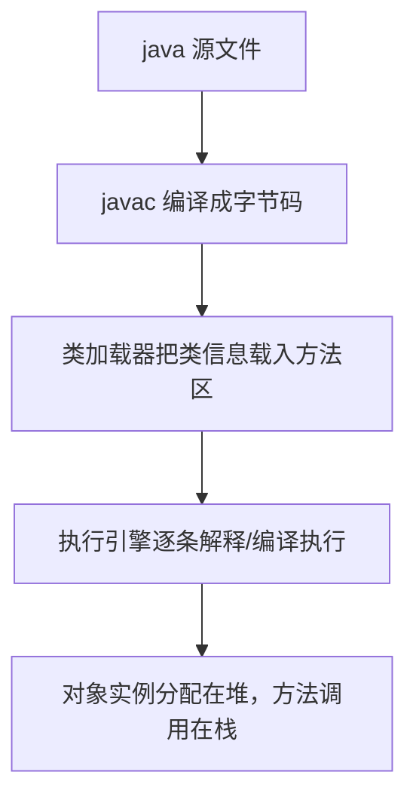
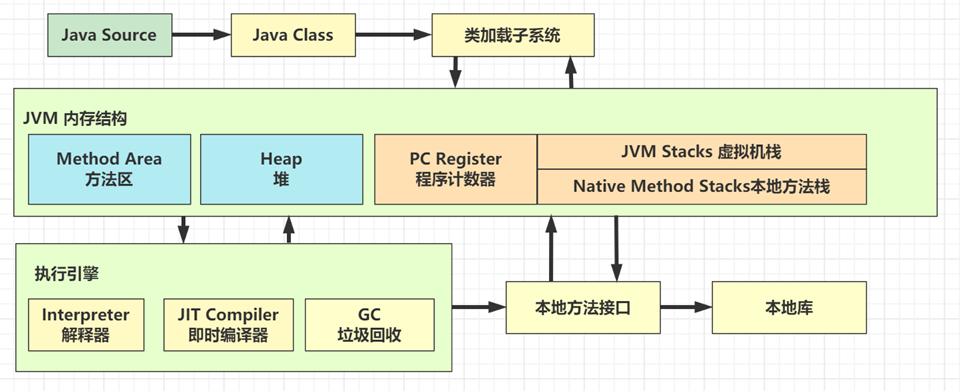
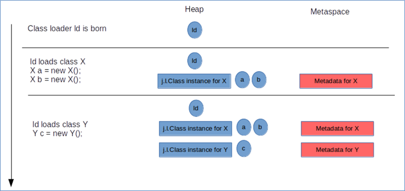
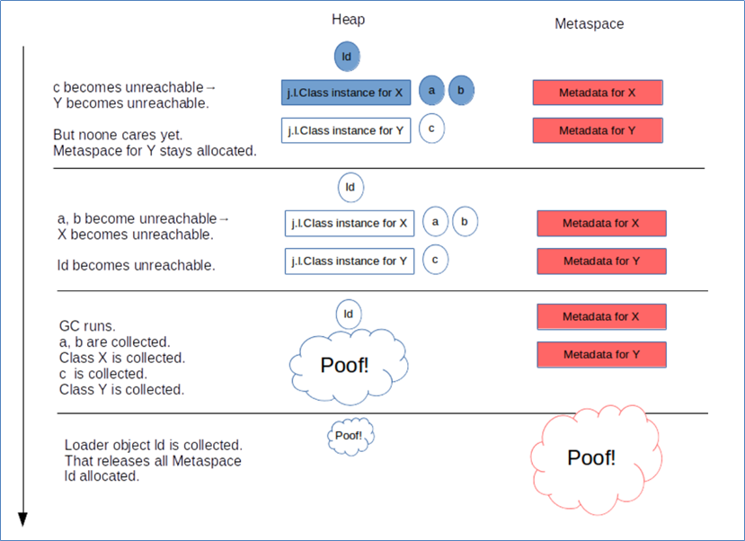
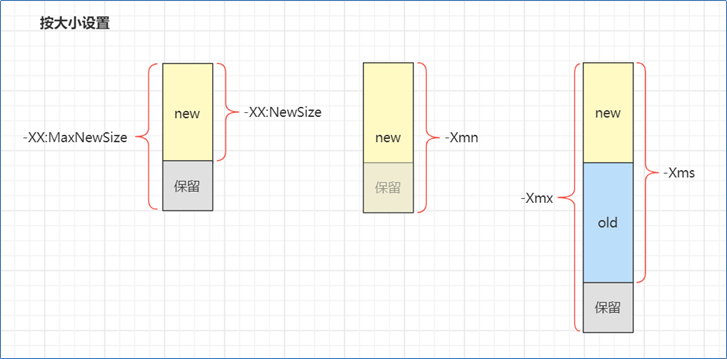

# JVM 内存结构：跟着一段代码的执行流程走一遍

面试题：请说一下 JVM 的内存结构，各个区域的作用是什么？

这道题是 JVM 篇的送分题也是分水岭。能把每个区域的名字和作用背下来，面试就算过了；但真正出彩的答法，是顺着一段 Java 代码的执行流程，把每个区域「什么时候参与、干了什么」讲清楚。背的是清单，讲流程才是理解。这篇就用后者把内存结构过一遍。

## 先给结论

JVM 内存结构按线程归属分两大家族：

- **线程私有**：程序计数器、虚拟机栈、本地方法栈。每个线程独立一份，互不干扰。
- **线程共享**：堆、方法区。所有线程都能访问。

执行引擎（解释器、JIT 即时编译器（白话：把跑得最勤的热点代码直接编译成本地机器码来加速）、垃圾回收）贯穿始终，负责把字节码变成机器码并管理堆内存。类加载子系统负责把类的信息读进方法区。



## 是什么：从一段代码的执行流程看内存结构

死记硬背每个区域的名字，印象不深。换个方式：写一段最简单的 Java 代码，看它从源码到执行，JVM 的各个部分分别干了什么活。

```java
public class Main {
    public static void main(String[] args) {
        Student stu = new Student();
        stu.study();
        stu.hashCode();
        stu = null;
    }
}
```

这段代码大家都很熟悉，但每一行背后都有内存结构在支撑。顺着执行顺序走一遍。

**第一步，源码变字节码。** 这段代码叫 Java Source，也就是 Java 源代码。CPU 能直接执行它吗？不行，Java 源代码需要先经过编译：通过 `javac` 命令把源码编译成 Java Class 字节码文件。字节码的作用非常大，它是一种中间表示，JVM 可以把它解释成适用于不同平台的机器指令，跨平台就是这么来的。

**第二步，启动 JVM。** 字节码有了，怎么运行？通过 `java` 命令跟上类名去执行。执行 `java` 命令的时候，JVM 就被创建出来了，上面架构图里除 Source 和 Class 之外的所有部分，都是 JVM 的组成部分。

**第三步，创建主线程。** JVM 启动后要做的一件重要事情，是创建一个名为 main 的主线程，用来执行入口方法，也就是 `main` 方法的代码。线程要干活，自己得占内存，主线程的内存从哪来？从虚拟机栈（JVM Stacks）里分配。不只是主线程，以后任何 Java 线程，包括用 `new Thread` 创建出来的线程，它们使用的内存都来自虚拟机栈。

**第四步，类加载。** 主线程跑起来了，内存也有了，但还不能执行 `main` 方法，因为方法代码在 Main 类里，类没加载，JVM 根本不知道有哪些代码可执行。所以 JVM 一旦发现自己有没见过的类，就会触发类加载，由类加载子系统完成。类加载做的事很简单：把存储在磁盘上的字节码文件里的信息读取到内存中，存放的位置就是**方法区**。

类的原始信息包括：类的名字、继承关系、成员变量、引用到的其他类的名字，以及方法的代码。主线程先触发最外层 Main 类的加载，执行时再遇到没见过的类（比如代码里的 `Student`），就再触发一次加载，把 Student 类的信息也放进方法区。到这就清楚方法区的作用了：存类的信息，包括方法代码。

**第五步，new 对象。** 代码执行到 `new Student()` 时，要创建一个实例对象。对象占用的内存来自**堆**：JVM 根据这个类有多少个成员变量、每个成员变量占多少字节，算出创建一个对象需要多大的内存，然后到堆里找一块空闲内存存放。对象里的成员变量有值了，也存在堆中。所以 Java 对象占用的内存，占的是堆的内存。

那局部变量和方法参数呢？比如 `stu` 这个引用，它只是个引用地址（引用值），不占用方法区和堆的内存，占用的是当前线程的栈内存。到这里三者的分工就清楚了：**方法区存类的信息，堆存对象的信息，方法内的局部变量和方法参数用栈的内存。**

**第六步，方法调用与本地方法。** 方法的调用分两类。一类是普通的 Java 方法，代码你自己实现；另一类是 Java 代码没法直接实现、要借助操作系统提供的函数来完成的，比如 `hashCode()`、`getClass()`，以及 `wait`/`notify`，这些叫**本地方法**。JVM 规范对这两类方法的内存做了划分：Java 方法用虚拟机栈，本地方法用本地方法栈。

但规范归规范，具体实现是另一回事。现在主流用的是 HotSpot，它并没有分得这么细，普通 Java 方法和本地方法内部用的其实是同一个虚拟机栈，相当于没有单独实现本地方法栈，把两者合二为一了。这点很多教材不讲，面试时能说出来是加分项。

**第七步，线程切换与程序计数器。** 线程不可能一直占着 CPU。主线程执行一些代码后，CPU 使用权可能交给其他线程，那下次再轮到自己时，从哪行代码继续执行？靠**程序计数器**。它非常简单，就是记录当前线程执行到第几行代码。线程即使被切换走，恢复执行时通过程序计数器就知道该从哪继续。

顺带把这几个区域的分工记牢：程序计数器记录代码执行到了第几行；虚拟机栈记录方法内的局部变量、方法参数，以及方法返回地址等信息；本地方法栈在 HotSpot 中没有单独实现，与虚拟机栈是同一个。

本地方法调用时，调用的不是 Java 代码，而是通过本地方法接口间接调用操作系统提供的功能，也就是本地库（Native Library）。

## 为什么这样设计

堆和方法区被所有线程共享，是因为对象和类的信息本来就要跨线程访问：线程一创建的对象放在堆里，线程二也要能访问到；方法区里的类信息同样是多个线程共享的。而程序计数器和虚拟机栈必须线程私有：每个线程执行到哪一行、有哪些局部变量，是各自的执行现场，混用就全乱套了。按线程归属划分内存区域，本质是为了线程安全与执行效率的平衡。

## 深入细节：执行引擎的三件套

上面的流程还缺一块：字节码最终是要交给 CPU 执行的，但 CPU 只认机器码，不认识字节码。这中间的转换由执行引擎完成，它有三员大将：

- **解释器（Interpreter）**：把字节码逐行翻译成机器码交给 CPU。它的特点是同一行代码反复执行就反复翻译，调用两次就解释两遍，效率不是最优。
- **JIT 即时编译器（Just-In-Time Compiler）**：专治热点代码。如果某段代码被频繁调用（比如已经调用了一万次），就属于热点代码，不适合每次都用解释器。JIT 负责发现热点代码，把它编译成机器码并缓存起来，下次再遇到直接从缓存里取机器码交给 CPU，省掉解释步骤，执行效率成倍提高。
- **垃圾回收（GC）**：当对象不再被引用时（比如代码里 `stu = null`，没有任何地方再引用这个 Student 对象），它就成了垃圾。等内存不足时就会触发垃圾回收，把这些不再使用的对象回收掉，把内存释放出来。GC 是执行引擎的组成部分。

三者的分工可以一句话串起来：解释器保证「能跑」，JIT 保证「跑得快」，GC 保证「跑得久」。

## 面试怎么答

标准答法建议按这个顺序展开：

1. **先分类**：线程私有（程序计数器、虚拟机栈、本地方法栈）和线程共享（堆、方法区），一句话给出全局图。
2. **再逐个说作用**：程序计数器记录当前线程执行到第几行；虚拟机栈存局部变量、方法参数，Java 方法用它；本地方法栈服务本地方法，HotSpot 中两者已合并；堆存对象实例；方法区存类信息、方法代码。
3. **加分项**：用一段代码的执行流程把各区域串起来（源码 → javac 编译 → java 启动创建主线程 → 类加载进方法区 → new 对象进堆 → 引用在栈上），体现理解而不是背诵。
4. **延伸项**：主动提一句执行引擎（解释器 + JIT + GC）和 HotSpot 对本地方法栈的合并实现，把话题引向自己熟悉的 GC 细节。

常见追问：

- **问**：为什么方法区要放类的信息，不放对象？
  **答**：类是模板、对象是实例，职责不同。类的名字、继承关系、方法代码这些结构信息加载一次供所有线程共享；而每个对象的数据各不相同，按需在堆里分配，两者分开管理，加载和回收的策略也不一样。
- **问**：程序计数器为什么是线程私有的？
  **答**：它记录的是「当前线程执行到哪一行」，是执行现场的组成部分。多线程切换后各线程要从各自的位置恢复，混用会导致跳错行，所以必须每线程一份。

## 常见误区

- **误区一**：把方法区叫「永久代」。永久代是 HotSpot 早期对方法区的实现，JDK 8 起改用元空间（Metaspace），方法区是规范、元空间是实现，别混称。
- **误区二**：认为对象一定在堆里。常规对象在堆，但 JIT 的逃逸分析可能把未逃逸的对象优化到栈上分配，这是运行时优化，不是内存结构的定义。
- **误区三**：说本地方法栈 HotSpot 一定单独实现。实际上 HotSpot 将虚拟机栈与本地方法栈合二为一，规范区分、实现合并。

## 课件配图
> 以下配图取自阶段七课件对应讲义，与上文讲解一一对应，可作为图文对照辅助理解。
**JVM 内存结构**（课件讲义图示）



**讲义配图**（课件讲义图示）

