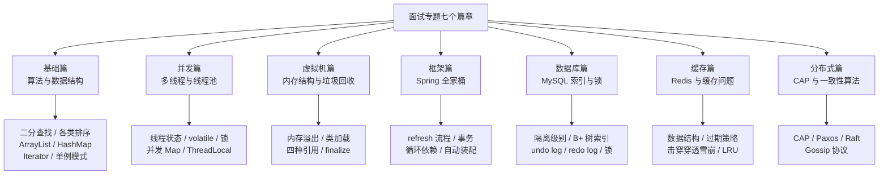

# 课程介绍：这门面试专题讲什么、怎么讲

准备面试的同学，聊到最后都会落到三个问题上：刷题是数量重要还是质量重要？把答案背下来能不能过面试？为什么有的题答案摆在眼前，看三遍还是记不住？本篇不急着讲题，先把这套面试专题的讲法和知识版图交代清楚。后面每篇文章对应一个面试题，遇到哪个查哪个。

## 先给结论

- 面试准备，质量永远排在数量前面。网上随手能搜到「面试一千题」之类的合集，答案大多是东拼西凑攒出来的，没经过仔细推敲和严格验证，甚至结论本身就是错的，照着背很容易被带偏。
- 题目关联的底层知识，比题目答案本身重要。背答案只能应付一场面试，打牢基础才是长期饭票。
- 知识掌握的速度，很大程度上取决于它呈现得是否形象。越抽象的讲解，理解成本越高，花的时间越长。
- 这套专题分七个篇章：基础、并发、虚拟机、框架、数据库、缓存、分布式，覆盖 Java 面试的高频知识点。

## 是什么：三个备考观点

**第一，质量重于数量。** 现在最不缺的就是面试题，网络上一搜一大把，「某某知识面试一千题」看起来又全又厚，但这类合集的答案有个共性毛病：粗制滥造。来源多是网上文章东抄一点西抄一点拼在一起，没有经过仔细推敲，也没有经过严格验证，有些结论干脆是错的。拿一个错误的答案去跟面试官讲，不是加分，是直接把天聊死。所以这套专题挑题讲题，先保证题是精心选的，答案是验证过的。

**第二，掌握题目背后的知识，而不是题目本身。** 「把题目和答案背下来就能过面试」这个想法不可取。面试官稍微换个问法、追问一层，背的答案就对不上。真正要做的是掌握题目关联的知识点，顺带把底层原理挖出来，这样才打得牢、走得远。目标不是应付这一次面试，而是后面漫长的职业生涯。

**第三，越形象，越好懂。** 难的知识点通常讲解也抽象，越抽象越难理解，掌握成本就越高。所以这套专题会尽量用可视化的手段重新包装这些题，把抽象的变成具体的。举个书里的例子：讲快速排序，不是丢一段代码让你自己悟，而是用可以交互的网页把每一步记录下来，想看哪一步就翻哪一步。单边循环法（也叫 Lomuto 分区）每一步怎么选基准点、怎么比较、怎么交换，都一步步摆出来；第一轮循环结束，比基准点小的放左边、大的放右边，接着在左侧区间再来第二轮。网上的动图也能演示快排，但动图不能倒退，你想再看一眼刚才那一帧，只能从头放一遍；可交互的页面就不存在这个问题。

## 深入细节：七个篇章的知识版图

七个篇章各管一块，从标题基本能猜出内容。

**基础篇**，算法和数据结构：二分查找、冒泡排序、选择排序、插入排序、快速排序；数据结构有 ArrayList、Iterator（fail-fast 与 fail-safe）、LinkedList、HashMap；还有一个热门的设计模式：单例模式。侧重点是换一种更形象的讲法，把这些学过的知识重新讲一遍。

**并发篇**，多线程相关：线程状态、线程池、`wait` 和 `sleep` 的区别、`lock` 和 `synchronized` 的区别、volatile、悲观锁与乐观锁、并发 Map、ThreadLocal。

**虚拟机篇**，JVM 相关：内存结构、内存参数、垃圾回收机制、内存溢出的各种情况、类加载的细节。这部分会挖得比较深，四种引用、`finalize` 的原理都会讲到，表面是面试题，实际往下扎得很深。

**框架篇**，以 Spring 为主：Spring 的 refresh 流程、Spring bean 的生命周期、Spring 事务失效的场景、SpringMVC 的执行流程、Spring 的注解、SpringBoot 的自动装配原理、Spring 中的设计模式（结合源码把体现模式的地方挑出来），还有经典的循环依赖问题。

**数据库篇**，MySQL 补充：事务隔离级别、快照读和当前读、InnoDB 与 MyISAM 两种引擎、索引（含 B+ 树结构）、一条查询语句的执行流程、undo log 和 redo log，以及各种锁：间隙锁、临键锁、行锁、表锁、全局锁。

**缓存篇**，以 Redis 为主：Redis 的数据结构（不是指数据类型，是类型底下更底层的结构，比如跳表）、KEYS 命令的执行效率问题、过期 key 的删除策略、Redis 的持久化，还有缓存的各种典型问题：击穿、穿透、雪崩、一致性、原子性；Redis 的事务；以及高频面试题 LRU cache 的实现，包括 Redis 自己怎么做的、自己要实现怎么做。

**分布式篇**，偏理论：CAP 定理、Paxos 算法、Raft 算法、Gossip 协议，以及一些分布式通用设计，比如怎么检测节点存活、怎么实现高可用、全局 ID 怎么生成、负载均衡策略怎么选、数据的分片策略有哪些、分布式事务有哪些实现方式。

## 面试怎么答

这篇文章本身不考，但它给了你一张备考地图：被问「你的知识盲区在哪」这类开放题时，可以照着七个篇章过一遍，逐个说掌握程度。更实际的用法是拿它当索引：哪个篇章弱，就去找对应的文章补。

## 常见误区

- **误区一**：追求刷题数量，收藏了一堆面试题合集却从不动笔验证答案对错。质量不过关的量，刷得越多错得越牢。
- **误区二**：把「背过答案」当成「掌握知识」。追问一层就露馅，根子就在底层原理没挖。
- **误区三**：专挑抽象的讲解啃。理解成本和抽象程度基本成正比，找形象、可视化的讲解材料，能少走很多弯路。
