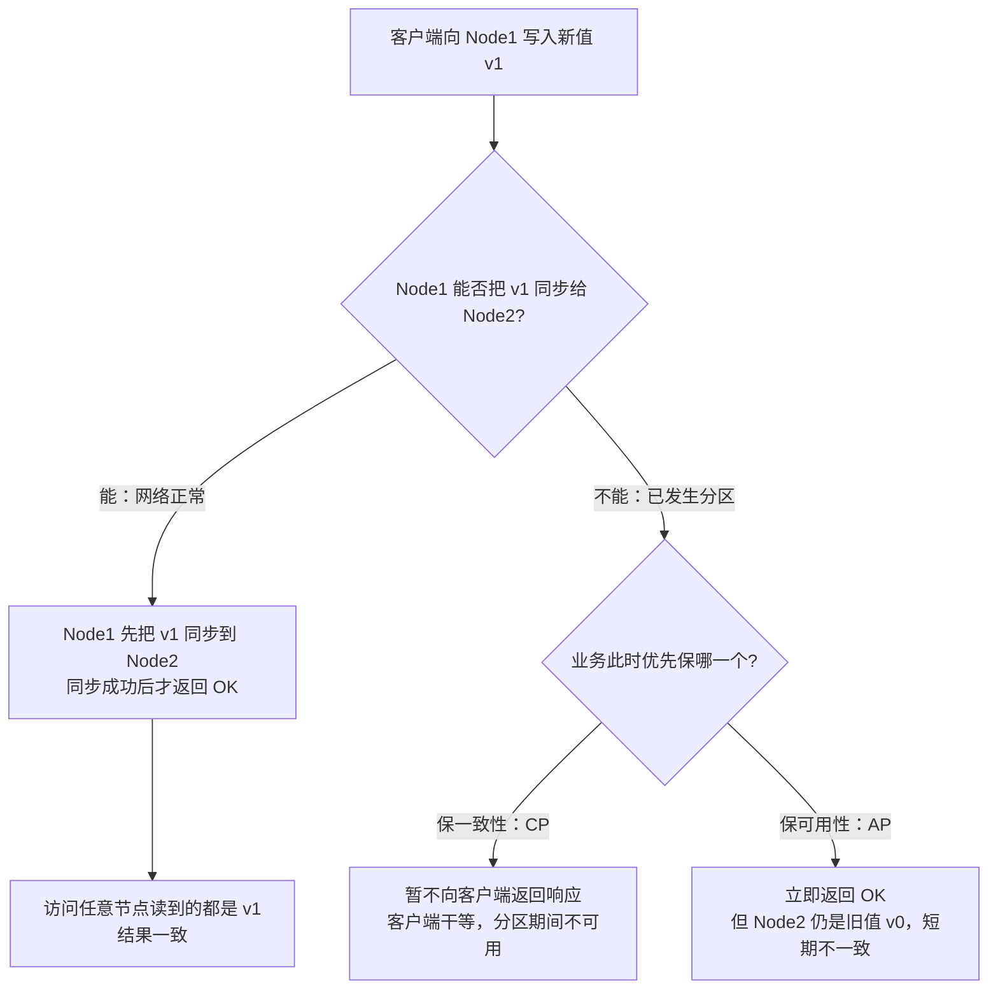
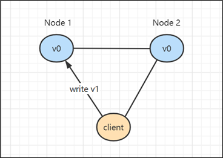
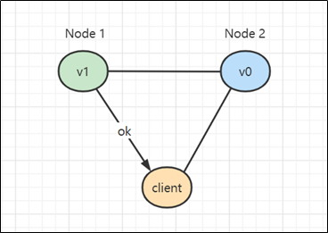
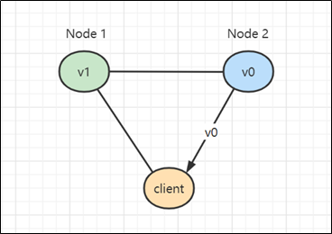
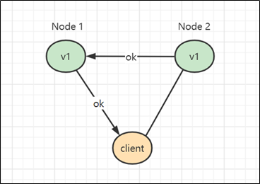
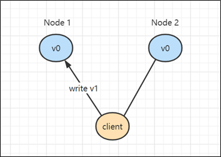
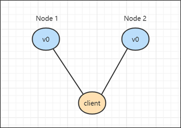
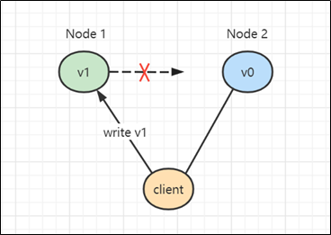
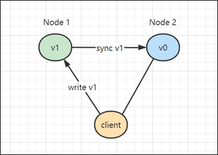
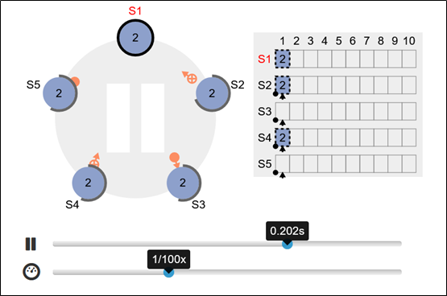

# CAP 定理：一致性、可用性和分区容忍性怎么权衡

面试题：说一下 CAP 定理。

这题是分布式篇的送分题，也是分水岭。三个单词的含义，大多数人都能背；真正拉开差距的是后半段：分区真的发生时，你在 C 和 A 之间怎么选，代价分别是什么。能把 Node1、Node2 的例子讲圆，这题才算答透。

## 先给结论

- C 是一致性（Consistency）：访问分布式系统中任意一个节点，总能返回一致的结果。不能访问节点 A 返回 10，访问节点 B 同一个值却返回 5。
- A 是可用性（Availability）：只要还有节点存活，系统就总能向客户端返回响应，不会因为某几个服务器挂了就停止服务，但不保证返回的是最新写入。
- P 是分区容忍性（Partition Tolerance）：节点之间网络通信出问题（消息丢失、延迟）时，系统仍能继续运行。
- CAP 定理：一个分布式系统中，这三个特性最多同时满足两个，不可能三者全要。分区必须容忍，所以实际是在 CP 和 AP 之间做权衡。

## 是什么

先看三个单词各自的含义。

**一致性。** 客户端访问集群里任意一个节点，拿到的结果都应该是一致的。同一个值，不能在这个节点上是 10、在那个节点上是 5，否则用户会觉得很困惑：到底哪个是对的？一致性要求的就是「任意节点、同一结果」。这段经典的英文定义可以顺手记一下：*Every read receives the most recent write or an error*（每次读都能拿到最新写入，否则宁可报错）。

**可用性。** 系统里的服务器挂了一台甚至几台，只要还有节点活着，就照样能向客户端返回响应，而不是说「我内部出问题了，暂停服务」。注意可用性只承诺「有响应」，不承诺「响应里一定是最新数据」，英文定义是 *Every request receives a (non-error) response, without the guarantee that it contains the most recent write*。

**分区容忍性。** 要理解它，先得知道什么叫分区。分区指的是分布式系统内部节点之间的网络通信出了问题。比如系统里有节点 A 和节点 B，A 发给 B 的消息丢了，或者延迟了，这就是内部通信故障。遇到分区有两种态度：一种是不容忍，一旦发现内部通信出问题，就停止对外服务；另一种是容忍，内部就算通信断了，系统也继续对外运行，英文定义是 *The system continues to operate despite an arbitrary number of messages being dropped (or delayed) by the network between nodes*。分布式系统选的是后者，所以分区容忍是必选项，不是可选项。

## 深入细节：用两个节点走一遍 CP 和 AP

假设系统里有两个节点 Node1 和 Node2，都存着一个值，初始都是 v0。

**没有分区时。** 客户端先向 Node1 写入新值 v1，写成功了。这时候要不要立刻给客户端返回「写入成功」？如果立刻返回 OK，而 v1 还没来得及同步给 Node2，客户端下次访问到 Node2，读到的还是旧值 v0。客户端明明写的是最新值，读出来却是旧的，这就是不一致。所以一致的做法是：Node1 先把 v1 同步给 Node2，Node2 确认同步成功，Node1 才向客户端返回 OK。这样客户端访问任意一个节点，拿到的都是 v1。

**分区发生时。** Node1 和 Node2 之间网络断了，Node1 收到了客户端的写请求，本地写成功，但 v1 同步不过去。这时候就轮到 CP 和 AP 做选择了。

选 CP，一致性优先：内部网络不通，就不能向客户端返回响应，因为此刻返回 OK 就等于把刚才那种不一致放出去了。代价是客户端一直干等，系统在他眼里就是卡住了、不可用了。选一致性，换来的是分区期间不可用。

选 AP，可用性优先：不等同步，直接向客户端返回 OK，客户端不用干等。代价是数据不一致：接下来的客户端如果访问到 Node2，读到的还是旧值。选可用性，换来的是分区期间数据可能不一致。

一句话收尾：CP 和 AP 的分歧，全部发生在「分区已经出现」这个前提下，争的是先保一致还是先保可用。

## 面试怎么答

建议按这个骨架展开：

1. **三个概念各一句话**：一致性是任意节点读到一致结果；可用性是节点还活着就有响应；分区容忍性是内部通信故障时系统继续运行。
2. **点明定理**：三者最多同时满足两个，不可能全要。
3. **给出结论**：分区在分布式里是必然的，不容忍分区等于放弃分布式，所以实际是 CP 和 AP 二选一，看业务取舍。
4. **用例子落地**：两个节点写 v1 的场景，CP 选择不返回响应保一致，AP 选择直接返回保可用，代价各自说清。

常见追问：

- **问：为什么不选 CA？**
  **答**：CA 意味着不容忍分区，内部网络一断就整体停止对外服务。而分布式系统的节点分布在不同机器、不同机房，网络分区是客观存在的，不容忍分区，系统的可用性根本无从谈起，所以工程上都在 CP、AP 里选。
- **问：集群 N 个节点，写入后要求同步到剩下 N-1 个节点才返回 OK，这样最保险，但任意一个节点同步失败，整个集群就不可用了，怎么提高可用性？**
  **答**：思路是不再把「全部节点同步成功」作为返回前提，往 AP 和最终一致的方向放松：先让客户端拿到响应，数据在后台继续向其他节点补齐，接受一段时间内的不一致。这也是后面讲一致性级别时要展开的内容。

## 常见误区

- **误区一**：把 CAP 理解成「三个里随便挑两个扔一个」。准确说法是：分区发生时，C 和 A 二选一，P 是必选项。
- **误区二**：认为 AP 就是彻底不要一致性。AP 牺牲的是分区期间的强一致，通常配最终一致性兜底，不是放任数据永远对不上。

## 课件配图
> 以下配图取自阶段七课件对应讲义，与上文讲解一一对应，可作为图文对照辅助理解。
**CAP 定理**（课件讲义图示）

**讲义配图**（课件讲义图示）

