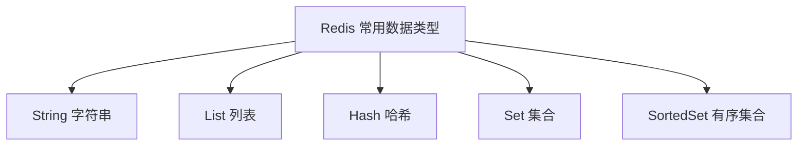
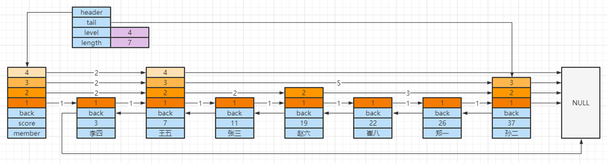
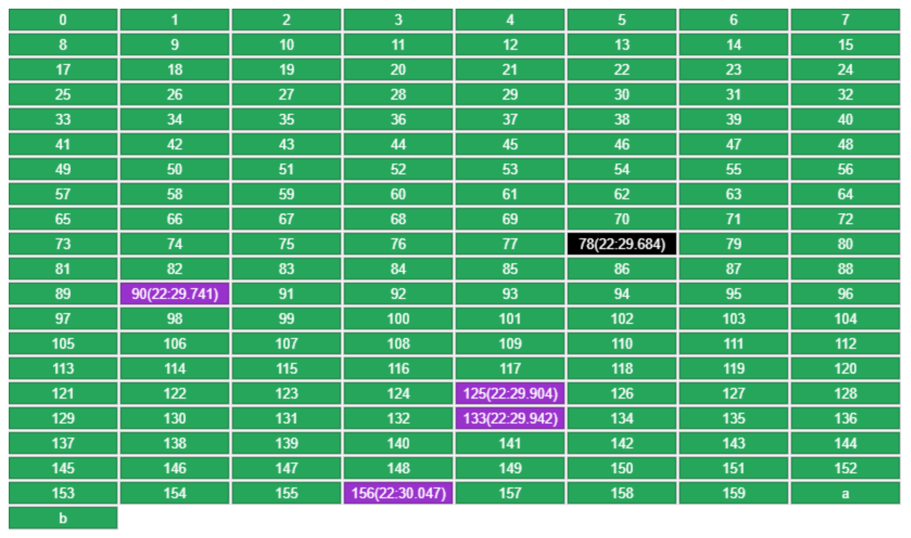

# Redis 数据类型概览：值的类型和底层编码

面试题：Redis 有哪些数据类型？某个数据类型的底层数据结构是怎样的？

Redis 数据类型的问法很固定：某某类型的底层数据结构是什么、怎么实现的、有哪些特点。所以这几个问题放在一起讲效率最高。这篇先把全景立起来：Redis 有哪些值类型、它们怎么被统一表示、编码到底是什么意思。后面每篇深入一种具体类型。

## 先给结论

- Redis 是键值型的内存数据库，这里说的数据类型指的是值的类型；键的类型没有花样，统一都是字符串。
- 常见的值类型有七种：string（字符串）、list（列表）、hash（哈希表）、set（集合）、sorted set（有序集合）、bitmap、hyperloglog。后两种用得不多，主要是做一些统计类需求。
- 每种值类型在底层都用一个叫 `redisObject` 的结构体来表示。结构体是 C 语言里描述复杂数据类型的方式，类似 Java 的类，但它只能定义属性、不能定义方法，相当于一个缩水版的类。
- 每种类型会根据情况不同有不同的编码（encoding）。这里的编码不是字符编码，而是指底层的数据结构。
- 这条主线面试最常考：同一种类型，数据量不同，底层实现可能完全不同。

## 是什么

先过一遍七种值类型。

string 是字符串，最基础的类型；list 是列表；hash 是哈希表；set 是集合，集合里的元素不重复；sorted set 是有序集合，在 set 的基础上加了排序功能，集合里的元素按分数有序；bitmap 和 hyperloglog 偏向统计场景，日常业务用得相对少。

再说统一的表示方式。不管哪种值类型，Redis 底层都用 `redisObject` 这个结构体来装。为什么要提它？因为面试官追问「Redis 怎么知道一个 key 存的是什么类型」时，答案就在这：每个值都带着自己的类型和编码信息，类型和编码共同决定这个值底层用什么结构存、用什么逻辑操作。

最后是编码的概念，这个词直译过来容易误解。它不是平时说的字符编码（比如 UTF-8），而是指这种类型的值底层用哪种数据结构实现。举个最直观的例子：Java 里的哈希表只有一种实现，数组加链表；Redis 的 hash 不一样，数据量小的时候用 ziplist（压缩列表）实现，数据量超过某个阈值，或者单个键值比较大的时候，才换成 hashtable（数组加链表）这种常见实现。同一套对外命令，底层换实现，这就是编码的意义：按数据量选最合适的结构，小数据紧凑省内存，大数据保证操作性能。

各类型常见的编码：string 有 int、embstr、raw 三种；hash 是 ziplist 和 hashtable；set 是 intset（整数集合）和 hashtable；sorted set 是 ziplist 和 skiplist（跳表）；list 是 quicklist，也就是多个 ziplist 串成的双向链表。具体每种在什么条件下切换，后面讲对应类型时细说。

## 深入细节

为什么同一种类型要准备多套编码？因为内存和性能要两头顾。ziplist 这类紧凑结构省内存，但插入删除要搬数据，数据一多就拖速度；hashtable、skiplist 这类结构操作快，但每个元素都有额外指针开销，数据少的时候纯浪费。Redis 的做法是设阈值，数据量在小结构里装得下就用小结构，超了再换，阈值可以在配置里调。

这里藏着一个高频追问：编码信息存在哪？就存在每个值的 `redisObject` 里，所以用 `OBJECT ENCODING` 命令可以直接查一个 key 当前用的编码。面试能说到这一层，说明真看过底层。

## 面试怎么答

被问「Redis 有哪些数据类型」，按这个节奏答：

1. **先分类说全**：string、list、hash、set、sorted set 是主力，bitmap 和 hyperloglog 做统计，七种报全。
2. **点出统一表示**：所有值底层都是 `redisObject`，类型和编码存在里面。
3. **解释编码**：编码指底层数据结构，同一种类型按数据量切换实现，举 hash 的 ziplist 到 hashtable 做例子。
4. **收尾预告**：具体每种类型的编码和切换条件，可以按面试官的追问逐个展开。

常见追问：

- **问： encoding 是字符编码吗？**
  **答**：不是。它指的是这个值底层用哪种数据结构，比如 ziplist、hashtable、skiplist，和字符编码没关系。
- **问：为什么要知道编码？**
  **答**：因为它直接决定内存占用和操作性能。比如小 hash 用 ziplist 很省内存，数据量大了不换实现，每次操作都要整块搬移，性能会塌。

## 常见误区

- **误区一**：把 encoding 理解成字符编码。它说的是底层数据结构。
- **误区二**：以为一种类型只有一种实现。恰恰相反，Redis 按数据量在多种实现之间切换，这是它内存控制的核心手段之一。
- **误区三**：把键的类型也当成多种。键统一是字符串，多样性全在值上。

## 课件配图
> 以下配图取自阶段七课件对应讲义，与上文讲解一一对应，可作为图文对照辅助理解。
**Redis 数据类型**（课件讲义图示）

**讲义配图**（课件讲义图示）

