# Spring refresh 流程概览：十二个步骤怎么分

面试题：说一下 ApplicationContext 的 refresh 流程。

ApplicationContext 是 Spring 的核心容器，refresh 是它初始化自己的方法，所有核心容器都必须调用 refresh 之后才能正常工作。这题的麻烦在于步骤多，直接按顺序背十二个方法名，记得累还容易串。靠谱的答法是先给分类框架，再按类别展开，最后落到最重的那一步上。

## 先给结论

- refresh 定义在所有 ApplicationContext 共同的父类 AbstractApplicationContext 里，方法体按重要调用可以数出十二个步骤（catch 和 finally 块里的不算）。
- 十二步分三段：第 1 步做准备工作；第 2 到 6 步创建和准备 BeanFactory；第 7 到 12 步准备 ApplicationContext 特有的功能。
- 第 11 步 `finishBeanFactoryInitialization` 负责创建和初始化容器里的单例对象，是整个 refresh 里最重的一步。
- ApplicationContext 只是个外层容器，bean 的创建、依赖注入、初始化这些核心活儿，实际交给 BeanFactory 完成，这就是第 2 到 6 步存在的理由。

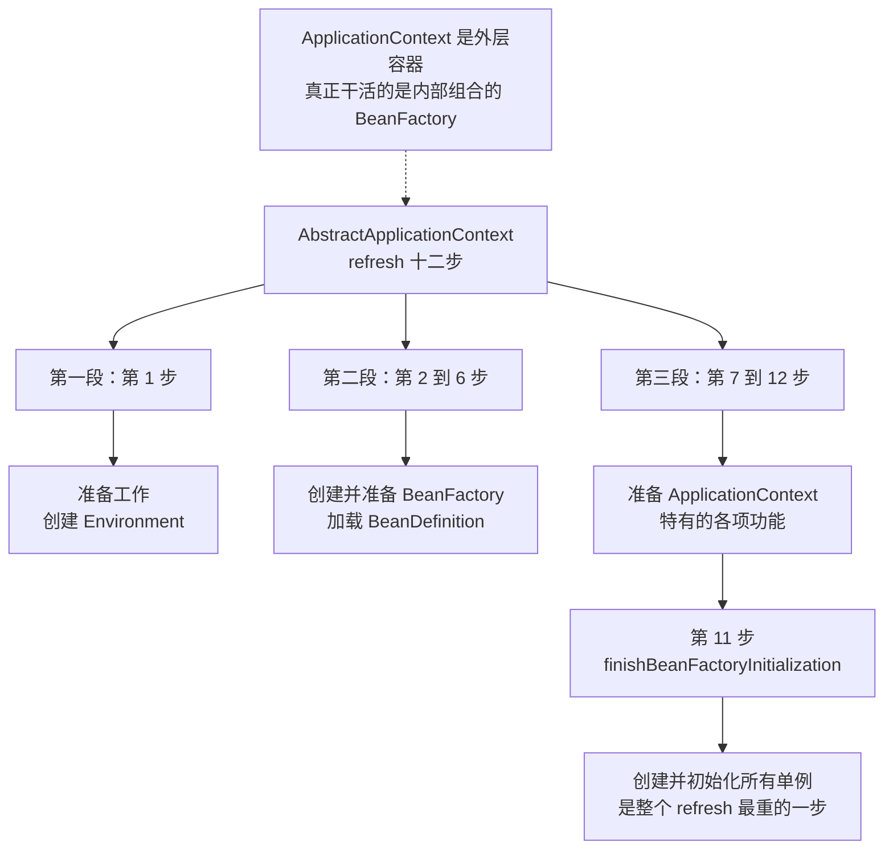

## 是什么：十二步的地图

先看代码，十二个步骤就是这十二个方法调用：

```java
// Prepare this context for refreshing.
prepareRefresh();

// Tell the subclass to refresh the internal bean factory.
ConfigurableListableBeanFactory beanFactory = obtainFreshBeanFactory();

// Prepare the bean factory for use in this context.
prepareBeanFactory(beanFactory);

try {
    // Allows post-processing of the bean factory in context subclasses.
    postProcessBeanFactory(beanFactory);

    // Invoke factory processors registered as beans in the context.
    invokeBeanFactoryPostProcessors(beanFactory);

    // Register bean processors that intercept bean creation.
    registerBeanPostProcessors(beanFactory);
    beanPostProcess.end();

    // Initialize message source for this context.
    initMessageSource();

    // Initialize event multicaster for this context.
    initApplicationEventMulticaster();

    // Initialize other special beans in specific context subclasses.
    onRefresh();

    // Check for listener beans and register them.
    registerListeners();

    // Instantiate all remaining (non-lazy-init) singletons.
    finishBeanFactoryInitialization(beanFactory);

    // Last step: publish corresponding event.
    finishRefresh();
}
catch (BeansException ex) {
    if (logger.isWarnEnabled()) {
        logger.warn("Exception encountered during context initialization - " +
                "cancelling refresh attempt: " + ex);
    }
    // ...
}
```

光看代码记不住，按作用分三类就好记：

**第一段，准备工作（第 1 步）。** 调用 `prepareRefresh()`，为后续所有步骤做准备，后面每一步都会用到它准备的东西。它具体准备了什么，下一篇单独讲。

**第二段，创建和准备 BeanFactory（第 2 到 6 步）。** 第 2 步 `obtainFreshBeanFactory()` 拿到一个全新的 BeanFactory；第 3 步 `prepareBeanFactory()` 给这个 BeanFactory 做基础准备；第 4 步 `postProcessBeanFactory()` 留给子类容器做定制；第 5 步 `invokeBeanFactoryPostProcessors()` 执行注册为 bean 的 BeanFactory 后置处理器；第 6 步 `registerBeanPostProcessors()` 注册拦截 bean 创建过程的 bean 后置处理器。

**第三段，准备 ApplicationContext 特有的功能（第 7 到 12 步）。** 第 7 步初始化消息源，第 8 步初始化事件广播器，第 9 步由具体容器子类初始化自己的特殊 bean，第 10 步检查并注册监听器 bean，第 11 步实例化所有剩余的非懒加载单例，第 12 步收尾并发布对应事件。其中第 11 步最值得标红：容器里那些单例对象，都是在这一步完成创建和初始化的。

## 深入细节

这里有个很多人没想过的问题：讲的是 ApplicationContext 的 refresh，为什么中间夹着 BeanFactory？

因为 ApplicationContext 定位是外层容器，它把最核心的活儿外包了：bean 的创建、bean 的依赖注入、bean 的初始化，这些并不是 ApplicationContext 亲自做的，而是借助 BeanFactory 完成。所以 refresh 的流程天然分成两截：先花五步把干活的 BeanFactory 创建好、准备好，再用六步料理 ApplicationContext 自己的特有功能。面试时把这个分工说清楚，比机械背十二个名字加分得多。

另一个值得注意的点是异常处理。十二步主体包在 try 里，一旦某一步抛出 BeansException，会记一条 warn 日志然后取消本次刷新。也就是说 refresh 是个整体性很强的过程，中途失败，容器就起不来。

## 面试怎么答

建议按这个顺序答：

1. **先给定位**：refresh 是 AbstractApplicationContext 里初始化容器的方法，分十二个重要步骤。
2. **再给分类**：第 1 步准备；第 2 到 6 步创建和准备 BeanFactory；第 7 到 12 步准备 ApplicationContext 特有功能。
3. **点出最重的一步**：第 11 步 `finishBeanFactoryInitialization` 创建和初始化所有非懒加载的单例 bean。
4. **补一句分工**：ApplicationContext 是外层容器，bean 创建、依赖注入、初始化靠 BeanFactory，所以中间五步是在备它。

常见追问：

- **问：十二个步骤里哪一步最能展开聊？**
  **答**：第 11 步。容器里所有单例对象都在这一步创建和初始化，bean 的生命周期、依赖注入、循环依赖这些问题的发生地全在这里，往下挖全是干货。
- **问：refresh 和 getBean 是什么关系？**
  **答**：refresh 负责把容器整个拉起来，到第 11 步时该创建的单例都创建完了；日常 getBean 大多是去拿这些已经就绪的单例。

## 常见误区

- **误区一**：以为 bean 的创建和依赖注入是 ApplicationContext 干的。它是外层容器，核心执行者是 BeanFactory，不理解这个分工，十二步的顺序就成了无意义的名词列表。
- **误区二**：把十二个步骤平铺着背。按「准备、备 BeanFactory、备 ApplicationContext 特有功能」三段记，再把第 11 步单拎出来，才记得住也讲得清。

## 课件配图
> 以下配图取自阶段七课件对应讲义，与上文讲解一一对应，可作为图文对照辅助理解。
**Spring refresh 流程**（课件讲义图示）
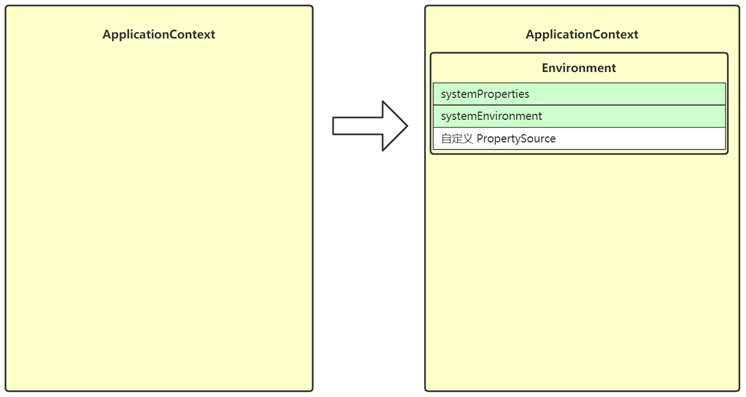
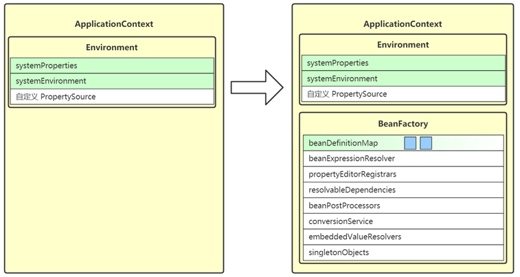
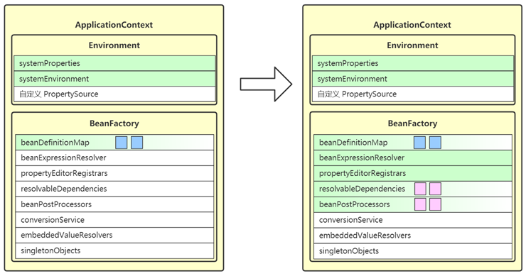
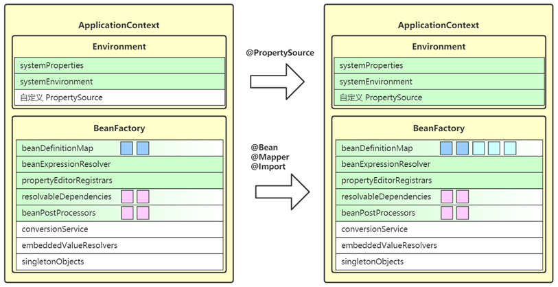
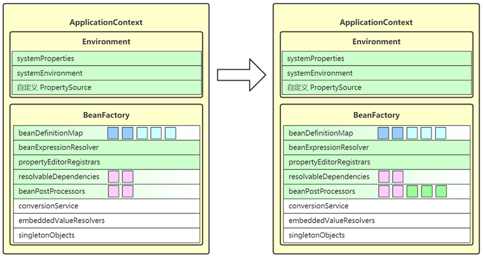
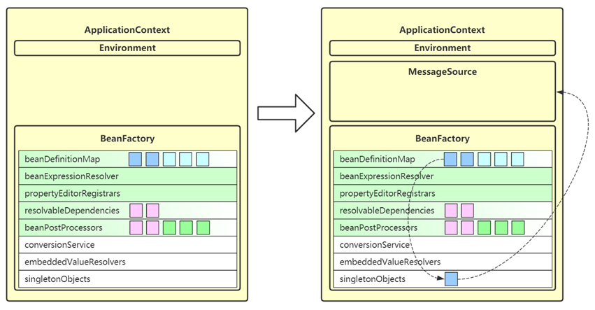
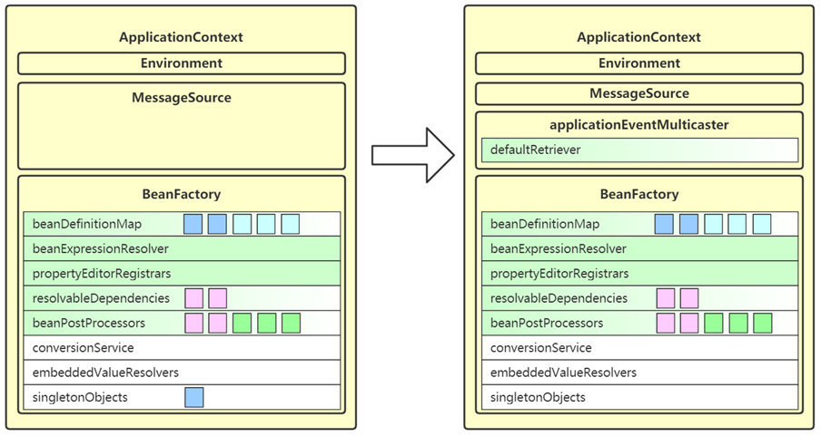
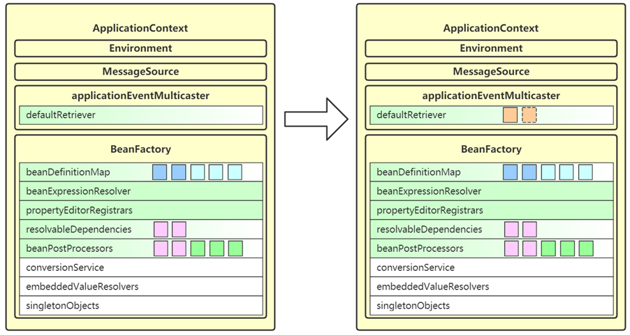
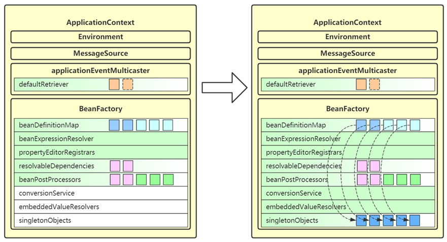
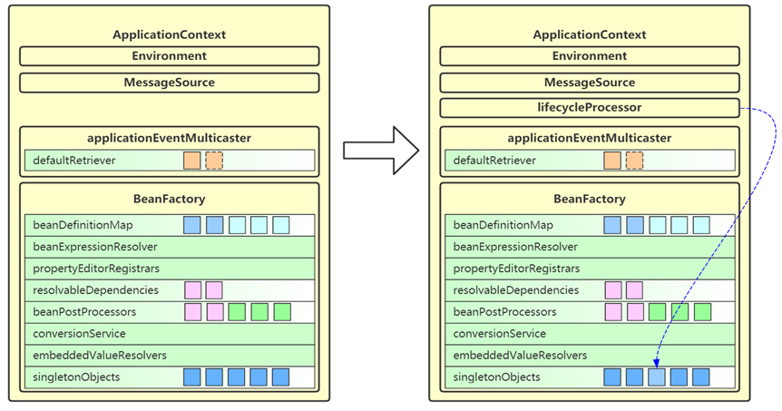
**讲义配图**（课件讲义图示）
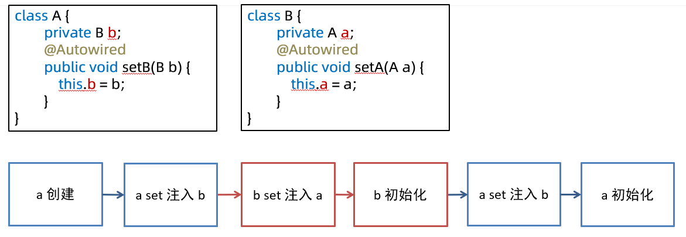
