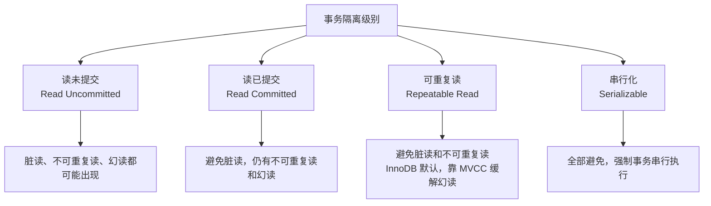

# MySQL 事务隔离级别：四种级别和三种读异常

面试题：MySQL 事务的隔离级别有哪些？

这题几乎人人「会答」：未提交读、提交读、可重复读、串行化，四个名字报一遍。但只报名字拿不到高分，面试官想听的是：每个级别在防哪种异常、各自的适用场景是什么、为什么线上最常用的只有 RC 和 RR。先给结论，再逐级过。

## 先给结论

- 隔离级别一共四种：未提交读、提交读（Read Committed，RC）、可重复读（Repeatable Read，RR）、串行化（Serializable）。
- 读异常有三种：脏读、不可重复读、幻读。隔离级别的本质，就是决定防住哪几种。
- 未提交读三种异常都可能出现，线上基本不用；RC 保证读到的都是已提交数据，不会有脏读，但仍有不可重复读和幻读；RR 在事务内基于快照读（读取事务开始时的一致性快照，靠 MVCC 多版本并发控制实现，因此看不到别的事务后续修改），不会出现不可重复读，仍可能有幻读；串行化三种全防，但性能代价最大。
- 实际开发最常用的是 RC 和 RR。选择标准就一句话：想看到最新的有效值用 RC，想要事务内更强的一致性用 RR。

## 是什么：先认三种异常

**脏读**，读到了其他事务还没提交的数据。这些数据可能是最新的增删改结果，但没提交就意味着可能被回滚，一旦回滚，这些修改就被撤销了，读到的就是无效数据。

**不可重复读**，同一个事务里多次读同一份数据，结果不一致。因为别的事务在中间改了并且提交了。

**幻读**，同一个事务里多次做范围查询，读到的行集不一样，比如第一次查出来 10 行，第二次查出来 11 行。

## 深入细节：四种隔离级别逐个过

**未提交读。** 能读到其他事务未提交的数据。它只关心数据是不是最新的，不关心数据是否有效，因为对方一个回滚，读到的数据就作废了，这就是脏读。这个级别下脏读、不可重复读、幻读三种异常都可能出现，所以开发中不会用它。

**提交读（RC）。** 只能读到其他事务已经提交的数据。人都提交了，数据自然是有效的，所以 RC 下不可能有脏读。但不可重复读和幻读仍然可能出现：事务 A 第一次读是个值，事务 B 改完提交，事务 A 再读就是新值，两次读不一致。RC 的适用场景是：你希望看到最新的有效值，每次查都查当前最新的结果，那就用提交读。

**可重复读（RR）。** 在事务范围内多次查询能保证一致：事务开始后第一次查询会建立一个快照，之后的查询都基于这个快照，不关心其他事务对这份数据做了什么修改。这样不可重复读就消失了。代价是看到的未必是最新有效值，别的事务的修改你可能压根看不到，你看到的始终是事务开始时那个快照。RR 下仍可能出现幻读，解决办法有两种：把隔离级别提升到串行化，或者加锁。RR 的适用场景是：整个事务运行期间要求数据保持一致，不能两次查询结果对不上。

**串行化（Serializable）。** 事务范围内只有读读能并发，也就是两个事务都在查询时可以并行；只要涉及读写（一个事务写一个事务查）或者写写，就会互相阻塞，事务只能挨个执行，事务一的代码执行完才执行事务二。这样当然不会产生任何交错，脏读、不可重复读、幻读全都没了，一致性最强。但读写、写写都阻塞，性能会受到很大影响，所以实际开发也不会用它。

RC 和 RR 的场景其实是对立的：要最新有效值选 RC，要事务内一致选 RR，按业务对「新」和「稳」的侧重来定。

## 面试怎么答

按这个节奏展开：

1. **报四种级别**：未提交读、提交读、可重复读、串行化。
2. **说清维度**：每种级别对应能防住哪些读异常，这是隔离级别的真正定义方式。
3. **讲场景**：RC 看最新有效值，RR 保事务内一致，串行化全防但性能差，未提交读线上不用。
4. **主动收尾**：补一句线上最常用 RC 和 RR，把话题引到具体项目的选型上。

常见追问：

- **问：RR 下还有幻读，怎么解决？**
  **答**：两条路，把隔离级别提升到串行化，或者对相关查询加锁，把可能插入新行的间隙也锁住。
- **问：RC 和 RR 怎么选？**
  **答**：看业务要「新」还是要「稳」。要每次读都是最新已提交的值，用 RC；要一个事务里前后读到的数据保持一致，用 RR，代价是看不到别人最新的修改。

## 常见误区

- **误区一**：以为隔离级别越高越好。串行化能干掉所有异常，但读写互相阻塞，性能代价极大，线上基本不用。
- **误区二**：以为 RR 看到的永远是最新数据。RR 基于事务内第一次查询建立的快照，别的事务后续的提交它看不到。
- **误区三**：把「串行读」和「串行化」当成两个东西。串行读就是串行化的一种表述，指的是同一时刻只允许一个事务访问数据。
