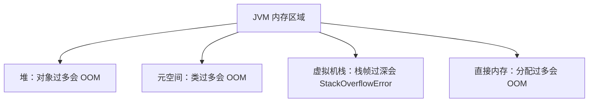

# JVM 内存结构：哪些区域会产生内存溢出

面试题：JVM 内存结构里，哪些区域会产生内存溢出？

这题通常是「说一下 JVM 内存结构」的追问。第一层答案一句话就能说完：除了程序计数器，其他四个区都有可能。但只说到这句，最多拿一半分，还得把两种错误类型分开：什么时候报 OutOfMemoryError，什么时候报 StackOverflowError，各自的典型场景是什么。

## 先给结论

- 五个区域里，程序计数器不会内存溢出，堆、方法区、虚拟机栈、本地方法栈都有可能。
- 溢出对应两种错误：OutOfMemoryError 是区域的空间被耗尽；StackOverflowError 是单个线程内方法调用次数太多，把栈打爆。
- OutOfMemoryError 的三种典型场景：堆内存耗尽、方法区内存耗尽、线程个数太多累积耗尽。
- StackOverflowError 的典型场景：递归调用没有正确的终止条件，无限递归把线程的栈内存耗光。
- 两种错误要分清：第三种是线程个数太多、总量太大；第四种是单个线程内调用太深。



## 是什么：先回顾五个区域

JVM 内存结构按线程归属分两大家族。线程私有的是程序计数器、虚拟机栈、本地方法栈；线程共享的是堆和方法区。程序计数器记录当前线程执行到第几行代码；虚拟机栈管方法内的局部变量、方法参数和方法调用；堆存对象实例；方法区存类的信息和方法代码。哪块会溢出，就围着这五块看。

```java
public class Main {
    public static void main(String[] args) {
        Student stu = new Student();
        stu.study();
        stu.hashCode();
        stu = null;
    }
}
```

这段代码就是最好的上下文：`new Student()` 的对象进堆，`stu` 这个引用在栈上，`stu = null` 之后对象不再被引用，就成了垃圾回收的目标。

## 深入细节：三种 OutOfMemoryError 和一种 StackOverflowError

**场景一，堆内存耗尽。** 堆用来存对象，对象创建得越来越多，而这些对象又一直在被使用，意味着它们不能被垃圾回收。垃圾回收只能释放不再被引用的对象所占的内存，一直被引用的它动不了。对象只进不出，堆最终被耗尽，报 OutOfMemoryError。上面代码里如果 `stu` 不置 null，或者被某个静态集合一直持有，就是这个局面。

**场景二，方法区内存耗尽。** 方法区存类的信息，这些信息的来源有两个：一个是类加载时从磁盘加载进来的类，另一个是运行期间动态生成的新类，很多框架都有这个需求，比如 Spring、MyBatis 在运行期生成代理类。不管哪种来源，类都要占方法区的内存，类的占用超过方法区设置的上限，就会 OutOfMemoryError。不过这种情况一般比较少：默认情况下方法区不设内存上限，物理内存有多大，它就能用多大，所以除非显式限制了大小或者疯狂生成动态类，否则很难把方法区撑爆。

**场景三，线程占用的内存太多。** 每创建一个线程，默认最多会占用一兆内存，线程个数越来越多，而这些线程又长时间运行不销毁，累积起来照样能把内存耗尽，报 OutOfMemoryError。正常情况下线程代码执行完，占用的内存会自然释放；就怕编程不当，线程一直挂着不回收，内存只借不还。

**场景四，StackOverflowError。** 它和前三项不是一类：单个线程内部，方法调用次数过多导致的。比如写了个递归调用，但终止条件写错了，方法无限调用下去。每一次方法调用，都要从该线程那一兆内存里分一点出来用，无限调用下去，这点栈内存必然被耗光，这时报的是 StackOverflowError。它和场景三的区别要咬死：场景三是线程个数太多、多份内存累积超限；场景四是单个线程内调用太深、一份内存被自己打穿。

## 面试怎么答

建议按这个骨架答：

1. **先过五个区域**：程序计数器、虚拟机栈、本地方法栈、堆、方法区，一句话点出只有程序计数器不会溢出。
2. **再分两种错误**：OutOfMemoryError 和 StackOverflowError，触发原因和报错信息都不同。
3. **OOM 讲三个场景**：堆耗尽（对象只进不出）、方法区耗尽（类和动态生成类超限，默认无上限所以少见）、线程太多累积耗尽。
4. **StackOverflowError 讲一个场景**：单线程内方法调用过深，典型是递归没写终止条件。
5. **收尾强调区分**：线程太多是总量问题，调用太深是单线程深度问题。

常见追问：

- **问：GC 一直在运行，为什么堆还会溢出？**
  **答**：GC 只回收不再被引用的对象。如果对象一直被强引用拿着，比如被静态集合、缓存只进不出，GC 再勤也回收不掉，堆还是会见底。
- **问：线程数暴涨和栈溢出怎么区分？**
  **答**：看报错：线程数过多报的是 OutOfMemoryError，通常是 unable to create new native thread；单线程调用过深报的是 StackOverflowError，伴随超长的调用栈。

## 常见误区

- **误区一**：说「五个区都可能溢出」。程序计数器存的是执行到第几行的行号，占用固定且极小，不可能溢出。
- **误区二**：把 StackOverflowError 也说成 OutOfMemoryError。两者是不同的 Error，触发条件和现场都不一样，面试官听得出区别。
- **误区三**：以为方法区很容易溢出。默认不设上限，实际触发的大多是显式限制了元空间大小、或者大量动态生成类的场景。
