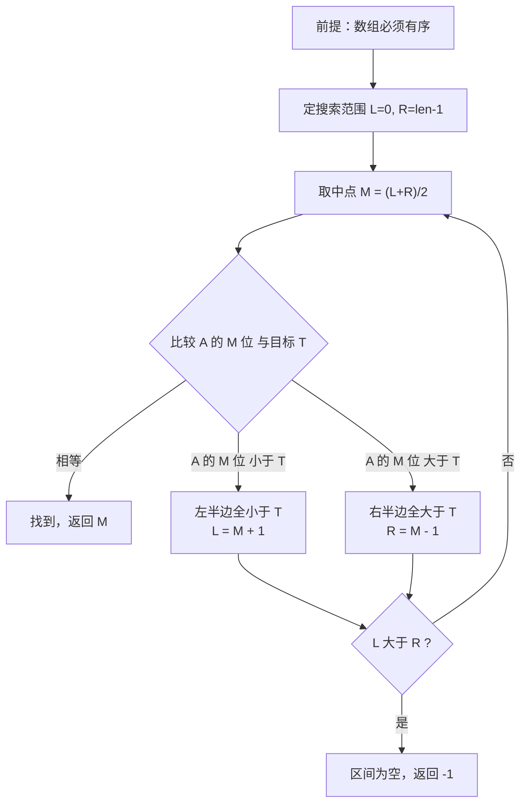

# 二分查找：折半查找的思路和手写要点

面试题：手写二分查找。

这题有两种考法。一种是出成笔试题，让你现场手写代码；另一种是出成选择题，在几个选项里挑正确的，考的全是细节：前提条件是什么、边界怎么处理、最坏比较多少次。手写本身不难，难的是一次写对；选择题的坑，基本都藏在前提和边界上。这篇把思路、细节一次说清。

## 先给结论

- 二分查找有个硬前提：待查找的数组必须有序。无序就得先排序，否则「丢一半」这个动作没有依据。
- 核心动作：每次取当前范围的中点值和目标值比，中点小就丢左半边，中点大就丢右半边，每比较一次，范围减半。
- 32 个元素的数组里找 126，顺序查找最坏要比较 32 次，二分只用了 5 次；就算元素多到 40 亿个，最坏也只需要比较 32 次。
- 手写的易错点全在边界：左右端点的初始值、更新方式、循环条件，以及中点的计算方式。



## 是什么：从顺序查找到折半查找

先看不用二分有多慢。一个长度为 32 的数组，里面是不重复的数字，要判断有没有 126 这个数。肉眼一扫就找到了，但计算机只能从头一个个比：看下标 0 是不是 126，不是；看下标 1，也不是。最坏情况下要找的元素在最后一个位置，就得比较 32 次。元素个数特别多的时候，这个效率无法接受。

于是有二分查找，但它有个前提：数组必须有序。给数组排好序，再找 126，就不用从头一个个比了。做法是：先确定搜索范围，一开始就是整个数组，下标 0 到 31；然后不逐个比，而是取这个范围的中间值来比。中间位置是下标 15，值是 66，拿 66 和 126 比，66 小。数组有序，66 左边的元素全都比 66 小，自然也不可能等于 126，这一下左半边全不用比了，比较范围直接少一半。

接下来只在右半边里找，再取中间值，这回是 112，还是比 126 小，左半边又丢掉一半；再取中间值 130，比 126 大，说明 130 右边的都比 126 大，右半边丢掉；再取中间值 121，比 126 小，左边含 121 全丢。范围一步步缩，最后一步就命中了。整个查找过程一共比较了 5 次，比顺序查找的 32 次少了整整六倍多。

记住这个结论：数组哪怕有 40 亿个元素，二分查找最坏情况也只需要比较 32 次左右，因为每次范围减半，比较次数是对数级别增长的。这就是折半查找的威力。

## 深入细节：手写代码和边界

标准的二分查找长这样：

```python
def binary_search(arr, target):
    left = 0
    right = len(arr) - 1
    while left <= right:
        mid = (left + right) // 2
        if arr[mid] == target:
            return mid
        elif arr[mid] < target:
            left = mid + 1
        else:
            right = mid - 1
    return -1  # 未找到
```

代码里每一行都在处理边界，逐个看：

- `left = 0`，`right = len(arr) - 1`：初始范围是闭区间，左右端点都是有效下标。
- `while left <= right`：因为是闭区间，左右端点重合时还有一个元素没查，所以条件是小于等于。这里写成 `left < right`，就会漏掉只剩一个元素的情况，这是最常见的手写错误。
- `mid = (left + right) // 2`：取中点。数据量极大的场景下，`left + right` 有溢出风险，更稳妥的写法是 `left + (right - left) // 2`，效果一样但不会加出界。
- 三分支：等于就返回下标；小于目标，说明目标在右半边，`left = mid + 1`，注意加 1，mid 已经比过了；大于目标，`right = mid - 1`，同理减 1。这两个加减 1 漏掉，范围就不收缩，直接死循环。
- `return -1`：循环走完还没找到，返回约定值表示不存在。

为什么二分必须要有序？因为「中点比目标小，所以左半边全可以丢」这个推理，依赖的就是有序性：中点左边的元素都不大于中点，自然也不大于比中点还大的目标。数组无序，这个推理不成立，丢掉的半边里可能就藏着答案。

## 面试怎么答

手写时按这个节奏来：

1. **先问清前提**：数组有序吗？有序才能二分，顺便提一句时间复杂度 O(log n)。
2. **边写边说边界**：闭区间、`left <= right`、`mid + 1` 和 `mid - 1`，把每个边界的作用讲出来，写对还讲得清，才是真的会。
3. **收尾补一句**：没找到返回 -1，调用方按这个约定处理。

常见追问：

- **问：数组里有重复元素，想找第一个或最后一个匹配的位置，怎么写？**
  **答**：思路不变，还是折半，只是把「等于就返回」改成「等于时继续收缩边界」：找第一个位置，命中后把右边界收到中点左边；找最后一个位置，命中后把左边界推到中点右边。这样能把范围逼到边界元素上。
- **问：为什么比较次数是对数级别？**
  **答**：每比较一次范围减半，n 个元素每次砍一半，砍到 1 就是 log n 次，所以 40 亿个元素最坏也就 32 次上下。

## 常见误区

- **误区一**：对无序数组用二分。前提是有序，先用这个前提卡一遍题目条件，很多选择题就考这个。
- **误区二**：循环条件用 `left < right` 却按闭区间更新端点。区间开闭和更新方式必须配套，混用必然漏答案或者死循环。
- **误区三**：更新端点时忘记加减 1。`left = mid` 或 `right = mid` 会让范围不再收缩，程序卡死。

## 课件配套可视化 Demo

> 本算法的交互式可视化页面已随本系列一并打包：[demos/day01_binary_search.html](demos/day01_binary_search.html)（基于 Bootstrap + jQuery，依赖的 `css/`、`js/` 已放在 `demos/` 下，直接用浏览器打开即可）。

页面用动态柱状图逐步演示 low / high / mid 三个指针的移动，以及「命中即返回」或「收缩半区」的全过程。本系列其余二分查找博客（整数溢出处理、选题、注意事项等）均可用同一页面对照演练。
