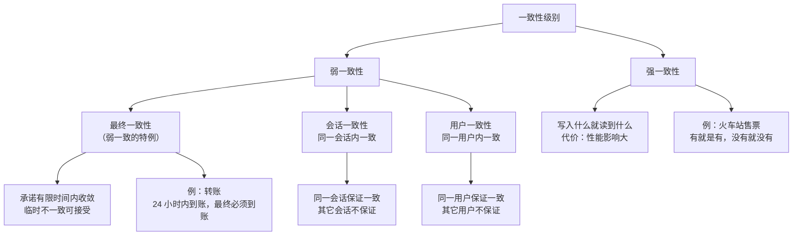
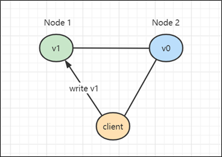
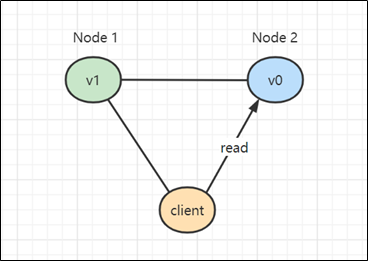
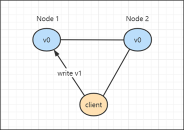
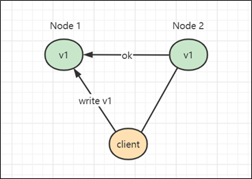
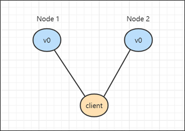
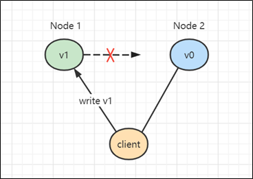
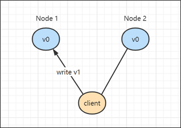
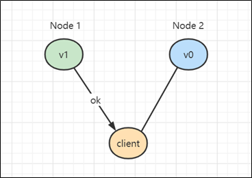

# CAP 中的一致性级别：强一致、弱一致和最终一致

面试题：一致性有哪些级别？

CAP 里选定 CP 或 AP 之后，还有个更细的问题：这个「一致性」本身也分级别，不同级别适配不同业务。这题的标准答案是三个：强一致性、弱一致性、最终一致性。拿分的关键不是把三个名词报出来，而是每个级别配一个能讲圆的例子。

## 先给结论

- 一致性分三个级别：强一致性、弱一致性、最终一致性，其中最终一致性是弱一致性的一个特例。
- 强一致：系统写入什么，读出来就是什么，绝不允许不一致；代价是性能，典型场景是火车站售票。
- 弱一致：写入成功后，不承诺立刻能读到，也不承诺多久之后能一致；典型场景是网购库存。
- 最终一致：承诺在一定时间内达到一致状态；典型场景是转账，到账提示 24 小时内，临时不一致可接受，最终必须到账。
- 三个级别各有适用场景，没有谁更优，按业务选。

## 深入细节：三个级别逐个过

**强一致性。** 顾名思义，系统写入什么，将来读出来的也会是什么，数据始终精确一致，不允许出现任何不一致。问题在实现成本：它对系统性能影响较大。回到之前 CP 的例子，两个节点之间发生网络分区，为了保一致，节点不能及时向客户端返回响应，客户端就卡在那里，整个系统的吞吐量被拖下来。强一致性也不是没有办法优化，Paxos、Raft、ZAB 这些共识算法，目标就是在保证强一致的前提下，把性能损失压下来。

**弱一致性。** 系统写入成功之后，不承诺立刻可以读到写入的值，甚至自己都未必能马上读到最新的；也不承诺具体多久以后数据能达到一致。例子就是网上购物：商品详情页展示的库存量是精确值吗？不一定。你看到「还有很多」，下单的瞬间却提示库存不足，因为你看到的是旧值，实际库存可能早被其他下单用户改少了。弱一致性在这个场景是可接受的，用户并不需要每时每刻看到最精确的库存，但有一个前提：必须在某个环节做一次准确的检查，也就是下单瞬间回源查真实库存，否则按详情页看到的旧库存扣减，就会超卖。反过来说，如果要求用户每次刷新都看到最新的精确库存，系统吞吐量会降到很低。弱一致性还能再细分，比如会话一致性（同一个会话内保证一致）、用户一致性（同一个用户内保证一致），细分粒度不同，本质都是放松了一致范围。

**最终一致性。** 可以看成弱一致性的特例：它保证在一定时间内，数据能达到一个一致的状态。典型例子是转账：转账完成后，钱不会立刻到对方账户，App 会提示 24 小时内到账。这种临时的不一致大家能接受，约定俗成；但最终必须一致，不能 24 小时过去了，钱从你账上扣了，对方却没收到，那不行。最终一致性在实现上有对应的算法，比如 Gossip 协议，靠节点之间随机捎带传播，让数据最终收敛，这块后面有时间再展开。

## 面试怎么答

按这个骨架答：

1. **报三个级别**：强一致、弱一致、最终一致，点明最终一致是弱一致的特例。
2. **每个级别配一个例子**：售票（强）、网购库存（弱）、转账到账（最终），例子比定义更能证明你真懂。
3. **点出权衡**：强一致保精度伤性能，弱一致换吞吐，最终一致在中间取平衡，各有场景，没有银弹。
4. **算法层面收尾**：强一致对应 Paxos、Raft、ZAB，最终一致常用 Gossip。

常见追问：

- **问：最终一致和弱一致的区别？**
  **答**：就在有没有时间承诺。弱一致连「多久能一致」都不承诺；最终一致承诺有限时间内一定收敛。所以最终一致是弱一致里可落地的那一档。
- **问：弱一致的场景怎么防止超卖？**
  **答**：展示层可以用旧数据，但关键动作必须回源做精确检查。网购库存就是在下单瞬间查真实库存，用这一次准确检查兜底。

## 常见误区

- **误区一**：把最终一致和弱一致并列成三选一。最终一致是弱一致的特例，区别只在有没有时间承诺。
- **误区二**：认为弱一致就是「数据随便不准」。弱一致靠关键环节的精确检查兜底，不是放任不一致，超卖就是这么防住的。
- **误区三**：以为强一致总是更好。强一致的性能代价摆在那，选哪种级别是业务权衡，不是技术优劣。

## 课件配图
> 以下配图取自阶段七课件对应讲义，与上文讲解一一对应，可作为图文对照辅助理解。
**CAP 定理**（课件讲义图示）

