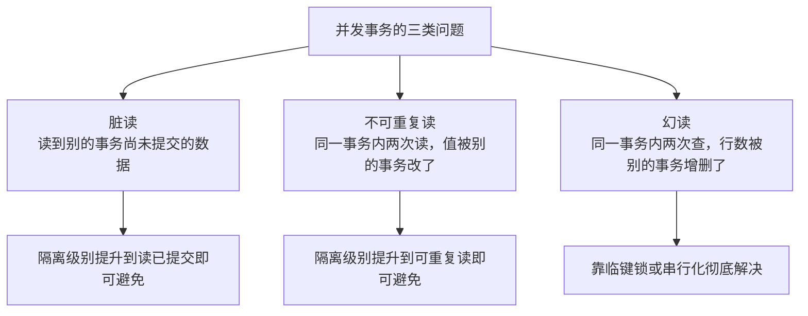

# 隔离级别：脏读、不可重复读与幻读

面试题：事务的隔离级别有哪些？分别会出现什么并发问题？

这道题是事务篇的高频题。四种隔离级别谁都背得出来，但面试官真正想听的，是你能把每种并发异常「在什么隔离级别下、由什么操作触发、怎么解决」讲清楚。背清单只能拿基础分，能画出两个事务交错执行的时间线、把脏读、不可重复读、幻读一个一个演示出来，才叫真懂。这篇就按这个路子过一遍。

## 先给结论

- **脏读**：一个事务读到了另一个事务还没提交的数据。脏读只在 read uncommitted（读未提交）级别下出现。
- **不可重复读**：同一事务内两次查询，同一行的结果不一样，因为别的事务改了数据并且提交了。主要出现在 read committed（提交读）。
- **幻读**：同一事务内两次查询，行的条数不一样，因为别的事务插入了新行。主要出现在 repeatable read（可重复读）。
- 隔离级别一级一级往上，正好一层封住前面一种现象，代价是并发度下降。
- 幻读有两种解决办法：读的时候加 `for update` 锁（给查询涉及的行加排他锁，阻止别的事务并发修改，从而堵住幻读），或者把隔离级别提到 serializable（串行化）。



## 是什么：三种异常现象

用一个 account 表做演示，表里有两个账户，余额都是 1000。

### 脏读

事务一 TX1 把自己的隔离级别设成了 read uncommitted。注意，只需要设置 TX1 一方就行，另一方 TX2 是什么隔离级别我们并不关心，不用把所有事务都设成一样。

TX1 开启事务后做了一次查询，看到两个账户余额都是 1000。接着 TX2 也开启事务，把账户 1 的余额改成了 2000，但是还没有提交。这时候 TX1 再查询，就看到账户 1 已经变成 2000 了，这就是脏读。

为什么叫「脏」？因为 TX2 随时可能 rollback。如果它回滚了，这个改成 2000 的操作就被撤销了，TX1 拿到的 2000 就是一个无效值。读到了别人未提交、随时可能不存在的数据，就是脏读。

```sql
tx1:
set session transaction isolation level read uncommitted;
start transaction;
select * from account; -- 查询结果: accountNo=1, balance=1000; accountNo=2, balance=1000
select * from account; -- 查询结果: accountNo=1, balance=2000; accountNo=2, balance=1000

tx2:
update account set balance = 2000 where accountNo=1;
```

### 不可重复读

把 TX1 的隔离级别提到 read committed，脏读就没有了。同样是开启一个事务，在事务里做两次查询，但两次查询之间有另一个事务做了一次更新并且提交了。注意 TX2 这次没有显式写 start transaction 和 commit，单独一条更新语句自己就是一个事务，语句执行完事务就结束了。

TX1 的两次查询结果不一致：第一次两个账户都是 1000，第二次账户 1 变成了 2000。这次的 2000 是有效值，因为 TX2 已经提交，数据确定下来了，不可能再回滚。但问题在于，同一个事务里两次查询结果不一样，到底以哪次为准？如果要把这两次结果拿去做计算，用第一次的 1000 还是第二次的 2000？这就造成了混乱。一次事务内多次查询结果不一致，就是不可重复读。

```sql
tx1:
set session transaction isolation level read committed;
start transaction;
select * from account; -- 查询结果: accountNo=1, balance=1000; accountNo=2, balance=1000
select * from account; -- 查询结果: accountNo=1, balance=2000; accountNo=2, balance=1000

tx2:
update account set balance = 2000 where accountNo=1;
```

### 幻读

再把隔离级别提到 repeatable read，不可重复读也没有了，但会出一个新问题：幻读。

幻读的起因一定是一边做查询、另一边做新增。TX1 在可重复读级别下开启事务，第一次查询时建立快照：它认为整个事务期间就这两条记录，取值都是 1000，别的事务做的增删改对它都暂时不可见。所以 TX1 第二次查，看到的还是两条记录、都是 1000。

但 TX2 新增的三号账户，在表里是真实存在的。TX1 查的时候看不到三号，于是认为自己也可以加一个三号账户，初始金额 5000，结果插入时报主键冲突：三号已经存在了。TX1 就很困惑，我查的时候明明没有三号，查一个不存在的记录报错，插一个查不到的记录也报错。这就是幻读，查询结果里像出现了「幻影」。

```sql
tx1:
set session transaction isolation level repeatable read;
start transaction;
select * from account; -- 查询结果: accountNo=1, balance=1000; accountNo=2, balance=1000
select * from account; -- 查询结果: accountNo=1, balance=1000; accountNo=2, balance=1000

tx2:
insert into account values(3, 1000); -- 插入新行
insert into account values(3, 5000); -- ERROR 1062: Duplicate entry '3' for key 'PRIMARY'
```

## 为什么这样设计

隔离级别的本质是在数据一致性和并发性能之间做取舍。级别放得越低，并发度越高，但能看到越多「不该看」的数据：read uncommitted 直接放开未提交的数据，于是有脏读；read committed 每次读都看最新提交的数据，于是同一事务内前后会不一致；repeatable read 用快照把旧数据固定住，已存在的行是稳定了，但快照挡不住别的事务真实插入的新行，幻读就来了。

所以四种级别是一层一层往上补的：read uncommitted 什么现象都有，read committed 封住脏读，repeatable read 封住不可重复读，serializable 串行执行全部封住。每上一层，并发能力就降一截。

## 深入细节：幻读的两种解决办法

### 第一种：读的时候加 for update 锁

隔离级别不提升，还是 repeatable read。TX1 在插入之前，先执行一条针对三号记录的加锁查询：

```sql
tx1:
set session transaction isolation level repeatable read;
start transaction;
select * from account; -- 查询结果: accountNo=1, balance=1000; accountNo=2, balance=1000
select * from account where accountNo=3 for update; -- 对 accountNo=3 的行加锁
insert into account values(3, 5000); -- 此时 tx2 的插入操作被阻塞（注释：/* 阻塞 */）

tx2:
insert into account values(3, 1000); -- /* 阻塞 */
```

对一条还不存在的记录提前加锁，相当于宣布这条记录只允许我自己操作。如果 TX2 在这条 for update 语句之后执行插入，就会因为锁冲突被卡住，阻塞在那里执行不了。TX1 这边不会再出现幻读，可以安全地插入自己的三号记录。等 TX1 事务结束，TX2 才发现自己这边报了主键冲突。

### 第二种：提升到 serializable

把隔离级别提到 serializable，效果一样，但加锁方式不同：

```sql
tx1:
set session transaction isolation level serializable;
start transaction;
select * from account; -- /* 此时已经加了读锁 */
-- 查询结果: accountNo=1, balance=1000; accountNo=2, balance=1000

tx2:
insert into account values(3, 1000); -- /* 阻塞 */
insert into account values(3, 5000); -- /* 阻塞 */
```

串行化级别下有一个容易误会的地方：我们并没有显式写 for update，但实际上普通的 select 已经被加上了共享读锁。其他事务可以来读，但想来写、想插入就不行了。TX2 执行 insert 会被阻塞，TX1 插入三号记录就能正常执行，同样不会出现幻读。

对比一下：for update 是给指定的行加排他锁，serializable 是给查到的所有行加共享读锁，最终的原理都是用锁的方式避免幻读。

## 面试怎么答

1. **先给定义再给级别对应**：脏读是读到未提交的数据，只在 read uncommitted 出现；不可重复读是同一事务两次查询同一行结果不一致，出现在 read committed；幻读是同一事务两次查询行数变了，出现在 repeatable read。
2. **演示一个例子**：用两个账户各 1000 的 account 表，把三种现象的时间线讲一遍，尤其是幻读为什么表现为「查不到却插不进去」。
3. **给解决方案**：幻读用 select ... for update 提前加锁，或者升级 serializable 让普通 select 也加共享读锁，本质都是加锁。
4. **加分项**：提一句两种读的路线，读最新提交数据的当前读走锁，固定时间点的快照读走快照，隔离级别就是在这两条路线之间做选择。

## 常见误区

- **误区一**：以为脏读在所有隔离级别都可能发生。实际上只有 read uncommitted 会读到未提交数据，read committed 以上都见不到。
- **误区二**：以为不可重复读读到的是无效数据。read committed 下读到的是已提交的有效值，问题出在同一事务内前后不一致，不是数据无效。
- **误区三**：以为 serializable 也要显式加 for update 才防幻读。串行化级别下普通 select 就自动带共享读锁，不用显式写。
