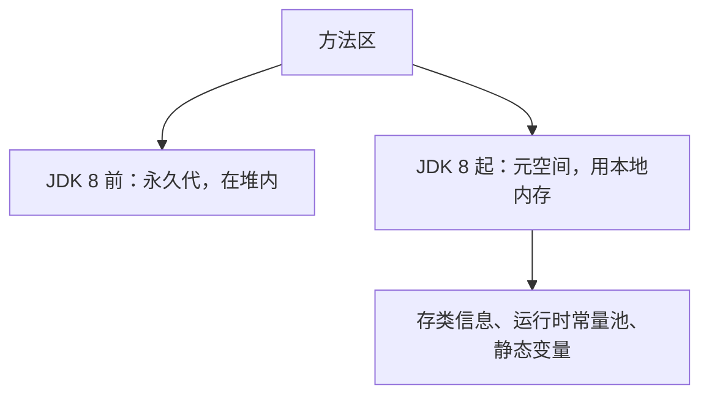

# JVM 内存结构：方法区、永久代与元空间

面试题：方法区和永久代、元空间是什么关系？

这道题看着是背书，实际考的是你能不能分清「规范」和「实现」。方法区是 JVM 规范里的定义，永久代和元空间是 HotSpot 在不同版本上的两套实现，三者不是并列关系。答的时候先一句话把关系定性，再展开元空间怎么工作，这道题就拿满了。

## 先给结论

- **方法区**是 JVM 规范中定义的一块区域，用来存储类的相关信息：类的名称、继承关系、引用的其他类、成员变量、方法的字节码、类和方法上的注解。
- **永久代**和**元空间**都是 HotSpot 对方法区的实现：永久代是 JDK 8 以前的实现，元空间（Metaspace）是 JDK 8 以后换的新实现。
- 元空间使用本地内存（白话：JVM 堆以外的操作系统内存，不受 -Xmx 堆大小限制）存储类的元数据；类的原始信息放在元空间里，访问它要借助堆中的 Class 对象，比如 X.class。
- 元空间的释放条件比较苛刻：要等到类的实例、Class 对象、类加载器都不再使用，类加载器被回收时，它加载过的类数据才会从元空间卸载。

## 是什么：三个概念的关系

先把最容易混淆的三个名字摆清楚。

方法区，前面已经反复提到，里面存类的相关信息：类的名称、继承关系、它引用的其他类的符号、成员变量、方法内的字节码，以及类上、方法上加的注解，这些都属于类的相关信息，最终都存储在方法区里。

但要注意一点：方法区只是 JVM 规范中的一个定义。规范只要求「得有这么一块区域来存储类的相关信息」，具体你的虚拟机怎么去实现这块区域，规范不管。不同的虚拟机实现完全可以有自己的实现方式。

永久代和元空间，就是对方法区的实现，而且都是 Oracle 的 HotSpot 虚拟机的实现。其中永久代版本比较老，是 JDK 8 以前对方法区的实现；元空间是 JDK 8 以后的实现，HotSpot 觉得 1.8 以前永久代这套实现不太好，就替换成了元空间，英文叫 Metaspace。

所以三者的关系一句话就能说清：**方法区是规范、是定义；永久代和元空间是不同 Java 版本对方法区的实现。**

## 为什么这样设计

永久代那套实现用得越久问题越明显：它大小受限，容易在加载类稍多时就把这块区域撑满，调优很别扭。JDK 8 起 HotSpot 换成元空间，改用本地内存来存类的元数据，空间上宽裕了很多，类元数据的管理也独立出来了。这也是为什么现在聊方法区，默认说的都是元空间。

## 深入细节：元空间是怎么工作的

元空间用本地内存存类的元数据，那这些信息是什么时候存进去的、什么时候释放？对着内存图走一遍就清楚了。

图的中间是 Java 的堆内存，右侧是元空间，刚开始元空间里什么都没有。数据的存入要等类加载：先有一个类加载器，它去加载类，比如加载了一个叫 X 的类，加载的结果就是把 X 这个类的元数据信息存入元空间，这时候元空间里就有数据了。

同时，它还会在堆内存里创建出来一个 X.class 对象，也就是 Class instance for X。这里要分清楚：**类的原始信息存储在元空间中，但你不能直接访问元空间，要借助堆里的 X.class 这个 Java 对象来间接访问。** 原始数据在元空间，访问入口在堆里。

有了 X 之后，就可以创建它的实例，比如图中的 A 和 B。随着时间推移，又加载了一个新类 Y，同样把 Y 的原始数据在元空间里存一份，也生成一个 Y.class 类对象放在堆里，将来通过这个类对象间接引用类的原始数据。图中也给它创建了实例 C。

再看释放。假设 C 已经不再被引用，Y 这个类也没人再用了，它俩可以作为垃圾被回收。但请注意：**虽然没有再用 C，也没有用 Y 这个类，元空间里 Y 的信息并不能被卸载。**

什么时候才能卸载？最终的答案是：得等整个类加载器不再被使用，它加载过的类的原始数据才会被卸载。单纯一个 Y 类没人用，并不会导致元空间里 Y 的数据被清掉。

接下来 X 也没人用了，实例 A、B 都不再引用，X.class 也没人用了，这些数据暂时还保留在元空间里，因为内存还充足。等将来内存不够，触发一次垃圾回收，GC 会把 X.class、Y.class 以及它们的实例 A、B、C 回收掉。当这个类加载器里所有的类都被回收了，类加载器自己也可以被回收，这时它才会把自己以前加载过的 X、Y 对应的类原始数据从元空间里清除掉。

所以元空间的内存释放比较苛刻：不光要等对象实例不再被使用、对象的 Class 对象不再被使用，还要等整个类加载器不再被使用，它占用的空间才能释放。一般来讲，系统的类加载器，包括应用程序类加载器，是没有机会被回收的，只有自定义类加载器，当它加载的类不再被使用时，自定义类加载器才可以被释放，它对应的元空间里的数据才能被释放。

## 面试怎么答

1. **先定性关系**：方法区是 JVM 规范的定义，永久代和元空间是 HotSpot 对方法区的两代实现，永久代在 JDK 8 以前，元空间在 JDK 8 及以后。
2. **说清方法区存什么**：类名、继承关系、引用的其他类、成员变量、方法字节码、注解这些类的原始信息。
3. **讲元空间两个特点**：用本地内存存类元数据；元数据在元空间，访问入口 X.class 在堆里。
4. **加分项**：讲元空间的卸载条件，要类实例、Class 对象、类加载器都不再使用，类加载器回收时才卸载，顺便把话题引到类加载器和 GC。

## 常见误区

- **误区一**：把方法区叫成永久代或元空间。永久代、元空间是实现，方法区是规范，面试时说混了会显得概念不清。
- **误区二**：以为类没人用了，元空间就会释放。必须等到类加载器被回收，它加载过的类数据才会卸载，这也是自定义类加载器容易引发内存问题的原因。
