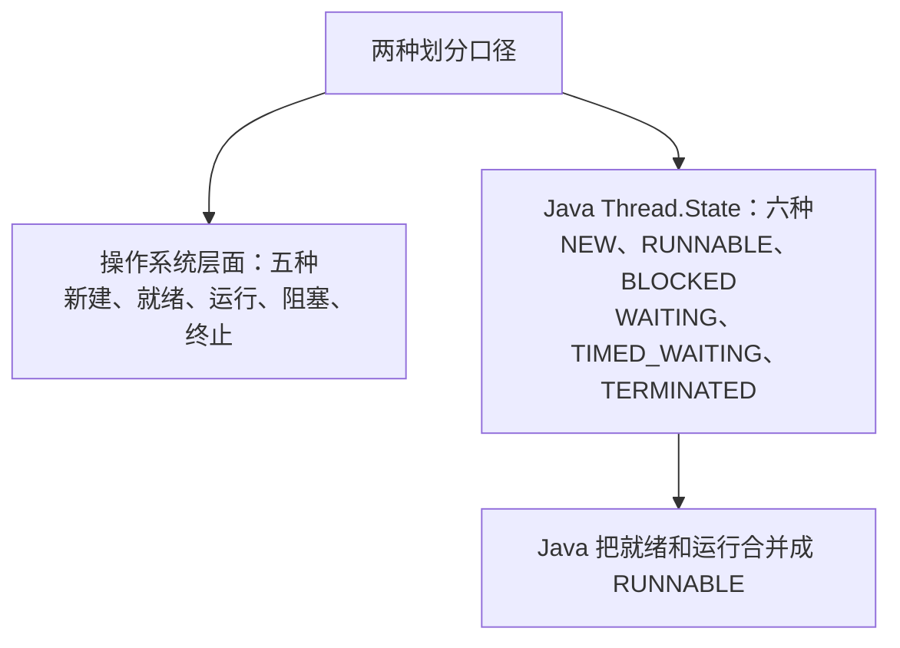

# 线程状态：操作系统五种与 Java 六种怎么对应

面试题：线程有哪些状态？

这道题有个有趣的地方：你说五种、他说六种，其实都没错。五种是操作系统层面对线程状态的划分，六种是 Java 语言层面的划分，Java 的六种是从线程源码里来的，不多不少就这六种。面试时能讲清两种说法的来历和对应关系，比单背一份清单出彩得多。

## 先给结论

- **Java 六种状态**：NEW、RUNNABLE、BLOCKED、WAITING、TIMED_WAITING、TERMINATED，划分依据来自 Java 线程的源码定义。
- **操作系统五种状态**：新建、就绪、运行、阻塞、终止，依据操作系统层面对线程的划分，按「能不能分到 CPU 时间」分类。
- **对应关系**：Java 的 RUNNABLE 拆成了操作系统的就绪和运行，还涵盖阻塞 IO；Java 的 BLOCKED、WAITING、TIMED_WAITING 合并成了操作系统的阻塞。
- 一拆一合，六种就变成了五种。

## 是什么：操作系统的五种状态

操作系统的五种状态是新建、就绪、运行、阻塞、终止，核心分类标准就一条：这个线程能不能分到 CPU 时间。

- **运行态**：线程有资格分到 CPU 来运行它的代码，并且正在被 CPU执行。
- **就绪态**：线程有资格分到 CPU，但暂时还没轮到它。
- **阻塞态**：线程暂时没有资格分到 CPU 时间来运行代码。

新建和终止跟 Java 里的 NEW、TERMINATED 差不多，不用细说，主要看中间这三种。

阻塞态里还有细分。拿锁失败就是典型的一种：同步代码块的代码你没资格执行，因为锁都没拿到，自然分不到 CPU 时间。wait 也是类似：拿到锁了但条件不满足，进入等待状态，暂时不需要分到任何 CPU 时间。BLOCKED、WAITING、TIMED_WAITING 都属于这种分不到 CPU 时间的阻塞状态。

阻塞态里还有一个特殊的叫阻塞 IO。执行磁盘 IO、网络 IO 的时候，用的是一套阻塞式 API，不需要分到任何 CPU，因为磁盘、网络的读写操作都是由磁盘和网卡上的芯片独立完成的，用不到 CPU。这种情况也暂时用不到 CPU，所以阻塞 IO 也归结为阻塞状态。

总结一下：能分到 CPU 时间、并且已经分到的，是运行态；可以分到但还没分到的，是就绪态；根本分不到 CPU 时间的，是阻塞态。阻塞态将来会恢复成就绪态，重新有资格去分 CPU 时间。

## 为什么这样设计

Java 的六种状态是从线程源码里定义出来的，比操作系统的五状态更细。为什么要更细？因为 Java 的并发 API 会把线程卡进不同的等待场景：拿不到锁、wait 等通知、sleep 睡一段时间，这三件事在 Java 程序里触发方式和恢复条件都不一样，源码里就分成了 BLOCKED、WAITING、TIMED_WAITING 三种。而操作系统不关心这些细节，只关心线程此时候有没有资格用 CPU，所以合成一个阻塞态。

## 深入细节：两种模型的对应关系

把两个模型叠在一起看。

Java 的六种状态：NEW（新建）、RUNNABLE（可运行）、BLOCKED（阻塞）、WAITING（等待）、TIMED_WAITING（有时限等待）、TERMINATED（终止）。转换条件都是显式调用：start() 让线程从 NEW 到 RUNNABLE；获取锁失败，从 RUNNABLE 到 BLOCKED，获取锁成功再回到 RUNNABLE；拿到锁后调用 wait()，从 RUNNABLE 到 WAITING，notify() 唤醒后回到 RUNNABLE；调用 sleep(long)，从 RUNNABLE 到 TIMED_WAITING，时间到了再回到 RUNNABLE；代码执行完毕，从 RUNNABLE 到 TERMINATED。

对比操作系统的五状态，一分一合：

- **一拆**：Java 的 RUNNABLE 对应操作系统的就绪和运行两种状态。正在被 CPU 执行的是运行态，排队等 CPU 的是就绪态，Java 把这两种合起来叫 RUNNABLE。
- **一合**：Java 的 BLOCKED、WAITING、TIMED_WAITING，对应操作系统的阻塞态。

还有一个容易忽略的点：**Java 的 RUNNABLE 除了就绪和运行，其实还涵盖阻塞 IO**。因为 Java 区分不了阻塞 IO 这种状态。所以你看到一个线程是 RUNNABLE，它有可能在操作系统层面是就绪态，有可能是运行态，也有可能是阻塞 IO 态。

## 面试怎么答

1. **先确认口径**：可以问一句面试官要 Java 层面还是操作系统层面，两种说法都给得出，显得概念完整。
2. **Java 六种逐个说**：NEW、RUNNABLE、BLOCKED、WAITING、TIMED_WAITING、TERMINATED，每种带一个触发条件，比如 sleep(long) 进 TIMED_WAITING、wait() 进 WAITING、拿锁失败进 BLOCKED。
3. **操作系统五种按 CPU 分类讲**：运行是正在被执行，就绪是有资格没轮到，阻塞是没资格分 CPU；阻塞再细分出阻塞 IO、BLOCKED、WAITING、TIMED_WAITING。
4. **加分项**：讲 RUNNABLE 涵盖就绪、运行和阻塞 IO，一拆一合把两个模型串起来。

## 常见误区

- **误区一**：把 RUNNABLE 理解成「正在运行」。RUNNABLE 可能是就绪排队中，也可能是阻塞 IO 中，只有正在被 CPU 执行的那一小段才是操作系统的运行态。
- **误区二**：以为操作系统阻塞态里没有 IO。阻塞 IO 是阻塞态的重要一类，磁盘、网络读写都由设备芯片完成，线程根本分不到 CPU。
