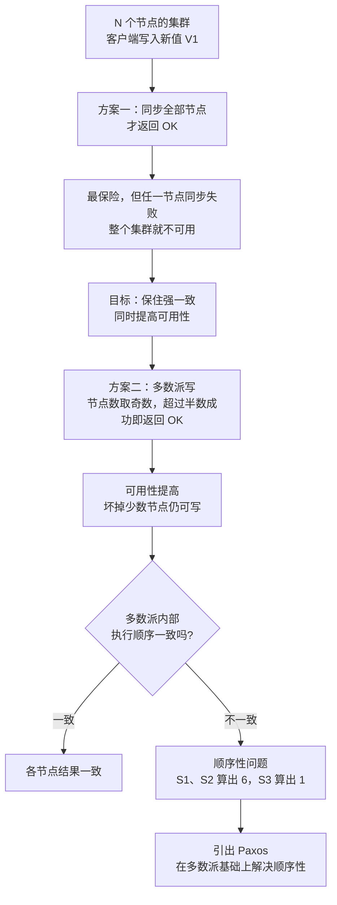

# Paxos 要解决什么问题：从全量同步到多数派

面试题：介绍一下 Paxos 算法，它解决什么问题？

直接问 Paxos 的面试题不多，但问分布式一致性，最后都会绕到 Paxos 上。这道题真正考的不是算法细节，而是你能不能把 Paxos 想解决的那个问题讲出来：强一致性和可用性打架的时候怎么办。把「全量同步不可用、多数派可用但引出顺序性问题」这条线讲清楚，Paxos 的动机就立住了。

## 先给结论

- 集群有 N 个节点，客户端写入新值后，如果要求同步到其余全部节点才返回 OK，最保险，但任意一个节点同步失败，整个集群就不可用。
- 为了提高可用性，引入多数派思想：节点数设为奇数，同步成功的超过一半，就可以向客户端返回 OK。
- 多数派写成功只解决了写的可用性，读的一致性先不考虑，办法有很多，比如只读 leader 或者做多数派一致性读。
- 多数派又带来顺序性问题：多个写操作在不同节点上的执行顺序不一致，结果照样不一致。
- Paxos 就是一个强一致性算法，要在满足多数派的前提下解决顺序性问题。

## 是什么：先摆出问题

假设集群中有 N 个节点，客户端要向其中一个节点写入一个新值 V1。这个节点能不能立刻向客户端返回 OK？不行，因为它还没有把这个最新的值同步到其他节点上，这时候直接返回 OK 会造成不一致。

所以它需要把新值 V1 同步到集群中的其他节点。同步全部完成，才返回一个 OK。这样看起来是不是最保险？确实是，但别忘了同步过程中可能有一个失败。比如 5 个节点里，3、4、5 都成功了，同步到 2 的时候，可能因为网络原因或者机器故障没有成功。这时候能返回 OK 吗？按照刚才的分析，希望全部成功才返回 OK，现在有一个没成功，就不能返回。客户端就一直卡在那里等，对它来讲这个系统就不可用了，造成整个集群不可用。

## 为什么这样设计

能不能在保证强一致性的基础上，稍微提高一下可用性？不要因为其中一个节点没有成功，就不返回 OK 了。

于是有人提出多数派的思想。所谓多数派：集群节点先设置成一个奇数个数，只要同步成功的超过一半，就可以向客户端返回 OK。比如正好是奇数五个节点，节点自己加上另外两个成功了，一共三个成功，这时候就可以返回 OK。至于剩下两个有没有同步成功、是不是挂了，都不用管，只要多数通过就行。

这样一来可用性就高了：坏掉少数几个节点，写服务依然能响应。

那有同学会问：客户端读的时候，万一读到的是少数派里的节点，里面还是旧值怎么办？这是另外一个问题，得把读写分开看，不然太复杂。刚才只说了写的时候多数派成功就返回 OK，读的一致性暂不考虑。解决办法有很多种，比如有的系统只允许读 leader 节点，其他 follower 不能读；也可以做多数派的一致性读。这些先放一边。

## 深入细节：多数派的顺序性问题

假设多数派写成功就可以返回 OK，这套机制还有一个问题：顺序性。

举个例子。一共五台服务器 S1 到 S5，有一个变量 X，在 S1 上 X 等于 5。客户端给它发了一个自增命令，原始值 5 自增就是 6。这个命令不能光在 S1 上执行，要在 S2、S3 上都执行，多数派成功了，S1、S2、S3 都返回自增命令已执行完，才可以向客户端返回 OK，S4、S5 可以不管。

但是在 Paxos 这种算法下，是允许多个服务器都执行写操作的。比如 S5 也是服务器，它也可以操作这个变量，只不过它发的命令不一样：set x 0，一个 set 操作，不是自增。而且这个 set x 0 也满足了多数派：让 S3、S4 执行，它自己也执行，多数派满足，返回 OK。单看这两个操作都没问题，但请注意中间这个 S3 服务器。

按照图上画的执行顺序，S3 首先执行的是 set x 0，把 X 更新成了 0；接下来它又接到一个 increase x 自增命令，是在 X 等于 0 的基础上做了一个自增，得到 1。

于是 S1 发起的这个自增写操作，执行结果不一致了：S1、S2 上得到的是 X 等于 6，而 S3 上得到的是 1。所谓的多数派内部自己都产生了不一致。这时候如果返回 OK，客户端再去访问，访问到 S1 拿到的是 6，访问到 S3 拿到的是 1，得到一个不一致的结果。

所以多个写操作之间，如果不考虑顺序性问题，即使满足了多数派写成功，也不能保证接下来的操作是一个一致性的结果。

因此就提出了 Paxos 这个算法，它能够在满足多数派写操作的时候，还能够解决刚才提到的顺序性问题。算法本身下一篇展开。

## 面试怎么答

1. **先摆问题**：N 个节点的集群，写操作如果要求全同步才返回 OK，任一节点失败就整体不可用。
2. **给出多数派思路**：节点设奇数，同步超过半数即返回 OK，可用性提高。
3. **点出代价**：多数派带来顺序性问题，用 S3 上先 set x 0 再 increase x 得到 1、而 S1、S2 是 6 的例子说明多数派内部也会不一致。
4. **收尾点题**：Paxos 是强一致性算法，在多数派的基础上解决顺序性问题，让集群对修改达成共识。

## 常见误区

- **误区一**：以为多数派写成功就等于一致。多数派之间执行顺序不一致，结果照样不一致，顺序性才是关键。
- **误区二**：把 Paxos 理解成「多数派投票」。多数派只是 Paxos 用到的一部分，它真正解决的是多个写操作之间的顺序性，靠的是提案机制把顺序定下来。
