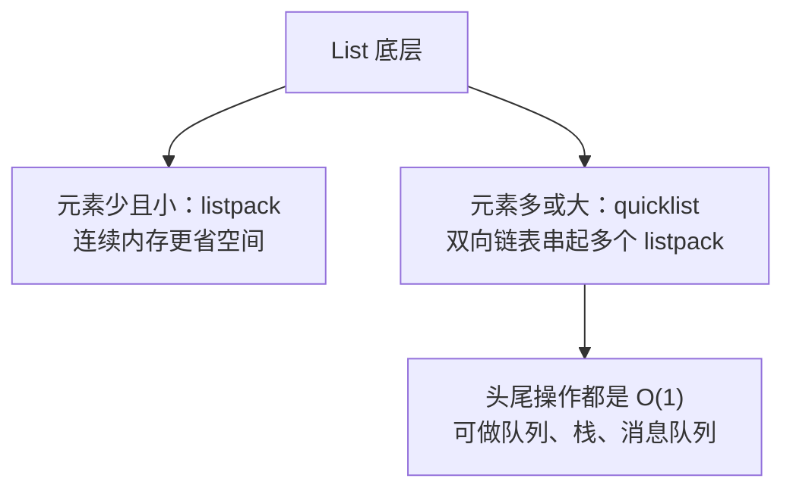

# Redis List 的底层：quicklist 与 ziplist

面试题：Redis 的 List 底层是怎么实现的？

Redis 每个数据类型都能问到底层，List 是其中的高频项。原因是它换过一次底层实现：3.2 版本以前用压缩列表或者普通链表，3.2 起改成了 quicklist。答这道题，能讲清 quicklist 和 ziplist 的两层关系、ziplist 的五段结构、变长编码的设计，就把「为什么 List 既省内存又快」讲明白了。

## 先给结论

- Redis 3.2 起，List 采用 quicklist 作为编码方式。
- quicklist 是一个双向链表，但它的每个节点不是一个数据，而是一个 ziplist；ziplist 才是真正存数据的小链表。quicklist 大链表套 ziplist 小链表，小链表里存数据。
- quicklist 继承了链表的特点：内存上不连续，操作头尾效率高，时间复杂度 O(1)，操作中间元素平均 O(n)。
- ziplist 用一块连续的内存存储数据，设计目标是存储紧凑、减少碎片、节约内存。
- ziplist 由 zbytes、zltail、zlentries、entry、zlend 五部分组成；entry 采用长度可变设计，前一 entry 长度不超过 253 用 1 个字节记录，超过 253 用 5 个字节，这会带来连锁更新问题。

## 是什么：quicklist 与 ziplist 的两层关系

从 Redis 3.2 这个版本开始，List 采用了一个叫 quicklist 的数据结构作为编码方式。

quicklist 是一个双向链表，但这个双向链表里不会直接存储最终的数据，它的每个节点又是一个 ziplist。也就是说：quicklist 是外层的一个大链表，里面的节点是一个个叫 ziplist 的小链表，小链表里头才存储一到多个数据。多个 ziplist 串起来，形成一个 quicklist。

那 quicklist 的特点有哪些？前面学过的链表相关特点它都有，因为它本质是链表：在内存上存储是不连续的；操作头尾的效率高，时间复杂度是 O(1)；但如果你操作的是中间的元素，效率就相对低一些，平均会达到 O(n)。所以这里有个建议：选择 Redis 命令时，尽量选时间复杂度低的命令，对于链表来讲，尽量去操作它的头尾元素，不要操作中间的元素。

那多个 ziplist 是怎么组织的？ziplist 的个数和大小都是可以设置的。默认大小是 8KB。刚开始 quicklist 里面其实只有一个 ziplist，新数据都往这一个 ziplist 里面放；当这个 ziplist 里面的元素总大小超过了 8KB，它就觉得一个 ziplist 不够用了，会再创建第二个 ziplist 来存储更多的数据。这样多个 ziplist 串起来形成 quicklist。

## 为什么这样设计

这是两种结构的折中。普通链表用指针把节点串起来，内存不连续，每个节点还要额外存指针，占内存；ziplist 用一块连续内存存数据，紧凑省内存，但元素一多效率就受影响。

quicklist 把两者组合起来：外层用双向链表，保住头尾操作 O(1) 的效率；内层用 ziplist，用连续内存换取紧凑和省内存。每个 ziplist 默认 8KB，超了就拆一个，避免单块太大拖累效率。

## 深入细节：ziplist 的结构

ziplist 也是个链表，但它和其他链表不一样：它是用一块连续的内存来存储数据的。传统链表是多个节点之间用指针、用 Java 里的引用联系起来，内存上不连续存储；ziplist 是用一段连续的内存存储多个数据。

它为什么要这样设计？这要提一下 ziplist 的设计目标：让数据存储得更加紧凑，好处是可以减少内存碎片，并且尽可能节约内存。把数据连续存储在一起，实际上有助于减少内存消耗，内存占用也会小。可以回想 Java 里 ArrayList 和 LinkedList 的比较：LinkedList 要比 ArrayList 占用更多内存，从连续这个角度讲，连续存储的数据占用的内存也会小一些。

ziplist 的结构有五部分组成：

1. **zbytes**：记录整个 ziplist 占用多少个字节。
2. **zltail**：记录尾节点的偏移量。用途是快速定位到尾节点，然后从尾节点倒着遍历。ziplist 也是支持双向遍历的，从头到尾或者从尾到头都行。
3. **zlentries**：记录 ziplist 里面有多少个节点、多少个元素。
4. **entry**：数据区，在 zlentries 和 zlend 之间存储数据，可以有 1 到 N 个。
5. **zlend**：结束标记，值是固定的。

每个 entry 的组成也要了解，它记录了四样东西：

- 前一个 entry 的长度。为什么要记录前一个 entry 的长度？其实就是为了倒序遍历。拿到当前 entry，要遍历到它上一个 entry，就可以根据这个长度，往前减这么多个字节，找到上一个 entry 完整的数据。
- 本 entry 的编码，也就是这个 entry 记录的是整数还是字符串等等。
- 本 entry 的长度。
- 本 entry 存储的实际数据。

这里要重点关注后半段：它的设计目标就是尽可能节约内存，那 Redis 的 ziplist 是怎么做到的？比如在 Java 里要记录一个数组的长度，都是用四个字节来记录，不管什么数组都固定四个字节。假设数组里就五个元素，也要用四个字节记录 5 这个长度，有点浪费。而 ziplist 会根据实际数据的长度不同，让记录长度的字节数也不一样：如果前一个 entry 的长度在 253 以内，1 个字节就够了；如果长度超过了 253，才用 5 个字节来记录。这就是长度可变设计，目的就是进一步尽可能节约内存。

最后看 ziplist 的特点：它适合存储少量的元素。如果元素个数太多，比如超过了 8KB，虽然内存能够比较节约、减少碎片，但是效率会受到影响，所以它只适合存储少量数据。因此超过 8KB 就把它分成两个 ziplist，避免元素个数多带来的效率影响。

还有一个问题：长度可变的设计会带来一个叫做连锁更新的问题。本节课不展开，大家知道有这么一个事就可以。

面试里还经常问 quicklist 和 ziplist 的区别：quicklist 在内存上是不连续的，ziplist 在内存上是连续的；两者的关系是 quicklist 是外面的大链表，大链表里面套了多个 ziplist 小链表，小链表里才存的数据。

## 面试怎么答

1. **先给两层关系**：List 3.2 起用 quicklist，quicklist 是双向链表，节点是 ziplist，数据在 ziplist 里。
2. **讲 quicklist 的链表特性**：内存不连续、头尾操作 O(1)、中间平均 O(n)，所以尽量操作头尾；每个 ziplist 默认 8KB，超了拆分。
3. **展开 ziplist 五段结构**：zbytes 记总字节数、zltail 记尾偏移量支持倒序、zlentries 记节点数、entry 是数据区、zlend 是结束标记。
4. **加分项**：entry 记录前一 entry 长度、编码、长度、数据四样；前一长度 253 以内 1 字节、超过 253 用 5 字节的变长设计，以及由此带来的连锁更新。

## 常见误区

- **误区一**：把 ziplist 说成双向链表。ziplist 是一块连续内存，靠 entry 里记录的前一 entry 长度实现倒序遍历，没有指针。
- **误区二**：把包含关系搞反。是 quicklist 包含多个 ziplist，不是 ziplist 包含 quicklist。
- **误区三**：只说 ziplist 省内存，不提 8KB 拆分。ziplist 只适合少量元素，元素多了效率下降，所以才按 8KB 拆成多个。
