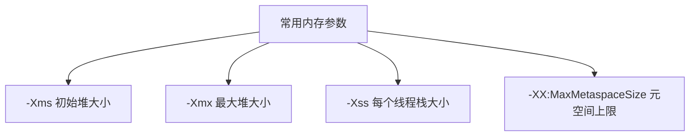
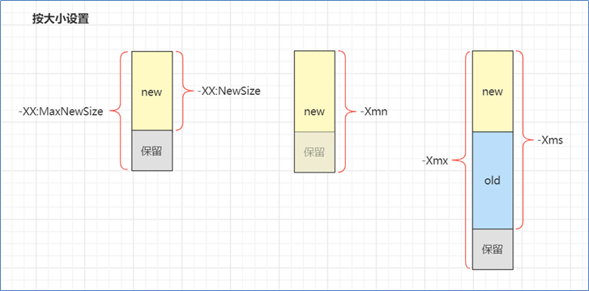
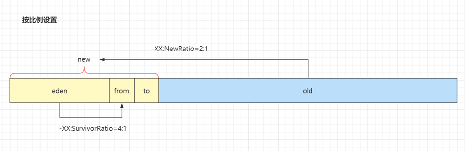
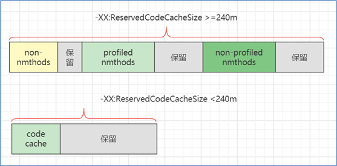
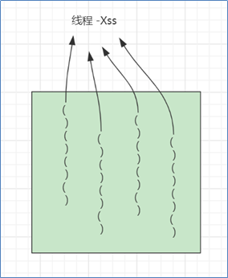
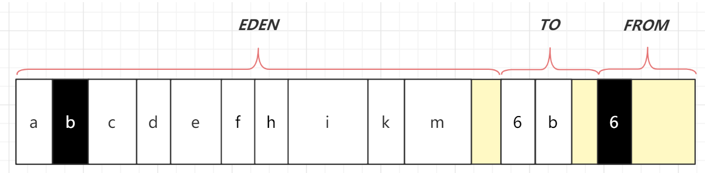

# JVM 内存参数：一道计算题讲透常用参数

面试题：对于 JVM 内存配置参数 -Xmx10240m -Xms10240m -Xmn5120m -XX:SurvivorRatio=3，其最小内存值和 Survivor 区总大小分别是多少？

这是一道很典型的 JVM 参数题，考察点不在于算术，而在于你是否真懂每个参数的含义。参数记混了，数字必然算错。把常用参数按「堆的比例设置、堆的大小设置、元空间、代码缓存、线程栈」分分类，这道题就是送分题。

## 先给结论

- **最小内存值**：由 `-Xms` 决定，10240m，也就是 10G。
- **Survivor 区总大小**：2048M，也就是 2G。
- 关键在 `-XX:SurvivorRatio=3` 的理解：它表示 Eden 与其中一个 Survivor 区的比例是 3:1，而 from 和 to 两个 Survivor 大小相等，所以新生代要等分成 5 份，Eden 占 3 份、from 和 to 各占 1 份，Survivor 总大小是两份。

## 是什么：逐个解读参数

先读题。这组参数有四个：`-Xmx10240M`、`-Xms10240M`、`-Xmn5120M`，还有一个 `-XX:SurvivorRatio=3`。要回答这道题，得先了解每个参数的含义。

**-Xmx**，指 Java 虚拟机最大内存是多少，后面的小 m 是单位，M 代表兆字节。10240m 换算一下就是 10 个 G。

**-Xms**，指 Java 虚拟机的最小内存数。一个是最大，一个是最小，这里最小内存数也是 10 个 G。所以题目问的最小内存值，答案就是 10240m，即 10G。

**-Xmn**，指虚拟机中新生代的内存数。从年代的角度，Java 虚拟机内存可以划分成新生代和老年代。这里新生代占了 5 个 G，总大小是 10 个 G，剩下的 5 个 G 就给老年代用。

**-XX:SurvivorRatio**，这个参数不太好理解，它代表了 Eden 区与其中一个 Survivor 区的内存占比，注意是内存占比。比如比例画成 4:1，意思就是 from 占一份内存的话，Eden 占四份内存。新生代再细分，可以分成 Eden 区和 Survivor 区，Survivor 又分成 from 和 to 两块，它俩的内存大小总是相等的。

## 为什么这样设计

堆内存的设置分两类思路。一类是按比例设置，比如 SurvivorRatio 控制 Eden 和一个 Survivor 的比例，NewRatio 控制整个新生代和老年代的比例；另一类是按大小设置，直接用 NewSize、MaxNewSize 指定每个区域的数值。

按大小设置时，最小值不够用了会自动扩展，上限是 MaxNewSize。也可以一上来就把 NewSize 和 MaxNewSize 设成一样，不要中间那个扩展过程，这时候用一个参数就够了，就是 `-Xmn`：新生代的最小值最大值都一样，都是 Xmn 设置的那个数值。

还有一条实用建议：生产环境中把 Xms 和 Xmx 设置为一样的，不要扩展过程，一上来就固定，这样效率会高一些。

## 深入细节：把这道题算完

回到题目，SurvivorRatio 是 3，指 Eden 跟 from 的比例是 3，也就是 Eden 是 from 的三倍。这种情况下，应该把新生代画成均等的 5 份：Eden 占 3 份，from 和 to 各占 1 份。

新生代这 5 个 G 除以 5，每份占 1G。题目问的是 Survivor 的总大小，from 和 to 都加起来，就是再乘以 2，得到 2048M，也就是 2 个 G。

顺便把两个默认值记住：SurvivorRatio 的默认值不是 4:1，是 8:1，也就是 Eden 占 8 份、from 和 to 各占 1 份；NewRatio 的默认值是 2:1，也就是老年代占 2 份内存的话，新生代占 1 份。

除了堆，还有几个区域的参数要了解。

**元空间**细分的话，可以把存储的类信息分成两类：class space 和 non-class space。class space 存类的最基本信息，比如类的名称、类的方法入口，方法入口会抽象出两张表，叫 itable 和 vtable；而方法的字节码、类上的注解，存储在 non-class space 里。class space 有一个上限，由 `-XX:CompressedClassSpaceSize` 参数控制，初始值是 1G，随着加载的类越来越多可以不断扩展，但上限受这个参数控制。class space 加 non-class space 的总上限，由 `-XX:MaxMetaspaceSize` 控制，默认不设置，也就是没有上限，物理内存多大，元空间就可以使用多大的内存；设置了就按设置的来。

**code cache**，代码缓存区，缓存编译后的机器码。前面讲过 JIT 即时编译器会把热点代码编译成机器码然后缓存起来，下次遇到热点代码不用再解析，直接从缓存拿机器码交给 CPU，效率就高。这些机器码就存在 code cache 里。它分两种情况：`-XX:ReservedCodeCacheSize` 设置得比较小、小于 240M 的话，编译好的机器码就放在一块，大小可以不断增长，但总大小受这个参数控制；如果设置成大于 240M，就会对这些优化后的机器码进行细分，分成三个区域：JVM 内部自己用的代码放一段，经过部分优化的代码放 profiled nmethods 段，经过完整优化的代码放 non-profiled nmethods 段，总大小受 ReservedCodeCacheSize 控制。

**-Xss**，控制每个线程占用的内存，也就是每个虚拟机栈有多大的内存。如果不设置，它跟操作系统有关，64 位 Linux 操作系统下每个线程会占 1M 的内存，可以通过这个参数自行调整。

## 面试怎么答

1. **先分类报参数**：堆相关的 Xmx、Xms、Xmn、SurvivorRatio、NewRatio；元空间的 CompressedClassSpaceSize、MaxMetaspaceSize；代码缓存的 ReservedCodeCacheSize；线程栈的 Xss。
2. **代入计算**：最小内存值看 Xms 是 10240m 即 10G；Survivor 总大小按 SurvivorRatio=3 把新生代 5G 等分 5 份，from 加 to 是 2048M 即 2G。
3. **补默认值**：SurvivorRatio 默认 8:1，NewRatio 默认 2:1，MaxMetaspaceSize 默认无上限。
4. **加分项**：提生产建议 Xms 和 Xmx 设成相等，避免堆扩展，并说明 from 和 to 永远相等是这道题最容易踩的坑。

## 常见误区

- **误区一**：SurvivorRatio=3 就把新生代分成 4 份。忘了 from 和 to 大小相等，必须分成 Eden 3 份加 from、to 各 1 份，一共 5 份。
- **误区二**：算 Survivor 只算 from。题目问的是总大小，from 加 to 两份都要算，5120M 除以 5 再乘 2。
- **误区三**：把 -Xms 当成 Survivor 相关参数。最小内存值对应的是 -Xms，是堆的整体最小值，和新生代划分没关系。

## 课件配图
> 以下配图取自阶段七课件对应讲义，与上文讲解一一对应，可作为图文对照辅助理解。
**JVM 内存参数**（课件讲义图示）

**讲义配图**（课件讲义图示）

