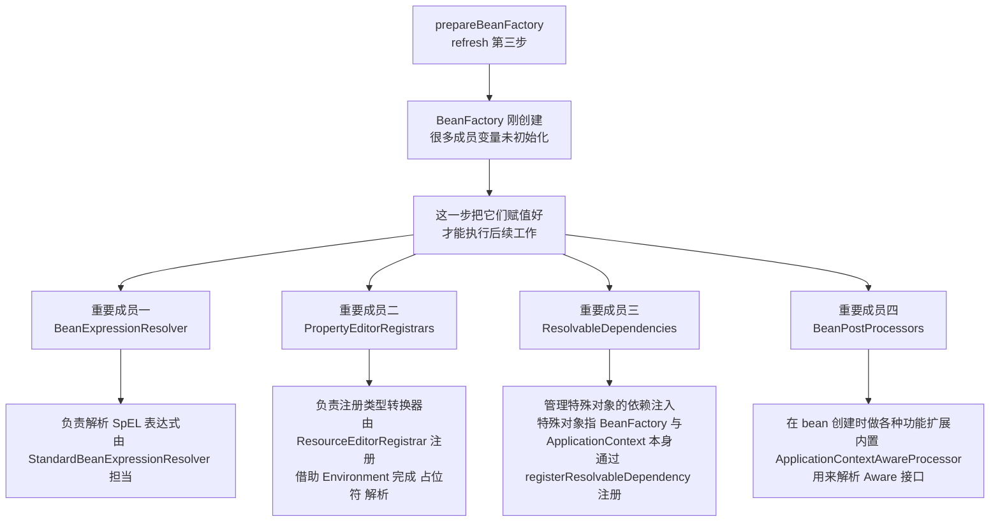

# Spring refresh 源码解析：准备 BeanFactory

面试题：说一下 Spring refresh 流程里 prepareBeanFactory 这一步做了什么？

refresh 的前两步把 BeanFactory 创建出来、加载好 BeanDefinition 之后，第三步 prepareBeanFactory 看起来很不起眼，源码里就是几行赋值。但这一步决定了后面 SpEL 解析、类型转换、特殊 bean 注入这些能力由谁提供。答得出这几个成员各自的分工，才说明真的跟过 refresh 的源码。

## 先给结论

- prepareBeanFactory 顾名思义就是准备 bean 工厂：BeanFactory 刚创建时有很多成员变量没有初始化，这一步把它们赋值好，才能执行后续工作。
- 重要的成员有四个：BeanExpressionResolver 负责解析 SpEL 表达式；PropertyEditorRegistrars 负责注册类型转换器；ResolvableDependencies 负责管理特殊对象的依赖注入；BeanPostProcessors 负责在 bean 创建时做各种功能扩展。
- 其中 BeanExpressionResolver 由 StandardBeanExpressionResolver 担当；类型转换器由 ResourceEditorRegistrar 注册，并借助 ApplicationContext 提供的 Environment 完成 ${} 解析。
- 特殊对象指 BeanFactory 本身和 ApplicationContext 本身，它们不是真正的 bean，通过 registerResolvableDependency 注册进 ResolvableDependencies。
- 内置的 ApplicationContextAwareProcessor 是一个 BeanPostProcessor，用来解析 Aware 接口。

## 是什么

上一步拿到的 BeanFactory 只是个空架子，很多成员变量还没有被初始化，直接用会处处碰壁。prepareBeanFactory 这一步要做的，就是把这些成员变量赋值好，让它具备执行后续工作的能力。这一步给 BeanFactory 赋值的成员里，重要的有四个，大家知道它们各自的功能就够了。

## 深入细节

### 第一个成员：BeanExpressionResolver

它的作用是解析 SpEL 表达式，也就是解析井号大括号（#{}）那种表达式，由 StandardBeanExpressionResolver 来担当。

### 第二个成员：PropertyEditorRegistrars

这个成员用来注册一些类型转换器。Spring 接下来在做值注入的时候，需要把字符串类型转换成其他类型，这个转换由谁完成？就靠注册进来的这些 PropertyEditor 转换器。具体由 ResourceEditorRegistrar 完成注册，并且它会应用 ApplicationContext 提供的 Environment 来完成 ${} 解析。

### 第三个成员：ResolvableDependencies

它的作用是管理一些特殊的对象，用来进行依赖注入。大部分 bean 都放在将来的 singletonObjects 单例池里，依赖注入也是从那里完成的。但是有一些比较特殊的对象，比如想注入 BeanFactory 本身、想注入 ApplicationContext 本身，这些对象并不是真正的 bean，没有在 singletonObjects 单例池里，也没有在 BeanDefinition 里去定义。那这些能不能注入？结果是可以。查询这些特殊对象时，不到 singletonObjects 里查，也不到 BeanDefinition 里查，而是到 ResolvableDependencies 里去查。Spring 通过 registerResolvableDependency 把它们注册到这里，将来依赖注入时如果需要这些特殊对象，就从这个成员里拿。

### 第四个成员：BeanPostProcessors

这个成员非常重要。它的作用是在 bean 创建时，对 bean 的各项功能做一些扩展，对里面的一些注解进行一些识别。Spring 标准的功能其实是非常有限的，它要对 bean 的创建过程做各种各样的扩展，就必须借助于很多 BeanPostProcessor 来完成。比如内置的 ApplicationContextAwareProcessor，就是用来解析 Aware 接口的。

### 这些成员什么时候被赋值

需要说明的是，并非所有成员都在 prepareBeanFactory 这一步里赋值。四个成员中前三个的准备工作在本步完成，而 BeanPostProcessors 的大量注册在更靠后的步骤进行，等到 bean 创建阶段才逐步填充进来。面试时能把「这一步先准备基础解析能力，后处理器在后面注册」的时间线讲清楚，会显得对 refresh 全流程有整体认知。

## 面试怎么答

可以这样组织：

1. **一句话定位**：prepareBeanFactory 是 refresh 第三步，给 BeanFactory 的成员变量做初始化，为后续能力打底。
2. **逐个说四个成员**：BeanExpressionResolver 解析 SpEL；PropertyEditorRegistrars 注册类型转换器、借 Environment 解析 ${}；ResolvableDependencies 管理 BeanFactory、ApplicationContext 这类特殊对象的注入；BeanPostProcessors 在 bean 创建时做扩展，ApplicationContextAwareProcessor 解析 Aware。
3. **拔高一句**：这一步体现的是「先备好工具，再干活」的顺序，后面的值注入、Aware 回调都依赖这里注册的组件。

常见追问：

- **问**：为什么注入 BeanFactory、ApplicationContext 不需要它们是 bean？
  **答**：它们不是由 BeanDefinition 定义的 bean，Spring 通过 registerResolvableDependency 把它们放进 ResolvableDependencies，依赖注入时按类型从这个 map 里查，所以不注册成 bean 也能注入。
- **问**：${} 和 #{} 有什么区别，分别谁解析？
  **答**：${} 是属性占位符，由 ResourceEditorRegistrar 借助 Environment 完成解析；#{} 是 SpEL 表达式，由 BeanExpressionResolver（StandardBeanExpressionResolver）解析。

## 常见误区

- **误区一**：以为 prepareBeanFactory 会把所有成员一次性初始化完。BeanPostProcessors 的主体注册在后面的步骤，这一步只是打好基础。
- **误区二**：把四个成员的分工记混。记法：表达式归 Resolver，类型转换归 Editor，特殊对象归 ResolvableDependencies，功能扩展归 PostProcessor。
