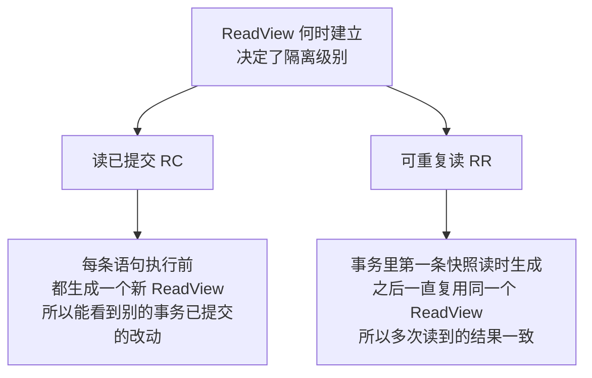

# 隔离级别：可重复读下快照的建立时机

面试题：在可重复读（RR）隔离级别下，快照是什么时候建立的？

上一节讲了快照读和当前读的概念，这一节专门解决「快照到底什么时候建立」这个问题。这是 RR 隔离级别的高频追问：答错时机，前面讲的「可重复读」就全塌了。建立时机一共三种，其中第一种是默认行为，第三种最容易被忽略。

## 先给结论

- 快照的建立有三种时机：事务中第一次执行 select 时；事务启动时（需要加 consistent snapshot 选项）；修改数据时（且是基于旧值修改的情况）。
- 默认情况下，快照在事务内第一次 select 时建立，不是事务启动时就建立。
- 快照记录的是建立那一刻所有已提交数据的状态，快照读读的是这个历史状态，不是最新提交的数据。
- 在 select 之前提交的修改，快照能看得到；在 select 之后提交的修改，快照读看不到。
- 基于旧值的修改（比如余额累加）必须读最新值，否则会丢更新，所以这条 update 会触发快照重建，之后的 select 读到重建后的结果。



## 是什么：快照读依赖什么工作

RR 下同一个事务内多次查询结果一致，底层依赖的就是快照读机制：每个查询读的都是快照建立那一刻的数据状态。所以「多次查询一致」成立的前提，是先搞清楚快照是哪一刻建立的。下面按三种建立时机分别过一遍例子，例子中有两个事务 tx1 和 tx2，tx1 设置为 RR 隔离级别。

## 深入细节

### 时机一：事务中第一次 select 时建立

默认情况下，事务开启了不会立刻建快照，而是执行第一条 select 的时候才建立。快照相当于在当前这个时间点拍了一张照片，记录这一刻所有已提交数据的状态。

这里要分两种情况看，关键看 tx2 的 update 在你的 select 之前还是之后提交。

如果 tx2 的 update 先提交，tx1 后执行 select，那么快照建立得晚，它针对的是当前时间点所有已提交的数据，所以快照里 1 号账户的余额已经是 2000：

```sql
tx1:
set session transaction isolation level repeatable read;
start transaction;
select * from account; /* 此时建立快照 */
-- 查询结果：
-- accountNo | balance
-- 1          | 2000
-- 2          | 1000

tx2:
update account set balance = 2000 where accountNo=1;
```

反过来，如果是 tx1 先执行 select 建立快照，tx2 后提交修改：快照记录的是 1 号、2 号两个账户余额都是 1000 的时刻。接下来 tx2 虽然把 1 号账户的余额修改成了 2000，但是 tx1 后面的查询是快照读，快照读意味着查询的是快照建立时的数据状态，因此查到的 1 号、2 号都是 1000，查不到那个 2000。因为快照读的基础就是：我要的不是最新提交的数据，我要的是快照建立时的数据。

这个例子也能看出来，RR 的底层就是依赖快照读机制，来建立事务内多次查询的一致性。

### 时机二：事务启动时建立

第二种情况，是在事务启动的时候就建立快照。不过要在事务启动时建立快照，必须修改一下 start transaction，给它加一个选项，加上 with consistent snapshot。加了这个选项之后，事务一开始就会建立快照。

还是刚才的例子，表面上看起来是 update 先执行，但是由于 tx1 的事务比 update 还要早一些，所以它在开启时就已经建立好快照了，已经把 1 号账户的 1000 记了下来。所以接下来的查询，查到 1 号账户是 1000，而不是修改后的 2000：

```sql
tx1:
set session transaction isolation level repeatable read;
start transaction with consistent snapshot; /* 此时建立快照 */
select * from account;
-- 查询结果：
-- accountNo | balance
-- 1          | 1000
-- 2          | 1000

tx2:
update account set balance = 2000 where accountNo=1;
```

所以要在事务启动时建立快照，就加 with consistent snapshot 这个选项，它把建立时机从「第一次 select」提前到了「事务启动」。

### 时机三：修改数据时重建快照

最后一种建立快照的情况，是修改数据的时候。当然有个前提：你基于旧的数据去修改数据时，它才会重新建立快照。

看这个例子。tx1 开启事务，没加 with consistent snapshot，所以在第一次查询时建立了一个快照，这时候两个账户数据都是 1000。接下来 tx1 执行了一个修改操作，但注意，这个修改和之前的稍有不同：它是在原有余额的基础上加了 1000，也就是把 1 号账户改成 2000，用的不是直接赋值，是在原有旧值的基础上累加。

与此同时 tx2 也执行了一条修改，执行的修改与 tx1 这边一样。问题来了：tx2 的修改是基于 1000 去加 1000，还是基于这边已经加好的 2000 去加 1000？肯定得基于 2000 加 1000。你要基于 1000 加 1000，相当于 tx1 的修改就丢失了。所以，虽然要保证可重复读，但是不能保证数据更新的丢失。

因此这条更新实际上会导致快照需要重新建立：它可以在最新提交的数据基础上去加 1000。这一步完成以后，余额已经更新成 3000。接下来再去执行 select 的时候，就不能再依赖最开始这个快照了，相当于得重新建立快照，重新建立以后查询出来的结果是 3000：

```sql
tx1:
set session transaction isolation level repeatable read;
start transaction;
select * from account; /* 此时建立快照 */
-- 查询结果：
-- accountNo | balance
-- 1          | 1000
-- 2          | 1000

update account set balance=balance+1000 where accountNo=1;
select * from account;
-- 查询结果：
-- accountNo | balance
-- 1          | 3000
-- 2          | 1000

tx2:
update account set balance=balance+1000 where accountNo=1;
```

这就是快照建立的第三种时机：修改数据时，而且是基于旧值去修改新值的情况，它会更新快照，相当于重新建立快照。

### 快照读与当前读的小结

最后把两种读取方式放在一起对比：

- **当前读**：读取的是最新提交的数据，意味着查询是需要加锁的。
- **快照读**：读取的是某一个快照建立时的数据，无需加锁，其实读取的是历史数据。

快照读的原理是回滚段，这个在讲 undo log、讲回滚段的时候再展开。RR 隔离级别的底层原理，其实就是依赖于快照读。

## 面试怎么答

按三个时机分层作答：

1. **默认时机**：事务内第一次 select 时建立，不是事务启动时。
2. **提前建立**：start transaction 加 with consistent snapshot 选项，事务启动即建立。
3. **重建时机**：基于旧值的修改会读最新值，触发快照重建，之后的 select 读到重建后的数据。

每个时机都配一个「快照在 update 之前还是之后建立」的判断，说明查到的到底是 1000 还是 2000，面试官立刻知道你理解的是机制不是口诀。

常见追问：

- **问**：为什么 RR 能保证同一个事务内多次查询结果一致？
  **答**：因为默认在第一次 select 时建立快照，之后的查询都是快照读，读的是快照建立时的历史版本，不受其他事务已提交修改的影响。
- **问**：什么情况下 RR 还会读到别的事务的修改？
  **答**：两种。一是第一次 select 建立得晚，对方的修改在你的 select 之前已提交，快照本身就包含了它；二是你基于旧值做了修改，这条 update 读的是最新值并触发快照重建，之后的 select 就能读到最新提交的数据。
- **问**：快照读和当前读的区别？
  **答**：当前读读最新提交数据、需要加锁；快照读读快照建立时的数据、无需加锁、读历史版本，底层靠回滚段（undo log）。

## 常见误区

- **误区一**：以为事务一启动快照就建立了。默认是第一次 select 时才建立，想提前必须显式加 with consistent snapshot。
- **误区二**：以为 RR 下任何修改都影响不到自己。基于旧值的修改必须读最新值，会触发快照重建，之后的查询会读到最新结果，这也是防止更新丢失的必然要求。
- **误区三**：把快照读和当前读混为一谈。快照读无需加锁读历史版本，当前读加锁读最新提交版本，两者底层路径完全不同。
