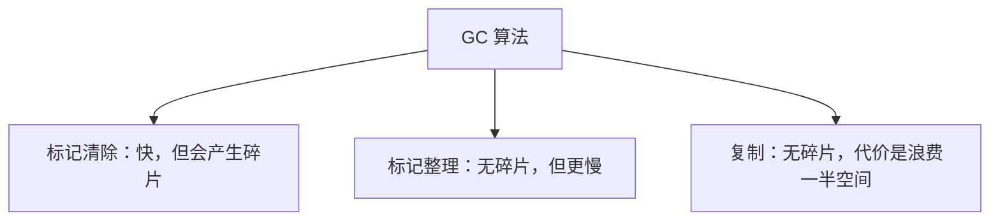
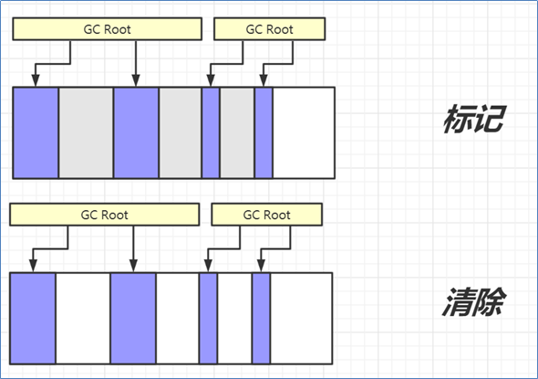
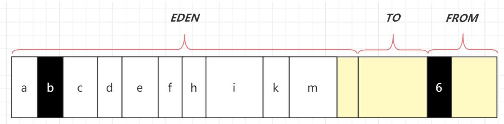
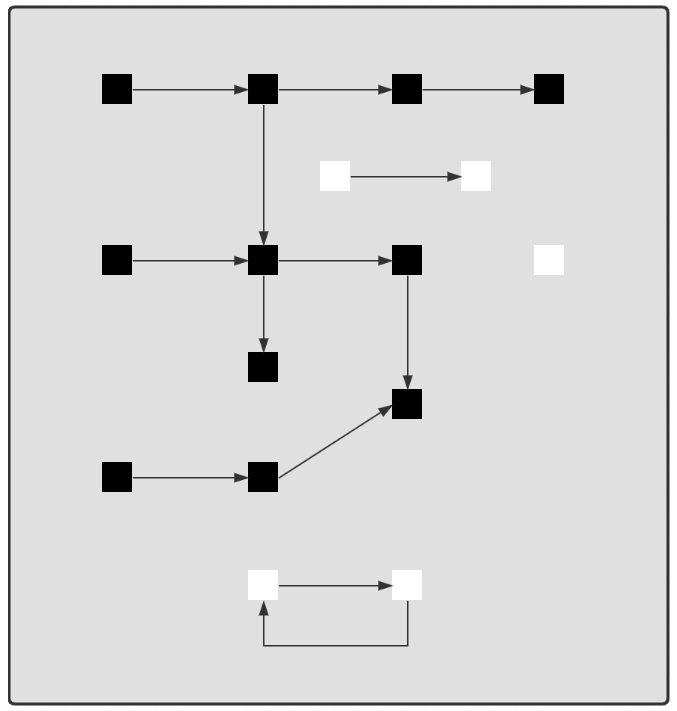
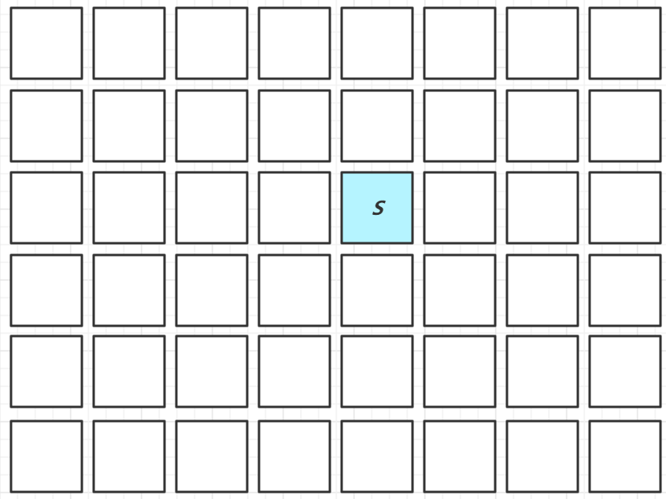
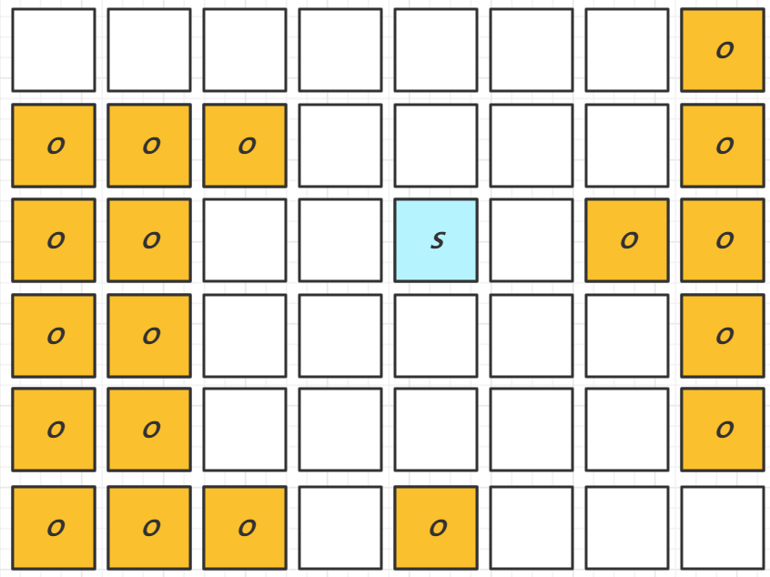

# JVM 垃圾回收算法

面试题：说一下 JVM 中的垃圾回收算法。

这是 JVM 篇的必考题。三种算法的名字人人会背，但面试要的是把每种算法的阶段、优缺点、适用场景讲清楚，并且能解释清楚「标记」到底是怎么回事。这篇按「先讲标记，再逐个过三种算法」的顺序展开。

## 先给结论

- JVM 垃圾回收算法一共三种：标记清除法、标记整理法、标记复制法，它们的共同点是都有「标记」。
- 标记就是找到那些不能被回收的对象，加一个标记；将来垃圾回收发生时，有标记的保留，没标记的作为垃圾清理掉，释放内存。
- 标记的方式是可达性分析：先找 GC Root（根对象），沿引用链遍历，能到达的对象加标记。
- 标记清除法的缺点是产生内存碎片，目前只有 CMS（一种以获取最短停顿为目标的老年代收集器，已废弃）用过，且已在新版本 JDK 中被废弃。
- 标记整理法多一个整理阶段，把存活对象向一端移动，没有碎片，但效率低，适合老年代。
- 标记复制法把内存分两块，存活对象复制到空闲区，无碎片、清理快，但要多占一份内存，适合新生代。

## 是什么

三种算法名字里都有「标记」，先说清楚标记的含义。

标记，就是找到那些不能被垃圾回收的对象，给它们加一个标记。将来垃圾回收发生了，加了标记的对象就保留下来，没有标记的对象就作为垃圾清理掉，把它们占用的内存释放掉。

那标记是怎么加上去的？以标记清除法为例，它的标记阶段是这样工作的：首先要找到一些 GC Root 对象，简单可以叫根对象。所谓根对象，就是那些一定不会被回收的对象。什么对象一定不会回收？比如一个方法正在运行，方法内有一个局部变量正引用着一个对象，这个对象就不能回收。道理很直白：如果你正在使用这个局部变量，前一刻它还有内容，结果垃圾回收发生以后，这个变量拿到的是 null，这肯定不行。所以局部变量正在引用的对象，是一定不能回收的，可以作为根对象。还有一种情况，比如静态变量引用的对象。静态变量除非类被卸载，否则一直存在，它引用的对象也得一直存在，所以静态变量引用的对象也可以作为根对象。

标记的具体做法是：先找到这些根对象，然后从根对象出发，沿着它的引用链去看，当前对象有没有被根对象引用到。直接引用算引用，间接引用也算引用。只要当前对象被根对象引用到，它就不能被回收，因为根对象一定不能回收，根对象引用的对象肯定也不能回收。所以沿着根对象的引用链找到了当前对象，就给它加上标记，表示将来不能被回收。如果一个对象沿着根对象找了一圈都没找到，它的引用链里没有它，那就不加标记，将来垃圾回收时就可以把它占用的内存释放掉。

标记阶段相当于把所有对象先过一遍，凡是沿着根对象能找到的，就加上标记。

## 为什么这样设计：三种算法分别解决什么问题

标记清除是最直觉的实现，但释放出来的内存不连续，于是有标记整理来消除碎片，又有标记复制用空间换时间和碎片。三种算法的演进脉络是：先解决「回收」，再解决「连续」，最后解决「快」。

## 深入细节

### 标记清除法

分两个阶段：标记阶段和清除阶段。

标记阶段就是上面说的，找到还在被使用的对象，加标记，将来不能回收掉。清除阶段很简单，那些没有加标记的对象，直接把它们的内存释放。

它的缺点很明显：未加标记的对象很大可能都是不连续的，即使把内存释放了，释放后的内存也是不连续的，这就造成内存碎片问题。比如说虽然释放的内存很多，但由于不连续，每一段空闲的内存可能仍然很小。需要一段比较大的连续内存时，这些内存每一段都不够用，虽然加起来够用，比如要放一个数组，数组需要的内存是连续的，这些碎片内存可能都放不下。所以会造成表面上释放了很多内存，实际分配一个对象时发现还是不够用。

内存碎片是标记清除算法最大的问题，被诟病很多。实际上现在的一些垃圾回收器都不再使用标记清除算法了，唯一使用过它的垃圾回收器是 CMS，而 CMS 在最新版本的 JDK 中已经被废弃。所以目前 Java 虚拟机中没有其他垃圾回收器在使用标记清除算法。

### 标记整理法

标记整理法是在标记清除的基础上做的改进，前两个阶段是类似的：先沿着 GC Root 标记被引用的对象，然后把没有标记的内存释放掉，把内存空出来。

但它比标记清除多了一个阶段，叫整理阶段。整理阶段很形象：把存活的对象靠向一端靠拢，移动对象的位置，让这些存活对象紧挨着，不留空隙。这样就避免了内存碎片问题，后续的空闲内存都是连续的内存。

它的缺点是效率比较低，因为多了一步整理的动作，要把对象往一端移动。既然要移动，就要重新计算对象的引用地址，还要发生内存复制等等，这些都会带来性能上的损耗，所以它的效率不如标记清除。

### 标记复制法

标记复制法的思路不太一样：把内存分成两部分，第一部分专门用来存对象，第二部分一开始是空闲的。第一阶段还是类似的，通过根对象标记哪些对象仍然被引用。接下来不一样了，它没有清除动作。标记完了以后，就知道哪些对象需要存活，接下来把这些存活的对象复制到空闲的那个区。比如蓝色的两个对象存活了，就把这两个对象复制到空闲区。复制完了以后，前面这个区域所有的内容都作废了，因为存活的对象已经复制走，需要回收的对象也不用留着了，直接把整个前面这个区域清空就可以了。相当于右边的区域又变成了存对象的区，左边这个区域又变成了空闲的区。

这个过程中不会有内存碎片的产生，因为复制存活对象的时候是一个挨一个复制，中间不会有间隙。效率上也比标记整理高，因为它专门留了一片空闲区域来进行复制，一开始不需要考虑清理的问题，只要考虑存活对象复制到空闲区域；最终的清理操作是把整个区域全部清理，原来的内容都作废了，直接往里写内容就行，所以清理动作非常迅速。

它也不是没有缺点，而且很显而易见：它占用了一份额外的内存，这个额外内存专门空闲出来配合复制使用。所以它唯一的缺点就是内存占用比较多。

### 三种算法的适用场景

标记整理法和标记复制法在现在的垃圾回收器里都有使用，但场景不一样。

标记复制法经常用于新生代的垃圾回收，因为新生代有一个假设：存活对象都非常少。既然存活对象少，复制的工作量也很少，只需要经过比较少的几次复制就能完成工作，内存碎片也清理好了，左边区域直接一清空，整个垃圾回收动作就完成了。但它不适合老年代，因为老年代存活对象可能比较多、垃圾对象比较少，复制的工作量大，而且老年代内存占用一般比较多，再准备一份空闲内存代价太大。

老年代适合采用标记整理的算法。

所以总结一下：标记清除法已经基本不用了，被淘汰了；标记整理法和标记复制法各有适用场景，标记整理法适用于老年代，标记复制法适用于新生代。

## 面试怎么答

按这个结构答：

1. **先讲标记**：三种算法共有的阶段，本质是可达性分析，从 GC Root 沿引用链找存活对象，找到的加标记。
2. **逐个讲三种**：
   - 标记清除：标记后直接清未标记的，缺点是内存碎片，CMS 用过，新版本 JDK 已废弃；
   - 标记整理：标记清除加一个整理，存活对象往一端挪，无碎片但效率低，适合老年代；
   - 标记复制：内存分两块，存活对象复制到空闲区后整块清空，无碎片、清理快，但多占一份内存，适合新生代。
3. **收尾点场景**：新生代用复制（存活少），老年代用整理（存活多），一句话把三种算法串到分代回收上。

常见追问：

- **问**：什么对象可以作为 GC Root？
  **答**：一定不会被回收的对象，比如正在运行的方法中局部变量引用的对象、静态变量引用的对象。
- **问**：为什么标记复制不适合老年代？
  **答**：老年代存活对象多，复制工作量大，而且需要额外一块同等大小的空闲内存，内存代价太高。
- **问**：标记清除为什么被淘汰？
  **答**：内存碎片问题，释放的内存不连续，遇到大对象分配仍然失败；唯一使用它的 CMS 已在新版本 JDK 中废弃。

## 常见误区

- **误区一**：只背算法名字，讲不清「标记」是什么。标记靠可达性分析，从 GC Root 沿引用链遍历，这是三种算法共同的基础。
- **误区二**：以为标记清除还在广泛使用。实际上基本被淘汰，CMS 是唯一的用户且已废弃。
- **误区三**：把标记整理和标记复制的适用场景说反。整理适合老年代（存活多），复制适合新生代（存活少）。

## 课件配图
> 以下配图取自阶段七课件对应讲义，与上文讲解一一对应，可作为图文对照辅助理解。
**JVM 垃圾回收**（课件讲义图示）

