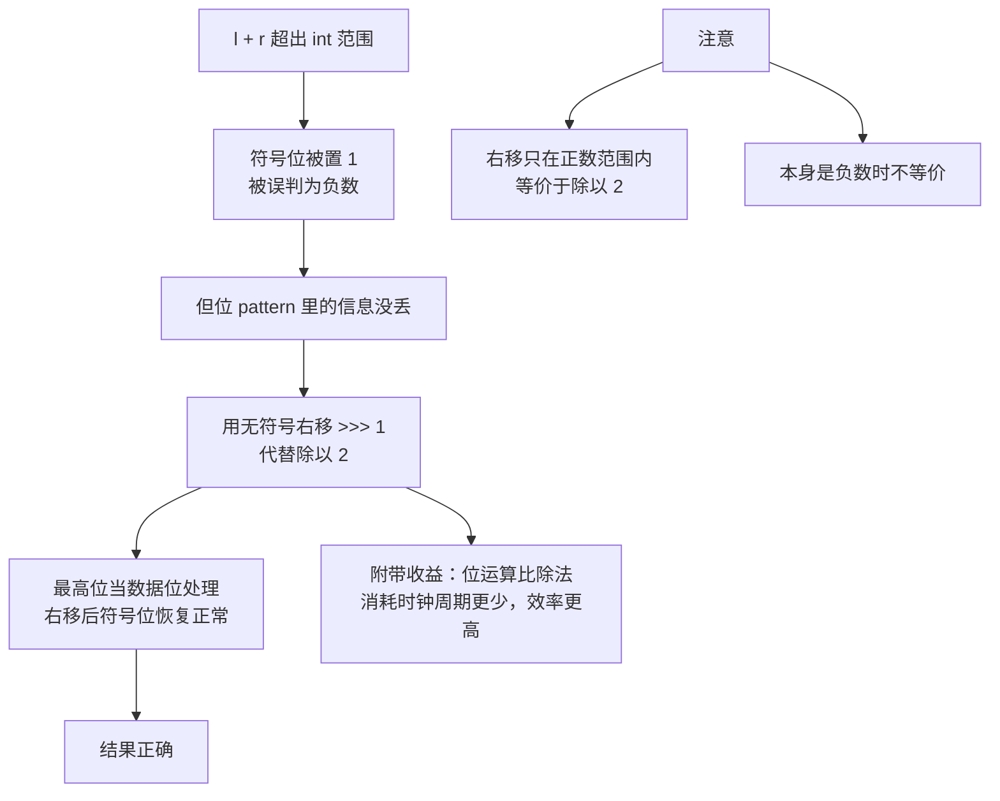

# 二分查找：解决整数溢出方法二

上一节用 l + (r-l)/2 解决了二分查找中间索引的整数溢出问题。这一节讲方法二，它比方法一更高效，也是目前各大厂代码里更常见的写法：用无符号右移代替除以 2。动手之前，先修正上一节公式推导时的一个小笔误。

## 先给结论

- 上一节公式推导里，中间位置加了括号之后，外面的减号忘了变过来，应该是加号。
- 方法二的做法：计算中间索引时，用无符号右移运算代替除法，写成 m = (l + r) >>> 1。
- 它不光能解决溢出问题，效率上也比除法高，因为 CPU 处理位运算消耗的时钟周期比除法运算少。
- 溢出的本质：l + r 超出了 int 范围，符号位被置 1，结果被错误识别成负数，但位pattern里的信息并没有丢。
- >>> 把最高位当数据位处理，右移之后符号位恢复正常，所以结果正确。
- 注意：右移只在正数范围内等价于除以 2，本身是负数时并不等价。



## 是什么

先修正笔误。上一节做公式推导的时候，中间这个位置加了括号以后，忘了把外面这个减号变过来，应该是加号。推导出的思路是：除二可以拆成两半分别除，l/2 + r/2 会丢精度，于是修正为 l + (r-l)/2，最终等价于 (l + r)/2 但不会溢出。这是方法一。

方法二换了个思路：本来是要除二，现在把除以二换成一个无符号的右移运算，右移一位。写出来就是 l 加上 r，也就是左边界加右边界，然后 >>> 1。

## 为什么这样设计

方法一要维护 l + (r-l)/2 这个稍复杂的表达式，而方法二回到最直觉的 l + r，只把最后的除二换成 >>> 1。直觉的形式加上位运算的效率优势，是它更流行的原因。

## 深入细节

### 效率上的收益

无符号右移不光能解决溢出问题，而且效率上要比除法高。因为 CPU 在处理位运算所需要消耗的时钟周期，比进行除法运算所需要的时钟周期更少。所以计算中间索引的代码改成 >>> 1 之后，先验证一下这种做法是不是真能达到不发生溢出的效果：把之前的结果先记录一下，然后重新运算，看两次是不是一致。

先看结论：第一次计算出来，这个中间索引是十亿多这个数；第二次呢，计算出来是一亿多。两次结果都一样，说明没有问题。

对应的代码和运行输出：

```java
public class IntegerOverflow {
    public static void main(String[] args) {
        int l = 0;
        int r = Integer.MAX_VALUE - 1;
        int m = (l + r) >>> 1;
        System.out.println(m);
        // 在右移
        l = m + 1;
        m = (l + r) >>> 1;
        System.out.println(m);
        System.out.println(126 + 63);
    }
}
```

有同学会问：既然第二次的时候，l 和 r 都比较大，那 l + r 明明是溢出了，为什么用 >>> 又能避免它的溢出？下面分析一下。

### 用 byte 的例子看溢出的本质

还是用之前 byte 的例子。之前说过，126 和 63，如果把它限制在 byte 的范围内做加法，由于它把符号位改变成了 1，导致它变成了一个负数。本来它俩加起来应该是 189，结果变成了负的 67。

但是换一种思路：把它当成一个更大范围的数字来考虑，比如当成计算器里的 word，也就是 short，一个两字节的数字。那个范围能不能存下这个 189？当然可以。189 的二进制位 pattern 是 11111101，信息并没有丢失，还是 189。只是之前的问题在于，byte 错误的把最高位的这个 1 当成了符号位，把它识别成了负的 67。

那如果我把它整体又移一位呢？整体再移之后，这个符号位是不是就恢复到了它正常的、非符号的这些范围之内？它就可以被正确识别了。所以它其实还是那个 189，又移之后它就不把最高位当成符号位，自然也没有之前的问题。

具体看一下 >>> 怎么移：把低位的 1 移到高位这边来，中间的 0 移过来，4 个 1 都平移过来，最后的 1 移走就没有了。上面是结果，下面是原始的。189 右移一位，就得到了正确的 94。

### 验证等价性

189 如果用除 2 的话，跟用 >>> 1，最终效果是一样的，都是 94。

但请注意一点：很多课程上会说位运算完全等价于除法，这不是 100% 正确。因为它只为正数运算时，才等价于除 2 的操作。如果你前面本身是个负数，那么它并不能等价于这个除 2。这点要注意。

## 面试怎么答

答题分三步：

1. **先给写法**：中间索引用 m = (l + r) >>> 1，无符号右移代替除二。
2. **讲清两个理由**：一是效率，位运算时钟周期比除法少；二是防溢出，>>> 把最高位当数据位，右移后符号位恢复正常，所以即使 l + r 溢出成负数，>>> 1 拿到的仍然是正确的中间值。
3. **补一个边界认知**：>>> 1 只对非负数等价于除 2，负数不等价，这是常见追问点。

常见追问：

- **问**：为什么 l + r 溢出了，>>> 1 还能算对？
  **答**：溢出只是符号位被置 1，整个位 pattern 并没有丢信息。>>> 是无符号右移，最高位补 0，不移码当成符号，右移一位后位 pattern 回到正确的数值范围，所以结果正确。
- **问**：>>> 1 和 / 2 完全等价吗？
  **答**：不是。只对正数等价，负数不等价。
- **问**：和方法一 l + (r-l)/2 比呢？
  **答**：都能防溢出；方法二回到 l + r 的直觉形式，且用位运算效率更高，所以更常见。

## 常见误区

- **误区一**：以为 >>> 1 是「修复」了溢出。它没有阻止 l + r 溢出，只是右移时按无符号处理，符号位恢复后结果自然正确。
- **误区二**：认为 >>> 1 和 / 2 永远等价。只对正数成立，负数不成立。
- **误区三**：推导公式时括号内外的符号不一致。中间位置加括号后，外面的符号要跟着一起变，别把加号写成减号。
