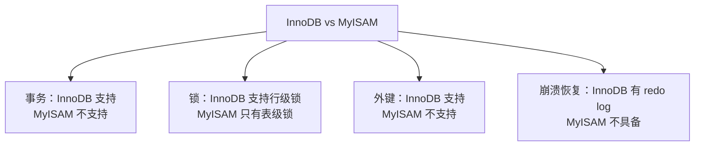
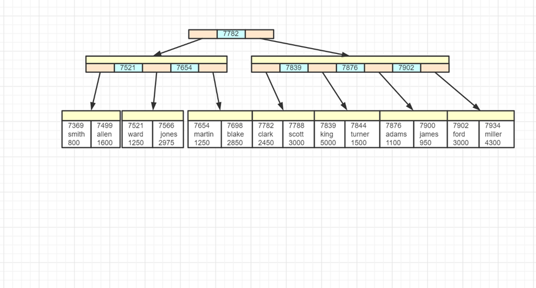
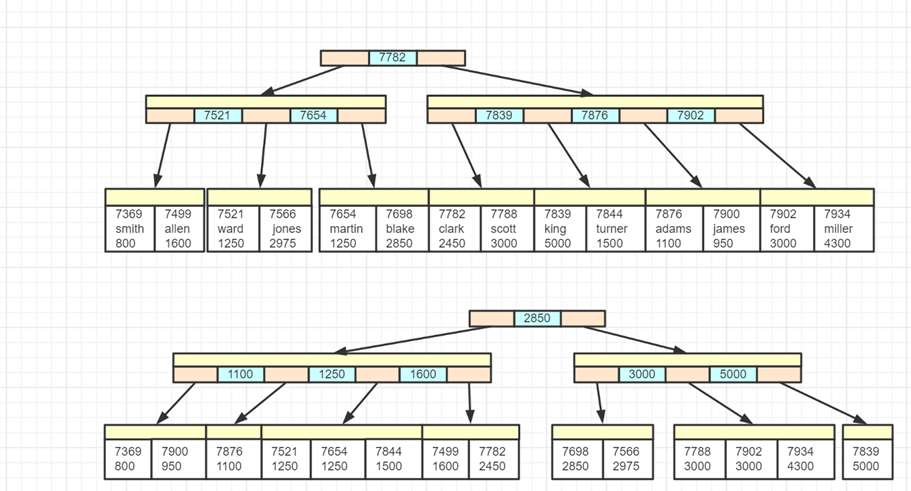
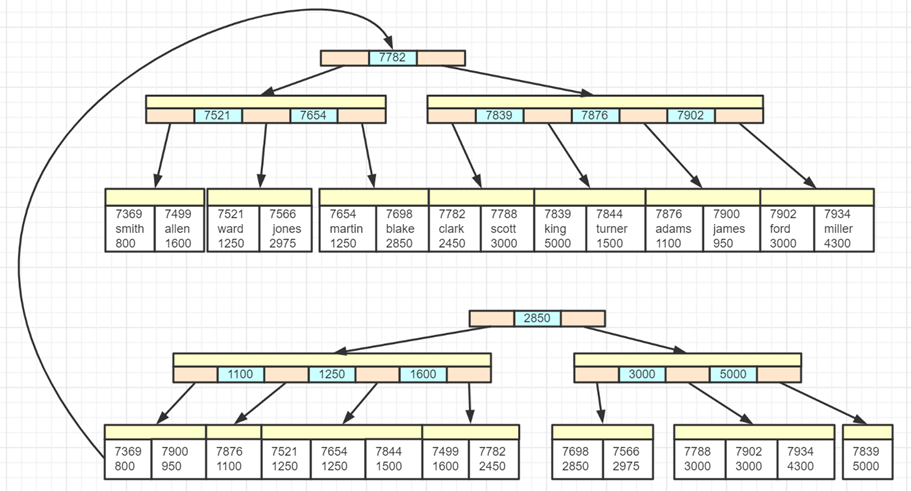
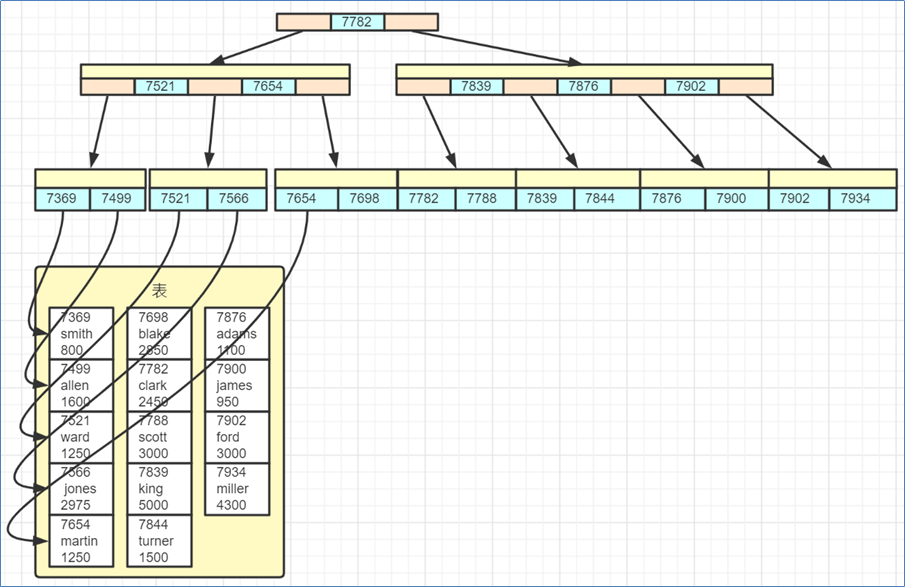

# 存储引擎：InnoDB vs MyISAM

面试题：MySQL 的存储引擎有哪些，InnoDB 和 MyISAM 有什么区别？

MySQL 的存储引擎其实挺多的，但需要重点掌握和对比的就两个：InnoDB 和 MyISAM。MyISAM 是早期 MySQL 中默认的存储引擎，而 InnoDB 是现在 MySQL 默认的存储引擎。这题的答法不是罗列参数，而是把索引结构、事务、锁、外键四条主线讲清楚，再补一个 MyISAM 唯一的优势场景。

## 先给结论

- InnoDB 是现在的默认引擎，支持事务、行锁和间隙锁、外键；MyISAM 是早期默认引擎，这些都不支持。
- 索引结构：InnoDB 分聚簇索引和二级索引两种，MyISAM 只有一种普通索引。
- 事务上，InnoDB 的 ACID（原子性/一致性/隔离性/持久性，事务必备的四项特性，下文会展开）各有底层技术支撑：undo log 支持回滚和当前读，redo log 实现持久性，两阶段提交实现一致性，当前读加锁实现隔离性；MyISAM 没有 undo log 和 redo log，保证不了持久性和一致性。
- 锁方面：InnoDB 支持行锁、间隙锁，RC 隔离级别下行锁，RR 隔离级别还多出间隙锁；MyISAM 只支持表锁，锁定粒度粗，性能没 InnoDB 好。
- 外键：InnoDB 支持，MyISAM 不支持。
- MyISAM 唯一比 InnoDB 强的是：它会保存表的总记录数，无条件的 count(*) 不用逐行数；但只要 count(*) 带了条件，两者就没差别。

## 是什么

MySQL 存储引擎有很多，重点掌握 InnoDB 和 MyISAM 两个。它们的关系是：MyISAM 是早期 MySQL 中默认的存储引擎，InnoDB 是现在 MySQL 默认的存储引擎。面试问「有哪些」，先答这两个，再点明默认引擎的变迁，就立住了。

## 深入细节

### 索引结构不同

InnoDB 中有两种索引：一种叫聚簇索引，一种叫二级索引。

- 聚簇索引：主键值作为索引数据，叶子节点还包含了所有字段数据。也就是说 InnoDB 的表数据本身就挂在聚簇索引上。
- 二级索引：被索引的字段值作为索引数据，叶子节点还包含了主键值。所以 InnoDB 的二级索引查完之后还要拿主键值回聚簇索引找完整行。

而 MyISAM 中索引就一种，普通索引：被索引字段值作为索引数据，叶子节点还包含了该记录数据页地址。所以讲起来 InnoDB 稍微复杂一些，索引的细节放到下一节专门讲。

### 事务支持不同

InnoDB 支持事务，MyISAM 不支持事务。事务有 ACID 四个特性：原子性、一致性、隔离性、持久性。InnoDB 通过什么来实现 ACID 这四个特性？它的底层是这样分工的：

- 通过 undo log，也就是回滚日志，来支持事务回滚，以及当前读，也叫多版本查询；
- 通过 redo log 重做日志实现持久性；
- 通过两阶段提交实现一致性；
- 通过当前读还有锁的一些实现来实现隔离性。

所以 InnoDB 在 ACID 的各个特性都有相应的底层技术来实现。而 MyISAM 就没有这些，它没有什么 undo log，也没有 redo log，所以它并不能保证事务的持久性，包括一致性等等都不能保证。

### 锁的支持不同

InnoDB 中锁的支持跟 MyISAM 中锁的支持不一样。InnoDB 是支持行锁、间隙锁的：对于 RC 隔离级别下它是支持行锁，那对于 RR 隔离级别还多出了间隙锁。而 MyISAM 中它只支持表锁，也就是它的锁定范围比较粗、粒度大，所以它的性能肯定是没有 InnoDB 在这方面的性能要高的。

### 外键支持不同

InnoDB 是支持外键的，而 MyISAM 中外键也不支持。

### MyISAM 唯一的优势：count(*)

MyISAM 唯一比 InnoDB 还要高的，是 InnoDB 多出来的一个特点，它会保存表的一个总记录数。比如说执行 select count(*) from 表的时候，MyISAM 实际上不会一个一个去数一共有多少条记录，它在增加和改变的时候，已经把这个记录总数每次都更新了，所以可以一下子就查到一共有多少条记录。

而 InnoDB 执行 count(*) 的时候，它就得一个一个记录去数，看一共有多少条记录。所以这一点上 MyISAM 要强一些。

但是大家想，如果 InnoDB 和 MyISAM 都执行一个带条件的 count(*)，那它们其实都一样了。因为带条件的话，它还是得根据条件去一条一条排查，这个时候它俩的性能就没有什么差异了。

## 面试怎么答

按「定位 + 对比表 + 收尾」组织：

1. **定位**：存储引擎可插拔，重点两个；MyISAM 是早期默认，InnoDB 是现在默认。
2. **对比四条主线**：索引结构（InnoDB 聚簇加二级，MyISAM 只有一种）；事务（InnoDB 的 undo log、redo log、两阶段提交、当前读加锁分别对应 ACID，MyISAM 都没有）；锁（InnoDB 行锁加间隙锁，RR 比 RC 多间隙锁，MyISAM 只有表锁）；外键（InnoDB 支持，MyISAM 不支持）。
3. **补一个反转点**：MyISAM 存总行数，无条件 count(*) 快；带条件两者一样。主动说出 MyISAM 唯一的优势，比背一面倒的结论更可信。

常见追问：

- **问**：为什么 InnoDB 的 count(*) 比 MyISAM 慢？
  **答**：MyISAM 维护了表的总行数，无条件 count(*) 直接返回；InnoDB 没有这个计数，需要逐行统计。但带 where 条件时两者都要逐行判断，就没差别了。
- **问**：RR 和 RC 在锁上有什么区别？
  **答**：RC 下 InnoDB 用行锁；RR 下除了行锁还有间隙锁，用来防止幻读。
- **问**：两阶段提交解决什么问题？
  **答**：让 redo log 和 bin log 保持一致，避免主从复制时主库与从库数据不一致，这是持久性之外对一致性的兜底。

## 常见误区

- **误区一**：只说 MyISAM 简单快。它只支持表锁，并发写性能差，功能上缺事务、外键，除了无条件 count(*) 没有优势。
- **误区二**：以为 InnoDB 的二级索引叶子存的是行数据。二级索引叶子存的是主键值，还要回表查聚簇索引。
- **误区三**：以为带条件的 count(*) MyISAM 也快。带条件就要逐行排查，两种引擎一样。

## 课件配图
> 以下配图取自阶段七课件对应讲义，与上文讲解一一对应，可作为图文对照辅助理解。
**InnoDB vs MyISAM**（课件讲义图示）

