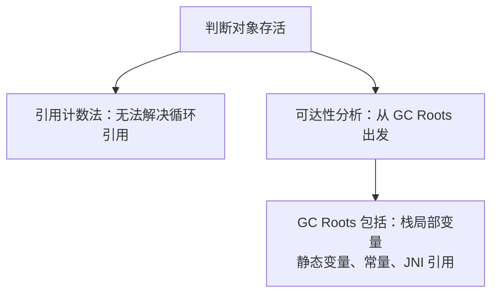
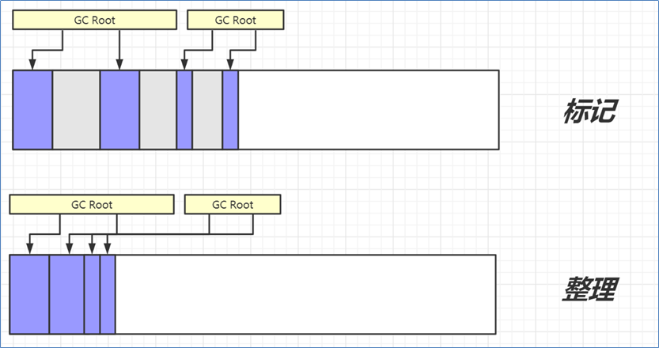
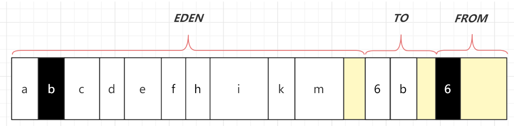
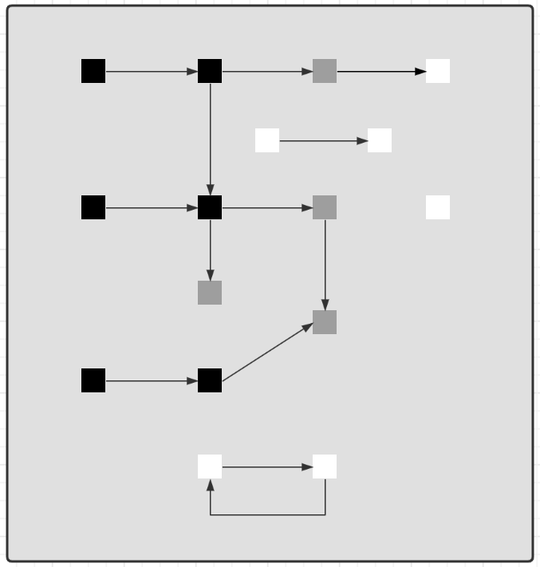
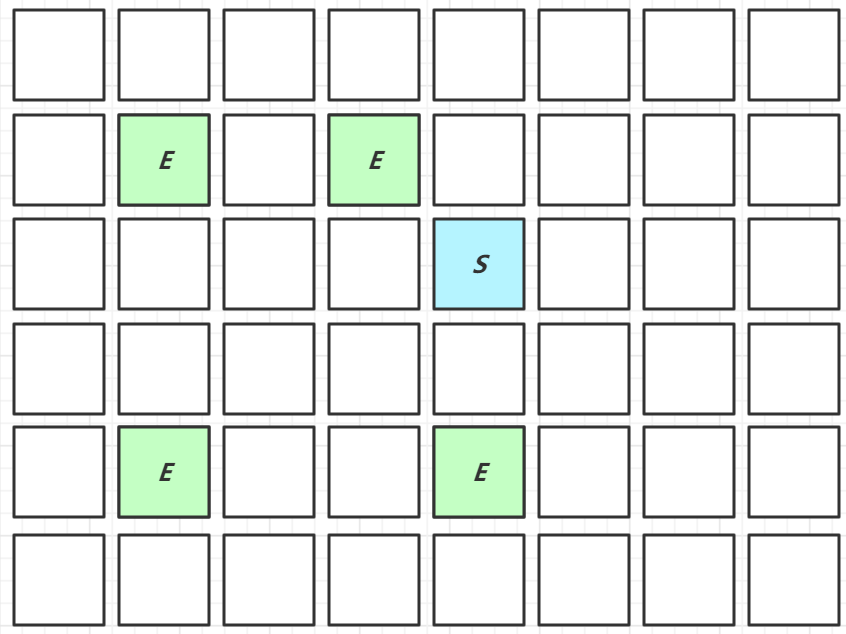

# 垃圾回收概述：GC 与分代回收

面试题：说说 GC 和分代回收算法。

这是 JVM 垃圾回收篇章的总纲题。这题牵扯的理论知识特别多，直接堆细节容易乱，正确答法是先给全景：GC 的目的、回收哪块区域、怎么判断对象无用、实现叫什么、分代回收的思想、按规模分哪几种。把骨架立起来，后面每一个点都能展开。

## 先给结论

- GC 的目的：找到无用的对象，把它们占用的内存自动释放，同时减少内存碎片、加快新对象的内存分配速度。
- GC 回收的区域是堆内存，不包括虚拟机栈，栈中方法占用的内存在方法调用结束时会自动释放。
- 判断对象有没有用，用的是可达性分析算法：从 GC Root 沿引用链找，能找到的加标记，是存活对象；找不到的作为垃圾回收。标记的具体实现牵涉三色标记法（白话：给对象标白/灰/黑三色，避免漏标和重复扫描）。
- GC 的具体实现称为垃圾回收器，常见的有并行垃圾回收器、CMS、G1 等。
- 分代回收思想：大部分对象朝生夕灭，用完立刻就能回收；少部分对象长时间存活，每次很难回收。据此把回收区分成新生代和老年代，用不同的回收策略。
- 按规模分三种：Minor GC（新生代的小范围回收）、Mixed GC（新生代加部分老年代的混合收集，G1 独有）、Full GC（全面的垃圾回收，停顿明显）。

## 是什么：GC 的目的

先思考一个问题：GC 的目的是什么？其实非常简单，垃圾回收的目的，就是找到那些无用的对象，把这些无用对象占用的内存释放掉。因为如果不释放，这些无用对象一直占着内存，可用内存会越来越少，最终直至耗尽。而且这个释放应该是自动的，程序员不需要手动干预，由垃圾回收器自动完成，这样就减少了程序员的工作量。

除此以外，GC 还可以减少内存碎片。内存碎片少了，给一个新对象分配内存的时候，速度也会提升。因为内存都是规整的，不需要做额外的计算去算哪块还空闲着，只需要顺着对象依次分配就可以。

所以 GC 的目的有三个：完成内存的释放，减少内存碎片，同时增加内存分配的速度。

## 深入细节：GC 的五个要点

GC 的知识点牵扯比较多，也比较杂，总结成五个要点。

### 要点一：回收的是哪块区域

内存区域分成了堆、虚拟机栈、方法区等等，那垃圾回收回收的区域是哪块？是堆内存，不包括虚拟机栈。因为栈中方法占用的内存在方法调用结束的时候就会自动释放，不需要我们去关心。我们要关心的只有堆内存。

### 要点二：怎么判断对象有没有用

使用的是可达性分析算法。先找到一些一定不会被回收的对象，也就是 GC Root，沿着 GC Root 的引用链去找，如果能够找到当前对象，那就给它加一个标记，加了标记的就表示是将来要存活的对象。如果沿着 GC Root 的引用链找不到，没加标记的，那么这些对象就可以作为垃圾将来进行回收。

当然加标记的时候会牵扯到一个三色标记法，这个后面还会讲到。

### 要点三：GC 的实现是垃圾回收器

垃圾回收的具体实现，我们称之为垃圾回收器。大家也得对常见的几种垃圾回收器有所了解，至少记住它们的名字：有并行的垃圾回收器，有 CMS 垃圾回收器，还有 G1 垃圾回收器等等。后面会展开讲。

### 要点四：分代回收思想

很多垃圾回收器都采用了分代回收的思想。它的理论依据是：我们的对象可以看成两大类。

第一类属于大部分对象，他们都是朝生夕灭的，用完了不会再用第二次。那么这些对象的内存可以在用完一次以后，就被回收掉。

另外一类是属于少部分对象，他们会长时间存活，所以在每次垃圾回收的时候，很难把它们回收。回收的时候发现还在使用不能回收，下次又回收的时候，发现还在用还是不能回收。

一类是很容易就可以被回收的，另外一类是很难被回收的。根据这两类对象的不同特性，就可以把回收区也划分成两个区：一个是新生代，一个是老年代，这就是所谓的分代。分代以后，新生代里面放那些朝生夕灭的对象，老年代里面放那些会长时间存活的对象。

针对这两个区域采用不同的回收策略。新生代可以让回收更为频繁一些，因为新生代里面大部分都是朝生夕灭，立刻就能把他们占用的内存释放掉，回收频繁也没什么问题。而老年代呢，就会很久才运行一次垃圾回收，因为老年代的垃圾回收运行得再频繁也没用，里面大部分对象都是长期存活、很难回收的。

所以针对不同的区域应用不同的回收策略，就更为合理，这就是分代回收的思想。

### 要点五：三种规模的 GC

根据 GC 的规模，可以分成三种不同的规模，分别叫 Minor GC、Mixed GC 和 Full GC。

- Minor GC 是指新生代发生垃圾回收，它是一个小范围的垃圾回收，暂停时间也比较短，对系统影响也比较少。
- Full GC 是指新生代和老年代都发生内存不足了，来一次全面的垃圾回收。Full GC 的暂停时间更长，一般发生了 Full GC，会很明显地感觉到系统停顿。
- Mixed GC 处于二者之间，它是指新生代发生了垃圾回收，部分的老年代也发生垃圾回收，这个叫混合收集，它是 G1 这种垃圾回收器独有的一种方式。

一般我们是不希望看到 Full GC 的。

## 面试怎么答

按「目的 + 五要点」的顺序答：

1. **目的**：自动释放无用对象内存、减少碎片、加快分配。
2. **五要点**：回收区域是堆（不含虚拟机栈）；可达性分析判断无用对象；实现是垃圾回收器（并行、CMS、G1）；分代回收思想（朝生夕灭进新生代、长期存活进老年代、不同区域不同策略）；三种规模（Minor、Mixed、Full GC）。
3. **收尾**：点一句不希望看到 Full GC，把话题引到 GC 调优，显出动机关乎性能。

常见追问：

- **问**：为什么虚拟机栈不用 GC 管？
  **答**：栈中方法占用的内存在方法调用结束时就自动释放了，生命周期确定，不需要垃圾回收器介入。
- **问**：新生代和老年代为什么用不同策略？
  **答**：新生代对象朝生夕灭，回收频繁代价小、收益大；老年代对象长期存活，频繁回收也回收不了多少，反而拖慢系统，所以很少触发。
- **问**：Mixed GC 为什么是 G1 独有的？
  **答**：Mixed GC 是新生代加部分老年代的混合收集，G1 把堆划分成多个 region，能挑选回收价值高的老年代 region 做混合收集，其他回收器没有这种 region 级的选择能力。

## 常见误区

- **误区一**：以为 GC 管所有内存区域。GC 回收的是堆，虚拟机栈的内存随方法结束自动释放，不在 GC 范围内。
- **误区二**：只记「可达性分析」五个字。要能说清从 GC Root 沿引用链遍历、可达的加标记存活、不可达的作为垃圾。
- **误区三**：把三种规模搞混。Minor 只新生代，Mixed 是新生代加部分老年代且 G1 独有，Full 是全面回收、停顿最长。

## 课件配图
> 以下配图取自阶段七课件对应讲义，与上文讲解一一对应，可作为图文对照辅助理解。
**JVM 垃圾回收**（课件讲义图示）

**讲义配图**（课件讲义图示）

