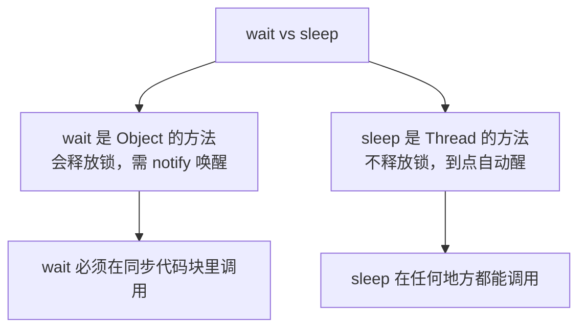

# wait vs sleep 的区别

面试题：对比一下 sleep 方法和 wait 方法。

这是多线程章节的高频面试题。两个方法效果看起来都是「让线程停一会」，很多人答完共同点就开始凭印象堆区别，答不全也讲不透。正确的打开方式是按共同点、方法归属、醒来时机、锁特性四个方面系统对比，其中锁特性是这题的胜负手。

## 先给结论

- 共同点：wait()、wait(long) 和 sleep(long) 的效果都是让当前线程暂时放弃 CPU 的使用权，进入阻塞状态。
- 方法归属不同：sleep(long) 是 Thread 类的静态方法；wait()、wait(long) 都是 Object 类的成员方法，每个对象都有，每个对象都可以作为锁。
- 醒来时机不同：sleep(long) 和 wait(long) 到时间会自动醒；wait() 和 wait(long) 还可以被 notify 唤醒，wait() 不被唤醒会一直等下去；三者都可以被打断唤醒。
- 锁特性不同：wait 调用前必须先获得这个对象的锁；wait 执行时会释放锁，允许其他线程获得；sleep 没有这个限制，但如果执行在 synchronized 代码块中，sleep 期间不会释放锁。



## 是什么：共同点

先看共同点。wait 方法常见的有两种：一种是无参的 wait，一种是带一个长整型参数的 wait。sleep 方法就一个，带长整形参数的 sleep。

它们的共同效果，都是让当前线程放弃 CPU 的使用权，进入阻塞状态。也就是说当前线程不用 CPU 了，其他线程可以去争取执行。

## 深入细节：三个方面的不同

### 不同一：方法归属不一样

sleep 方法是 Thread 类中的静态方法。而两个 wait 方法呢，都是 Object 中的成员方法，每个对象都有。

这意味着什么？每个对象都可以作为锁。你获得了这个对象锁以后，就可以调用这个对象的 wait 方法，让当前线程进入等待。

从 JDK 的方法声明上就能直接看出归属差异：

```java
public class Thread {
    // sleep 是 Thread 的静态方法，睡的是「当前线程」，跟哪个对象锁无关
    public static native void sleep(long millis) throws InterruptedException;
}

public class Object {
    // wait / notify 是 Object 的成员方法，作用在某个具体对象的锁上
    public final void wait() throws InterruptedException;
    public final native void wait(long timeout) throws InterruptedException;
    public final native void notify();
    public final native void notifyAll();
}
```

注意 `wait` 和 `notify` 都是 `final` 的，子类改不了；而且它们都声明抛出 `InterruptedException`，这也是「等待中可以被打断」在签名层面的体现。

### 不同二：醒来时机不一样

带参的 sleep 和带参的 wait，它们的参数其实就决定了会等待多长时间。等够了这个时间，它们自然就会醒过来。等待时间的单位都是毫秒值。

两个 wait 方法还可以被 notify 来唤醒。notify 又分两种：一种就叫 notify，它是在这个对象上所有等待的线程里，拿一个来唤醒；还有一个叫 notifyAll，是把这个对象上所有等待的线程全部唤醒。

这里的无参 wait，如果没有用 notify 唤醒，它就会一直等下去。带参的 wait，除了用 notify 唤醒之外，等够了时间它也会自动醒过来。

另外一个大家可能不太关注的点：它们都可以被打断唤醒。什么叫打断唤醒？就是如果你拿到了当前的线程对象，那你就可以调线程对象的 interrupt 方法，它就会让这个等待的线程抛出一个打断异常，然后让它们醒过来。sleep 的线程和 wait 的线程，都可以用这种打断的方式唤醒。

### 不同三：锁特性不一样

wait 方法的调用，必须获得这个对象的锁，然后才能调用这个对象的 wait 方法，也就是 wait 必须配合锁一起用。sleep 就没有这个要求，跟锁一起用也行，不跟锁一起用也可以。

另外一个非常重要的点：你获得对象锁以后可以调它的 wait，但是你调了 wait 以后，它会把这个锁再释放掉，允许其他线程获得这个锁对象。也就是说当前线程虽然不用 CPU 了，但其他线程里面还可以用这个 CPU，用这个锁。形象地说就是：我放弃了，但你们还可以用。

而 sleep 方法呢，如果它是在 synchronized 代码块中被执行的，也就是它先获得了一个锁，然后调用了 sleep，那这个时候 sleep 的过程中并不会释放这个对象锁。也就是虽然 sleep 的线程放弃了对 CPU 的使用，但是其他想获得锁的这个线程也用不了这个 CPU。形象地说：我放弃了，但你们也用不了。

把这两个说法放到同一段代码里对照，差别就很直观了（课件 `day02/WaitVsSleep.java`）：

```java
static final Object LOCK = new Object();

// t1 拿到锁后调用 wait(5000L)，等待期间把锁放掉，主线程立刻就能进同步块
private static void waiting() throws InterruptedException {
    Thread t1 = new Thread(() -> {
        synchronized (LOCK) {
            try {
                LoggerUtils.get("t").debug("waiting...");
                LOCK.wait(5000L);
            } catch (InterruptedException e) {
                LoggerUtils.get("t").debug("interrupted...");
                e.printStackTrace();
            }
        }
    }, "t1");
    t1.start();

    Thread.sleep(100);
    synchronized (LOCK) {
        main.debug("other...");        // 不用等满 5 秒，几乎与 waiting 同时打印
    }
}

// t1 拿到锁后调用 sleep(5000L)，睡眠期间攥着锁不放，主线程只能卡在 synchronized 上
private static void sleeping() throws InterruptedException {
    Thread t1 = new Thread(() -> {
        synchronized (LOCK) {
            try {
                get("t").debug("sleeping...");
                Thread.sleep(5000L);
            } catch (InterruptedException e) {
                get("t").debug("interrupted...");
                e.printStackTrace();
            }
        }
    }, "t1");
    t1.start();

    Thread.sleep(100);
    /*synchronized (LOCK) {
        main.debug("other...");        // 要等满 5 秒、t1 退出同步块后才打印
    }*/
}
```

同样的「t1 拿锁 + 主线程 0.1 秒后抢锁」结构，一个用 wait、一个用 sleep，主线程那边一个是立刻打印、一个是等满五秒才打印。锁特性的差异不需要背，跑一遍就记住了。

完整的运行演示（包括非法调用 wait 的报错、interrupt 打断）放在下一节，这里先把文字层面的对比记牢。

## 面试怎么答

按「共同点 + 三方面」的框架答：

1. **共同点**：都让当前线程放弃 CPU，进入阻塞状态。
2. **方法归属**：sleep 是 Thread 的静态方法；wait 是 Object 的成员方法，每个对象都有，都能当锁。
3. **醒来时机**：sleep(long)、wait(long) 到点自动醒；wait 还能被 notify、notifyAll 唤醒，无参 wait 不唤醒就一直等；都能被 interrupt 打断唤醒。
4. **锁特性**：wait 必须先持有对象锁，调用后释放锁；sleep 不要求持锁，但在 synchronized 块中执行时不释放锁。

最后用两句话点题：wait 会释放锁，sleep 不会释放锁，这是并发编程里最容易踩的坑之一。

常见追问：

- **问**：为什么 wait 要定义在 Object 上，而不是 Thread 上？
  **答**：因为 wait 操作的是对象锁，每个对象都可以作为锁，线程在某个对象上等待、由某个对象唤醒，所以锁在哪，等待的方法就定义在哪。
- **问**：notify 和 notifyAll 的区别？
  **答**：notify 只唤醒在这个对象上等待的线程中的一个，具体哪个不保证；notifyAll 唤醒全部等待的线程，让它们重新竞争锁。
- **问**：sleep 在 synchronized 块中有什么风险？
  **答**：sleep 期间不释放锁，其他线程拿不到锁也无法推进，如果等待逻辑写得不好，容易造成阻塞甚至死锁。
- **问**：打断唤醒是什么？
  **答**：拿到线程对象后调用 interrupt 方法，会让等待中的线程抛出打断异常并醒过来，sleep 和 wait 都支持。

## 常见误区

- **误区一**：只答「sleep 是 Thread 的，wait 是 Object 的」就结束。锁特性才是重点：wait 释放锁，sleep 不释放。
- **误区二**：以为 sleep 到点一定精确唤醒。醒来的时机受线程调度影响，到点是获得再次被调度的资格，不是精确到毫秒的承诺。
- **误区三**：忽略无参 wait 和带参 wait 的区别。无参 wait 不被 notify 就永远等下去，带参 wait 到时间也会自己醒。
