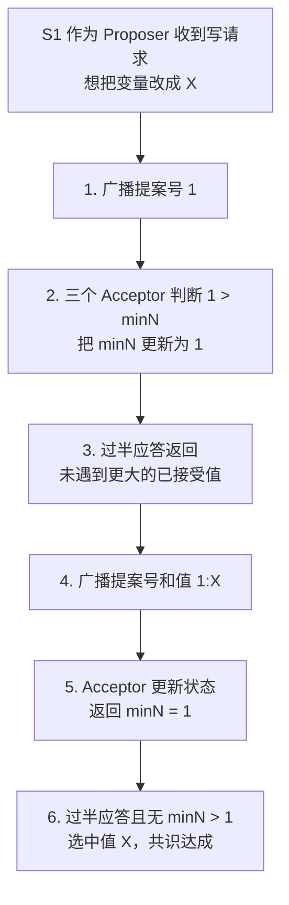

# Basic Paxos 算法例 1：五台机器走一遍无冲突流程

面试题：结合例子讲一下 Paxos 算法的工作流程。

前面把 Basic Paxos 的两个阶段讲完了，但那毕竟是抽象描述。面试官这时候往往会追一句：举个例子走一遍。例 1 就是最干净的那个例子：五台机器，一个提案，全程没有任何竞争，每一步都踩在点子上。把这个例子讲顺，Paxos 的主流程就算真懂了，后面碰到冲突场景也有底气。

## 先给结论

- 场景：五台服务器 S1 到 S5，S1 作为 Proposer 收到客户端写请求，要把一个变量更新成值 X。
- 流程六步：P 广播提案号 1，Acceptor 把 minN 更新为 1 后返回应答；P 收到过半应答且没有见到更大的已接受值，继续用自己的 X；P 广播提案号和值 1:X；Acceptor 更新状态后返回 minN；P 收到过半应答且没有出现 minN 大于自己的提案号，选中 X。
- 一致性落点：所有服务器最终都知道这个变量要修改成 X，共识达成。

## 是什么：场景设定

假设集群里有五台服务器，分别是 S1、S2、S3、S4、S5。

现在假设 S1 是一个 Proposer，它收到了客户端的一个写请求：想把一个变量更新成一个最新的值 X。

但它一上来就能直接更新吗？不行。它得先发起一个提案，询问集群中其他机器，看是不是大家都对这个修改能够达成一个共识、达成一个认可。所以它发起了一个提案，假设提案号是 1。这个提案它发了一份给自己，也给 S2 发了一个，给 S3 发了一个，当然也会发给 S4 和 S5，这里为了图简洁省略了。

## 深入细节：预备阶段

提案发出去之后，来看 Acceptor 这边。

每个 Acceptor 检查：你发过来的提案号是不是大于我记录的最小提案号。可以认为刚开始每个 Acceptor 的最小提案号是一个最小最小的整数值，你发过来的 1 肯定比那个最小整数值要大，所以 Acceptor 就把最小提案号更新成了 1。

将来可能会有多个值，为了看得清楚，这里用一个冒号做分隔。现在后面这两个值，也就是已接受提案号和已接受值，还没有，所以是空白的，只有第一个值，也就是最小提案号的信息。

接收到提案以后，这些 Acceptor 就可以返回信息了，返回应答给 Proposer。由于后两个值都没有，所以应答里也没有画已接受提案号和已接受值，就直接把应答返回给了 Proposer。

Proposer 这边，只要收到的应答过半，它就认为多数人对这个提案认可了，就可以做下一步的操作。当然它这里会检查应答里有没有已接受值：如果有，它就会用这个已接受值替换掉当前要修改的值。当前的值假设是要修改成 X，现在有没有已接受值呢？大家看，返回的应答里并没有已接受值，所以没有发生任何替换，还是用原始的 X 来做这个修改。

至此，准备阶段完成。

## 深入细节：接受阶段

接下来是接收阶段。这一阶段里，Proposer 会把提案号和值再做一次广播。

提案号是什么呢？还是刚才这个 1，都在这一轮提案里面。值是谁呢？没有发生修改，就以 Proposer 自己的值为准，要把它修改成 X。这个具体的值随着提案号一起广播给所有的 Acceptor。

Acceptor 拿到提案号和值之后，就知道应该做什么样的修改了：要把值改成 X。注意一开始它只收到一个提案号，并不包括值，也不知道要改成什么；只有提案通过了，才会把它修改成具体的值。这第二个阶段，也就是 Accept 阶段，才会真正修改成这个值。

这时发过来的提案号 n 是 1。每个 Acceptor 记录的最小提案号也是 1，1 大于等于 1，条件成立。因此后续的更新可以做：

- 把最小提案号和已接受提案号都更新成 1；
- 把已接受值更新成 X。

到这一步，相当于所有服务器都知道要把值修改成 X 了。

接下来返回响应，响应里包括最小提案号 1，返回给 Proposer。Proposer 这边同样检查收到的应答是否过半：它收到了自己的，还有 S2 的、S3 的，一共三个应答，在五台机器里已经算过半。过半说明这次操作成功了。

但还有一个很重要的条件要满足：返回的最小提案号不能大于当前的提案号。现在这个条件不成立，因为返回的最小提案号是 1，Proposer 当前的提案号也是 1，1 并不大于 1。所以这个值被选中了。

也就是说，这时候大家都达成了一个共识：接下来把这个变量的值修改成 X。这是第一个例子。

## 面试怎么答

1. **先交代场景**：五台服务器，S1 是 Proposer，收到把变量改成 X 的写请求。
2. **按六步走流程**：广播提案号 1，Acceptor 更新 minN 并应答；Proposer 收过半应答、没有更大的已接受值，沿用 X；广播 1:X；Acceptor 校验 n 大于等于 minN 后更新三个变量并返回 minN；Proposer 收过半应答且 minN 不大于 n，选中 X。
3. **点出两个判断点**：预备阶段看应答过半、看有没有已接受值要替换；接受阶段看应答过半、看返回的 minN 有没有超过自己的提案号。两个条件都踩过，值才被选中。

常见追问：

- **问**：这个例子里为什么没有发生值的替换？
  **答**：替换只在预备阶段的应答里带回已接受值时才发生。例 1 里所有 Acceptor 都是第一次接到提案，已接受值是空的，应答里没有带回来，所以 Proposer 保持自己的 X 不变。
- **问**：为什么接受阶段的条件是 n 大于等于 minN，而不是大于？
  **答**：因为 minN 就是提案号 1 的提案自己写进去的，同一轮提案里 n 和 minN 必然相等。用大于等于才能让提案顺利通过，否则自己的提案会被自己拦住。
- **问**：如果最后返回的 minN 比 n 大会怎么样？
  **答**：说明这期间有提案号更大的提案介入，本次提案即使应答过半也失败，这个值不会被选中。冲突场景下的例子会专门分析这种情况。

## 常见误区

- **以为应答过半就等于选中了**。过半只是其中一个条件。例 1 里两个过半都成立，同时还要满足「返回的 minN 不大于 n」，三个条件都过，X 才真正被选中。少看一个都会把结论答歪。
- **把接受阶段的条件记成 n 大于 minN**。正确的是 n 大于等于 minN。因为 minN 就是本轮提案自己写进去的，同一轮里两者相等，写成大于会让提案自己把自己拦住。
- **以为 Acceptor 更新完状态值就生效了**。Acceptor 只是把 acceptN、acceptValue 记下来，真正「选中」是 Proposer 那边的判断，只有它确认过半且没人插队，这个值才算定下来。
- **以为例 1 演示的是完整算法**。例 1 刻意挑了无冲突的场景，六步是一次顺利走完的流程。遇到多个 Proposer 抢提案、已接受值需要替换的情况，得看后面的例子。
