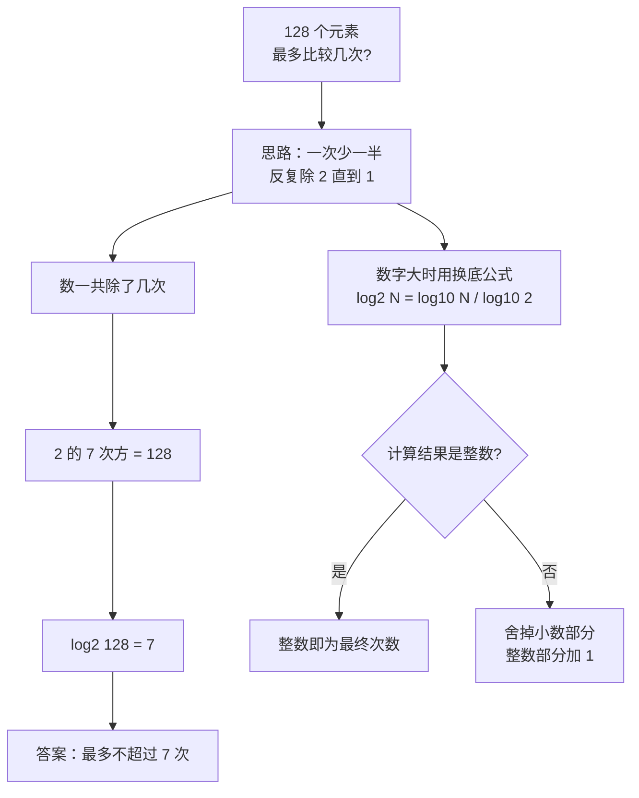

# 二分查找面试题：128 个元素最多比较几次

面试题：在拥有 128 个元素的数组中二分查找一个数，需要比较的次数最多不超过几次？

这题是二分查找比较次数题的进阶版：不给具体序列，只给元素个数，问比较次数的上限。它考的是把前面的推演抽象成公式：一次少一半，除到 1 为止，数除了几次。再进一步，数字大了不能手动除二，要会换成对数来算。

## 先给结论

- 思路：初始元素二分，一次少一半，一直除二，直到除到 1，数中间一共除了几次，就是最终比较的次数。
- 128 个元素：2 的 7 次方等于 128，也就是 log2 128 等于 7，结果是整数，7 就是答案，**最多不超过 7 次**。
- 数字大时转成对数运算：求以 2 为底的 N 的对数；计算器上的对数是以 10 为底的，要用换底公式，log2 N 等于 log10 N 除以 log10 2。
- 小数处理：算出来是整数，整数就是最终结果；算出来是小数，把小数部分舍掉，剩余的整数加一。

## 深入细节：除二法

第三题是这么问的：在拥有 128 个元素的数组中，二分查找一个数，需要比较的次数，最多不超过几次。

解这种题目很简单：初始元素二分嘛，反正就是一次少一半，你就除二呗，直到把它除到了 1。那就中间数数一共除了几次，那这就是最终比较的次数。

所以解答这种题目，一种做法就是每次除二除二除二，看一下一共中间除了几次二。当然也可以转换成另一种形式：看看是 2 的几次方等于 128，它俩是等价的。

计算机专业的同学应该都比较熟悉，2 的 7 次方是 128。如果你实在不知道是几次方，就用除二的方法，看除到 1 一共需要几次，这就是最终的次数。

## 深入细节：用计算器算对数

不过如果面试官给的数字比较大，不是 128 是一个很大的数，那你如果再用除法，那要除到天荒地老。这时候我们可以用指数的方式，把它转换成对数运算来求这个 n，也就是求一个以 2 为底的 128 的对数。

求对数大家可能手算算不出来，如果手边有计算器的话，可以用计算器来算。以系统自带的计算器为例，切换到科学模式，它就可以求对数了。

但是要注意：系统计算器里的对数是以 10 为底的对数，不是以 2 为底的对数。比如说求 100 的对数，它是 2，可以看到它是以 10 为底的，因为 10 的 2 次方等于 100。

所以我们得把这种以 10 为底的对数，转换成以 2 为底的对数。怎么转呢？用换底公式：先求以 10 为底 128 的对数，再求以 10 为底 2 的对数，然后两个一除，就是最终以 2 为底 128 的对数。

计算一下：128 求以 10 为底对数是这么多，它再除以一个以 10 为底 2 的对数 0.3，最终得到的是 7。这就是这道题。

## 深入细节：40 亿个元素

如果这个数字非常大，那我们只能用这种求对数的方式来算了。比如说有 40 亿个数，千万十万百万千万亿十亿，这是 40 亿的数。那 40 亿二分查找最多需要查几次呢？

我们先求它的对数，然后再除以 2 的对数，结果约等于 31.89 次。那当然这个次不能是小数，遇到这种小数，咱就把小数部分舍掉，然后剩余的整数加一，也就是 31 加 1 等于 32 次。

那如果这个求出来是整数，整数就是最终结果。所以 40 亿我们二分查找也只要比较 32 次就能找到。这也是二分查找高效性所在。

## 面试怎么答

1. **先给方法**：一次少一半，除到 1 数次数；等价于问 2 的几次方等于 N。
2. **报 128 的答案**：2 的 7 次方是 128，结果是整数，所以最多不超过 7 次。
3. **补大数处理**：不能手动除二时转对数，求 log2 N；注意系统计算器是以 10 为底，要除一个 log10 2 完成换底。
4. **说清取整规则**：整数直接取，小数舍小数部分再加一。拿 40 亿举例，约 31.89，进到 32 次。

常见追问：

- **问**：为什么是除到 1，不是除到 0？
  **答**：区间里还剩 1 个元素时，再比较一次就能确定在不在，这就是比较的尽头。除到 1 数的是把区间缩到单个元素需要的对折次数，正好对应比较次数。
- **问**：小数为什么要加一？
  **答**：比较次数只能是整数，而实际对折步数不会比理论值少。3.7 次意味着折三次还不够，得再补一次，所以舍小数加一，等价于向上取整。

## 常见误区

- **误区一**：拿到大数还在手动除二。除两次就知道该换对数了，40 亿这种量级手除没有意义。
- **误区二**：计算器直接按 log 就用。系统计算器的 log 是以 10 为底的，要除一个 log10 2 才是以 2 为底的对数。
- **误区三**：小数结果直接舍。舍掉小数还要加一，31.89 对应的是 32 次，不是 31 次。
