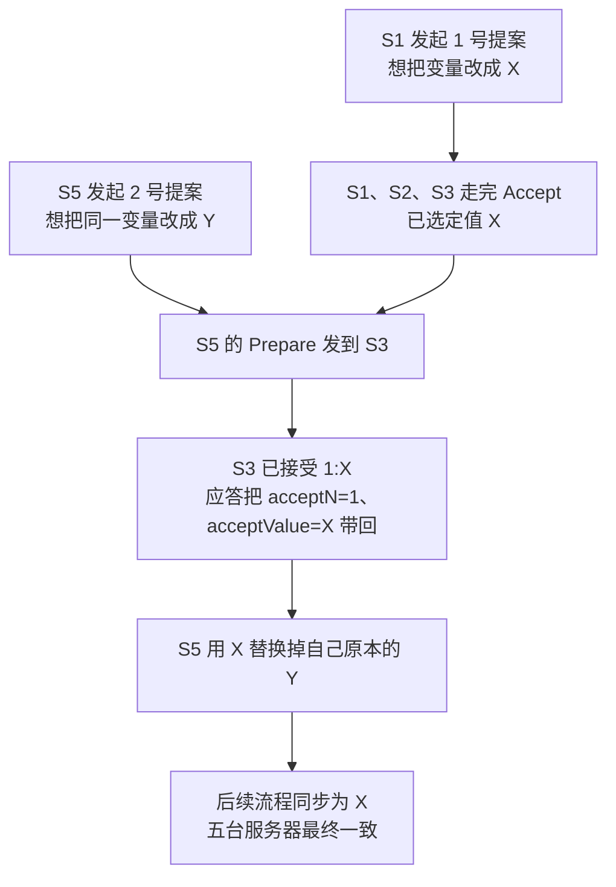

# Basic Paxos 算法例 2：两个 Proposer 同时提案

面试题：如果有两个 Proposer 同时发起提案，想改的值不一样，Paxos 能保证最终一致吗？

例 1 走的是无冲突的理想流程，面试官往往会顺着追问：两个提案者同时提案、值还不一样，系统还能达成一致吗？例 2 就是回答这个问题的。它把 Basic Paxos 最核心的机制亮了出来：预备阶段 Acceptor 会把已接受的值带回来，后到的 Proposer 拿它替换自己的值，冲突由此被消解。

## 先给结论

- Paxos 允许有多个 Proposer 同时出现，例 2 里 S1 发起一号提案想改成 X，S5 发起二号提案想改成 Y。
- 前半段略过：S1 的一号提案已经最终通过，S1、S2、S3 都选定变量以 X 为准。
- 冲突消解的关键：S3 已经走完 Accept 阶段，它的已接受提案号和已接受值已经是 1 和 X；S5 的预备请求发到 S3，应答把 1 和 X 带回，S5 用 X 替换掉自己原本的 Y。
- 最终五台服务器都选定 X，虽然出现了两个 Proposer，仍然达成一致。

## 是什么：场景设定

假设有这么一种情况：有两个 Proposer 它们同时提案。

有一个 S1，它发起了一个一号提案，想法是把一个变量修改成 X。那么还有一个 S5 服务器，它发起了一个二号提案，想法还是把同一个变量修改成 Y。

有意思的问题来了：一个提案者跟另一个提案者，他们想修改的值不一样，那最终这五台服务器能不能达成一个一致呢？我们通过 Paxos 算法来分析。

这里再强调一遍：Paxos 算法是允许多个 Proposer 同时出现的，S1 和 S5 多个 Proposer 都同时出现没问题。

## 深入细节：一号提案已尘埃落定

前面这部分分析我们略过，因为它跟例 1 几乎一模一样。也就是 S1 这边，它的一号提案已经最终通过了，并且已经选中了最终的值 X。对于前三台服务器 S1、S2、S3，他们都认为最终这个变量应该以 X 为准，已经选中了 X 值。

接下来分析 S5 这边的二号提案，看它最终能不能达到一个一致的效果。

## 深入细节：预备阶段取回已接受值

S5 发起了 prepare 提案，把这个提案号发给集群里的机器。注意它要过半，肯定得把这个请求发给 S1 到 S3 中的其中一台，它才能过半；如果只发给自己和 S4，票数肯定不能过半。所以假设它发给了其中的 S3。

发给 S3 以后注意，S3 这个时候的状态跟之前就有所不同了。因为 S3 的时间线上面，它已经经历了 accept 流程，经历了第二个阶段，那个 Accept 阶段了。所以它的 acceptN，就是已接受的提案号，和 acceptValue，已接受的值，已经有东西了，已经是 1 和 X。

所以这里，如果 acceptN 跟 acceptValue 已经有值了，那么它接下来在返回这个接受的值、这个 prepare 应答的时候，就会把这里的 1 和 X 作为响应返回回去，返回给提案者，也就是 S5。

所以 S5 拿到的 acceptValue，就会替换掉它原本的 Value Y。因为它发现这个 acceptValue 的优先级更高：acceptValue 意味着这个值已经是已经被其他服务器所接受的值，它比你这个处在一个 prepare 阶段的值优先级要高。Y 还是处于 prepare 阶段，而这里的 X 已经处于 accept 阶段，所以它的值的优先级高，会用 X 替换掉你原本的 Y。

替换掉了以后，它接下来进入了它的第二个阶段，也就是 accept 阶段。这回它的 accept 阶段里，在发送提案号和值的时候，提案号不变，还是它自己的 2 号提案，但是值已经全部变成了 X，会把 X 发给 S3、S4，加上自己，凑够过半的票数。

## 深入细节：最终仍然一致

大家想，这回它经历了这个 accept 阶段以后，返回的 minN 是 2。当然了，它们都是以 X 来进行这个修改，最终所接受的值也都是 X。

这样就达成了我们这五台服务器，虽然出现了两个 Proposer，最终呢，我们达成了一个一致性的效果：大家都选定了 X 这个值。

这就是如果产生了冲突、产生了这种 Proposer 的冲突，用 Paxos 一致性算法，最终仍然能达到一个实际选定值的一致性。

## 面试怎么答

1. **先给结论**：能一致。Paxos 允许多个 Proposer 同时出现，冲突时靠预备阶段取回已接受值来消解。
2. **再走流程**：S5 的二号提案必须发给已接受过提案的机器（S1 到 S3 中至少一台）才能过半；S3 的 prepare 应答带回 acceptN 和 acceptValue，也就是 1 和 X。
3. **点出替换**：S5 发现 X 处于 accept 阶段、优先级高于自己 prepare 阶段的 Y，用 X 替换 Y；Accept 阶段广播出去的提案号还是 2，值已经是 X。
4. **收尾**：五台服务器最终都接受 X，冲突场景下依然达成一致，这就是 Paxos 正确性的体现。

常见追问：

- **问**：为什么 S5 不坚持自己的 Y？
  **答**：因为 Y 还停在预备阶段，而 X 已经被 S1、S2、S3 在接受阶段选定。已接受值的优先级高于准备阶段的值，这是 Basic Paxos 的既定规则，坚持 Y 会破坏已经达成的一致。
- **问**：如果 S5 的 prepare 只发给自己和 S4 会怎样？
  **答**：应答到不了过半，S5 连多数派的认可都拿不到，更取不回 S3 上已接受的 X，提案直接失败。所以预备请求必须覆盖已接受过提案的机器所在的多数派。
- **问**：为什么最终返回的 minN 是 2？
  **答**：S3 在预备阶段把 minN 从 1 更新成了 2，S4 之前没收到过提案，minN 也被置成 2。S5 收齐应答后检查 minN 不大于自己的提案号 2，条件不成立，值被选中。

## 常见误区

- **误区一**：以为后到的 Proposer 可以用新值覆盖已选中的值。优先级不看提案号新旧，看阶段：accept 阶段已接受的值优先于 prepare 阶段准备提交的值。
- **误区二**：以为 prepare 发给谁无所谓。要过半，还必须覆盖已接受过提案的机器，否则取不回已接受值，一致性就断了。
- **误区三**：把例 2 的结论记成「提案号大的值赢」。例 2 里赢的是 X，靠的是阶段优先级和取回替换，不是提案号压过 1 号提案的值。
