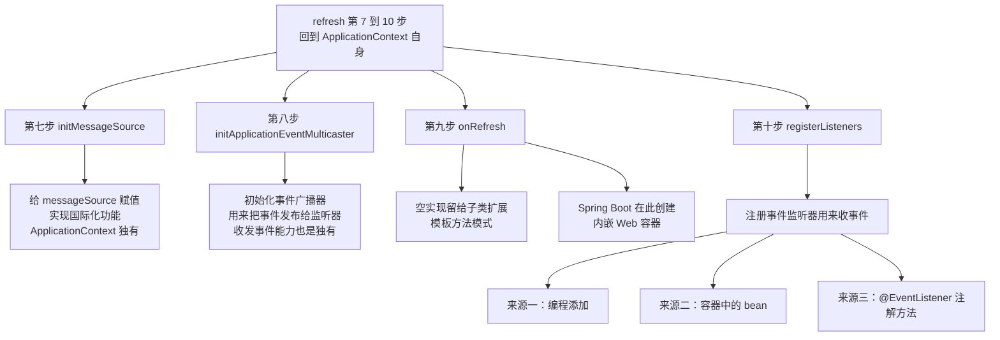

# Spring refresh 第七到十步：ApplicationContext 的独有功能

面试题：refresh 方法第七步到第十步分别做了什么？

前六步都在完善 BeanFactory，从第七步开始，refresh 的重心回到 ApplicationContext 本身，给它装配国际化、事件这些 BeanFactory 没有的能力。面试问到这里，考的是你能不能把这四步的功能一句话说清：国际化、事件广播器、留空扩展、事件监听器。分得清哪些是 ApplicationContext 独有、哪些又是模板方法模式，回答就完整了。

## 先给结论

- 第七步 initMessageSource：给 messageSource 成员变量赋值，实现国际化功能，是 ApplicationContext 独有的。
- 第八步 initApplicationEventMulticaster：初始化事件广播器，用来发布事件给监听器，也是 ApplicationContext 独有的收发事件能力。
- 第九步 onRefresh：空实现，留给子类扩展，体现模板方法设计模式；Spring Boot 在这里创建内嵌 Web 容器。
- 第十步 registerListeners：注册事件监听器用来收事件，来源有三个，编程添加、容器中的 bean、@EventListener 注解的方法。

## 深入细节：第七步，国际化

前面的二到六这几个步骤，都是在不断完善我们的 BeanFactory。从第七步开始，又回到了 ApplicationContext，来给 ApplicationContext 的一些成员变量进行赋值。

第七步做的事情，就是给一个叫 messageSource 的成员变量进行赋值。这个 messageSource 是用来干嘛的？说白了，它就是用来执行国际化功能的，这个可能平时设计得比较少，知道它是实现国际化的就行。

那么这个 messageSource 从何而来呢？它先找到容器的 BeanDefinition Map 中，看有没有一个名字就叫 messageSource 的 bean，当然你得实现 MessageSource 这个接口，就把它作为我们 messageSource 的实现。那如果没有呢？我们就提供一个空的 messageSource 实现，也就是不支持国际化功能。

所以第七步可以看成是 ApplicationContext 独有的一个功能，这是 BeanFactory 没有的，它具备这种国际化的功能。

## 深入细节：第八步，事件广播器

第八步叫 initApplicationEventMulticaster，初始化一个 applicationEventMulticaster，应用程序事件的 multicaster 广播器。

它是干嘛的呢？ApplicationContext 还有一个独特的功能，就是它可以收发事件。将来发事件的呢，就是我们看到的这个 multicaster，它是用来发送事件的。将来 Spring 的容器里面还可以定义一些监听器，这些监听器就可以用来收事件。将来事件发生了，它就会把这个事件对象由 multicaster 发送给各个监听器对象。这个 multicaster 翻译过来叫事件广播器。

它从何而来呢？其实跟 messageSource 类似，也是先到容器里找，看看你有没有一个这个 multicaster 的 bean。如果有，那就把它作为我们的这个 multicaster 的实现；如果你的 BeanDefinition Map 里没有提供，没有提供也没关系，它会提供一个默认的 multicaster。

那这个 multicaster 里面有一个集合，这个集合内部就维护了所有的监听器。将来 multicaster 调用方法发事件的时候，就相当于遍历这个集合，把事件发送给对这个事件感兴趣的那些监听器。它的调用方法有一个 publishEvent 方法，这个方法内部就会调我们的 multicaster 来发布这个事件。

这是第八步，它的作用就是用来发布事件给将来那些监听器的。

## 深入细节：第九步，留空给子类

第九步这个比较简单，它叫 onRefresh，它也是一个空实现，也是留给子类来扩展的。

那对应的设计模式呢？不用想了，前面都讲过，跟第四步一样，都是体现了一个模板方法的设计模式。

那有的子类呢，它会在这一步去创建那个 web server。就是在 Spring Boot 里会用到，Spring Boot 里都有那种内嵌的 web 容器嘛。Spring Boot 其实就是扩展了这个 onRefresh 的方法，在这里面创建了一些内嵌 web 容器。也就是 Spring Boot 的子类，在这一步中可以准备这种 web server 内嵌容器，体现的也是讲过的这个模板方法设计模式。

## 深入细节：第十步，注册监听器

第十步就是注册监听器对象。前面第八步讲了有个事件广播器发事件的对吧，那你发事件得有人来收。谁来收呢？就是一系列的 ApplicationListener 这样的应用程序监听器对象。

那这些监听器对象从哪来呢？它有两个来源：一个呢，我们可以通过编程添加；还有一方面就是这个 BeanDefinition Map，如果你的这些 bean 实现了 ApplicationListener 接口，那在这一步就会把这些 bean 找出来，找出来以后就加入到刚才说到 multicaster 这个集合里。将来它发事件的时候，就到这个集合里把事件发给这些监听器。

还有一部分我刚才没讲，就是它可能来自于标注了 @EventListener 注解的方法，这些方法也会被适配为一个监听器对象。

那怎么收事件呢？只要你的监听对象实现了 ApplicationListener 接口，它都会让你重写 onApplicationEvent 这样一个方法。将来 multicaster 发送事件的时候，它就会把对象从这个方法这传进来，你拿到这个事件对象来进行处理就可以了。

## 四步小结

刚才讲完了 7、8、9、10 这四个步骤，虽然看起来讲的多，但是大家理一下：

- 第七步添加了国际化功能；
- 第八步添加了事件的发布器；
- 第九步留给子类扩展；
- 第十步添加了事件的监听器，用来收事件。

这就是 7 到 10 这几个步骤他们做的事情。

## 面试怎么答

1. **先给分工**：前六步完善 BeanFactory，七到十步回到 ApplicationContext，装配它独有的能力。
2. **逐步说功能**：第七步 messageSource 管国际化，第八步 multicaster 管发事件，第九步 onRefresh 留空扩展，第十步 registerListeners 管收事件。
3. **点出来源规则**：messageSource 和 multicaster 都是先在 BeanDefinition Map 里找同名的 bean，找不到就用默认实现或空实现。
4. **补设计模式和例子**：onRefresh 和 postProcessBeanFactory 一样是模板方法模式，Spring Boot 借它创建内嵌 Web 容器；监听器有三个来源，@EventListener 方法也会被适配成监听器。

常见追问：

- **问**：messageSource 找不到对应的 bean 会怎样？
  **答**：提供一个空的 messageSource 实现，也就是容器没有国际化能力，但启动不受影响。这是标准的兜底思路：优先用容器里的 bean，没有就给默认实现。
- **问**：第八步和第十步是什么关系？
  **答**：第八步准备发事件的广播器，第十步准备收事件的监听器，监听器最终都加进广播器内部的集合。先有广播器，再注册监听器，顺序不能反。
- **问**：onRefresh 为什么设计成空实现？
  **答**：refresh 的脉络由父类定死，但不同子类的收尾动作不一样，Spring Boot 要建内嵌 Web 容器，别的子类可能有别的事。留空让子类按需扩展，这就是模板方法模式。

## 常见误区

- **误区一**：把 messageSource 和 multicaster 当成 BeanFactory 的功能。它们都是 ApplicationContext 独有的，BeanFactory 没有国际化和事件收发能力。
- **误区二**：漏掉监听器的第三个来源。除了编程添加和容器里的 bean，标了 @EventListener 注解的方法也会被适配成监听器对象。
- **误区三**：以为第十步注册完监听器就开始收事件。监听器加进广播器的集合，真正收事件要等后续容器运行过程中 publishEvent 被调用。
