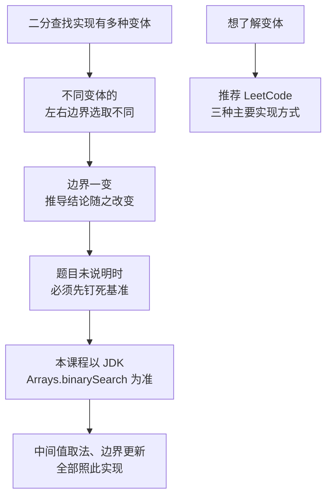

# 二分查找注意事项：以 JDK 的实现为准

面试题：你讲的二分查找是按哪种实现来的？

这是个收尾提醒，内容不多但很实在。课程里讲的二分查找，以 JDK 中 Arrays 工具类的 binarySearch 实现作为讲解示范，前后选择题的解答思路和依据也以此为准，比如左右边界的选取。为什么强调这个？因为二分查找有很多变体，换了实现，边界选取就变，之前总结的推导结论也就不正确了。

## 先给结论

- 本课程的二分查找以 JDK 的 Arrays.binarySearch 实现为示范，左右边界选取等结论都以 Java 的这个实现为准。
- 二分查找有很多变体，不同实现的左右边界选取有变化，换实现等于换结论。
- 课程里的选择题都默认以 JDK Java 实现为基础，没有考虑变体的情况。
- 想了解变体，可以网上自己搜，推荐 LeetCode 的网站，上面讲了三种主要的实现方式，课堂不展开。

## 深入细节：为什么强调基准

真正做二分查找，实现方式不止一种。如果用的是变体的实现代码，左右边界的选取就会有些变化，那之前总结的推导左右边界的结论就不正确了，会影响到答案选择。所以先把基准钉死：一切以 JDK 中 Arrays.binarySearch 的实现为准，比如左右边界的选取、中间值的取法，都以 Java 的这个实现为准。

不用担心之前看过的选择题，它们也没有考虑这么多，就是假定都以 JDK Java 中的实现为基础，没有考虑变体的情况。

对变体感兴趣的同学，可以网上自己去搜索，推荐 LeetCode 的网站，上面讲解了三种主要的实现方式，这里不做深入展开。

## 面试怎么答

被问「你的二分查找按哪种讲的」，直接答：按 JDK Arrays.binarySearch 的实现，左右边界、中间值取法都以它为准。再补一句：二分存在多种变体，边界处理不同，题目不特别说明时以标准库实现为基准。

常见追问：

- **问**：变体之间差在哪？
  **答**：主要差在左右边界的初始化、区间的开闭和中间值的取法，这些直接决定比较路径和边界结论。
- **问**：面试做题按哪个来？
  **答**：题目不声明时按 JDK 标准库实现；有些题目会明确边界风格，按题目要求来。

## 常见误区

- **误区一**：以为二分查找只有一种写法。变体的边界选取不同，结论不能混用。
- **误区二**：换实现还沿用旧结论。边界规则跟着实现走，换了实现要重新推边界。
