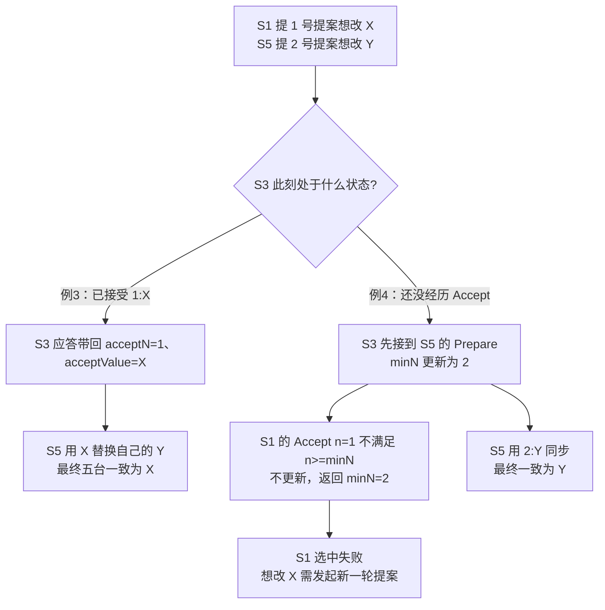

# Paxos 算法例3、例4：accept 与 prepare 的先后

面试题：Paxos 中 accept 和 prepare 的执行顺序会影响结果吗？

前几个例子把最常见的冲突路径走完了，这篇再看两个边界情况，回答一个具体问题：S3 上一号提案的 accept 和二号提案的 prepare 哪个先执行，对最终结果有没有影响。结论是：值被接收的早晚不影响结果，accept 和 prepare 的先后才影响。

## 先给结论

- 例3 和例2 一样，都是 accept 在前、prepare 在后，最终分析结果一模一样：S5 用 X 替换自己的 Y，五台服务器一致选定 X。
- 接收值发生在前还是在后，对最终分析结果不产生影响。
- 例4 反过来，prepare 在前、accept 在后：二号提案的 prepare 先把 minN 更新成 2，之后一号提案的 accept 因提案号 1 小于 minN 2 条件不成立而失败，一号提案选值失败。
- 选值失败不意味着系统不一致：失败方会开启新一轮提案，最终 S5 的二号提案成功，五台服务器一致选定 Y。



## 深入细节：例3

把注意力集中在 S3 上。S3 先执行了一号提案的 accept，再处理二号提案的 prepare，也就是先成后黄。这跟例2 的顺序是一样的，例2 也是先处理一号提案的 accept，再处理二号提案的 prepare。

两例的差别只在于值被接收的时机：例2 里值先被接收，二号提案的 prepare 后到；例3 里 prepare 先处理，值最后才接收。但分析一下就会发现，两种情况最终分析出来的结果一模一样：接收值发生在前还是后，对最终分析的结果不产生影响。

真正会产生影响的，是 accept 和 prepare 这两个操作的先后，这个分析留作练习，这里不展开。

## 深入细节：例4

例2、例3 都是 accept 在前 prepare 在后，例4 换个顺序：二号提案的 prepare 先执行，一号提案的 accept 后执行，也就是黄在前成在后。这种情况下结果就不一样了，分析一下。

还是 S1 发起一号提案想改成 X，S5 发起二号提案想改成 Y。区别在于：S1 还没来得及发送 accept 提案，S5 就提前发出了二号的 prepare 提案。

发送 prepare 提案时，接受者发现提案号比它记录的最小提案号大，就会更新最小提案号：

```latex
\text{如果 } n > \text{minN} \text{ 则 } \text{minN} = n
```

S3 的最小提案号刚开始是 1，二号提案的提案号 2 比 1 大，于是最小提案号更新成 2。

接着 S3 执行一号提案的 accept 操作。accept 要满足一个条件：当前提案号要大于等于最小提案号：

```latex
\text{如果 } n >= \text{minN} \text{ 则 } \text{acceptN} = \text{minN} \text{ 且 } \text{acceptValue} = \text{value}
```

一号提案的提案号是 1，最小提案号已经变成 2，1 大于等于 2 不成立。条件不成立，意味着这两步操作没有执行：acceptN（接收提案号）和 acceptValue（接收值）都没有被赋值。

还不算完。S3 会返回一个最小提案号，返回给 S1 这个提议者。S1 这边虽然收到的应答过半，但返回的最小提案号是 2，和它当前的 n 相比，2 大于 n，这个条件一旦满足，这次选值操作就失败了，想把值置成 X 的操作失败，X 不能成为最终的结果，图上用红色表示失败。应答过半也没用，这个条件成立就选不中。

选值失败之后怎么办？图上没画：如果选值失败，它会重复这个流程，再开启新一轮提案。对 S1 来讲，它会开启第三轮提案，在第三轮里再尝试把值改成 X。

那最终值会被改成几？S1 的这一轮失败了，S5 那边就成功了。S5 经历自己的 prepare 阶段后没受什么干扰，流程和之前类似；再经历自己的 accept 流程，把自己的提案号和自己的值 Y 发给 S3、S4、S5，最终它们都以 Y 作为最终要接受的值。

所以例4 的结论是：后来的 prepare 在先前的 accept 之前，会造成先前的提案失败，但最终结果仍然一致，最终选中 Y，只是没选中 X；X 要等下一轮提案再争取选中。

三种情况到这里分析清楚了：情况一是例2，情况二是例3，情况三是例4。

## 面试怎么答

1. 先给判断标准：看 S3 上 accept 和 prepare 谁先执行。
2. accept 在前（例2、例3）：prepare 应答带回 acceptValue，后到者替换自己的值，最终一致。
3. prepare 在前（例4）：minN 被推高，先前的 accept 条件不成立而失败，选值失败方开新一轮，最终仍一致。
4. 点题：不管哪种顺序，Paxos 保证的是一致性，不是某一个提案一定成功。

常见追问：

- **问**：accept 条件不成立会发生什么？
  **答**：acceptN 和 acceptValue 不更新，并返回当前 minN；提议者看到 minN 大于自己的 n，即使应答过半也判定选值失败，转而发起新一轮提案。
- **问**：例2 和例3 结果为什么相同？
  **答**：两者都是 accept 在前 prepare 在后，S3 在 prepare 应答里带回已接受的 X，S5 用 X 替换 Y，路径一致；值被接收的早晚不改变分析结果。

## 常见误区

- **误区一**：以为 accept 一定在 prepare 之后。prepare 可能插到前面，把 minN 推高，让后面的 accept 直接失效。
- **误区二**：以为提案失败等于系统不一致。失败的一方会开新一轮提案，最终选出的值仍然唯一，一致性由算法保证。
