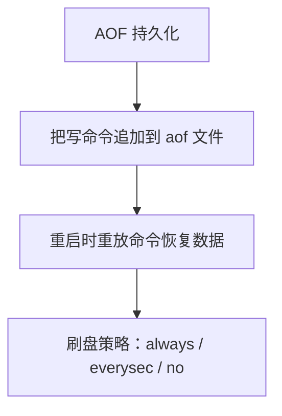

# Redis 持久化：AOF 的工作机制

面试题：说一下 Redis 的 AOF 持久化。

Redis 持久化是高频面试题，但因为重要，值得再系统复习一遍。先想清楚目的：万一 Redis 服务器挂了，要把内存的数据提前保存在磁盘文件里，重启后再从磁盘文件恢复，数据不丢。持久化有多种方式，这篇讲 AOF。

## 先给结论

- AOF 把运行过程中的每条写命令记录下来，追加到 AOF 文件中；查询命令不记录，因为它不更改数据状态。
- 恢复时重启服务器，找到 AOF 文件，把每条命令取出来执行一遍，数据就重建出来了。
- AOF 是写后日志：先执行命令，再记录日志，和 MySQL 的 redo log 先写日志再改数据正好相反。
- AOF 有三种同步策略：Always、Every second、No，安全性递减、性能递增。

## 深入细节：AOF 的工作机制

AOF 就是将 Redis 运行过程中的每条写的命令都记录下来，追加到一个 AOF 文件中。注意两点：

第一，记录的是写命令。查询命令不会记录，因为查询命令不会更改数据的状态，所以只记录增删改这种写命令。

第二，它是追加到 AOF 文件的末尾。追加意味着顺序写，不要随机写，这样写日志的时候效率会高一些，跟 MySQL 里 redo log 的道理是一样的。

那 AOF 日志刚开始还是记录到内存中的，只有在满足了一定条件后，才会把内存中的日志同步到磁盘中。

将来万一 Redis 服务器挂了，它再次重启的时候，就会找到刚才的 AOF 文件，把里面的每条命令取出来执行一遍。因为所有命令都记录了，这些命令保证了数据是完整的，从头到尾执行一遍，就可以恢复数据。恢复后的数据和崩溃前的数据应该是一模一样的。

## 深入细节：写后日志

AOF 日志是一个写后日志：先执行命令，再记录日志。也就是写入日志在后面，执行命令、修改数据在前面。

这跟很多其他数据库不一样，比如说 MySQL，它的 redo log 是先写日志，再修改数据。从这点上能看出两者设计上的一些不一样。

为什么 AOF 要设计成写后日志？关键点是为了性能。Redis 向 AOF 写日志的时候，没有对任何命令做语法检查。如果它要先记录日志、后修改数据，那么就必须提前把这些命令的语法正确性做一个检查；如果不检查，日志中先记的命令就可能把语法错误的命令也记录到日志里，将来恢复执行到这条错误命令时也会报错，影响恢复。

所以 AOF 先执行命令，再记录日志：先执行命令，这个命令语法是否正确一下子就能看出来；正确了，记录日志肯定也没有问题；如果不正确，从执行命令那块就会断开，也不会把错误的信息记录到日志里。

## 深入细节：三种同步策略

AOF 日志有三种同步策略，分别是 Always、Every second 和 No。

### Always：同步写

先执行命令，然后写入日志，日志成功地写到磁盘以后，它才会向客户端返回结果。

这样可以做到基本不丢数据，数据的一致性是最高的。但性能当然不高，因为客户端那边必须等命令也执行完了、日志也记录好了，才能得到结果。

### Every second：每秒写

先把这个日志写到内存的缓冲区中，然后每隔一秒，就把内存缓冲区中的数据同步到磁盘里。

显然这样最多就丢一秒的数据：内存中还没来得及往磁盘写的时候 Redis 挂了，就会丢失这一秒的数据。它的性能比第一种要高一些，因为不是频繁地去同步磁盘。瓶颈主要在磁盘的读写上，频繁同步磁盘性能就低了。

### No：操作系统写

Redis 只是把这些执行的增删改命令同步到内存缓冲区，就可以向客户端返回，它不用关心什么时候内存中的日志数据同步到磁盘。具体什么时候同步，由操作系统决定，由操作系统决定什么时候把内存中的数据刷入磁盘。

这个风险就更大一些，因为并不能确定什么时候操作系统会把内存中的数据同步到磁盘。一旦服务器重启或挂了，丢失的数据可能会最多。

三种策略一句话总结：第一种安全性最高但性能相对最低，最后一种性能最高但数据安全性、一致性越低。这是典型的安全性与性能的权衡。

## 面试怎么答

1. 先给目的：服务器挂了数据不丢，提前存磁盘，重启重放恢复。
2. 讲机制：只记写命令、追加到文件末尾顺序写、重启逐条执行重建数据。
3. 讲写后日志：先执行再记录，为了省掉语法检查；对比 MySQL redo log 先写日志再改数据。
4. 讲三种同步策略：Always 基本不丢、Every second 最多丢一秒、No 交给操作系统，安全性递减性能递增。

常见追问：

- **问**：AOF 为什么只记写命令？
  **答**：恢复数据靠重放命令，查询命令不改数据状态，记了也没用，只记增删改的写命令就够重建。
- **问**：三种同步策略怎么选？
  **答**：看业务对数据丢失的容忍度。不能丢选 Always，能容忍秒级丢失选 Every second 换性能，极端追求性能选 No。

## 常见误区

- **误区一**：以为 AOF 和 MySQL redo log 一样先写日志。AOF 是写后日志，先执行命令再记录，为的是不做语法检查保性能。
- **误区二**：以为 Always 策略绝对不丢。它基本不丢、一致性最高，但同步写磁盘的代价是性能低。
