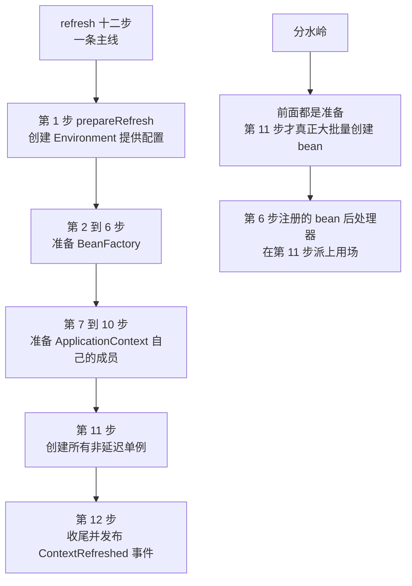

# Spring refresh 十二步小结

面试题：Spring 的 refresh 方法做了哪些事？

refresh 是 Spring 容器启动的核心方法，`AbstractApplicationContext` 的 `refresh()` 是一个模板方法，内部按固定顺序走了 12 步。面试问这个问题，不是要你把 12 个方法名背下来，而是看你有没有把前面的步骤串成一条线：哪几步在准备 BeanFactory，哪几步在准备 ApplicationContext 自己，最后两步在收尾。

## 先给结论

- refresh 一共 12 步，第 2 到第 6 步都在准备 BeanFactory，第 7 到第 10 步回到 ApplicationContext 准备它自己的成员，第 11 步创建所有非延迟单例，第 12 步收尾并发布 ContextRefreshed 事件。
- 第 1 步 `prepareRefresh` 创建 Environment，为后续准备配置信息。
- 第 11 步 `finishBeanFactoryInitialization` 是分水岭：前面都是准备，这一步才真正大批量创建 bean，第 6 步注册的 bean 后处理器在这一步派上用场。

## 是什么：refresh 的 12 步

refresh 12 个步骤，每一步可以用一句话概括：

1. `prepareRefresh`：做好准备工作，创建 Environment 对象，Spring 后续的运行都从这个对象里拿配置信息。
2. `obtainFreshBeanFactory`：获取或创建一个 BeanFactory。根据 ApplicationContext 类型不同，有可能是直接获取一个已经创建好的 BeanFactory，也有可能新创建一个。
3. `prepareBeanFactory`：准备 BeanFactory，为它的各个成员变量赋值，比较重要的有表达式解析器、类型转换器，还有一些内置的 BeanPostProcessor。
4. `postProcessBeanFactory`：交给子类去扩展 BeanFactory，这是一个空方法，留给子类按需重写。
5. `invokeBeanFactoryPostProcessors`：通过 BeanFactory 后处理器来扩展 BeanFactory。这一步有一个重要的后处理器叫 ConfigurationClassPostProcessor，配置类相关的注解（比如 @Configuration、@ComponentScan、@Bean）都是在这一步解析的。
6. `registerBeanPostProcessors`：准备 bean 后处理器。常见的 bean 后处理器有三个，一个是解析 @Autowired 注解的，一个是解析 @Resource 注解的，还有一个是创建代理类的。它们在后面的第 11 步创建 bean 时才会被调用。
7. `initMessageSource`：为 ApplicationContext 准备 MessageSource，实现国际化功能。
8. `initApplicationEventMulticaster`：为 ApplicationContext 准备事件发布器。
9. `onRefresh`：留给子类扩展，同样是空方法。
10. `registerListeners`：为 ApplicationContext 准备监听器，和第 8 步相互呼应，一个负责发布事件，一个负责接收事件。
11. `finishBeanFactoryInitialization`：初始化所有非延迟单例。创建每个单例 bean 的过程中，第 6 步准备好的那些 bean 后处理器都会执行，完成各自的扩展功能。
12. `finishRefresh`：准备生命周期管理器，最终由事件发布器发布 ContextRefreshed 事件，整个 refresh 结束。

## 为什么这样分组

第 2 到第 6 步都围着 BeanFactory 转：先拿到它，再准备它，再用两种方式扩展它，一种是通过子类重写，一种是通过 BeanFactory 后处理器，最后把创建 bean 时要用到的 bean 后处理器注册好。

从第 7 步开始，主角又回到 ApplicationContext，为它自己的各个成员做准备：国际化、事件发布器、子类扩展、事件监听器。

第 11 步是真正的创建时刻。前面所有的准备，包括 bean 后处理器的注册，都是为这一步服务的。

第 12 步收尾：准备生命周期管理器，并发布 ContextRefreshed 事件通知外界容器刷新完成。

## 面试怎么答

1. 先给框架：refresh 12 步，前 6 步准备 BeanFactory，中间 4 步准备 ApplicationContext，最后 2 步创建单例并收尾。
2. 再挑重点展开：第 5 步的 ConfigurationClassPostProcessor 解析配置类注解，第 6 步注册 bean 后处理器，第 11 步初始化非延迟单例并执行这些后处理器。
3. 最后点事件：第 8 步准备事件发布器、第 10 步注册监听器、第 12 步发布 ContextRefreshed 事件，三者是一条线。

常见追问：

- **问**：第 5 步和第 6 步都跟后处理器有关，区别是什么？
  **答**：第 5 步是 BeanFactory 后处理器，作用在 BeanFactory 上，用来解析配置类注解、加工 bean 定义；第 6 步是 bean 后处理器，作用在创建出来的 bean 对象上，比如注入 @Autowired、@Resource 标注的属性，或者生成代理对象。
- **问**：refresh 里哪一步最耗时？
  **答**：第 11 步，因为它要创建所有非延迟加载的单例 bean，每个 bean 还会走一遍实例化、依赖注入、初始化、后处理器处理的完整流程。

## 常见误区

- **误区一**：把 12 个方法名逐个背给面试官。方法名只是表象，讲清分组和各步职责才算真懂。
- **误区二**：以为第 4 步和第 9 步很重要。这两个都是留给子类的空方法，不重写就没有逻辑，理解成「扩展点」即可。
