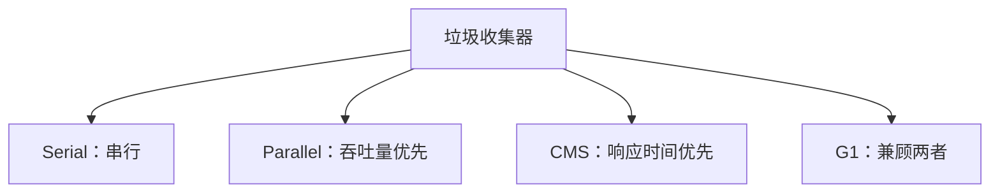
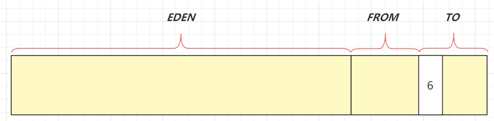
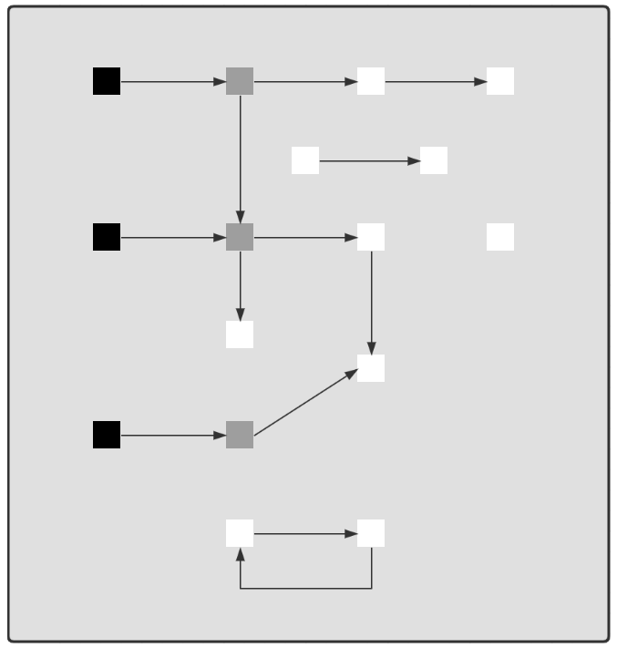
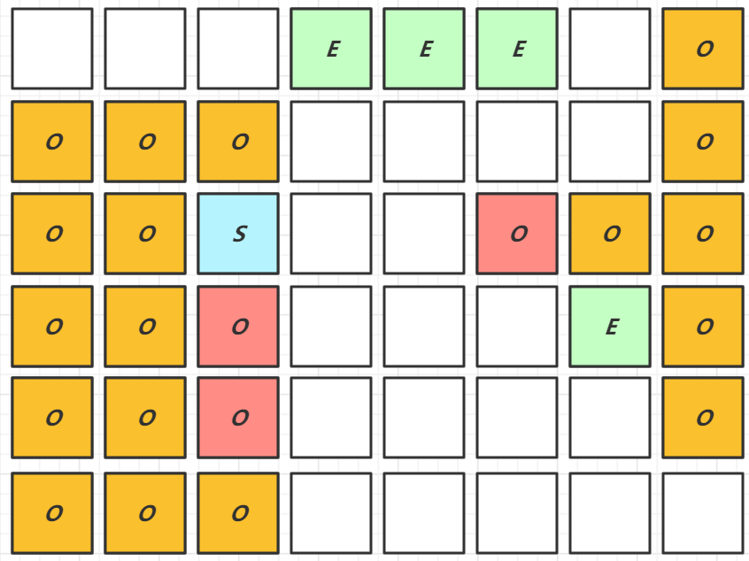
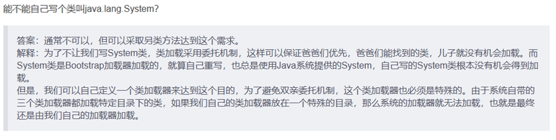

# JVM 垃圾回收器：Parallel GC 与 CMS

面试题：你知道哪些垃圾回收器？它们各自适合什么场景？

JVM 的垃圾回收器是面试高频题，问法一般是「Parallel GC 和 CMS 的区别」「什么样的应用选什么样的回收器」。答这类题的关键不是罗列参数，而是抓住两条主线：一个看停顿时间，一个看吞吐量，回收器的设计目标就是在这两者之间做选择。

## 先给结论

- Parallel GC 由两个回收器组成，一个工作在新生代，一个工作在老年代。新生代回收用标记复制算法，触发 Minor GC；老年代回收用标记整理算法，触发 Full GC。两者都会 Stop-The-World（白话：GC 干活时把用户线程全部暂停，停顿越短体验越好）。
- Parallel GC 侧重吞吐量，适合做大量计算、对停顿不敏感的应用。
- CMS 是老年代回收器，并发标记、并发清除，只有重新标记时需要 Stop-The-World。它用标记清除算法，会产生内存碎片，这是它最大的缺点，较新的 JDK 已将其标记为废弃。
- CMS 侧重响应时间，适合互联网这类对停顿时间敏感的应用。并发失败时会退化为 Full GC 作为保底。

## 是什么：Parallel GC

Parallel GC 实际上由两个垃圾回收器组成，一个工作在新生代，另一个工作在老年代。

当 Eden 区内存不足时，Parallel GC 中的新生代回收器开始工作，这次回收是 Minor GC。Minor GC 意味着停顿时间会比较短，因为存活对象少，整个回收过程使用标记复制算法，所以不会有内存碎片。

如果是老年代内存不足，就会触发 Full GC。Full GC 意味着 Parallel GC 中的两个回收器都会工作，新生代的也工作，老年代的也工作。老年代回收用的是标记整理算法，这个过程同样会 Stop-The-World，造成应用程序暂停，而且停顿时间比新生代的 GC 更长。标记整理同样不会有内存碎片。

Parallel GC 侧重的是吞吐量。应用程序可以分成两大类：一类注重响应时间，比如互联网应用，对响应时间要求越短越好，尽可能不暂停；另一类注重吞吐量，要做大量计算，停顿多一点没关系，但单位时间内完成的业务总量要高。Parallel GC 属于后者，如果你的应用属于要求高吞吐、注重大量计算的类型，可以选择它。

那它为什么叫 Parallel？因为它虽然在新生代和老年代回收时都会 Stop-The-World，但暂停期间会使用多个线程来并行执行垃圾回收，所以吞吐量高。虽然有暂停，但是多线程并行回收把暂停时间压了下来。

## 是什么：CMS

ConcurrentMarkSweep GC，也就是 CMS，是一个老年代的垃圾回收器。从名字上就能看出来，Concurrent 是并发，意味着垃圾回收器工作的时候，用户线程的暂停时间非常短，两者可以并发执行。

当然它并不是所有阶段都能并发。能并发的是标记阶段和清除阶段，都可以让用户线程同时运行。并发标记会有漏标问题，所以需要一个重新标记来防止漏标，重新标记的时候仍然需要 Stop-The-World。

CMS 采用的是标记加清除算法，这意味着会有内存碎片，这也是它最大的缺点。因为有内存碎片，在最新的一些 JDK 中 CMS 已经被标记为废弃，毕竟有了更优秀的回收器。

CMS 的第二个特点是会有一个 Failback Full GC，这是它并发失败时的保底策略。如果清除速度小于对象产生的速度，就会造成并发失败，此时会触发一次 Full GC，让新生代和老年代都来一次彻底的垃圾清理。但显然一旦触发，就不能并发了，用户线程无法同时运行。

如果你的应用注重响应时间而不是吞吐量，选择 CMS 是比较好的，因为它大部分时间都可以并发运行，停顿时间非常短。

## 面试怎么答

1. 先分类：Parallel GC 管新生代加老年代，CMS 只管老年代。
2. 讲算法和停顿：Parallel 的新生代用标记复制、老年代用标记整理，都 STW，但多线程并行；CMS 并发标记加并发清除，只有重新标记 STW。
3. 讲选型：重吞吐选 Parallel，重响应时间选 CMS；CMS 有内存碎片和并发失败退化的代价。

常见追问：

- **问**：CMS 为什么会产生内存碎片，有什么影响？
  **答**：因为它用标记清除而不是标记整理，回收后存活对象东一个西一个，空闲空间不连续。碎片多了可能提前触发 Full GC，甚至因为找不到连续空间而晋升失败。
- **问**：CMS 并发失败怎么办？
  **答**：退化为 Full GC，新生代老年代一起彻底回收一次，此时不再并发，停顿会明显变长，这是保底策略。

## 常见误区

- **误区一**：以为 CMS 全程不停顿。它的重新标记阶段仍然需要 Stop-The-World，只是停顿很短。
- **误区二**：以为 Parallel GC 只有一个回收器。它由新生代和老年代两个回收器组成，Full GC 时两个一起工作。

## 课件配图
> 以下配图取自阶段七课件对应讲义，与上文讲解一一对应，可作为图文对照辅助理解。
**JVM 垃圾回收**（课件讲义图示）

**讲义配图**（课件讲义图示）

