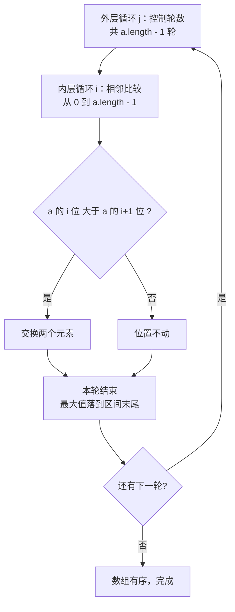

# 冒泡排序的初步实现

面试题：手写一下冒泡排序。

冒泡排序是面试白板题的常客，考的不是算法多难，而是循环写不写得对、边界条件考不考虑。这一篇先做初步实现：外层循环控制轮数，内层循环做相邻比较和交换，先把版本跑通，优化放到下一篇。

## 先给结论

- 一轮冒泡的比较次数是数组长度减 1，因为 n 个元素只需要 n-1 次相邻比较就能把最大的换到最后。
- 内层循环每次比较相邻的两个元素 a[i] 和 a[i+1]，前一个大于后一个就交换。
- 外层循环重复 length-1 轮，就能把整个数组排好序。
- 初步版本不管每轮该少比较几次，也不管提前排好序的情况，还有明显优化空间。



## 是什么：一轮冒泡

提前准备一个数组 {5, 9, 7, 4, 1, 3, 2, 8}，再准备一个交换数组中两个元素的方法。

先思考一轮冒泡需要比较几次。八个元素，比较七次就能把最大的元素交换到最后去，所以比较的次数是数组的长度减一。

每一次比较的是相邻的两个元素。比如第一次比较 5 和 9，相邻元素用代码表示就是 a[i] 和 a[i+1]。如果 a[i] 小于等于 a[i+1]，不用动，比如 5 小于 9；如果前一个元素大于后一个元素，就交换它们的位置，比如 i 是 9、i+1 是 7 的时候，交换后 7 在前 9 在后。

这样一遍走下来，就完成了一轮冒泡。跑一遍可以看到结果：5 7 4 1 3 2 8 9，最大的 9 已经在最后。

## 深入细节：重复多轮

一轮冒泡会把最大的元素放到最后，第二轮把第二大的放到最后，以此类推。所以还要一个外层循环来重复冒泡过程，重复的次数同样是数组长度减一，也就是 length-1 轮。

为了观察过程，在外层循环里加一句输出，打印第几轮冒泡以及当前数组。运行后可以看到一共进行了七轮冒泡（轮次从 0 开始），最后一轮已经把数组排成了 1 2 3 4 5 7 8 9。

落成的代码就是这样：

```java
public static void bubble(int[] a) {
    for (int j = 0; j < a.length - 1; j++) {      // 外层循环：控制轮数，共 length-1 轮
        for (int i = 0; i < a.length - 1; i++) {    // 内层循环：一轮里的相邻比较
            if (a[i] > a[i + 1]) {                  // 前一个大于后一个
                Utils.swap(a, i, i + 1);            // 交换两个元素
            }
        }
        System.out.println("第" + j + "轮冒泡" + Arrays.toString(a));
    }
}
```

用到的 swap 方法实现如下，三个动作完成一次交换：

```java
public static void swap(int[] array, int i, int j) {
    int t = array[i];
    array[i] = array[j];
    array[j] = t;
}
```

这两个方法都来自课件 day01 的 sort 包，可以直接跑。

## 面试怎么答

1. 先讲清楚两层循环各自的职责：外层管轮数，内层管一轮里的相邻比较。
2. 比较次数是 length-1，轮数也是 length-1，先入为主地写对边界。
3. 主动承认这是初步实现，还能优化：每轮少比较几次、提前排好序就退出，把话题引到下一篇。

常见追问：

- **问**：时间复杂度是多少？
  **答**：最好和最坏都是 O(n²) 的比较量级，最好情况下（加退出标志）可以做到 O(n)；交换次数最坏也是 O(n²)。
- **问**：是稳定排序吗？
  **答**：是。相等元素不会交换，相对顺序保持不变。

## 常见误区

- **误区一**：内层循环边界写成 i 小于 a.length，越界访问 a[i+1]。边界应该是 a.length-1。
- **误区二**：轮数写成 a.length。正确轮数是 length-1，或者优化后配合退出标志提前结束。
