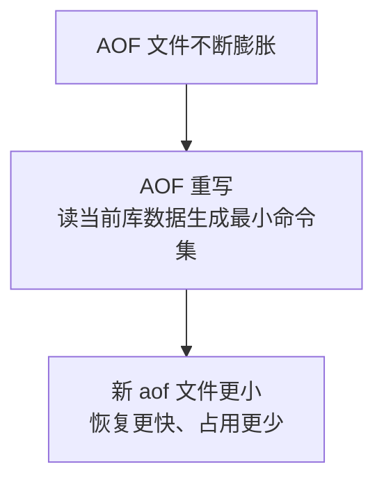

# Redis 持久化：AOF 重写

面试题：AOF 文件太大了怎么办？

AOF 记录写命令实现持久化，但时间一长文件会越来越大，带来一系列问题。解决手段就是 AOF 重写。面试问 AOF 重写，核心考两点：它解决什么问题，以及它怎么在不阻塞主进程的前提下把文件瘦下来。

## 先给结论

- AOF 重写要解决三个问题：文件大小受操作系统限制、文件太大写入效率变低、文件太大恢复时非常慢。
- 瘦身的依据是：同一个 key 的多次操作只有最后一次有效，前面的都可以合并掉。
- 重写不去解析旧 AOF 文件，而是直接根据当前内存中数据的状态，为每个 key 生成一条命令，写入新的日志文件。
- 重写由后台子进程完成，不阻塞主进程；期间的新命令先记到重写缓冲区，子进程处理完再把增量指令补进重写日志，最后用重写日志替换旧 AOF 文件。

## 为什么需要重写

随着时间推移，AOF 日志文件里记录的命令操作会越来越多，文件越来越大。太大不行，原因有三：

第一，任何文件大小都受操作系统限制，不能超过操作系统的上限。

第二，文件太大，写入效率会变低。

第三也是最重要的一点，文件太大会导致恢复时的速度变得非常慢。AOF 文件的目的就是崩溃时把数据恢复成崩溃前的状态，文件太大意味着里面有太多命令需要执行，恢复速度自然慢。

所以需要对 AOF 文件进行重写，本质就是对现有文件瘦身。

## 深入细节：重写的原理

重写的策略很简单：对同一个 key 的多次操作进行瘦身。

比如对一个 key 修改了 100 遍，AOF 里就记录了 100 条修改日志。但恢复时真的要把这 100 条全部执行一遍吗？没必要，因为只有最后一次修改有效，前面 99 次的结果不用关心，最后一次改成什么样，恢复时就该是什么样。

注意，重写并不是去读现有的 AOF 日志，把里面的 key 全部读出来做排序、找每个 key 最后一次修改，那样太麻烦、速度也慢。它的做法是：记录当前 Redis 内存中数据的状态。内存里的数据都是最新的，把内存中有哪些 key 找出来，为每个 key 生成相应的一条命令（主要是新增命令），记录到新的 AOF 日志文件里就可以了，完全不用管旧 AOF 里记了哪些。

而且重写过程是由一个后台子进程完成的，不阻塞主进程，不影响正常的业务增删改查。

## 深入细节：重写的完整流程

当 AOF 重写发生时，流程如下：

1. 创建一个后台子进程，根据当前主进程的内存状态生成一个内存快照。生成快照是为了防止不一致：如果直接在主进程上遍历 key，遍历过程中突然来了增删改命令，数据就对不上了。有了快照，就把当前数据状态先固定下来，之后怎么改都不影响子进程遍历的这一份。
2. 对子进程的内存进行遍历，把每个 key 对应的命令写入新的日志文件，也就是重写日志。
3. 此时如果有新的命令执行，修改的是主进程内存，不会影响子进程内存，但这些新命令不能丢，要记录到一个叫重写缓冲区的位置。
4. 等子进程把所有 key 处理完毕，把重写缓冲区里的增量指令再写入重写日志。这样既包含发生重写那一刻所有 key 的状态，也包含期间的增量修改。
5. 在此期间旧的 AOF 日志仍然正常工作，不影响原有逻辑。等重写完毕，用新的重写日志替换掉旧的 AOF 日志，重写完成。

## 面试怎么答

1. 先给动机：AOF 文件太大有三个问题，受操作系统限制、写入变慢、恢复变慢。
2. 讲原理：同一 key 多次操作只留最后一次；重写不看旧文件，直接按内存现状生成命令写新文件。
3. 讲流程：子进程加内存快照保证一致性，增量命令进重写缓冲区，最后补写并替换旧文件，全程不阻塞主进程。

常见追问：

- **问**：为什么重写要由子进程完成？
  **答**：遍历内存、生成命令是重活，放在主进程会阻塞业务请求。子进程基于内存快照工作，主进程继续服务，互不影响。
- **问**：重写缓冲区是干什么的？
  **答**：子进程遍历快照期间，主进程照常处理写命令，这些增量命令记到重写缓冲区；子进程完成后把缓冲区内容补进重写日志，保证重写期间的数据不丢。

## 常见误区

- **误区一**：以为重写是分析压缩旧 AOF 文件。实际是绕开旧文件，直接按内存数据现状生成新文件。
- **误区二**：以为重写期间旧 AOF 停写。旧 AOF 全程正常工作，重写日志就绪后才替换。
