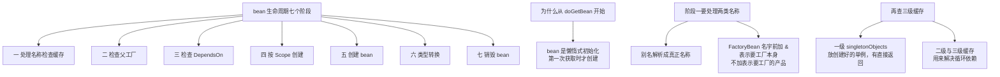
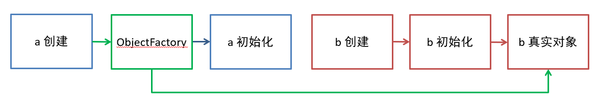

# Spring bean 生命周期：处理名称与检查缓存

面试题：说一下 Spring bean 的生命周期。

Spring bean 的生命周期是经典面试题。讲法很多，这一系列按源码把生命周期划分成七个阶段，入口是 AbstractBeanFactory 里的 doGetBean 方法。本篇讲第一阶段：处理名称与检查缓存，也就是 doGetBean 方法进来做的第一件事。

## 先给结论

- 七个阶段依次是：处理名称检查缓存、检查父工厂、检查 DependsOn（白话：显式声明 bean 之间的创建先后顺序依赖）、按 Scope 创建 bean、创建 bean、类型转换、销毁 bean。
- 生命周期从 doGetBean 开始而不是 doCreateBean，因为 bean 的创建是懒惰式的，第一次获取时才创建。
- 阶段一要处理两类名称：别名要解析成真正名称；FactoryBean 这类特殊名字前面加 & 符号表示要工厂本身，不加表示要工厂的产品。
- 处理完名称还要查三级缓存：一级缓存 singletonObjects 放创建好的单例，有就直接返回；二级和三级缓存用来解决循环依赖。

## 为什么从 doGetBean 开始

Spring 里 bean 的创建是懒惰式初始化：一开始并不会创建这些 bean，当你第一次获取它的时候，才去创建实例，然后做依赖注入、初始化等操作。所以生命周期的起点是 doGetBean，它是 AbstractBeanFactory 中一个重要的抽象父类方法，Spring 生命周期的重要方法大多定义在这个抽象父类里。

至于阶段怎么划分，各家文章说法不一，不用纠结。阶段只是帮助记忆的分组，重要的是搞清楚生命周期里 Spring 到底做了哪些事。

## 深入细节：名称处理

doGetBean 方法第一件事情是做名称处理，处理两类名字。

第一是别名。Spring 支持别名系统，一个 bean 可以有好几个名字，根据名字 A 能找到它，根据名字 B 也能找到它。所以第一步要先把别名解析成真正名称，后续流程都以 bean 的真正名字为准。

第二是特殊 bean 的特殊名字，典型是 FactoryBean。FactoryBean 是 Spring 中专门用来生产其他对象的工厂 bean。如果你想取得工厂本身而不是它的产品，就要在名字前面加一个 & 符号；不加 & 符号，取到的是工厂生产出来的产品。所以这类名字也要特殊处理。

## 深入细节：检查缓存

名称处理完，还要去缓存里看看有没有已经创建好的单例对象，一共三级缓存。

一级缓存叫 singletonObjects，首先到它里面找有没有创建好的单例。如果有，就不用再创建，直接返回。它起加速作用，同时保证单例对象的唯一性。

三级缓存叫 singletonFactories，放的是单例的工厂；二级缓存叫 earlySingletonObjects，放的是单例工厂的产品。这两个都是为了解决循环依赖的：三级缓存可以解决循环依赖，二级缓存用于既需要产生代理、又发生了循环依赖的情况，此时要提前创建代理，就会用到二级缓存。

所以第一阶段就做三件事：把别名解析成实际名称，识别 FactoryBean 这种带 & 前缀的特殊名字，再到三级缓存里查对象，缓存里有就直接用，没有才继续后面的动作。

## 面试怎么答

1. 先给七阶段地图，再说明今天只展开第一阶段，避免一上来陷进细节。
2. 讲名称处理：别名解析、FactoryBean 的 & 规范。
3. 讲三级缓存：一级放成品单例，二级放早期对象，三级放工厂；二、三级服务循环依赖，二级兼顾代理场景。
4. 点出懒惰初始化：这就是生命周期从 doGetBean 开始的原因。

常见追问：

- **问**：不加 & 取 FactoryBean 会怎样？
  **答**：拿到的是工厂生产出来的产品对象，而不是工厂本身；想要工厂本身必须在名字前加 &。
- **问**：三级缓存在什么阶段写入？
  **答**：在创建单例的过程中，bean 实例化之后、初始化之前，会先把创建工厂放进三级缓存提前暴露，这样循环依赖的对方才能引用到它。

## 常见误区

- **误区一**：以为三级缓存都放 bean 实例。一级放成品，二级放早期对象，三级放的是工厂对象。
- **误区二**：以为 bean 都在容器启动时创建。默认非懒加载单例确实会预创建，但单个 bean 的创建入口仍是 doGetBean，原型等场景更是用到才创建。

## 课件配图
> 以下配图取自阶段七课件对应讲义，与上文讲解一一对应，可作为图文对照辅助理解。
**讲义配图**（课件讲义图示）

