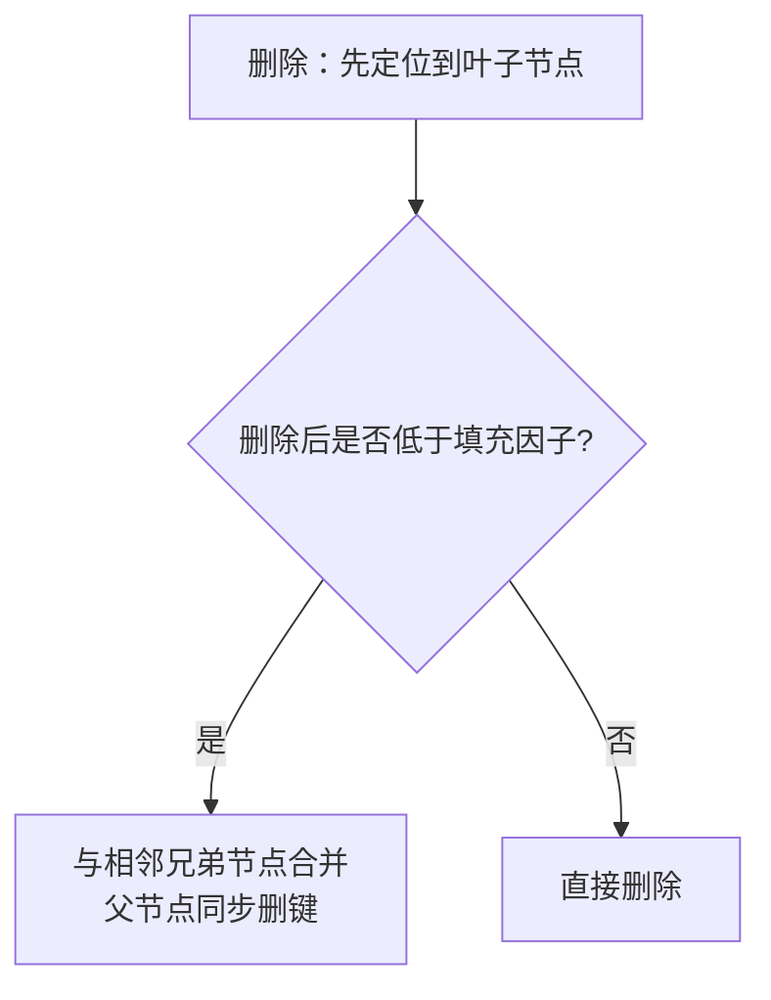
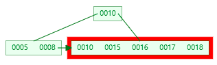
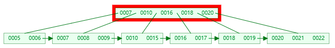
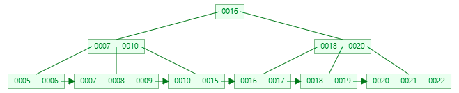
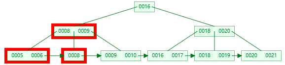

# B+树的删除操作

面试题：B+树删除 key 的过程是怎样的？

索引篇讲完 B+树的新增和查询，接下来是删除。删除比插入更麻烦的地方在于：删完不能破坏 B+树的平衡，节点里 key 太少就要调整。调整手段无非两种：向兄弟借，或者和兄弟合并。下面以五阶 B+树为例，分叶子节点和非叶子节点两种情况讲。

## 先给结论

- 删除分两种情况：叶子节点中 key 的删除，以及非叶子节点中 key 的删除。
- 判断要不要调整，看删除后节点的 key 数还富不富余。五阶下，删除后 key 个数大于 m/2-1（即 1）才算富余。
- 删完不富余，先看兄弟：兄弟有富余就借一个过来，借完要调整父节点的分界值，保证区间仍然正确。
- 兄弟也不富余，就和兄弟合并。叶子合并后子节点数减少，父节点少留一个分界值。
- 非叶子节点删除规则类似：key 个数大于阶数/2+1 就直接结束，否则走借或合并，合并会让树高降低一层。

## 叶子节点删除：富余情况

初始状态还是假设五阶的 B+树。想在叶子节点里删一个 key，先看删完以后 key 的个数有没有富余。

富余指的是删完以后节点上 key 的个数大于阶数除以 2 减 1。五阶下 5 除以 2 减 1 等于 1，也就是删完如果 key 个数还大于 1，就是最简单的情况，删完就结束了，没有更多操作。

比如删 22，这个节点上一共三个 key，删完还剩两个，大于 1，仍然富余，删完即结束。

## 叶子节点删除：向兄弟借

第二种情况是删完不富余。比如节点里有 10 和 15，把 15 删掉只剩 10，个数是 1，不大于 1，不满足富余条件。

这时要看兄弟有没有富余。兄弟意味着有同一个父节点：对 10、15 这个节点来说，7、8、9 所在的节点是它的兄弟，16、17 所在的节点不是。

如果兄弟有富余，就问兄弟借一个。比如删掉 15 后向兄弟借 9 过来，自己变成 9、10，个数大于 1 了；兄弟借走一个后剩下的 key 个数也大于 1，两边都够了。

但借完要调整父节点。删除之前，父节点用 7 和 10 把数据分成三个区间：小于 7、大于等于 7 小于 10、大于等于 10。借过来一个 9 以后，如果父节点不调整，9 大于等于 10 就不成立，区间条件被破坏。所以要把父节点这里也调整成 9，重新变成小于 9 和大于等于 9 两个正确的区间划分。

## 叶子节点删除：合并兄弟

第三种情况，删完不富余，兄弟那边也不够借，就要合并兄弟的叶子节点。

接着上面的场景，假设节点里还有 7 和 8，先删 7，删完剩 8，不富余。考虑借之前有个细节：如果父节点中出现了 7，也要一并删掉，也就是叶子节点里删了 7，父节点这里同样要做调整。删完之后还要保证区间条件成立：如果直接删 7 不调整，底下的叶子要分三个区间，父节点就得有两个值才行，所以要把 8 提上去。提上去之后，左侧 5、6 仍然小于 8，中间大于等于 8 小于 9，右侧大于等于 9，仍然是平衡的。

最后考虑借不了就合并：删完后 key 个数大于 1 的条件不成立，左边借完也不够 1，右边也不够借，所以考虑合并。跟左边合并还是右边合并都行，看具体实现。比如跟左边合并，5、6、8 合并成一个节点。合并以后子节点的个数由三个变成两个，父节点这里就不需要用两个值划分三个区间了，只保留一个 9，划分成小于 9 和大于等于 9 两个区间即可。

## 非叶子节点删除

非叶子节点的删除，规则和叶子节点类似。刚才调整父节点时，内部节点里的 key 被删掉之后没有了，就相当于删除了非叶子节点上的 key，同样要满足平衡规则。

非叶子节点的 key 个数如果是大于阶数除以 2 加 1，就是最简单的情况，不需要额外操作。如果个数太少，就走借或合并的逻辑，和叶子节点删除差不多：兄弟节点有富余，父节点的 key 下一个、兄弟节点找一个 key 上一个，删除结束。

看当前这个例子，内部节点原来有 8 和 9，8 没了只剩 9，个数不够。看兄弟有富余吗，兄弟也没有：兄弟上一个 key、把父节点的 key 弄下来，兄弟那边也只剩一个，不够，所以第二个条件不成立。

那就走第三个条件，兄弟节点没富余，把兄弟节点连同父节点连同自己，合并成一个新的节点，树的高度会降低一层，原来三层现在变成两层。9 和父节点的 16，连同兄弟那边的 18、20，合成一个新的节点。合并之后，底下的区间仍然满足：四个值划分成五个区间。

## 面试怎么答

1. 先分类：叶子删除和非叶子删除，规则同构。
2. 讲富余线：五阶下删除后 key 数大于 m/2-1 才算富余，富余直接结束。
3. 讲两种调整：兄弟富余就借，借完调整父节点分界值；兄弟不富余就合并，父节点少一个分界值。
4. 非叶子删除合并会降树高，这是和叶子删除最直观的区别。

常见追问：

- **问**：为什么借了 key 还要改父节点？
  **答**：父节点里的 key 是区间的分界值，叶子内容变了，分界值不跟着变，区间条件就不成立，查询会走错分支。
- **问**：合并和借的优先级？
  **答**：先判断兄弟有没有富余，有就借，成本低；借不了才合并，合并会减少子节点数、可能让父节点继续失衡，甚至降低树高。

## 常见误区

- **误区一**：删完 key 直接结束，不检查富余。少于阈值的节点会让树失衡，必须借或合并。
- **误区二**：以为只有叶子节点会被删。非叶子节点里的 key 也会被删（比如被中间 key 顶替或父节点调整时），同样要走平衡逻辑。

## 课件配图
> 以下配图取自阶段七课件对应讲义，与上文讲解一一对应，可作为图文对照辅助理解。
**索引基础**（课件讲义图示）

