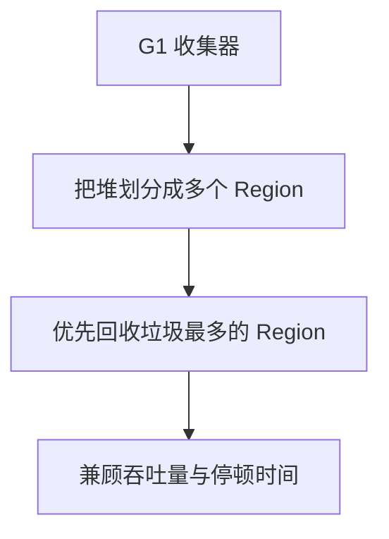
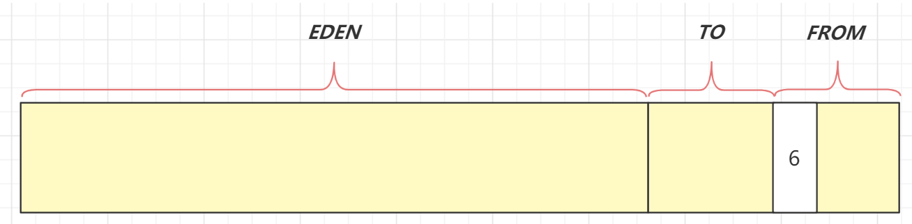
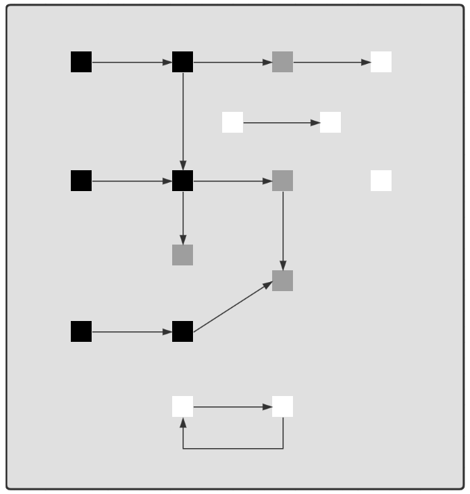
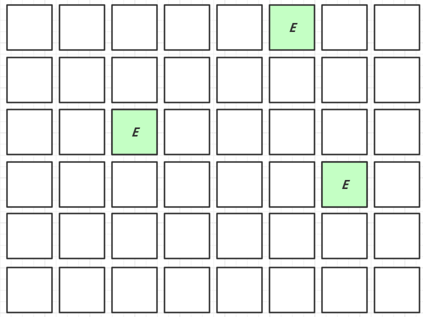
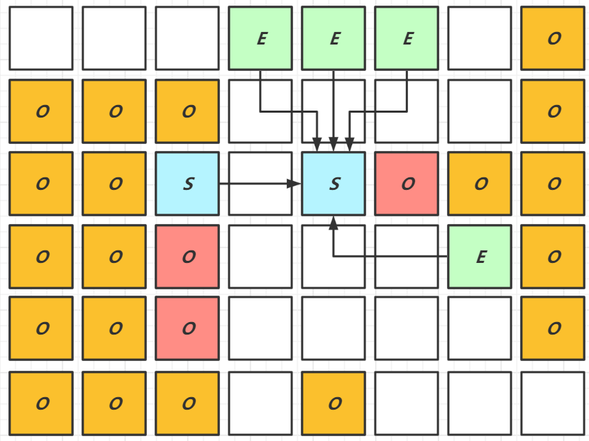

# G1 垃圾回收器

面试题：G1 垃圾回收器有什么特点？

G1 从 JDK 9 开始成为默认垃圾回收器，能作为默认说明综合能力好：它兼顾响应时间和吞吐量，这一点是 Parallel GC 和 CMS 各占一头，而 G1 两头都想要。它最大的结构特点是把堆内存划分成多个大小相等的区域，每个区域可以充当 Eden、Survivor 或老年代，另有一种 Humongous 区域专门存大对象。

## 先给结论

- G1 从 JDK 9 起是默认垃圾回收器，设计目标是兼顾响应时间和吞吐量。
- 堆被划分成多个大小相等的 region，每个 region 可以充当 Eden、Survivor、Old，另有 Humongous 区域存大对象。
- 大对象复制成本高，G1 主要用标记复制算法，所以用一些连续区域来存大对象，做特殊处理。
- 工作流程分三个阶段：新生代回收、并发标记、混合收集，另外有 Fallback Full GC 作为保底。

## 是什么：region 划分

G1 把整个堆内存划分成多个大小相等的区域，英文叫 region。每个区域都可以充当 Eden、Survivor 或老年代。刚开始这些区域都是空闲的，创建对象时挑出一些空闲区域作为 Eden 区。

随着对象越来越多，Eden 区逐渐放满，就会触发第一次新生代垃圾回收。

Eden 区不能无限创建，因为 Eden 区的大小受整个新生代的限制。G1 中新生代的内存占比在 5% 到 60% 之间波动，由 G1 自动调整。既然新生代总量有限，Eden 区的数量就不能随便加，够数了就触发回收。

## 深入细节：新生代回收

第一阶段是新生代的内存回收，采用的还是标记复制算法：沿着 GC Roots 引用链找，给可达对象加标记，标记好的留下来，没标记的当垃圾。

找到存活对象后，用复制算法把它们复制到 Survivor 幸存区，之前 Eden 区占用的内存就可以释放。标记和复制的过程都需要暂停用户线程，触发 Stop-The-World。不过幸存对象比较少，暂停时间相对较短。

随着时间推移，新生代内存又分配给 Eden 区存新对象，然后再次耗尽。这时会把 Eden 中的幸存对象和上一次 Survivor 区里的幸存对象合在一起，复制到一个新的幸存区。如果 Survivor 区里有些对象已经超过晋升阈值，这些比较老的对象会晋升到老年代。这样一来，Eden 区和上一次的 Survivor 区内存都可以释放，这也是一次新生代垃圾回收。

## 深入细节：并发标记

第二阶段是并发标记。G1 会对老年代区域做并发标记，标记阶段用户线程可以同时运行；重新标记阶段需要 Stop-The-World，用来处理并发期间产生的变动，防止漏标。

## 深入细节：混合收集

第三阶段是混合收集。从字面意思能猜出来，它既包括新生代的内存释放，也包括部分老年代区域的内存释放。

并发标记完成后开始混合收集，参与复制的有 Eden、Survivor 和老年代。其中老年代会根据暂停时间目标，选择部分回收价值高的区域进行复制，复制时 Stop-The-World。按需挑选区域，正是 G1 能够兼顾响应时间和吞吐量的关键：用可预期的停顿，换尽可能高的回收收益。

此外 G1 也有 Fallback Full GC，作为回收跟不上时的保底。

## 面试怎么答

1. 先给定位：JDK 9 起的默认回收器，兼顾响应时间和吞吐量。
2. 讲结构：堆划成多个相等 region，可充当 Eden、Survivor、Old，Humongous 专存大对象。
3. 讲流程三阶段：新生代回收（标记复制、STW 但短）、并发标记（仅重新标记 STW）、混合收集（eden/survivor/old 都参与，old 按停顿目标挑区域）。

常见追问：

- **问**：G1 为什么要 Humongous 区域？
  **答**：G1 主要用标记复制算法，大对象复制成本太高，直接分配可能拖垮回收，所以用连续区域集中存大对象，避免频繁复制。
- **问**：G1 和 CMS 都讲并发，区别在哪？
  **答**：CMS 只回收老年代、用标记清除、有内存碎片；G1 面向整堆、按 region 混合收集、整体用标记复制，还能通过停顿时间目标控制 STW 时长。

## 常见误区

- **误区一**：以为 G1 的新生代和老年代是固定连续的内存块。G1 里它们是逻辑概念，物理上是一个个 region 动态充当的。
- **误区二**：以为 G1 全程不停顿。新生代回收和混合收集的复制阶段都要 Stop-The-World，只是停顿可控制、比较短。

## 课件配图
> 以下配图取自阶段七课件对应讲义，与上文讲解一一对应，可作为图文对照辅助理解。
**JVM 垃圾回收**（课件讲义图示）

