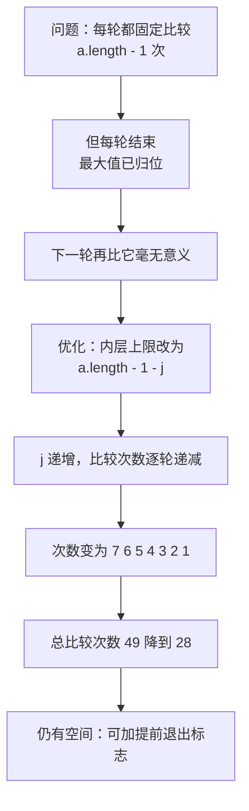

# 冒泡排序优化：减少比较次数

面试题：冒泡排序有哪些优化点？

初步实现跑通之后，第一个显而易见的优化就是减少比较次数。思路很直接：每一轮冒泡都会把当前最大的元素送到末尾，下一轮就不该再碰它。下面把比较次数打印出来，先看问题，再改。

## 先给结论

- 内层循环的比较次数不必要每轮都一样：第一轮比较 length-1 次，之后每轮依次少一次。
- 利用外层循环变量 j，把内层边界从 a.length-1 改成 a.length-1-j，就实现了比较次数逐轮递减。
- 优化后七轮冒泡的比较次数是 7、6、5、4、3、2、1，总比较次数从 49 次降到 28 次。
- 这还只是第一层优化，后面还可以加提前退出标志。



## 问题：每轮都比较那么多次

先思考内层循环的循环次数表示什么：它表示一轮冒泡里需要进行多少次比较。初步实现里，它的取值固定是元素个数减 1，八个元素就比较七次。

但并不是每轮冒泡都需要比较七次。第一轮冒泡后，9 已经冒泡成功排到最后，下一轮再把 8 和 9 比一次毫无意义，因为 9 已经是最大。所以第二轮应该比第一轮少比较一次，第三轮比第二轮再少一次，比较次数可以逐轮递减。

把比较次数打印出来验证：只要进了内层循环就表示发生了一次比较。未优化时，第一轮比较 7 次（下标 0 到 6），第二轮还是比较 7 次，但这时 9 已经排好，后面的比较都是浪费；第三轮更没必要，因为 8 也排好了。

## 优化：利用外层变量递减

改进方法非常简单，利用外层循环的 j 变量。j 一开始是 0，所以第一轮冒泡的比较次数不受影响；随着 j 不断增长，第二轮就在元素个数减 1 的基础上又减 1，第三轮再减 1，以此类推，达到比较次数逐次递减的效果。

也就是把内层循环的边界从 a.length-1 改成 a.length-1-j：

```java
public static void bubble(int[] a) {
    for (int j = 0; j < a.length - 1; j++) {
        // 内层上限随 j 递减，比较次数逐轮减少
        for (int i = 0; i < a.length - 1 - j; i++) {
            System.out.println("比较次数" + i);
            if (a[i] > a[i + 1]) {
                Utils.swap(a, i, i + 1);
            }
        }
        System.out.println("第" + j + "轮冒泡" + Arrays.toString(a));
    }
}
```

跑一下看效果：第一轮冒泡需要比较 7 次，第二轮只需要比较 6 次，逐轮递减，最后一轮只需要比较 1 次。这就是第一个优化，可以减少内层循环的比较次数。

配合每轮的数组输出可以看到排序过程：第一轮后是 5 7 4 1 3 2 8 9，第二轮后是 4 1 3 2 5 7 8 9，第三轮后是 1 3 2 4 5 7 8 9，第四轮起数组已经排成 1 2 3 4 5 7 8 9，后续轮次不再变化。

## 面试怎么答

1. 先指问题：初步实现每轮都固定比较 length-1 次，后排元素重复比较。
2. 给改法：内层边界改成 a.length-1-j，比较次数 7、6、5、4、3、2、1 递减。
3. 算收益：总比较次数从 n(n-1) 量级降到 n(n-1)/2，即 49 次降到 28 次。
4. 主动延伸：还能加标志位，某一轮没有交换就提前退出，最好情况降到 O(n)。

常见追问：

- **问**：加了递减之后时间复杂度有变化吗？
  **答**：渐进复杂度仍是 O(n²)，但常数减半，比较次数从 n(n-1) 降到 n(n-1)/2。
- **问**：还有什么优化？
  **答**：记录一轮内最后一次发生交换的位置，下一轮边界直接缩到这个位置；以及加标志位，无交换即有序，提前退出。

## 常见误区

- **误区一**：只减轮数不减比较边界。轮数和内层边界都要收，否则后排元素还在重复比。
- **误区二**：以为改完就不是 O(n²) 了。递减只是砍掉一半常数，渐进复杂度不变，真正降复杂度要靠提前退出。
