# Raft 算法概述

面试题：为什么有了 Paxos 还要有 Raft？Raft 由哪几部分组成？

Paxos 是共识算法的理论基础，但难理解、难实现。Raft 的主要目的就是比 Paxos 更容易理解、更容易学习，这句话是 Raft 的作者自己在视频里说的。当然，Raft 也能解决 Paxos 那些实际的缺点，比如效率低和活锁问题。面试问 Raft，先答出它的整体结构，再按模块展开。

## 先给结论

- Raft 把共识算法分解成三个部分：Leader 选举、执行操作、确保安全。
- Leader 相当于 Paxos 里 Proposer 的简化版：集群同一时刻只有一个 Leader，崩溃后从剩余的 Server 中再选一个。
- 所有增删改操作都由 Leader 执行并记录日志，再把日志复制到其他 Server，多数派记录成功后 Leader 才执行命令、向客户端返回结果。
- 安全性的关键约束：Leader 崩溃后，拥有最新日志的 Server 才能成为新 Leader。

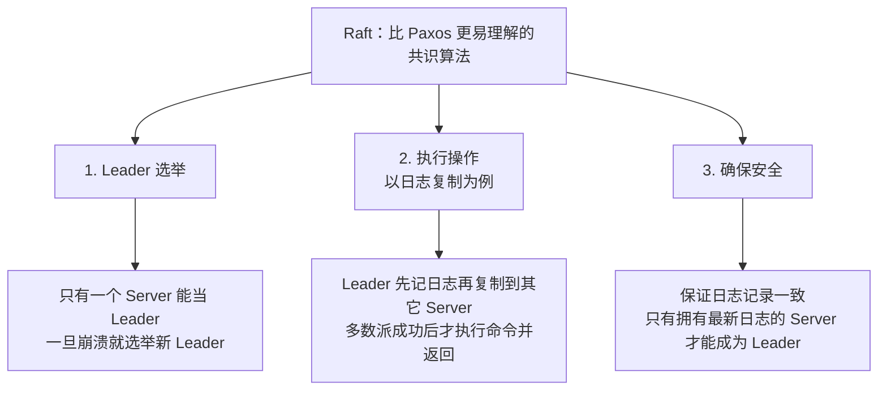

## 是什么：三个部分

整个 Raft 算法分成三个部分：Leader 选举、执行具体的操作，以及确保安全也就是保证一致性。先概要看一遍，细节后面展开。

## 深入细节：Leader 选举

Leader 顾名思义是领导者，作用和 Paxos 里的 Proposer 提案者类似，但设计上更简化。Paxos 允许多个提案者并存，容易冲突，实现也更复杂；Raft 不做那么复杂的设计，整个集群同一时刻只能有一个 Server 作为 Leader。天无二日，如果有多个 Leader，集群就打架了。

Leader 崩溃了也没事，可以从剩余的 Server 里选举出一个新的 Leader。这些剩余的 Server 英文叫 Follower，也就是追随者，可以理解为选民，由它们推举出新的 Leader。

## 深入细节：执行操作

执行操作以分布式系统里最典型的日志复制为例。做分布式数据库，执行增删改之前都要先记录日志，而且日志不能只记录在 Leader 一台机器上，要记录到整个集群过半的机器上才算保险。

流程大致是这样：

1. 增删改操作先发给 Leader，由 Leader 来执行并记录自己的日志。
2. Leader 把日志复制到其他 Server 上，这个过程叫 Log Replication。如果其他 Server 上的日志和 Leader 有不一致的部分，会被 Leader 的日志覆盖，因为集群以 Leader 的日志为准则，认为它是最完整的。
3. 当多数派的 Server 都记录日志成功，把这个成功信息反馈给 Leader，Leader 才可以执行具体的增删改命令。在日志被多数派接受之前，命令是不能执行的。
4. 命令执行完，Leader 向客户端返回结果。

## 深入细节：确保安全

安全主要指日志记录的一致性。有一个重要准则：如果 Leader 挂了，拥有最新日志的 Server 才能成为 Leader，也就是要保证 Leader 的先进性。

比如有多个候选者都想成为 Leader，要挑一个日志最完整、最新的服务器，推选它为下一任 Leader。这样新 Leader 不会丢已经提交的日志，一致性才有保障。

## 面试怎么答

1. 先给定位：Raft 是为了比 Paxos 更易理解而设计的共识算法，分三部分。
2. 讲 Leader：单 Leader 简化设计，Follower 超时发起选举，崩溃后重选。
3. 讲日志复制：Leader 记录日志、复制到过半机器、多数派确认后才执行并响应客户端，不一致的以 Leader 为准。
4. 讲安全约束：只有最新日志的 Server 能当 Leader。

常见追问：

- **问**：Raft 和 Paxos 最直观的区别是什么？
  **答**：Paxos 允许多个提案者并发提案，靠提案号规则防冲突；Raft 强制单 Leader，所有操作走 Leader 一个入口，用选举和心跳替代复杂的提案竞争，所以更好懂。
- **问**：为什么日志要复制到多数派才算成功？
  **答**：多数派保证任意两次选举的集合必然有交集，交集中的服务器投票受已提交日志约束，新 Leader 一定包含最新已提交日志，不会丢数据。

## 常见误区

- **误区一**：以为 Raft 里可以有多个 Leader 同时工作。同一任期只有一个 Leader，多个候选者竞争，最终只可能有一个票数过半当选。
- **误区二**：以为日志复制完成就等于命令执行。多数派记录成功只是提交条件，Leader 收到多数派确认后才真正执行命令并返回客户端。

## 课件配图
> 以下配图取自阶段七课件对应讲义，与上文讲解一一对应，可作为图文对照辅助理解。
**Raft 算法**（课件讲义图示）
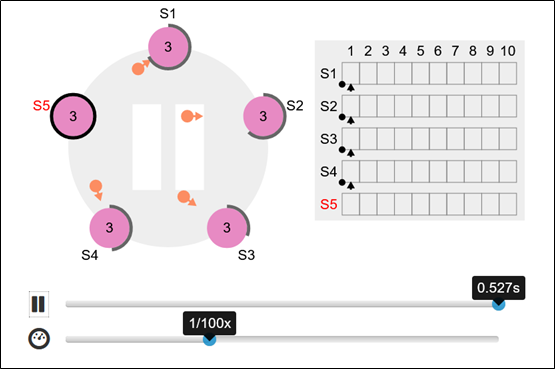
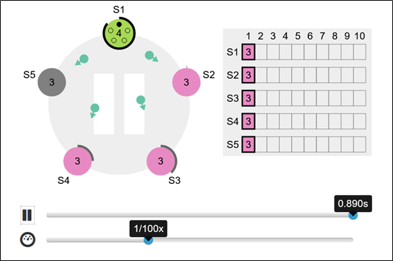
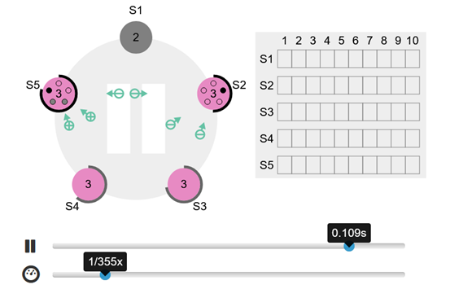
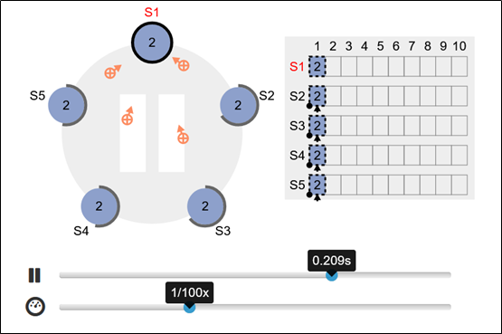
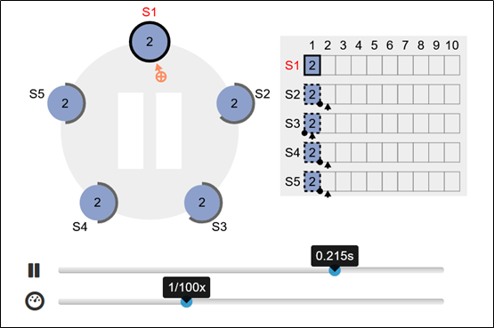
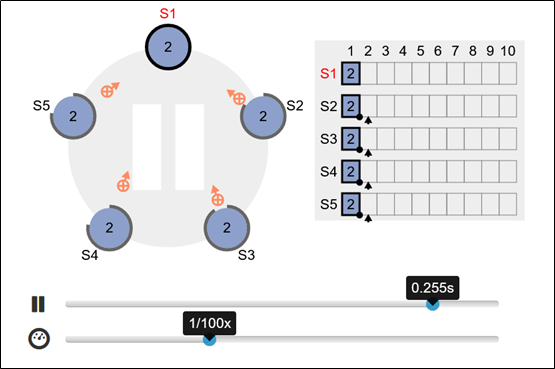
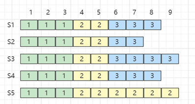
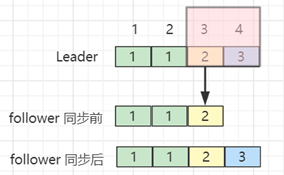
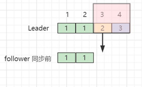
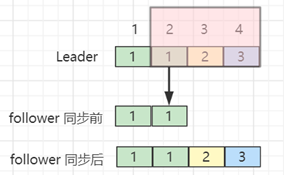
**讲义配图**（课件讲义图示）
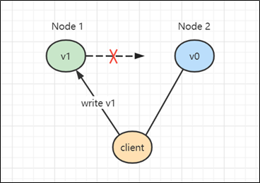
