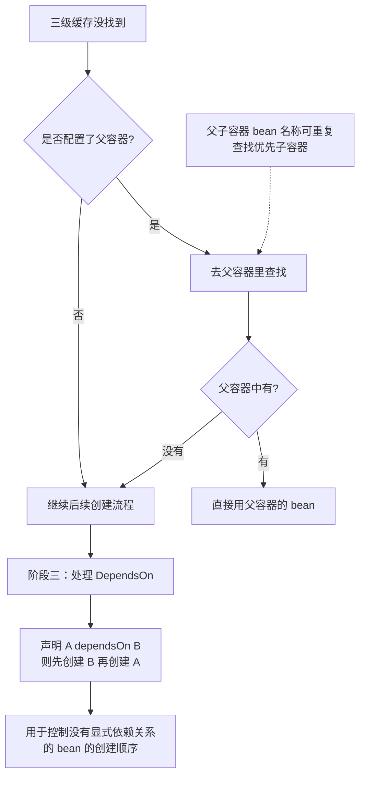

# Spring bean 生命周期：查找父容器与处理 DependsOn

面试题：Spring bean 生命周期的七个阶段，第二、三阶段做了什么？

上一篇讲了第一阶段处理名称与检查缓存。缓存里没有找到 bean，并不会立刻创建，还要先看父容器；确认要创建之后，还要处理 DependsOn 声明的前置依赖。这两个阶段都不涉及真正的实例化，但决定了去谁那里找、按什么顺序创建。

## 先给结论

- 阶段二查找父容器：当前容器缓存没找到，如果配置了父容器，会去父容器里找，找到直接用，找不到才继续后续创建流程。
- 父子容器的 bean 名称可以重复，查找规则是优先子容器，找不到再去父容器。
- 阶段三处理 DependsOn：@DependsOn 用来控制没有显式依赖关系的 bean 的创建顺序，声明 A dependsOn B，就会先创建 B 再创建 A。
- DependsOn 用得比较少，了解即可。

## 深入细节：查找父容器

第一阶段查三级缓存，缓存里有了直接返回。缓存里没有，也并不会立刻创建 bean。如果容器配置了父容器，它会先到父容器里查找这个 bean，看看父容器里有没有已经创建好的，有就直接用父容器的 bean，不会走下面的创建流程；父容器里还是没有，才继续向下走后续流程。

这里有个要注意的规则：父容器和子容器中的 bean 名称是可以重复的。比如父容器已经有一个 A，子容器也可以有一个名字同样叫 A 的 bean。名字发生重复时，优先找子容器的 bean，找到了就返回；找不到才继续到父容器查找。

这个阶段比较简单，理解成「缓存没中先去父容器兜一圈」即可。

## 深入细节：处理 DependsOn

第三阶段的核心是理解什么叫 DependsOn。

大部分 bean 之间是有依赖关系的，比如 A 依赖 B，这种有依赖关系的 bean，创建次序天然有保障：必须先把 B 创建出来，才能创建 A，因为创建 A 时要注入 B。

但有些 bean 之间没有依赖关系，比如 A 和 B 没有显式依赖，这时如果想控制它们的创建次序，就可以用 DependsOn。比如想让 B 先创建、A 后创建，就让 A dependsOn B，这样 Spring 会先把 B 创建出来，回过头来再创建 A。

所以 DependsOn 就是用在没有显式依赖的 bean 的创建顺序控制上。实际开发中用得比较少，大家了解一下即可。

放到整个生命周期里看，这一阶段 Spring 在创建某个 bean 时，如果发现它有 DependsOn 声明的 bean，会提前把这些依赖的 bean 先创建，然后再回来创建当前的 bean。

原版课程在这个阶段还扩展了 @Conditional 的解析时机、beanName 的解析时机、@Bean 的解析、@DependsOn 与 @Lazy、@Primary 的解析时机，以及 @Scope 代理的解析。这些属于源码细节，面试前大致了解即可，现阶段先掌握 DependsOn 的作用。

## 面试怎么答

1. 先串上下文：第一阶段查缓存没中，进入阶段二。
2. 讲父容器规则：父子容器 bean 名可重复，优先子容器，找不到再去父容器。
3. 讲 DependsOn：显式依赖天然保证顺序，没有显式依赖又想控序就用 @DependsOn，被依赖者先创建。

常见追问：

- **问**：父子容器名字重复时一定返回子容器的吗？
  **答**：按查找规则是先查子容器，命中直接返回；只有子容器没有时才去父容器找，所以等效优先子容器。
- **问**：@DependsOn 和依赖注入有什么区别？
  **答**：依赖注入是 bean 之间真正的引用关系，Spring 按依赖图决定创建顺序；@DependsOn 不建立引用，只是声明一个创建次序的前置约束。

## 常见误区

- **误区一**：以为缓存没中就会立刻创建。还要先看父容器，父容器有就直接用。
- **误区二**：以为控制创建顺序只能靠依赖注入。没有显式依赖时可以用 @DependsOn 显式声明先后。
