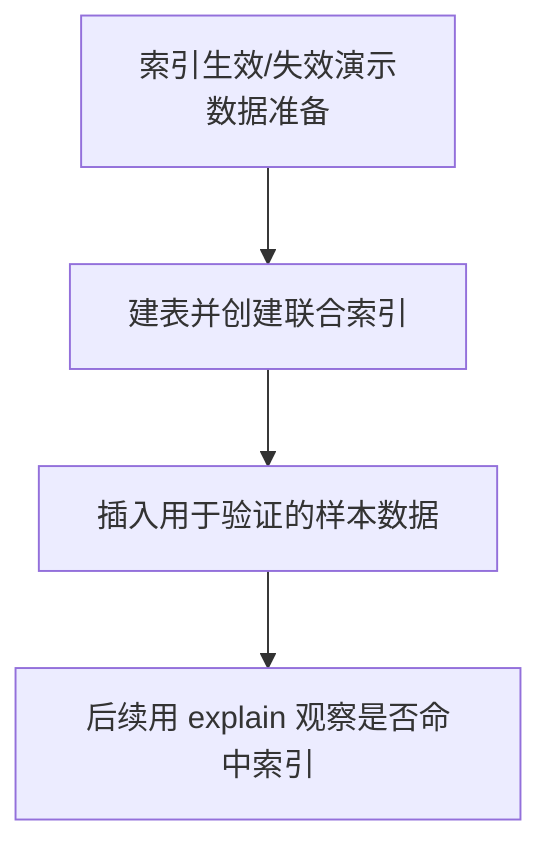

# 索引生效与失效：测试数据准备

面试题：命中索引需要注意什么？索引什么时候会失效？

这是一道高频面试题，有正向问法「命中索引需要注意什么」，也有反向问法「索引什么时候会失效」，两种问法考察的是同一件事：对索引使用条件的掌握。后续几篇会用实例演示的方式，在百万级数据上逐条验证索引什么时候生效、什么时候失效。这一篇先做数据准备。

## 先给结论

- 演示需要一张百万级的测试表，这里用 big_person，100 万条数据、15 列。
- 数据准备三步：改 my.ini 加 secure_file_priv= 并重启；执行 db.sql 建表；用 LOAD DATA INFILE 导入文本文件。
- 之所以把建表脚本和数据文件分开，是因为数据量大时写在 SQL 脚本里导入非常慢，LOAD DATA INFILE 导入 txt 快得多。



## 深入细节：为什么改配置文件

第一步，以 Windows 下的 MySQL 为例，找到 MySQL 的安装目录，打开默认的配置文件 my.ini。在原有的 [mysqld] 选项下面加一条配置：

```ini
[mysqld]
secure_file_priv=
```

等号后面什么都不写，直接一个回车就可以。加完以后重启 MySQL 服务器，让这个选项生效。

这条配置的作用和第三步导入文件有关。默认情况下，由于权限原因，MySQL 不允许在任意路径下导入外部数据文件。加上这条配置，主要就是为了让它不考虑权限限制，可以从任意目录下导入外部数据文件。

## 深入细节：建表与导入

第二步，执行课程提供的 SQL 脚本 db.sql。里面主要是建表语句，会建一张叫 big_person 的表。

第三步，执行 LOAD DATA INFILE 命令，后面跟上文本文件的路径，最后写上 into table big_person，把文本文件中的数据导入 person 表：

```sql
LOAD DATA INFILE 'D:\big_person.txt' INTO TABLE big_person;
```

文本文件在课程资料的 bigperson.zip 里，用的时候先解压即可。注意命令里的路径要根据文件实际存放的位置修改。

为什么要把建表脚本和数据文件分成两个？因为数据文件内容比较多，如果全写在 SQL 脚本里导入速度非常慢。所以把较少的建表语句放在 db.sql 里，很快就能执行完；把导入数据的部分单独用一个 txt 文件，再用 LOAD DATA INFILE 导入，速度比较快。整个数据量大约是 100 万条、15 列。

这三步执行完，就可以开始索引的验证实验了。

## 面试怎么答

数据准备本身不是面试考点，但这张表是后面所有索引实验的地基。被问到准备过程时，讲清三点即可：secure_file_priv 放开文件导入权限、db.sql 负责建表、LOAD DATA INFILE 负责快速导入百万数据。顺带可以点出「建表脚本和数据文件分开是为了导入效率」，这能体现你实际做过数据准备，而不是只会背结论。

## 常见误区

- **误区一**：把百万级数据写进 SQL 脚本逐条 insert。数据量大时导入极慢，应该用 LOAD DATA INFILE 配合文本文件。
- **误区二**：改完 my.ini 不重启。secure_file_priv 需要重启 MySQL 服务器才会生效。
