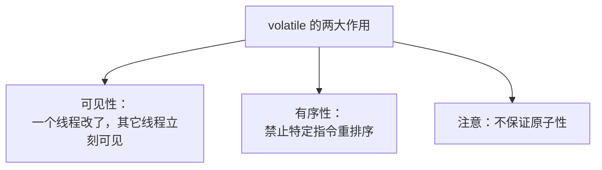

# volatile 能否保证线程安全

面试题：volatile 能保证线程安全吗？

这是并发编程的高频面试题。volatile 之前我们在讲双检索单例的时候见过，当时用它修饰共享变量，解决指令重排序（CPU 或编译器为提升性能而调整代码执行顺序，单线程无感、多线程下可能出错）的问题。那它能不能完全保证线程安全？要回答这个问题，先得把线程安全拆开看。

## 先给结论

- 线程安全要考虑三个方面：可见性、有序性、原子性。
- volatile 能够保证被修饰共享变量的可见性和有序性，但并不能保证原子性。
- 可见性指一个线程对共享变量修改，另一个线程能看到最新的结果。
- 有序性指一个线程内代码按编写顺序执行，不被 CPU 或缓存打乱。
- 原子性指一个线程内的多行代码以一个整体运行，执行期间不能有其他线程的代码插队。



## 深入细节：线程安全的三个方面

可见性，就是指当一个线程对共享变量做了修改，另外一个线程能看到这个共享变量最新的结果。如果一个线程修改了共享变量，另一个线程看到的还是之前的旧值，那就表示不可见。

有序性，是指一个线程内代码按编写的顺序执行。比如编写顺序是 1、2、3，执行时如果变成了 3、2、1，说明 CPU 或缓存对指令做了优化、调整了顺序。这样的代码在单线程下没问题，但多线程下就会产生意料之外的结果。

原子性，是指一个线程内的多行代码以一个整体来运行，这多行代码执行期间不能有其他线程的代码插队。如果有其他线程代码插队，也会造成意料之外的结果。

所以将来提线程安全，这三个方面都要综合考量，不能只考量其中几个。

## volatile 的能力边界

volatile 修饰的共享变量，只能保证该共享变量的可见性和有序性。也就是说，它至少能保证共享变量改了其他线程能看到最新的结果；共享变量的读写操作顺序有一定保障，不会随便被打乱。

但是 volatile 修饰的变量并不能保证原子性。

所以这道题的答案到这儿已经给出：volatile 能干前两件事，但解决不了原子性的问题。为了加深印象，接下来分别对可见性、有序性、原子性各举一个例子。

```java
static volatile int balance = 10;

public static void subtract() {
    int b = balance;
    b -= 5;
    balance = b;
}

public static void add() {
    int b = balance;
    b += 5;
    balance = b;
}

public static void main(String[] args) throws InterruptedException {
    CountDownLatch latch = new CountDownLatch(2);
    new Thread(() -> { subtract(); latch.countDown(); }).start();
    new Thread(() -> { add();     latch.countDown(); }).start();
    latch.await();
    LoggerUtils.get().debug("{}", balance);
}
```

两个线程一个加 5 一个减 5，理想结果还是 10。但 `balance` 即使被 volatile 修饰，结果仍然可能不是 10，原因就在字节码层面：

```text
t1                          t2
0: getstatic   // 读 10
                            0: getstatic   // 也读到 10
                            3: iconst_5
                            4: isub        // 10-5=5
                            5: putstatic   // 写回 5
3: iconst_5
4: iadd        // 10+5=15
5: putstatic   // 写回 15
```

`getstatic`（读）和 `putstatic`（写）之间隔着 `iadd`/`isub`，读写不是一整个不可分割的操作，两个线程的这几步可以交错，于是后写的覆盖先写的。volatile 能保证「改了别的线程看得到」，但管不了「读改写」这三步被别的线程插队。这就是原子性问题。

## 面试怎么答

1. 先拆解：线程安全有三方面，可见性、有序性、原子性。
2. 再对号入座：volatile 保证前两者，不保证第三者。
3. 给理由：volatile 的可见性靠强制读写主存，有序性靠禁止指令重排序；而 i++ 这类复合操作编译后是多条指令，volatile 管不住指令间的交错。
4. 补方案：要原子性用 synchronized、Lock，或者原子类。

常见追问：

- **问**：volatile 怎么保证可见性？
  **答**：被 volatile 修饰的变量，每次读取都从主存读，每次写完都立刻刷新回主存，所以一个线程的修改对其他线程可见。
- **问**：i++ 为什么不是原子操作？
  **答**：它编译后是读变量、加一、写回多条指令，多条指令之间可能被其他线程插队，需要用锁或原子类保证整体执行。

## 常见误区

- **误区一**：以为 volatile 修饰的变量做自增就线程安全。自增是复合操作，volatile 不保证原子性，并发自增要用 AtomicInteger 或加锁。
- **误区二**：只记住「volatile 不保证原子性」，说不清可见性和有序性分别指什么。三方面的定义要能脱口而出。
