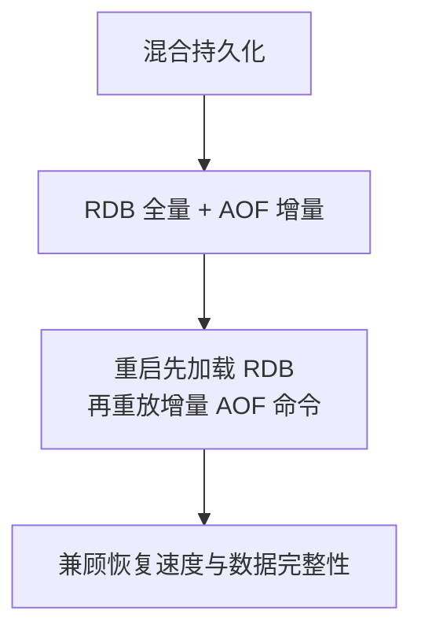

# Redis 持久化：混合持久化

面试题：Redis 的混合持久化是什么？

RDB（内存快照，按时间点把全量数据存成二进制文件）恢复快但两次快照之间丢数据，AOF（追加命令日志，记录每条写命令）数据全但文件大、恢复慢。有没有两全其美的办法？Redis 4.0 开始的混合持久化就是答案：用 RDB 做全量备份，两次 RDB 之间用 AOF 做增量备份，两者存进同一个 AOF 日志文件。

## 先给结论

- 混合持久化从 Redis 4.0 开始支持，默认没有开启，通过配置项 aof-use-rdb-preamble 控制，默认值是 no，改成 yes 开启。
- 它不会同时用两份日志，而是把数据统一存入 AOF 日志：日志前半部分是二进制的 RDB 格式，后半部分是 AOF 的命令日志。
- 第二次 RDB 时直接覆盖前面的日志文件，所以不会出现 AOF 命令越来越多的问题，也不用做 AOF 重写。
- 优点是恢复速度快、增量数据更完整；缺点是与旧版本的 Redis 文件格式不兼容。



## 是什么：RDB 加 AOF

之前说过 RDB 的缺点：两次 RDB 之间如果发生宕机，这之间所有的增删改操作都会丢失。解决办法就是把它跟 AOF 结合在一起：用 RDB 作为全量备份，两次 RDB 之间采用 AOF 作为增量备份。

因为 AOF 能把所有的增删改命令都记录下来，记录的力度更细，这样将来发生丢失时，丢失的数据也会更少。

## 深入细节：日志结构与配置

混合持久化不会同时用 AOF 日志和 RDB 日志两份文件，它把数据统一存入 AOF 的日志，只是日志的前半部分用二进制的 RDB 格式，后半部分用 AOF 的方式记录 Redis 命令。

这样有一个小缺点，就是可读性比较差：日志文件前半部分是二进制的，人读不懂；后半部分是人能读懂的 Redis 命令。

控制开关的配置项是 aof-use-rdb-preamble，默认 no：

```conf
aof-use-rdb-preamble yes
```

在 Redis 4.0 的配置文件里可以找到它，把值改成 yes 就支持混合持久化了。

## 深入细节：覆盖机制与优缺点

第一次 RDB 时，日志前半部分记 RDB 格式，后半部分记命令格式。第二次 RDB 时，它就把前面的日志文件覆盖掉。这样也不会产生 AOF 里面命令越来越多的问题，连 AOF 重写都不需要做了。

所以它的优点非常多：既结合了 RDB 的优点，也结合了 AOF 的优点。恢复速度快，而且增量数据用 AOF 的 Redis 命令表示，数据更完整，AOF 文件过大的问题也被解决了。

缺点有一点点：与旧版本的 Redis 文件格式不兼容。如果用的是 4.0 以前的 Redis，它不识别前半部分二进制、后半部分是命令的这种文件格式。不过现在用的基本上都是 4.0 以上的版本，这个问题不算大问题。

## 面试怎么答

1. 先给动机：RDB 丢增量、AOF 恢复慢，混合持久化取两者之长。
2. 讲结构：统一写 AOF 日志，前半段二进制 RDB 全量，后半段 AOF 增量命令。
3. 讲配置：aof-use-rdb-preamble 默认 no，改 yes 开启；二次 RDB 覆盖旧文件，不用重写。
4. 讲兼容性：旧版本 Redis 不识别这种混合格式。

常见追问：

- **问**：混合持久化恢复时怎么处理前后两段？
  **答**：先按 RDB 二进制格式加载前半段全量数据，再把后半段的 AOF 命令逐条重放，恢复到最新状态。
- **问**：它和 AOF 重写有什么区别？
  **答**：AOF 重写是按内存现状生成命令写新文件，体积仍可能增长；混合持久化每次直接写一份 RDB 全量加后续增量，靠覆盖旧文件控制体积，不需要重写机制。

## 常见误区

- **误区一**：以为混合持久化会同时维护 RDB 和 AOF 两个文件。它只有一份 AOF 日志，内部混合两种格式。
- **误区二**：以为默认开启。aof-use-rdb-preamble 默认是 no，需要手动开启。
