# Spring bean 生命周期：按 Scope 创建

面试题：不同 Scope 的 bean，生命周期有什么区别？

上一篇讲完名称、缓存、父容器和 DependsOn，正式进入创建环节。bean 在定义时可以有不同的 Scope，严格来讲不同 Scope 的生命周期不一样。这篇用单例、原型、请求三种 Scope 各跑一个例子，看它们的创建和销毁分别发生在什么时机。

## 先给结论

- 常见的 Scope 有 singleton、prototype、request、session、application，其中单例、原型、请求三种最具代表性。
- 单例 bean 在容器 refresh 时被创建（refresh 第 11 步内部就是调每个单例的 getBean），容器 close 时被销毁，BeanFactory 负责调用销毁方法。
- 原型 bean 在首次 getBean 时被创建，容器关闭不负责销毁，需要自己拿到 BeanFactory 手动调 destroyBean。
- 请求作用域的 bean 首次 getBean 时创建并存入 request 作用域，请求结束（requestCompleted）时销毁。
- 三种 Scope 的生命周期起点都是 getBean，差别在终点。

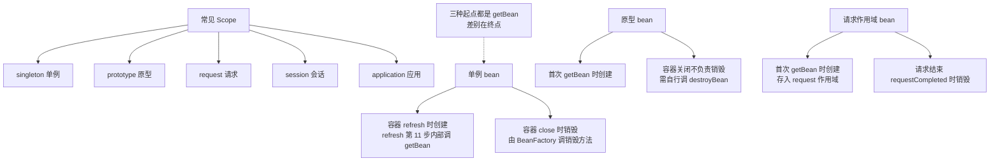

## 深入细节：单例作用域

Bean1 上定义了初始化方法和销毁方法，分别用 @PostConstruct 和 @PreDestroy 标注，配套一个解析这两个注解的 bean 后处理器：

```java
@PostConstruct
public void init() { LoggerUtils.get().debug("{} - init", this); }

@PreDestroy
public void destroy() { LoggerUtils.get().debug("{} - destroy", this); }
```

然后注册 bean 并 refresh：

```java
context.registerBean("bean", Bean1.class);
context.refresh();
context.close();
```

运行后可以看到 init 和 destroy 分别被调用了。也就是说，refresh 的时候会执行到每个单例 bean 的 getBean 方法，在创建的第五阶段调用它的初始化方法；调用 close 的时候，因为 bean1 注册了销毁方法，最终会调用它的销毁方法。

所以单例 bean 的生命周期是：从 refresh 创建，到 close 被销毁。

## 深入细节：原型作用域

原型（prototype）bean 是首次 getBean 时被创建。代码和单例例子差不多，区别是把 bean 的 Scope 通过编程的方式指定为 prototype：

```java
context.registerBean("bean", Bean1.class, bd -> bd.setScope("prototype"));
context.refresh();
// 获取 Bean
Bean1 bean = context.getBean(Bean1.class);
// 通过 DefaultListableBeanFactory 手动调用 destroyBean
context.getDefaultListableBeanFactory().destroyBean(bean);
```

注意一个现象：如果只调 refresh 和 close、不主动去 getBean，容器启动和关闭并不会导致原型 bean 的创建以及销毁，跑起来什么都发生。

原型 bean 什么时候被创建？第一次调用 getBean、真正使用它的时候。原型 bean 也可以销毁，不是说不能销毁：从 ApplicationContext 拿到 BeanFactory，通过 BeanFactory 的 destroyBean 方法把原型 bean 传进去，就可以销毁。因为没有人去记录有哪些原型 bean 该销毁，只有使用者自己知道，所以想让它销毁，就手动调用 destroyBean。

从日志也能看到：调用 getBean 时内部会调用初始化方法，最后调 destroyBean 时也会调用相应的销毁方法。

## 深入细节：请求作用域

请求作用域的 bean 也是首次 getBean 时被创建，创建完放到 request 作用域里，等 request 作用域对象的生命周期结束之前，要把跟 request 关联的 bean 也做销毁。

要模拟 web 环境下的 request Scope，需要先注册一个 request Scope，并把 bean 的 Scope 定义成 request：

```java
context.getRefreshableApplicationContext().registerScope("request", new RequestScope());
context.registerBean("bean", Bean1.class, bd -> bd.setScope("request"));
context.refresh();

for (int i = 0; i < 2; i++) {
    new Thread(() -> {
        MockHttpServletRequest request = new MockHttpServletRequest();
        ServletWebRequest webRequest = new ServletWebRequest(request);
        RequestContextHolder.setRequestAttributes(webRequest);

        Bean1 bean = context.getBean(Bean1.class);
        LoggerUtils.get().debug("{}, {}", bean, request);
        // request 请求结束调用这些方法
        webRequest.requestCompleted();
    }).start();
}
```

在非 web 环境模拟 request，可以用 Spring 提供的 MockHttpServletRequest，再用 ServletWebRequest 封装，目的是绑定到当前线程。接下来调 getBean，它把 bean 创建出来以后存入 request 对象的作用域；之后通过 request 的 getAttribute 从作用域里取，拿到的就是刚开始 getBean 创建出来的那个，也就是同一个 request 里多次获取这个 bean，都是同一个。

什么时候结束？webRequest 对象在请求结束之前调一下 requestCompleted 方法，它内部就会去调用跟 request 绑定的这些 bean 的销毁方法。

启动两个线程模拟两个请求，可以看到线程 0 每次用到的都是同一个 bean1（哈希码相同），第一次 getBean 时创建并调用 init，之后从 request 作用域取到的也是同一个；最后调 requestCompleted 时针对这个 bean 调用了销毁方法。另一个线程是另一个独立的 bean。

## 对 Scope 的理解

把 Scope 理解为「从某个范围里找到这个 bean」更为贴切：

- 单例 bean，就是从单例池、也就是 BeanFactory 的 singletonObjects 这个范围内获取。单例池还没有就创建并放进去，已经有了就直接返回。
- 原型 bean 没地儿存，每次都是创建新的。
- 请求作用域的 bean，就是从 request 请求对象的作用范围获取，没有就创建放入请求域，有了就从请求域里拿。

三个作用域的例子看完，结论是：它们的起点其实都是从 getBean 开始，只不过终点不一样。单例到容器结束前销毁，请求作用域到特定请求域结束前销毁，原型只能自己控制什么时候销毁。

## 面试怎么答

1. 先列 Scope：singleton、prototype、request、session、application，重点讲前三个。
2. 讲生命周期三线：单例 refresh 创建、close 销毁；原型 getBean 创建、手动 destroyBean；request getBean 创建、请求结束销毁。
3. 点共同点：起点都是 getBean，差别在终点。
4. 拔高理解：Scope 本质是「从哪个范围找 bean」。

常见追问：

- **问**：原型 bean 为什么容器不帮它销毁？
  **答**：容器只管理单例的完整生命周期，原型 bean 创建后交给使用者，容器不记录引用，销毁只能由使用者通过 BeanFactory 的 destroyBean 主动触发。
- **问**：session 和 application 作用域和 request 的区别？
  **答**：机制相同，只是绑定的作用域对象不同：request 绑定一次请求，session 绑定一次会话，application 绑定整个 ServletContext，销毁时机随各自作用域结束。

## 常见误区

- **误区一**：以为容器关闭会销毁所有 bean。原型 bean 容器不负责销毁，只有单例会。
- **误区二**：以为 request 作用域的 bean 每次 getBean 都是新的。同一个请求内是同一个，请求之间才不同。

## 课件配图
> 以下配图取自阶段七课件对应讲义，与上文讲解一一对应，可作为图文对照辅助理解。
**Spring bean 循环依赖**（课件讲义图示）
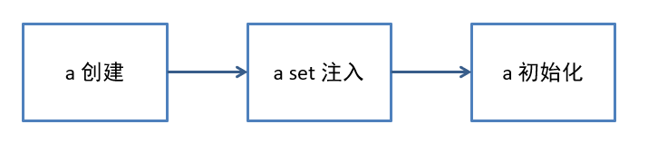
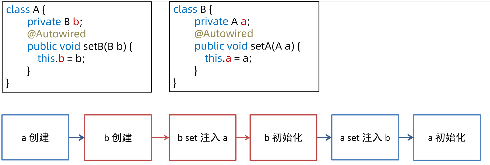
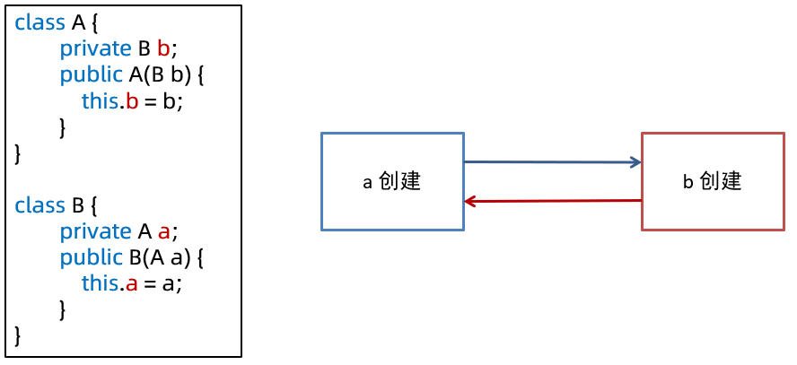
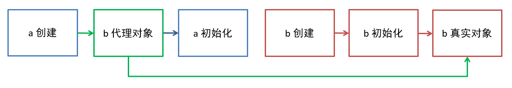
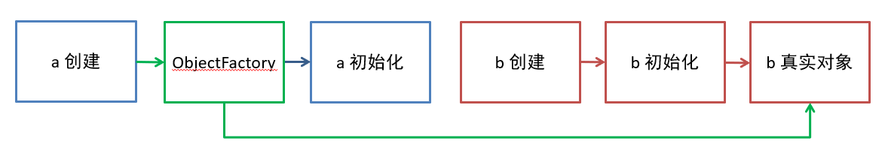
**解决 set 循环依赖的原理**（课件讲义图示）
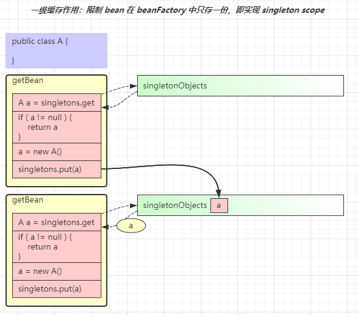
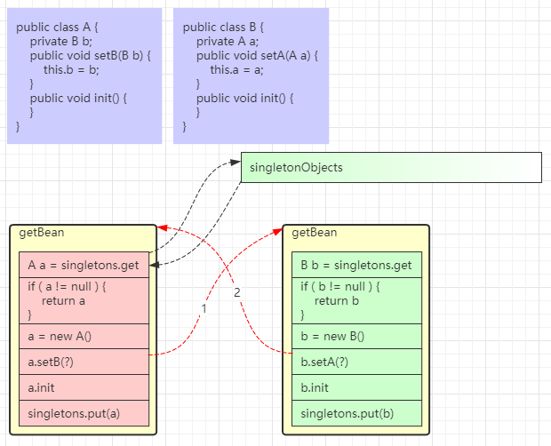
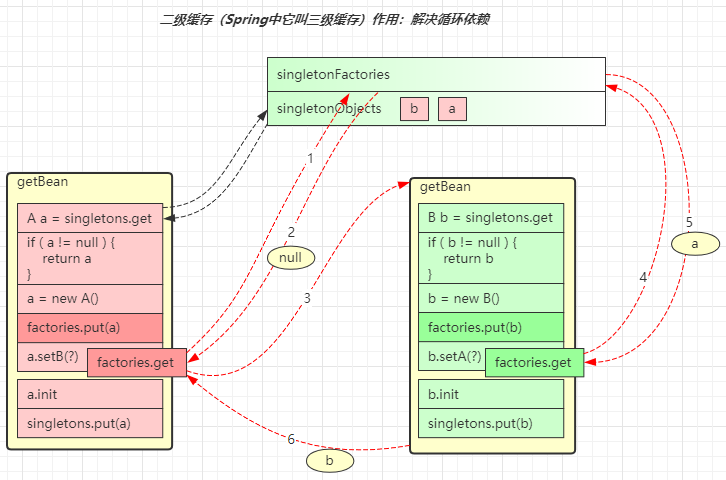
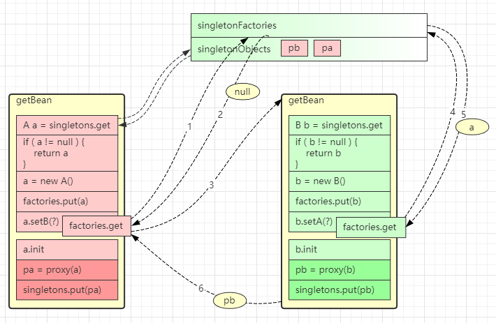
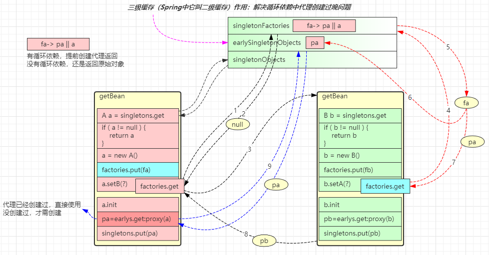
