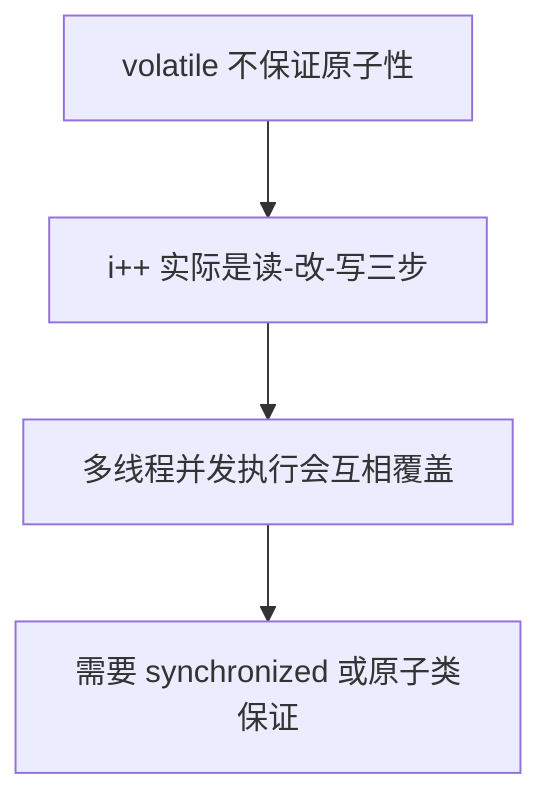

# volatile 原子性演示

面试题：为什么 volatile 不能保证原子性？

上一篇给出结论：volatile 能保证可见性和有序性，不能保证原子性。这篇用代码和字节码把原子性问题的根源挖出来，并用 debug 复现一次指令交错，眼见为实。

## 先给结论

- 一个共享变量 balance 初始为 10，被 volatile 修饰；一个线程减 5，一个线程加 5，正常结果应该是 10。
- 跑一次结果是 10，只能说明跑的次数太少；相同代码跑一百万次，结果可能是 5，也可能是 15。
- 根源一：balance -= 5 这类操作不是原子操作，编译成字节码后是多条指令。
- 根源二：多线程下这多条指令会发生交错，后写入的结果覆盖先写入的，产生意料之外的值。
- 解决思路是让多条指令作为整体执行，synchronized、Lock 或者原子类都可以。



## 演示代码

共享变量用 volatile 修饰，两个方法分别做减 5 和加 5：

```java
public class AddAndSubtract {
    static volatile int balance = 10;
    public static void subtract() {
        balance -= 5;
    }
    public static void add() {
        balance += 5;
    }
    public static void main(String[] args) throws InterruptedException {
        CountDownLatch latch = new CountDownLatch(2);
        new Thread(() -> {
            subtract();
            latch.countDown();
        }).start();
        new Thread(() -> {
            add();
            latch.countDown();
        }).start();
        latch.await();
        LoggerUtils.get().debug("{} ", balance);
    }
}
```

两个线程都运行结束后，主线程去看最终余额。按理一个减 5 一个加 5，应该是 10。运行一下，结果确实是 10。

但我说这个代码在多线程下其实是有问题的。你运行出一次正确结果，只能说明运行的次数太少；如果相同代码跑一百万次，可能会发现结果不一定是 10，还有两种可能：一种是 5，另一种是 15。

## 根源一：一行代码不是一条指令

用 javap -c 反编译 class 文件，看 subtract 和 add 方法的字节码。subtract 方法是这样的：

```text
0: getstatic #7 // Field balance:I
3: iconst_5
4: isub
5: putstatic #7 // Field balance:I
```

一共四条指令：getstatic 先读取共享变量的值；iconst_5 准备数字 5；isub 做减法；最后 putstatic 把运算结果写回静态变量。

add 方法类似，只是中间指令换成 iadd：

```text
0: getstatic #7 // Field balance:I
3: iconst_5
4: iadd
5: putstatic #7 // Field balance:I
```

所以表面上一行代码，到底层并不是一条指令，可能是多条指令。这是第一个原因。

## 根源二：指令交错

第二个原因是多线程下这多条指令会发生交错。

如果不交错，结果是正确的。比如 t1 执行加法，先 getstatic 读到初始值 10，准备 5，iadd 得到 15，最后 putstatic 写回，t1 执行完 balance 是 15；然后 t2 执行减法，读到 15，减 5 得 10，写回，结果就是 10。

但 CPU 在多个线程之间来回切换。如果切换发生在 t1 只执行了 getstatic、还没执行后三条指令时，t2 提前运行，t2 的 getstatic 拿到的还是 10，因为 t1 没有真正把加法结果写回静态变量。t2 在 10 的基础上减 5 得 5，写回静态变量。事情没完，t1 还剩三条指令没执行，CPU 切回 t1，它加 5 时用的还是最开始读到的那个 10，并不知道最新值已经被改成 5，于是 10 加 5 得 15 写回，把 5 覆盖掉，最终结果是 15。

反过来交错就会得到 5。

## 用 debug 复现

debug 只能在一行代码上停下来，它并不认为这是多行代码，所以做一个简单模拟：把代码改成等价的多行操作，先读初始值到局部变量，再运算，最后写回共享变量。

```java
public static void subtract() {
    int b = balance;
    b -= 5;
    balance = b;
}
```

加法同理：

```java
public static void add() {
    int b = balance;
    b += 5;
    balance = b;
}
```

在两条写回语句上加断点，debug 运行。先让减法线程往下走一行，读到初始值 10，还没来得及执行后两行，CPU 切到加法线程；加法线程读 balance 还是 10，10 加 5 得 15 写回，此时共享变量是 15。但减法线程的代码还没执行完，回到减法线程，它是在 10 的基础上去减 5，并没有意识到别的线程已经加了 5，10 减 5 得 5，把之前的 15 覆盖掉。继续运行，最终结果就是 5。15 的场景可以自己再试。

## 怎么解决

要么这条指令是原子的、不可分割，只有一条，那交错也无所谓；要么这多条指令作为一个整体执行，中间不能有其他线程的指令插队，这就是保证原子性。

保证原子性有很多做法：前面见过的 synchronized、Lock 锁，都可以保护多行代码作为整体执行；后面还会讲到用 CAS 实现无锁的原子性操作。重点是先看这些问题的根源：代码不是原子的，加上多线程指令交错，就会产生不期望的结果。

## 面试怎么答

1. 先给结论：volatile 保可见性和有序性，不保原子性。
2. 讲演示：balance 加 5 减 5，偶尔得 5 或 15，不是恒定的 10。
3. 讲字节码：一行 i++ 编译后是 getstatic、iconst、iadd/isub、putstatic 四条。
4. 讲交错：两条线程交错执行，后写覆盖先写，丢失一次更新。
5. 给方案：synchronized、Lock、原子类。

常见追问：

- **问**：volatile 不是会刷新主存吗，为什么还丢更新？
  **答**：可见性保证每次读主存、写完刷新，但读和写之间是独立的动作。两个线程都读到 10 再各自运算写回，后写的覆盖先写的，中间这次更新就丢了。
- **问**：AtomicInteger 为什么能保证原子性？
  **答**：它底层用 CAS 指令，比较并交换是一条原子指令，更新失败会自旋重试，不需要加锁。

## 常见误区

- **误区一**：以为 volatile 修饰的变量做复合操作就安全。加减、自增都是读改写多步，必须加锁或用原子类。
- **误区二**：以为跑几次结果对就是安全的。并发问题低频偶发，要大量重复跑才暴露。
