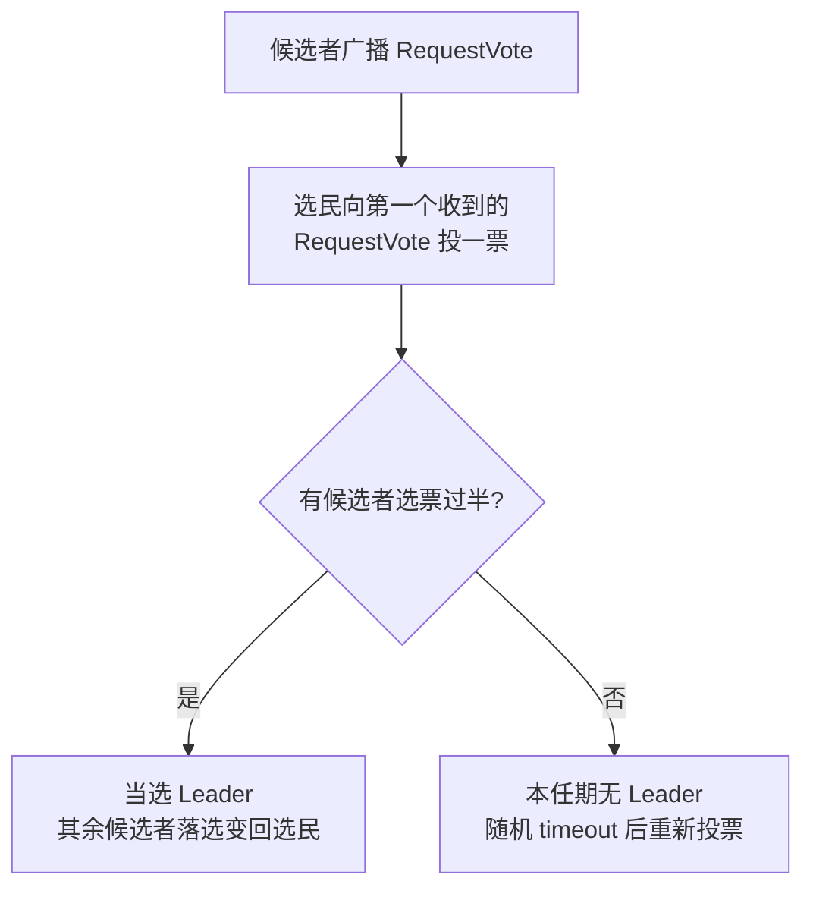

# Raft 算法：Leader 选举（文字总结）

面试题：Raft 的 Leader 选举规则是什么？

上一篇跟着可视化动画把 Raft 的 Leader 选举过程走了一遍，这篇用文字把规则浓缩成六点。动画负责建立画面感，这六条负责面试直接可背。建议对照动画一起消化。

## 先给结论

- Leader 靠不断发送 `AppendEntries` 心跳证明自己活着；Follower 收到心跳就重置自己的超时计时器。
- Follower 超时没收到心跳，角色转为 Candidate，任期加一，发送 `RequestVote` 请求拉票。
- 投票规则：Follower 只把票投给本任期内收到的第一个投票请求，第二个一律拒绝；选票过半即当选 Leader，落选则退回 Follower。
- 每个任期最多一个 Leader，也可能没有（选票都不过半），不过半就再投一轮。
- 超时时间取 t 到 2t 之间：t 是两个节点间通信的平均单向时间，2t 是往返时间。
- 任期由各个 server 自己维护即可，无需全局编号；收到更新的任期就同步，遇到更旧的任期视为错误。

## 深入细节：六条规则

**第一条，Leader 持续发心跳。** Leader 会不断向其余的 Follower（也就是选民）发送 `AppendEntries` 请求，证明自己还活着。Follower 这边只要收到 Leader 的 `AppendEntries` 请求，就会重置自己的超时时间。

补充一下超时时间的机制：每个节点的超时时间都在不断缩短，减到 0 就超时。但如果收到了 Leader 发过来的请求，说明 Leader 还活着，就不需要超时了，直接把超时时间重置为最初的最长状态，从头开始算，这样就避免了超时。

**第二条，超时后角色转换。** 如果 Follower 收不到 `AppendEntries` 请求、超时了，角色就从选民转换成候选者。比如动画里的 S1，从选民变成了候选者，同时把任期加一：例子里原来的任期是 3，现在加一变成 4。变成候选者之后，它就发送 `RequestVote` 请求，也就是投票请求，请求其他节点选它自己作为下一任 Leader。

**第三条，一人一票。** Follower 收到第一个 `RequestVote` 投票请求后，会向该候选者投一票（赞成票）；如果是第二次再收到 `RequestVote`，就不会投赞成票了。这样即使有多个候选者，也必定会选出一个 Leader。

看例子：现在有两个候选者。对于 S4 来说，它收到的第一个请求来自 S5 的投票请求，所以投了赞成票；收到的第二个来自 S2 的投票请求，返回的是否决票。S3 也一样，给 S5 投了赞成票，就不能再给 S2 投赞成票。也就是说每个节点只能投一票，这样就保证了不会出现混乱的情况。

将来选票如果过半，候选者就当选 Leader；如果落选，就变回选民的角色。

**第四条，每任期最多一个 Leader。** 但也有可能没有，一种情况是一开始大家都是选民、还没选；还有一种非常少见的特殊情况，就是选票都不过半。比如 S4 投票给了 S5，S3 投票给了 S2，两个候选者各得两票，票数相当，谁都过不了半。这时没关系，再进行一轮投票就可以。这种情况出现的几率非常少，因为各节点的超时时间是随机的，网络上投票请求来回的传输时间也不一样，很难遇到大家票数相当的情况。

**第五条，超时时间不能太短也不能太长。** 如果 timeout 太短，人家 Leader 可能还活着，你这边就 timeout 了，然后大家去选下一任 Leader，天下大乱。如果 timeout 太长，Leader 都挂了很久了大家还不知道，就都还是选民，选民意味着不能处理客户端的增删改操作，这段时间整个集群处于不可用状态。

合适的范围是 t 到 2t 之间：t 指两个节点之间通信的一个平均时间（单向传输时间），2t 就是往返的传输时间。只要把 timeout 设置在这个范围内就可以。

**第六条，任期由各节点自己维护。** 它不像 Paxos 里面那个提案号，提案号必须是全局编号，大家都不能重复。Raft 里面的任期号不需要全局维护，因为只要收到了请求，发现有比自己更新的任期，就直接更新为那个更新的任期；收到消息时也会把自己的任期更新为更新的任期。如果遇到的是更旧的任期，就认为这是一个错误。

## 面试怎么答

按「心跳、超时、拉票、投票、任期」的顺序讲：

1. Leader 在任期内不断向 Follower 发送 `AppendEntries` 心跳，Follower 收到就重置超时。
2. Follower 超时没收到心跳，转为 Candidate，任期加一，发 `RequestVote` 拉票。
3. Follower 只投本任期收到的第一个请求，一人一票；过半当选 Leader，落选退回 Follower。
4. 每任期最多一个 Leader，选票都不过半时可能没有 Leader，再投一轮即可。
5. 超时时间取 t 到 2t，太短会误判、太长会长时间不可用。
6. 任期各 server 自维护，见新同步、见旧拒绝，不需要全局编号。

常见追问：

- **问**：两个 Candidate 可能同时当选吗？
  **答**：不可能。每个 Follower 在一个任期内只投一票，而当选需要多数票，两个候选者不可能同时拿到多数票，投票规则在数学上就保证了唯一性。
- **问**：为什么超时时间要随机？
  **答**：避免多个 Follower 同时超时、同时成为 Candidate，把票分散开谁也不过半。随机错开后，先超时的节点更容易先拉到多数票。
- **问**：Raft 的任期和 Paxos 的提案号有什么区别？
  **答**：Paxos 的提案号必须是全局唯一编号；Raft 的任期由各节点自己维护，靠「收到更新任期就同步、遇到更旧任期视为错误」来收敛，不需要全局分配。

## 常见误区

- **误区一**：以为每个任期一定能选出 Leader。选票都不过半的任期可以没有 Leader，需要再进行一轮投票。
- **误区二**：以为任期需要全局维护。任期由各个 server 自己维护即可，这正是 Raft 比 Paxos 容易理解的原因之一。
