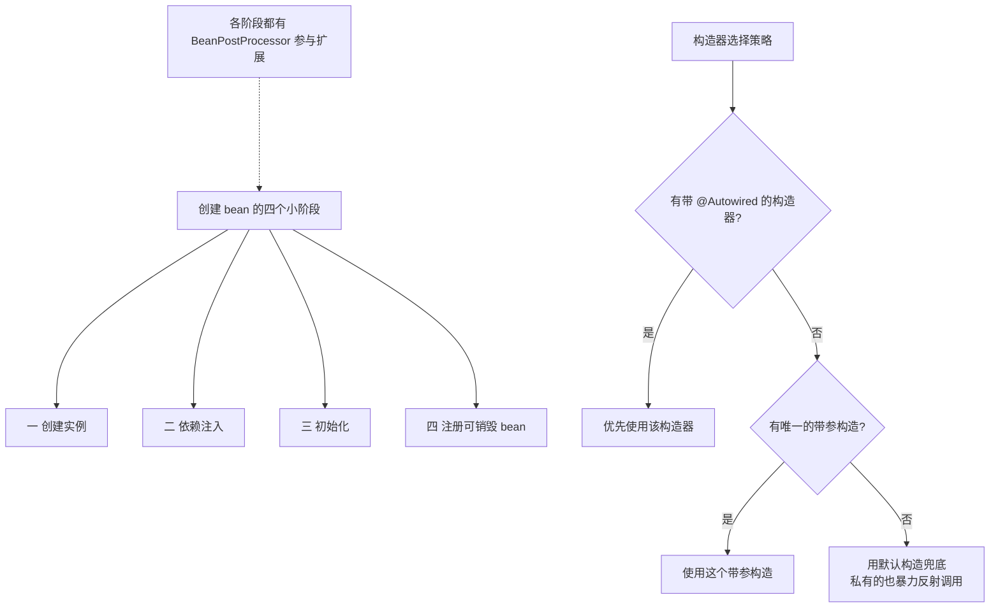

# Spring Bean 创建流程：创建实例阶段

面试题：Spring 创建 bean 实例时，怎么决定用哪个构造器？

上一篇讲了 bean 按 scope 的创建与存放，这篇正式进入创建 bean 的第一个小阶段：创建实例。Spring 创建 bean 的整体流程非常长，全部展开要讲六个多小时，这里只捞面试真正会问的重点：构造器怎么选，选不到怎么办。

## 先给结论

- 无论哪种 scope（singleton 进单例池、request 这类自定义 scope 进对应作用域、prototype 哪也不放自己管理），创建 bean 的总流程完全一样，都走四个小阶段：创建实例、依赖注入、初始化、注册可销毁 bean。
- 创建实例的策略：优先用带 `@Autowired` 注解的构造器；没有则用唯一的带参构造；再没有就用默认构造兜底，私有的也会通过暴力反射强行调用。
- 面试记住两条就够：`@Autowired` 或唯一带参构造，加默认构造兜底。
- 每个阶段都有大量 BeanPostProcessor（bean 后处理器）参与扩展：解析 `@Autowired`、`@Resource`、`@PostConstruct` 等注解，以及创建代理对象。

## 是什么：创建 bean 的四个小阶段

第四个阶段会按 bean 的 scope 定义处理实例：singleton 放入 BeanFactory 的单例池；自定义的 scope，比如 request scope，放入 request 相关的作用域；prototype 哪也不放，将来由你自己管理它。

虽然它们有不同的作用域实现，但整个创建 bean 的流程是一样的，都会走到第五步，走同样的创建流程。这个流程比较复杂，可以画成四个小阶段：创建阶段、依赖注入阶段、初始化阶段，以及图上没画的注册可销毁 bean 阶段。

每个小阶段又会有很多的 bean 后处理器参与进来，对阶段功能做一些扩展和增强。比如它会去解析成员变量或成员方法上的 `@Autowired` 注解、`@Resource` 注解、`@PostConstruct` 注解等。本来这些功能是没有的，都属于扩展的功能，这些注解的解析由不同的 BeanPostProcessor 完成。创建代理对象也属于扩展功能。

## 深入细节：创建实例的方式

创建 bean 实例的方式有很多种，工厂方法、Supplier 等，这里不逐一展开，重点掌握两条标红的思路。

**思路一：AutowiredAnnotationBeanPostProcessor 选择构造器。** 一个 bean 可能有好多构造器，到底调哪个来创建实例，得让 Spring 有所选择。`AutowiredAnnotationBeanPostProcessor` 这个 bean 后处理器，会优先选择带 `@Autowired` 注解的构造器，作为最终的构造器来创建 bean 的实例。如果没有加 `@Autowired`，但是有一个唯一的带参构造（就一个构造，没得选了），这个后处理器也会选择这个唯一的带参构造，用它来创建 bean 的实例。

**思路二：默认构造兜底。** 如果以上条件都没满足，没有找到合适的构造，就采用默认构造（无参构造）来创建 bean 的实例。注意一个细节：如果这个构造方法是私有的，Spring 一样会使用这个私有的构造来创建实例，走保底策略，通过暴力反射把构造方法的 `setAccessible` 设为 `true`，然后也来调用。

画面线的流程图上还能看到创建 bean 实例的其他路径，一并并入：

- 有自定义 TargetSource 的情况，由 `AnnotationAwareAspectjAutoProxyCreator` 创建代理对象返回。
- Supplier 方式创建 bean 实例：Spring 5.0 的新功能，方便用编程方式创建 bean 实例。
- 工厂方法方式创建 bean 实例：分成静态工厂与实例工厂；工厂方法若有参数，需要对工厂方法参数进行解析，利用 `resolveDependency`；如果有多个工厂方法候选者，还要进一步按权重筛选。
- `mbd.getPreferredConstructors`：选择所有公共构造器。

## 面试怎么答

分三层展开：

1. **先给全景**：创建 bean 分四个小阶段，创建实例、依赖注入、初始化、注册可销毁 bean；每个阶段都有 BeanPostProcessor 参与扩展，注解解析和代理创建都是后处理器的活。
2. **再讲构造器选择**：优先带 `@Autowired` 的构造器；没有则用唯一的带参构造；都没有就用默认构造兜底，私有的也反射强行调用。
3. **加分项**：主动提一句其他创建路径（Supplier、工厂方法、TargetSource 代理）和 `AutowiredAnnotationBeanPostProcessor` 这个关键后处理器，说明自己读过源码。

常见追问：

- **问**：为什么私有的构造器也能被调用？
  **答**：兜底策略走反射，`setAccessible(true)` 关闭访问检查，所以私有无参构造照样能实例化，只是平时不推荐这么写。
- **问**：AutowiredAnnotationBeanPostProcessor 只在创建实例阶段出现吗？
  **答**：不是。创建实例阶段它解析构造器上的 `@Autowired`，决定用哪个构造创建实例；到了依赖注入阶段，它继续识别成员上的 `@Autowired` 和 `@Value`，两个阶段都参与。

## 常见误区

- **误区一**：以为 Spring 只会用 public 无参构造。私有构造也会被暴力反射强行调用。
- **误区二**：以为没有 `@Autowired` 就没法用带参构造。唯一的带参构造同样会被选用来创建实例。
