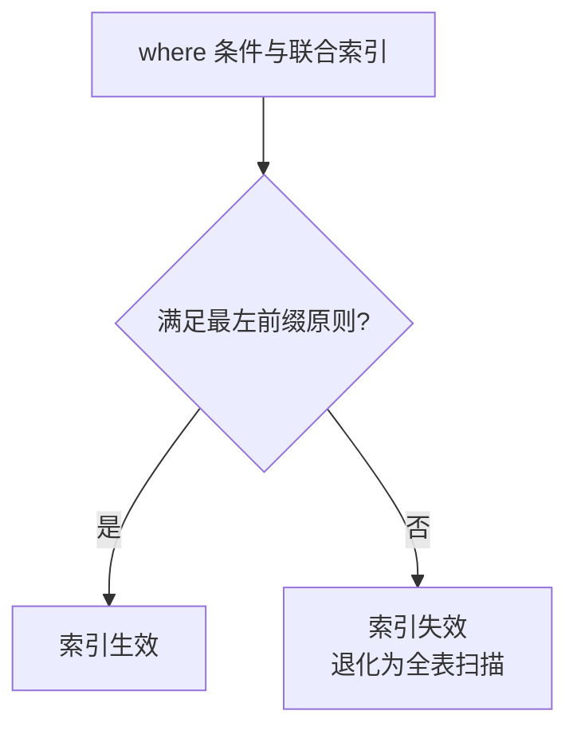

# 索引在 WHERE 筛选中的生效与失效

面试题：where 条件怎么写才能用上索引？

建了索引不等于用上索引。这篇用几组实测例子，把 where 场景下索引的生效与失效规则过一遍：模糊查询的最左前缀、组合索引的最左前缀、列上的函数计算、隐式类型转换。规则就四条，但每一条都能让索引悄悄失效，面试官很爱拿这个挖坑。

## 先给结论

- 组合索引遵守最左前缀原则：建立索引时最左列必须出现在查询条件里，与条件中列的书写顺序无关。
- 模糊查询还要遵守字符串的最左前缀：`like 'dav%'` 能用索引，`like '%day'` 不能。
- 列上做函数计算，索引必失效；计算要挪到值上，不要放到列上。隐式类型转换本质上也是在列上套了转换函数。
- 列与比较值的类型要一致，避免隐式类型转换把索引拖失效。



## 深入细节：四组例子

测试表是 `big_person`。先看跟模糊查询有关的三个例子，只看 where 条件部分：

```sql
explain SELECT * FROM big_person WHERE first_name LIKE 'dav%' LIMIT 5;
explain SELECT * FROM big_person WHERE last_name LIKE 'dav%' LIMIT 5;
explain SELECT * FROM big_person WHERE last_name LIKE '%day' LIMIT 5;
```

之前建立的组合索引是 last_name 在左、first_name 在右。第一条的条件里没有出现组合索引最左侧的 last_name，不符合组合索引的最左前缀原则，肯定不会用索引。第二条、第三条都出现了 last_name，符合组合索引的最左前缀，但 like 条件不一样：第二个是 `'dav%'`，最左侧是精确字符，符合字符串的最左前缀；第三个是 `'%day'`，以通配符开头，最左侧不是精确字符，不符合字符串的最左前缀。

所以结论是：一和三不会用索引，二会用。explain 实测验证：一、三都没用上，二里面用上了。检查索引的时候，不光要看是否满足组合索引的最左前缀，如果做了模糊查询，还要考虑模糊查询的字符串最左前缀。

第二个例子，再加深一下组合索引最左前缀的印象。为省、市、县三列建立一个组合索引，省在最左侧。四条 sql：

```sql
create index province_city_county_idx on big_person(province,city,county);
explain SELECT * FROM big_person WHERE province = '上海' AND city = '宜兰县' AND county = '中西区';
explain SELECT * FROM big_person WHERE county = '中西区';
```

第一条三个条件都有，最左列省出现在查询条件中，会用索引。第二条和第一条的区别只是条件的顺序，把省放到了后面写，其实没有区别：组合索引的最左前缀，指的是建立索引时最左侧的列应该出现在 where 条件里，条件中列的先后顺序无所谓，只要出现就行，排前排后没有任何影响。所以第二条和第一条结果一样，会用索引。第三条只出现了市和县，没有最左侧的省；第四条根本没有出现最左侧的省，都不会用索引。explain 实测：一、二用上了，三、四没用上。

第三个例子，看函数计算问题。在 birthday（生日）列上建了索引：

```sql
create index birthday_idx on big_person(birthday);
explain SELECT * FROM big_person WHERE ADDDATE(birthday,1) = '2005-02-10';
```

两条 sql 最终达到的目的是一样的，都是搜出相同的记录：一条是把函数 `ADDDATE` 应用在列上（在生日列的基础上加一天，也就是生日的第二天，看等不等于 2005 年 2 月 10 日）；另一条是把函数应用在值上（把要比较的值往前推一天，等价于找生日是 2 月 9 日的记录）。

但哪个会用索引？第一条不会用到索引。以后只要你在列上进行了函数运算，索引就会失效；如果你在值上进行了函数运算，列上没有动它，索引不会失效。实测对比：函数在列上，没用上索引，花了 2.87 秒；函数在值上，利用了索引，0.00 秒，也就是不到毫秒。结果完全一样，速度差了几个数量级。

最后一个例子，隐式类型转换的问题。在手机列上建索引：

```sql
create index phone_idx on big_person(phone);
explain SELECT * FROM big_person WHERE phone = '13000013934';
explain SELECT * FROM big_person WHERE phone = 13000013934;
```

先 `desc big_person` 看一下手机列的类型，是字符串。字符串类型跟字符串做比较的时候，不牵扯到隐式类型转换，字符串跟字符串比是正常比较，会用上索引。但如果列的类型是字符串，后面是一个数值，就有可能出现隐式类型转换：MySQL 会使用一个转换函数，把前面这个字符串列应用转换函数转成数字，然后再跟后面的数字值进行比较。前面说过，只要列上应用了函数，索引就会失效；隐式转换本质上也是在列上应用了一个转换函数，最终导致索引失效。实测：带引号的字符串比较用上了索引，不带引号的数字比较没用上。

## 面试怎么答

总口诀四条，按这个顺序背：

1. 组合索引的最左前缀：最左列必须出现，条件中列的书写顺序无所谓。
2. 模糊查询也要守字符串最左前缀，`%` 放开头必失效。
3. 列上应用函数计算索引失效（隐式类型转换也算），计算要放到值上。
4. 列和比较值类型保持一致，避免隐式转换。

再补一句实战习惯：拿不准就 explain，看 key 列用没用上索引，别凭感觉。

常见追问：

- **问**：`like '%key%'` 一定用不上索引吗？
  **答**：以通配符开头就确定不了前缀范围，用不上 B+ 树索引；前后都要模糊匹配的需求，要考虑全文索引等其他检索手段。
- **问**：为什么条件里列的顺序无所谓？
  **答**：最左前缀指的是建立索引时列的位置，优化器按索引定义去匹配条件，不按书写顺序走。

## 常见误区

- **误区一**：以为查询条件里列的书写顺序要跟索引一致。实际只看最左列有没有出现，顺序无所谓。
- **误区二**：以为类型差不多就行。字符串列跟数字比，一次隐式类型转换就让索引失效，还多付了转换开销。
